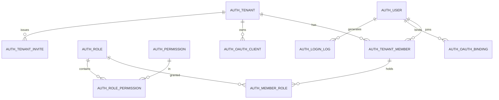

# 用户与租户体系 + OAuth 登录模块 — 设计文档 v0.3.0

> **版本**：v0.3.0（设计稿，未实施）｜ **日期**：2026-11-10 ｜ **状态**：待评审
>
> **定位**：在「 **linlan-emis（BuddyOne）统一身份中台** + **dsh-java / DSH-Desktop 对标 WorkBuddy** + **dsh-java-ontology 作为下游资源服务**」的分层下，明确本仓库的身份接入边界。
>
> **结论先行**：统一认证中心由 **linlan-emis（对外代号 BuddyOne）** 承担——Java 路线 `linlan-emis/backend`（Spring Boot 3.5.16 / Spring Authorization Server 1.x），Python 路线 `../../../../linlan-emis/server`（实现同一套 OIDC 端点与 JWT claims 契约）。`dsh-java-ontology` **不再自建 IdP、不再规划 `dsh-auth` 工程**，只做 **OAuth2 Resource Server**：通过 JWKS 验签、读取 `tenant_id` / `role_level` 注入 `TenantContext`。
>
> **关联文档**：
> - `../../../../linlan-emis/docs/1.0.0/01-architecture.md`、`02-user-tenant-model.md`、`03-oauth2-authorization-server.md`、`04-permission-model.md` — 中台架构、租户模型、OIDC、权限模型
> - `docs/0.2.1/ontology-platform-design.md` — 产品层设计（三级知识架构、双数据源）
> - `docs/0.2.2/design.md`、`docs/0.2.2/spec.md` — 0.2.2 现状与边界（M5 权限元模型不在本期）
> - `docs/contract/permissions.yaml` — 端点权限矩阵（活文档，fail-closed）

---

# 一、背景与目标

## 1.1 产品对标关系

| 层级 | 腾讯侧 | 我们侧 | 说明 |
|------|--------|--------|------|
| 工作台 | WorkBuddy | **DSH-Desktop**（Tauri）+ **dsh-java**（Harness 运行时） | 单人/单机的 agent 工作台 |
| 协同 / 身份中台 | **Buddy One** | **linlan-emis（代号 BuddyOne）** | 统一账号、租户、OAuth2/OIDC、基础角色 |
| 下游业务 / 资源服务 | WorkBuddy 内的业务应用 | **dsh-java-ontology**、dsh-ontolab-siis、linlan-xiaolan | 只验签 + 消费 claims，不签发 token |

> 分层结论：`linlan-emis/backend`（Java）与 `../../../../linlan-emis/server`（Python）是 **BuddyOne 的两条技术路线**，对下游暴露 **同一套 OIDC 端点与 JWT claims 契约**；`dsh-java-ontology` 属于 WorkBuddy 生态的 **下游资源服务**，只做 Resource Server。

Buddy One 的能力骨架可拆成四件事，逐项对位如下（"我们现状"指本次调整前的 ontology）：

| 能力维度 | Buddy One 的做法 | 我们现状（迁移前） | 本次调整目标 |
|---------|-----------------|-----------------|------------|
| 统一账号（Buddy One ID） | 一个 ID 打通文档/会议/ima/网盘 | 每个应用各自维护 `onto_sys_user`，ontology 自签 HS256，桌面端甚至免登录 | 由 **linlan-emis** 统一签发 OIDC token；ontology 下线自建登录/注册入口 |
| 团队 / 租户空间 | 团队空间 + 成员协作 | 只有 `tenant_id` 字段 + `BaseRepository` 自动加 `WHERE tenant_id=?`，没有租户实体、没有成员管理 | 租户/成员模型落在 linlan-emis；ontology 只消费 `tenant_id`、不建 `auth_*` 表 |
| 跨应用授权 | 应用间互信 + 统一授权 | 各应用共享 HS256 密钥，任何服务都能伪造任意用户 token | linlan-emis 以 RS256 + JWKS 发证；ontology 降级为 RS，只验签 |
| 统一积分 / 数据池 | 5 万通用积分 + 1TB 共享空间 | 无 | 不属于本仓库范围，由 linlan-emis 规划（P3 可选） |

## 1.2 现状盘点（已核实，迁移前现状）

**认证链路（`dsh-onto-flow`）**

| 组件 | 位置 | 行为 |
|------|------|------|
| `AuthController` | [AuthController.java](file:///Users/mac/Workspace/linlannet/linlants/dsh-java-ontology/dsh-onto-flow/src/main/java/net/linlan/dsh/sys/controller/AuthController.java) | `/api/auth/login`、`/register` 为 `@PublicApi`；`/userinfo`、`/password` 为 `@RequiresRole(2)` |
| `JwtUtil` | [JwtUtil.java](file:///Users/mac/Workspace/linlannet/linlants/dsh-java-ontology/dsh-onto-flow/src/main/java/net/linlan/dsh/sys/security/JwtUtil.java) | **HS256 对称密钥**，claims = `sub` + `userName` + `roleLevel` + `tenantId`，默认 24h |
| `JwtAuthenticationFilter` | [JwtAuthenticationFilter.java](file:///Users/mac/Workspace/linlannet/linlants/dsh-java-ontology/dsh-onto-flow/src/main/java/net/linlan/dsh/sys/security/JwtAuthenticationFilter.java) | 解析 token → 写入 `TenantContext`；`default-director-enabled=true` 时**未登录即按主任放行** |
| `RoleInterceptor` | [RoleInterceptor.java](file:///Users/mac/Workspace/linlannet/linlants/dsh-java-ontology/dsh-onto-flow/src/main/java/net/linlan/dsh/sys/security/RoleInterceptor.java) | `@PublicApi` 放行；无 `@RequiresRole` → 403（fail-closed）；`roleLevel > 注解值` → 403 |
| `TenantContext` | [TenantContext.java](file:///Users/mac/Workspace/linlannet/linlants/dsh-java-ontology/dsh-onto-base/src/main/java/net/linlan/dsh/common/TenantContext.java) | ThreadLocal：`tenantId` / `roleLevel` / `userId` |
| 密码 | `SysUserService` | 已使用 **BCrypt**（可直接迁移，无需改哈希算法） |
| 表 | `onto_sys_user` / `onto_sys_role` / `onto_sys_user_role` / `onto_sys_audit_log` | `role_level` 单列表示角色，`uk_user_name` 全局唯一 |

**关键缺口**

1. **无租户实体**：`tenant_id` 是一个裸 BIGINT，没有名称、状态、配额、创建者、成员关系；`role_level` 存在**用户表**上（一人只能有一个角色、属于一个租户），无法表达"同一人在 A 租户是主任、在 B 租户是研究员"。
2. **无元数据权限**：只有三档粗粒度层级，没有 `permission` 权限点、没有资源级授权；0.2.2 明确"M5 权限元模型不在本期"。
3. **无标准协议**：自签 HS256，没有 OIDC 发现文档、没有 JWKS、没有 refresh / revoke / introspect；桌面端拿不到可用的登录方式，只能靠 `default-director-enabled` 免登录演示。
4. **密钥全局共享**：`dsh.ontology.jwt.secret` 在每个应用配置里，泄露即等于全平台失守，也无法轮换。
5. **无第三方登录**：飞书/企微/GitHub 均未接入。
6. **与分层定位不一致**：ontology 仍在扮演 IdP（自签 token + 自建账号入口），与已创建的 `linlan-emis` 职责重叠，必须收敛为 Resource Server。

> 目标态：token 由 **linlan-emis** 签发，ontology 只验签并消费 claims；本节其余内容作为迁移前事实保留。

## 1.3 设计目标与非目标

**目标（本期设计覆盖）**

- 明确分层：**linlan-emis 是唯一 IdP**（Java `backend` / Python `py-api` 双路线），`dsh-java-ontology` 是 Resource Server。
- 定义 IdP 与 RS 之间唯一的硬契约：issuer / JWKS / claims 集合（`tenant_id` / `role_level` / `user_name` 等）。
- 保留 `role_level` 三档语义，不破坏 `RoleInterceptor` / `TenantContext` / `BaseRepository`。
- 给出 ontology 侧的改造与迁移路径：`JwtUtil` 改 JWKS 验签、自建登录入口下线、`onto_sys_user` 逐步只读化。

**非目标（明确不做）**

- 不在本仓库实现 OAuth2/OIDC 协议，不建 `auth_*` 表，不做租户/成员管理台——这些归属 linlan-emis。
- 不做 SP 发起的 SSO 协议族（SAML / CAS）；只接 OIDC 联邦。
- 不在本期重写 ontology 的业务权限（`permissions.yaml` 的 123 个端点不动，只换"身份来源"）。
- 不做跨租户数据物理隔离（仍共用库，靠 `tenant_id` 逻辑隔离，与现状一致）。

---

# 二、方案选型

## 2.1 三个候选

### 方案 A：内嵌 `dsh-java-ontology`

在 `dsh-onto-flow` 里扩展 `AuthController`，加 OAuth 端点（`/oauth2/authorize`、`/oauth2/token`、`/oauth2/jwks`），继续用现有 HS256 或改 RS256。

- 优点：改动最小，一个 jar 搞定，部署无新增组件。
- 致命问题：**IdP 会被业务库绑死**。`dsh-java-ontology` 有双数据源（`onto_*` / `gwy_*`）、123 个端点、字典/本体/报表域；把认证耦合进去后，任何一次业务发版都可能影响全产品登录；`dsh-java`（harness）、`dsh-java-desktop`、SIIS 若都要登录，就得反向依赖 ontology，形成"业务服务 → 业务服务"的坏依赖。
- 另一个问题：**受众范围错**。IdP 是平台级基础设施，ontology 是产品级应用，二者生命周期不同（ontology 0.2.2，IdP 需要长期稳定）。
- 结论：不采用。IdP 职责已由 **linlan-emis（BuddyOne）** 承接，ontology 不重复建设。

### 方案 B：独立认证中心 `linlan-emis`（已创建，推荐）

统一认证中心由 **linlan-emis（BuddyOne）** 承担，独立工程、独立库、独立发版节奏；各应用只做 Resource Server：

- **Java 路线**：`linlan-emis/backend`（Spring Boot 3.5.16 / Java 17 / Spring Authorization Server 1.x）
- **Python 路线**：`../../../../linlan-emis/server`，实现同一套 OIDC 端点与 JWT claims 契约

- 优点：职责单一；可独立扩容/灰度；密钥与用户数据集中；新产品接入只需注册 OAuth client；符合 Buddy One 的"统一账号"形态。
- 成本：+1 进程 +1 库 + 一套部署单元；身份数据迁移与双模式过渡由 linlan-emis 主导，ontology 配合改造验签链路。
- 对 ontology 的结论：**只做 Resource Server**，不新建 `dsh-auth`、不做认证 starter。

### 方案 C：直接把 `linlan-eframe` 后端当 IdP

`eframe-api` 已有登录、验证码、注册、`TokenService`、`SysPermissionService`，看起来"开箱即用"。

- 优点：零开发即可登录。
- 不成立的原因（逐条）：
  1. **无租户模型**：全仓 Java 无 `tenant` 命中，`BaseOrgan` 是组织机构不是租户，改造成本高于重写。
  2. **不是 OAuth**：`TokenService` 是"JWT + Redis 会话"的自有 token，没有 `authorize/token/jwks` 端点，没有 PKCE，桌面端无法接入。
  3. **强 Redis 会话**：每个请求回查 Redis，与"Resource Server 本地验签"的目标相反，也引入 Redis 单点。
  4. **耦合前端与后台**：`eframe-api` 同时承载 Admin/Sys CRUD、代码生成、定时任务，认证中心不应背这些。
  5. **许可证状态不一致**：`LICENSE` 文件是 **Apache-2.0**，但 `eframe-core` 等源码头声明 **AGPL-3.0**（见 8.1），直接复用前必须先澄清。

**结论：选 B（linlan-emis）。C 的价值仅在于"抄工程骨架"，不在于"拿来当 IdP"。**

## 2.2 对比矩阵

| 维度 | A 内嵌 ontology | **B 独立 `linlan-emis`** | C 直接用 eframe |
|------|----------------|----------------------|----------------|
| 职责边界 | 差（业务绑认证） | **好** | 差（后台绑认证） |
| 多租户改造量 | 中（要拆用户表） | 中（新库设计） | 高（无租户概念） |
| OIDC 标准支持 | 需自研 | **Spring Authorization Server 提供** | 无 |
| 桌面端接入 | 难（无 PKCE） | **易** | 难 |
| 密钥轮换 / JWKS | 需自研 | **内置** | 无 |
| 部署单元 | 复用 | +1 进程 +1 库（linlan-emis 已建） | 复用 |
| 发版影响面 | 全产品 | 仅 IdP | 全产品 |
| 长期演进 | 差 | **好** | 差 |
| 工作量 | 中 | 中 | 低（但后续返工大） |

---

# 三、目标架构

## 3.1 角色划分

| 角色 | 组件 | 职责 |
|------|------|------|
| **IdP / OP** | **linlan-emis（BuddyOne）**：`backend`（Java）/ `py-api`（Python） | 登录、授权码、令牌签发、JWKS、用户/租户/成员管理、审计 |
| **Resource Server** | `dsh-java-ontology`、`dsh-java`（harness）、`dsh-ontolab-siis`、`dsh-java-desktop` 本地服务 | 仅验签 + 读 claims，不签发 |
| **Client** | 桌面端（public）、Web 管理台（confidential/BFF）、服务间（confidential） | 走标准授权流程取 token |
| **Federated IdP** | 飞书 / 企业微信 / GitHub / 任意 OIDC | 第三方登录来源，交由 `linlan-emis` 联邦 |

## 3.2 部署拓扑

```
                        ┌──────────────────────────────────────┐
                        │   浏览器 / Tauri 桌面端 / 下游服务      │
                        └──────────────────┬───────────────────┘
                                           │ OIDC (code + PKCE / client_credentials)
                        ┌──────────────────▼───────────────────┐
                        │  linlan-emis（BuddyOne）              │
                        │  ├ Java 路线：backend   :8080         │
                        │  ├ Python 路线：py-api  :8080         │
                        │  ├ /oauth2/authorize  /oauth2/token   │
                        │  ├ /oauth2/jwks       /userinfo       │
                        │  └ /api/v1/{tenants,users}           │
                        └──────┬───────────────────┬───────────┘
                               │ JWKS(公钥)         │ 管理 API
        ┌──────────────────────┘                    └───────────────┐
        │                                                            │
┌───────▼────────┐  ┌───────────────┐  ┌──────────────┐  ┌─────────▼────────┐
│ dsh-java       │  │ dsh-java-     │  │ dsh-ontolab- │  │ linlan-emis      │
│ (harness)      │  │ ontology      │  │ siis         │  │ frontend (Vue3)  │
│ RS :8090       │  │ RS :8100      │  │ RS :8101     │  │ :5173            │
└────────────────┘  └──────┬────────┘  └──────────────┘  └──────────────────┘
                           │
                 ┌─────────┴──────────┐
                 │ dsh_java_ontodb    │
                 │ dsh_java_siisdb    │
                 └────────────────────┘
```

**关键约束**：IdP 与业务库**物理分离**。linlan-emis 不读 `onto_*`；ontology 不读 linlan-emis 库。唯一耦合是 **JWT claims 契约**（见 §4.5）。Java 与 Python 两条 IdP 路线必须产出同一契约。

## 3.3 技术选型

| 项 | 选择 | 理由 |
|----|------|------|
| JDK | 17 | 与 linlan-emis backend / ontology 一致 |
| Spring Boot | 3.5.16 | 与 linlan-emis backend / ontology 完全一致，便于共享运维脚本 |
| 认证协议 | **Spring Authorization Server 1.5.x** | 归属 linlan-emis（Java 路线）；ontology 不实现 OAuth 协议 |
| Python 路线 | `../../../../linlan-emis/server` | 与 Java 路线共用 OIDC 端点与 claims 契约 |
| 持久层 | 各路线自定（Java MyBatis / Python 依 py-api 实现） | 仅影响 IdP 内部，不影响下游契约 |
| 库 | MySQL 8（linlan-emis 自有库，当前 `emisdb`） | ontology 库 `dsh_java_ontodb` 保持不变 |
| 缓存 | Redis（**可选**） | 仅用于 refresh token / 授权码 / 登出黑名单；**不做每请求会话校验** |
| 前端管理台 | `linlan-emis/frontend`（Vue3 + Vite） | 人员/租户/客户端/审计四个页面 |
| 签名算法 | **RS256**（2048/3072），JWKS 暴露公钥 | 各 RS 只能验签，无法伪造 |
| Access Token | 15 min，JWT | 短寿命，降低吊销成本 |
| Refresh Token | 14 天，旋转（rotation）+ 重放检测 | 可撤销 |
| ID Token | 5 min | 仅前端展示身份 |

---

# 四、OAuth2 / OIDC 流程设计

## 4.1 客户端与授权模式

| 客户端 | 类型 | 授权模式 | 回调 | 备注 |
|--------|------|---------|------|------|
| `dsh-ontology-web` | confidential（BFF） | Authorization Code + PKCE | `https://onto.example.com/login/oauth2/code/linlan` | token 存服务端会话，浏览器只拿 HttpOnly Cookie |
| `dsh-desktop` | **public** | Authorization Code + PKCE | `http://127.0.0.1:{随机端口}/callback`（首选）/ `dsh://auth/callback`（备选） | refresh token 存系统钥匙串 |
| `dsh-desktop-headless` | public | **Device Code** | — | 无浏览器环境 / 内网服务器 |
| `dsh-harness`（服务间） | confidential | Client Credentials | — | 仅申请 `internal` scope，无用户身份 |
| `emis-admin` | confidential | Authorization Code + PKCE | linlan-emis 管理台自身 | 仅 `platform:admin` |

> 客户端注册由 **linlan-emis** 管理；ontology/harness/SIIS 只作为 client 或 RS 使用，不在本仓库注册。
> 禁止使用 Implicit 与 Password 模式。现有 `/api/auth/login` 只作为**过渡期兼容端点**保留（见 §六）。

## 4.2 Web（ontology 管理台）登录时序

```mermaid
sequenceDiagram
    participant B as 浏览器
    participant W as dsh-java-ontology (BFF)
    participant A as linlan-emis (IdP)
    participant R as Redis/DB

    B->>W: GET /api/ontologies (无会话)
    W-->>B: 302 → /oauth2/authorize?response_type=code&client_id=dsh-ontology-web&code_challenge=...
    B->>A: GET /oauth2/authorize
    A-->>B: 登录页（账号密码 / 飞书 / 企业微信）
    B->>A: POST 凭证
    A->>R: 校验 + 记录登录审计
    A-->>B: 302 → BFF 回调 ?code=...
    B->>W: GET /login/oauth2/code/linlan?code=...
    W->>A: POST /oauth2/token (code + code_verifier)
    A-->>W: access_token + refresh_token + id_token
    W->>W: 建立服务端会话（Cookie=SESSION）
    W-->>B: 302 回原页面，Set-Cookie: HttpOnly; Secure; SameSite=Lax
```

## 4.3 桌面端（Tauri）登录时序

```
1. 用户在桌面端点“登录”
2. 桌面端生成 code_verifier / code_challenge(S256)，启动临时 HTTP 监听 127.0.0.1:<随机端口>
3. 调系统浏览器打开 linlan-emis 的授权端点（issuer 以环境配置为准，生产示例）：
   https://id.linlan.net/oauth2/authorize
     ?response_type=code
     &client_id=dsh-desktop
     &redirect_uri=http://127.0.0.1:PORT/callback
     &scope=openid profile tenant offline_access
     &code_challenge=...&code_challenge_method=S256
     &state=<随机>
4. 用户在浏览器完成登录（可能与桌面端不在同一会话）
5. 浏览器 302 到 127.0.0.1:PORT/callback?code=...&state=...
6. 桌面端校验 state → POST /oauth2/token（public client，无 secret，带 code_verifier）
7. 得到 access_token(15m) + refresh_token(14d) + id_token
8. access_token 放内存；refresh_token 写系统钥匙串（macOS Keychain / Windows Credential Manager）
9. 后续调 ontology / harness 时带 Authorization: Bearer <access_token>
```

**要点**

- 必须是 **public client + PKCE**，不能在 Tauri 包里放 client_secret（可被反编译）。
- loopback 优先于自定义 scheme：`dsh://` 的注册行为在 Windows/Linux 上不稳定。
- 端口冲突时重新绑定随机端口并重算 `redirect_uri`；IdP 侧对 `dsh-desktop` 放宽为 `http://127.0.0.1:*`（校验 host + scheme，不校验端口）。
- 现有 `src/lib/device_pairing.ts` 的 `pairing_code` 流程是"设备配对"，与 OAuth 的 **Device Code** 语义不同，**不复用**，避免概念混淆。

## 4.4 多租户上下文

一个用户可属于多个租户，但**一个 access token 只承载一个激活租户**（接口由 linlan-emis 提供）：

```
POST /api/v1/auth/switch-tenant  { "tenantId": 1024 }   (Authorization: Bearer <token>)
→ 200 { access_token, expires_in: 900, tenant_id: 1024, role_level: 1, roles: [...], perms: [...] }
```

- 切换租户**换发 access token**，不复用旧 token 的 claims。
- 若客户端拿 refresh token 换新 token，默认继承 refresh token 上绑定的租户；需要跨租户时显式调用 switch。
- 主任（`role_level=0`）允许 `tenant_id=null` 表示"跨租户"，与现状一致。

## 4.5 Token 契约（**这是 IdP 与各 RS 之间唯一的硬契约**）

**Access Token claims**

| claim | 类型 | 说明 | 兼容性 |
|-------|------|------|--------|
| `iss` | string | linlan-emis issuer（开发示例 `http://localhost:8080`，生产以部署域名为准） | 新增 |
| `sub` | string | 全局用户 ID（linlan-emis 用户表 id） | 对应现有 `sub` |
| `aud` | string | client_id | 新增 |
| `exp` / `iat` / `jti` | — | 标准 | 新增 |
| `tenant_id` | number/null | 当前激活租户 | **标准字段**；过渡期兼容读旧 `tenantId` |
| `role_level` | number | 0/1/2 | **标准字段**；过渡期兼容读旧 `roleLevel`，`RoleInterceptor` 语义不变 |
| `user_name` | string | 登录名；同时发 `preferred_username` | **标准字段**；过渡期兼容读旧 `userName` |
| `roles` | string[] | `DIRECTOR` / `RESEARCHER` / `GUEST` / 自定义 | 新增（P3 用） |
| `perms` | string[] | 权限点，如 `onto:ontology:write` | 新增（P3 用） |
| `tenant_ids` | number[] | 可切换租户列表 | 新增 |
| `scope` | string | `openid profile tenant onto.read` | 新增 |

> **兼容策略（过渡双读）**：ontology 现有 `JwtUtil` 读取 camelCase `tenantId` / `roleLevel` / `userName`。迁移期过滤器 **先读 snake_case，缺失时回退 camelCase**；两者冲突时以 snake_case 为准，并记录 `token_source` 便于统计迁移进度。P4 收口时移除 camelCase 回退。
>
> **双路线一致性**：`linlan-emis/backend`（Java）与 `../../../../linlan-emis/server`（Python）必须产出本表的 **同一 claims 集合**；字段名、类型、空值语义不得分叉。

**ID Token**：标准 claims + `nonce`、`auth_time`、`name`、`picture`、`email`。

**Refresh Token**：不透明字符串（非 JWT），服务端存储，**每次使用即旋转**，旧 token 复用视为泄露并吊销整条 token 链。

## 4.6 密钥、轮换与登出

- 密钥对存 `auth_signing_key`（私钥加密存储，或用 KMS/文件挂载）；JWKS 端点返回全部公钥并带 `kid`。
- 轮换：新密钥上线 → JWKS 同时暴露新旧 → 等 > access token 寿命（15min）→ 旧密钥转 `retired` → 30 天后删除。
- 各 RS 配置 `dsh.auth.jwks-uri`，本地缓存 1h + `kid` 未命中时强制刷新。
- 登出：
  - 前端调 `POST /logout`（RP-Initiated Logout）→ IdP 清会话 → 回调 `post_logout_redirect_uri`。
  - 桌面端额外清钥匙串 + 调 `POST /oauth2/revoke` 吊销 refresh token。
  - access token 不主动拉黑（寿命 15min），高风险场景用 `jti` 黑名单（Redis，可选）。

---

# 五、多租户与权限数据模型

> **归属说明**：本章数据模型与 DDL 由 **linlan-emis（BuddyOne）** 落地；`dsh-java-ontology` 不建 `auth_*` 表，只在业务表保留 `tenant_id` 列，并在 `TenantContext` 中消费 claims。本章保留为跨仓库契约参考。

## 5.1 概念模型

```
User（全局，一个人一条）
  └─ Membership（用户在租户内的身份，N:N）
        └─ MemberRole（租户内角色，N:N）
              └─ Role ─ RolePermission ─ Permission（权限点）

Tenant（租户 / 团队空间）
  ├─ Invite（邀请码/邮件邀请）
  ├─ OAuthClient（该租户可用的应用）
  └─ CreditAccount（可选：积分池）
```

与 Buddy One 的映射：`User` ↔ Buddy One ID；`Tenant` ↔ 团队空间；`Membership + Role` ↔ 成员与权限；`OAuthClient + scope` ↔ 跨应用授权；`CreditAccount` ↔ 通用积分。



## 5.2 DDL 草案（归属 linlan-emis；库名以 emis 为准，当前 `emisdb`）

> 表前缀说明：下表沿用早期草案的 `auth_*` 前缀；linlan-emis 当前 P0 实际表为 `sys_user` / `emis_tenant`，落地时按 emis schema 规范映射，**字段语义不变**。`py-api` 路线使用同一逻辑模型。
>
> 约定：主键 `id BIGINT AUTO_INCREMENT`；时间 `DATETIME`；`del_flag`/`status` 用 `VARCHAR(1)` 与现有风格一致；所有表带 `created_by/created_at/updated_by/updated_at/remark`。

### 5.2.1 租户

```sql
CREATE TABLE `auth_tenant` (
  `id`           bigint       NOT NULL AUTO_INCREMENT COMMENT '租户ID',
  `tenant_code`  varchar(64)  NOT NULL COMMENT '租户编码（唯一，用于域名/子域）',
  `tenant_name`  varchar(128) NOT NULL COMMENT '租户名称',
  `tenant_type`  varchar(16)  NOT NULL DEFAULT 'TEAM' COMMENT 'TEAM=团队 / ORG=机构 / PERSONAL=个人',
  `parent_id`    bigint       DEFAULT NULL COMMENT '上级租户（机构-部门树，可空）',
  `logo`         varchar(512) DEFAULT NULL,
  `owner_user_id` bigint      NOT NULL COMMENT '租户所有者',
  `max_members`  int          NOT NULL DEFAULT 50 COMMENT '成员上限',
  `status`       varchar(1)   NOT NULL DEFAULT '0' COMMENT '0=正常 1=停用',
  `del_flag`     varchar(1)   NOT NULL DEFAULT '0',
  `created_by`   varchar(64)  DEFAULT NULL,
  `created_at`   datetime     DEFAULT CURRENT_TIMESTAMP,
  `updated_by`   varchar(64)  DEFAULT NULL,
  `updated_at`   datetime     DEFAULT CURRENT_TIMESTAMP ON UPDATE CURRENT_TIMESTAMP,
  `remark`       varchar(800) DEFAULT NULL,
  PRIMARY KEY (`id`),
  UNIQUE KEY `uk_tenant_code` (`tenant_code`)
) ENGINE=InnoDB DEFAULT CHARSET=utf8mb4 COLLATE=utf8mb4_unicode_ci COMMENT='租户/团队空间';
```

### 5.2.2 用户（全局）

```sql
CREATE TABLE `auth_user` (
  `id`           bigint       NOT NULL AUTO_INCREMENT COMMENT '全局用户ID',
  `user_name`    varchar(64)  NOT NULL COMMENT '登录名（全局唯一）',
  `nick_name`    varchar(64)  DEFAULT NULL,
  `email`        varchar(128) DEFAULT NULL,
  `phonenumber`  varchar(32)  DEFAULT NULL,
  `password`     varchar(200) DEFAULT NULL COMMENT 'BCrypt；第三方登录用户可为空',
  `avatar`       varchar(512) DEFAULT NULL,
  `status`       varchar(1)   NOT NULL DEFAULT '0' COMMENT '0=正常 1=停用 2=锁定',
  `mfa_enabled`  tinyint      NOT NULL DEFAULT 0,
  `last_login_at` datetime    DEFAULT NULL,
  `last_login_ip` varchar(64) DEFAULT NULL,
  `del_flag`     varchar(1)   NOT NULL DEFAULT '0',
  `created_by`   varchar(64)  DEFAULT NULL,
  `created_at`   datetime     DEFAULT CURRENT_TIMESTAMP,
  `updated_by`   varchar(64)  DEFAULT NULL,
  `updated_at`   datetime     DEFAULT CURRENT_TIMESTAMP ON UPDATE CURRENT_TIMESTAMP,
  `remark`       varchar(800) DEFAULT NULL,
  PRIMARY KEY (`id`),
  UNIQUE KEY `uk_user_name` (`user_name`),
  UNIQUE KEY `uk_email` (`email`)
) ENGINE=InnoDB DEFAULT CHARSET=utf8mb4 COLLATE=utf8mb4_unicode_ci COMMENT='全局用户';
```

> **注意**：`email` 唯一索引需允许 NULL（MySQL 允许多个 NULL），否则第三方用户会冲突。

### 5.2.3 成员关系（租户内角色）

```sql
CREATE TABLE `auth_tenant_member` (
  `id`         bigint      NOT NULL AUTO_INCREMENT,
  `tenant_id`  bigint      NOT NULL,
  `user_id`    bigint      NOT NULL,
  `role_level` tinyint     NOT NULL DEFAULT 2 COMMENT '0=主任/1=研究员/2=访客（兼容字段）',
  `dept_id`    bigint      DEFAULT NULL COMMENT '租户内部门（可空）',
  `job_title`  varchar(64) DEFAULT NULL,
  `status`     varchar(1)  NOT NULL DEFAULT '0' COMMENT '0=正常 1=禁用 2=待接受邀请',
  `joined_at`  datetime    DEFAULT NULL,
  `invited_by` bigint      DEFAULT NULL,
  `created_at` datetime    DEFAULT CURRENT_TIMESTAMP,
  `updated_at` datetime    DEFAULT CURRENT_TIMESTAMP ON UPDATE CURRENT_TIMESTAMP,
  PRIMARY KEY (`id`),
  UNIQUE KEY `uk_tenant_user` (`tenant_id`,`user_id`),
  KEY `idx_user` (`user_id`)
) ENGINE=InnoDB DEFAULT CHARSET=utf8mb4 COLLATE=utf8mb4_unicode_ci COMMENT='租户成员';
```

### 5.2.4 角色 / 权限点

```sql
CREATE TABLE `auth_role` (
  `id`          bigint      NOT NULL AUTO_INCREMENT,
  `tenant_id`   bigint      DEFAULT NULL COMMENT 'NULL=平台内置角色',
  `role_code`   varchar(64) NOT NULL COMMENT 'DIRECTOR/RESEARCHER/GUEST/...',
  `role_name`   varchar(64) NOT NULL,
  `role_level`  tinyint     NOT NULL DEFAULT 2 COMMENT '0/1/2，决定“层级”语义',
  `builtin`     tinyint     NOT NULL DEFAULT 0,
  `status`      varchar(1)  NOT NULL DEFAULT '0',
  `del_flag`    varchar(1)  NOT NULL DEFAULT '0',
  `created_at`  datetime    DEFAULT CURRENT_TIMESTAMP,
  `updated_at`  datetime    DEFAULT CURRENT_TIMESTAMP ON UPDATE CURRENT_TIMESTAMP,
  PRIMARY KEY (`id`),
  UNIQUE KEY `uk_tenant_role` (`tenant_id`,`role_code`)
) ENGINE=InnoDB DEFAULT CHARSET=utf8mb4 COLLATE=utf8mb4_unicode_ci COMMENT='角色';

CREATE TABLE `auth_permission` (
  `id`          bigint      NOT NULL AUTO_INCREMENT,
  `perm_code`   varchar(128) NOT NULL COMMENT '如 onto:ontology:write',
  `perm_name`   varchar(128) NOT NULL,
  `app_code`    varchar(64) NOT NULL COMMENT '归属应用：onto/siis/harness',
  `perm_type`   varchar(16) NOT NULL DEFAULT 'API' COMMENT 'API/MENU/DATA',
  `status`      varchar(1)  NOT NULL DEFAULT '0',
  `created_at`  datetime    DEFAULT CURRENT_TIMESTAMP,
  PRIMARY KEY (`id`),
  UNIQUE KEY `uk_perm_code` (`perm_code`)
) ENGINE=InnoDB DEFAULT CHARSET=utf8mb4 COLLATE=utf8mb4_unicode_ci COMMENT='权限点';

CREATE TABLE `auth_role_permission` (
  `id`        bigint NOT NULL AUTO_INCREMENT,
  `role_id`   bigint NOT NULL,
  `perm_id`   bigint NOT NULL,
  `created_at` datetime DEFAULT CURRENT_TIMESTAMP,
  PRIMARY KEY (`id`),
  UNIQUE KEY `uk_role_perm` (`role_id`,`perm_id`)
) ENGINE=InnoDB DEFAULT CHARSET=utf8mb4 COLLATE=utf8mb4_unicode_ci COMMENT='角色-权限';

CREATE TABLE `auth_member_role` (
  `id`        bigint NOT NULL AUTO_INCREMENT,
  `member_id` bigint NOT NULL COMMENT 'auth_tenant_member.id',
  `role_id`   bigint NOT NULL,
  `created_at` datetime DEFAULT CURRENT_TIMESTAMP,
  PRIMARY KEY (`id`),
  UNIQUE KEY `uk_member_role` (`member_id`,`role_id`)
) ENGINE=InnoDB DEFAULT CHARSET=utf8mb4 COLLATE=utf8mb4_unicode_ci COMMENT='成员-角色';
```

### 5.2.5 OAuth 客户端与第三方绑定

```sql
CREATE TABLE `auth_oauth_client` (
  `id`                     bigint       NOT NULL AUTO_INCREMENT,
  `client_id`              varchar(128) NOT NULL,
  `client_secret_hash`     varchar(200) DEFAULT NULL COMMENT 'public client 为空；BCrypt',
  `client_name`            varchar(128) NOT NULL,
  `client_type`            varchar(16)  NOT NULL COMMENT 'WEB/DESKTOP/SERVICE/ADMIN',
  `redirect_uris`          text         NOT NULL COMMENT '逗号分隔',
  `post_logout_redirect_uris` text      DEFAULT NULL,
  `scopes`                 varchar(512) NOT NULL DEFAULT 'openid,profile',
  `grant_types`            varchar(256) NOT NULL DEFAULT 'authorization_code,refresh_token',
  `require_pkce`           tinyint      NOT NULL DEFAULT 1,
  `access_token_ttl`       int          NOT NULL DEFAULT 900,
  `refresh_token_ttl`      int          NOT NULL DEFAULT 1209600,
  `tenant_id`              bigint       DEFAULT NULL COMMENT 'NULL=全局客户端',
  `status`                 varchar(1)   NOT NULL DEFAULT '0',
  `created_at`             datetime     DEFAULT CURRENT_TIMESTAMP,
  `updated_at`             datetime     DEFAULT CURRENT_TIMESTAMP ON UPDATE CURRENT_TIMESTAMP,
  PRIMARY KEY (`id`),
  UNIQUE KEY `uk_client_id` (`client_id`)
) ENGINE=InnoDB DEFAULT CHARSET=utf8mb4 COLLATE=utf8mb4_unicode_ci COMMENT='OAuth 客户端注册';

CREATE TABLE `auth_oauth_binding` (
  `id`            bigint       NOT NULL AUTO_INCREMENT,
  `user_id`       bigint       NOT NULL,
  `provider`      varchar(32)  NOT NULL COMMENT 'FEISHU/WECHAT_WORK/GITHUB/OIDC',
  `provider_uid`  varchar(128) NOT NULL COMMENT '第三方唯一标识（open_id/union_id/sub）',
  `provider_name` varchar(128) DEFAULT NULL,
  `extra_json`    json         DEFAULT NULL,
  `created_at`    datetime     DEFAULT CURRENT_TIMESTAMP,
  `updated_at`    datetime     DEFAULT CURRENT_TIMESTAMP ON UPDATE CURRENT_TIMESTAMP,
  PRIMARY KEY (`id`),
  UNIQUE KEY `uk_provider_uid` (`provider`,`provider_uid`),
  UNIQUE KEY `uk_user_provider` (`user_id`,`provider`)
) ENGINE=InnoDB DEFAULT CHARSET=utf8mb4 COLLATE=utf8mb4_unicode_ci COMMENT='第三方账号绑定';
```

### 5.2.6 邀请、审计、签名密钥、积分（可选）

```sql
CREATE TABLE `auth_tenant_invite` (
  `id`          bigint      NOT NULL AUTO_INCREMENT,
  `tenant_id`   bigint      NOT NULL,
  `invite_code` varchar(64) NOT NULL,
  `invite_type` varchar(16) NOT NULL DEFAULT 'CODE' COMMENT 'CODE/EMAIL/LINK',
  `target`      varchar(128) DEFAULT NULL COMMENT '邮箱/手机号',
  `role_level`  tinyint     NOT NULL DEFAULT 2,
  `max_uses`    int         NOT NULL DEFAULT 1,
  `used_count`  int         NOT NULL DEFAULT 0,
  `expire_at`   datetime    DEFAULT NULL,
  `status`      varchar(1)  NOT NULL DEFAULT '0',
  `created_by`  bigint      NOT NULL,
  `created_at`  datetime    DEFAULT CURRENT_TIMESTAMP,
  PRIMARY KEY (`id`),
  UNIQUE KEY `uk_invite_code` (`invite_code`)
) ENGINE=InnoDB DEFAULT CHARSET=utf8mb4 COLLATE=utf8mb4_unicode_ci COMMENT='租户邀请';

CREATE TABLE `auth_login_log` (
  `id`          bigint      NOT NULL AUTO_INCREMENT,
  `user_id`     bigint      DEFAULT NULL,
  `user_name`   varchar(64) DEFAULT NULL,
  `tenant_id`   bigint      DEFAULT NULL,
  `client_id`   varchar(128) DEFAULT NULL,
  `login_type`  varchar(16) NOT NULL COMMENT 'PASSWORD/FEISHU/WECHAT_WORK/GITHUB/REFRESH/DEVICE_CODE',
  `result`      varchar(16) NOT NULL COMMENT 'SUCCESS/FAIL',
  `fail_reason` varchar(200) DEFAULT NULL,
  `ip`          varchar(64) DEFAULT NULL,
  `user_agent`  varchar(512) DEFAULT NULL,
  `trace_id`    varchar(64) DEFAULT NULL,
  `created_at`  datetime    DEFAULT CURRENT_TIMESTAMP,
  PRIMARY KEY (`id`),
  KEY `idx_user_time` (`user_id`,`created_at`),
  KEY `idx_tenant_time` (`tenant_id`,`created_at`)
) ENGINE=InnoDB DEFAULT CHARSET=utf8mb4 COLLATE=utf8mb4_unicode_ci COMMENT='登录审计';

CREATE TABLE `auth_signing_key` (
  `id`         bigint      NOT NULL AUTO_INCREMENT,
  `kid`        varchar(64) NOT NULL,
  `alg`        varchar(16) NOT NULL DEFAULT 'RS256',
  `public_key` text        NOT NULL,
  `private_key` text       NOT NULL COMMENT '加密存储或交由 KMS 托管',
  `status`     varchar(16) NOT NULL DEFAULT 'ACTIVE' COMMENT 'ACTIVE/RETIRED',
  `created_at` datetime    DEFAULT CURRENT_TIMESTAMP,
  `retired_at` datetime    DEFAULT NULL,
  PRIMARY KEY (`id`),
  UNIQUE KEY `uk_kid` (`kid`)
) ENGINE=InnoDB DEFAULT CHARSET=utf8mb4 COLLATE=utf8mb4_unicode_ci COMMENT='令牌签名密钥';

-- P3 可选：统一积分池（对标 Buddy One 通用积分）
CREATE TABLE `auth_credit_account` (
  `id`            bigint   NOT NULL AUTO_INCREMENT,
  `tenant_id`     bigint   NOT NULL,
  `balance`       bigint   NOT NULL DEFAULT 0,
  `frozen`        bigint   NOT NULL DEFAULT 0,
  `total_granted` bigint   NOT NULL DEFAULT 0,
  `version`       int      NOT NULL DEFAULT 0 COMMENT '乐观锁',
  `updated_at`    datetime DEFAULT CURRENT_TIMESTAMP ON UPDATE CURRENT_TIMESTAMP,
  PRIMARY KEY (`id`),
  UNIQUE KEY `uk_tenant` (`tenant_id`)
) ENGINE=InnoDB DEFAULT CHARSET=utf8mb4 COLLATE=utf8mb4_unicode_ci COMMENT='积分账户';

CREATE TABLE `auth_credit_txn` (
  `id`         bigint      NOT NULL AUTO_INCREMENT,
  `tenant_id`  bigint      NOT NULL,
  `user_id`    bigint      DEFAULT NULL,
  `app_code`   varchar(64) NOT NULL,
  `amount`     bigint      NOT NULL COMMENT '正=消耗，负=充值',
  `balance_after` bigint   NOT NULL,
  `biz_id`     varchar(128) DEFAULT NULL COMMENT '幂等键',
  `created_at` datetime    DEFAULT CURRENT_TIMESTAMP,
  PRIMARY KEY (`id`),
  UNIQUE KEY `uk_biz` (`biz_id`),
  KEY `idx_tenant_time` (`tenant_id`,`created_at`)
) ENGINE=InnoDB DEFAULT CHARSET=utf8mb4 COLLATE=utf8mb4_unicode_ci COMMENT='积分流水';
```

## 5.3 与现有 `role_level` 的映射

| 现有 `role_level` | 内置 `role_code` | 语义 | 数据可见性（现状） |
|-------------------|------------------|------|-------------------|
| 0 | `DIRECTOR` | 主任 | 跨租户（`tenant_id` 可为 NULL），可看全局汇聚 |
| 1 | `RESEARCHER` | 研究员 | 本租户私有 + 共享层只读 |
| 2 | `GUEST` | 访客 | 仅共享层只读 |

**兼容策略**

1. `auth_tenant_member.role_level` 与 `auth_role.role_level` 双写：签发 token 时取 `member.role_level` 写入 `role_level` claim，`RoleInterceptor` **零改动**。
2. 内置三个角色的 `role_level` 固定为 0/1/2，不允许在管理台修改（防止提权绕过 `@RequiresRole`）。
3. 自定义角色必须映射到 0/1/2 之一（`auth_role.role_level`），权限点只能**在层级允许的范围内做减法**，不能突破层级上限。即：`@RequiresRole(1)` 的端点，访客无论如何配权限点都进不来。
4. 未来（P3）引入 `@RequiresPermission("onto:ontology:write")` 时，采用"层级 AND 权限点"双闸门，避免一次性推翻既有 `permissions.yaml`。

## 5.4 `TenantContext` 扩展（最小改动）

保持现有三个方法不变，新增两个（P3 才用）：

```java
// dsh-onto-base/.../TenantContext.java —— 仅新增，不修改既有语义
private static final ThreadLocal<Set<String>> CURRENT_PERMS = new ThreadLocal<>();

public static void setPerms(Set<String> perms) { CURRENT_PERMS.set(perms); }
public static Set<String> getPerms() { return CURRENT_PERMS.get(); }
public static boolean hasPerm(String code) {
    Set<String> p = CURRENT_PERMS.get();
    return p != null && (p.contains("*") || p.contains(code));
}
```

`BaseRepository` 的 `WHERE tenant_id=?` 逻辑**不动**。注意：`application.yml` 当前 `dsh.ontology.security.default-director-enabled` 默认为 `true`（演示便利），生产必须显式关闭；P2 起发布清单强制 `false`，P4 删除该项。

---

# 六、与现有 ontology 的兼容与迁移

## 6.1 Resource Server 改造点

| 改造项 | 现状 | 目标 | 改动量 |
|--------|------|------|--------|
| 验签 | `JwtUtil` HS256 本地密钥 | `NimbusJwtDecoder` + JWKS（RS256），`iss`/`aud` 校验 | 重写 `JwtUtil` 内部实现，**方法签名不变** |
| Filter | `JwtAuthenticationFilter` 解析 claims | 同上 + 注入 `perms`/`roles` | 小 |
| Claims 读取 | `tenantId` / `roleLevel`（camelCase） | 先读 `tenant_id` / `role_level`，缺失回退 camelCase | 小 |
| 拦截器 | `RoleInterceptor` 读 `roleLevel` | 语义不变 | 0 |
| 上下文 | `TenantContext` 三个字段 | 新增 `perms` | 小 |
| 登录接口 | `POST /api/auth/login` 自签 | 302 跳转到 **linlan-emis** 授权端点（或仅返回升级提示） | 小 |
| 注册接口 | `POST /api/auth/register` 自建用户 | 下线，账号统一在 linlan-emis 管理 | 小 |
| 配置 | `dsh.ontology.jwt.secret` | `dsh.auth.issuer` / `dsh.auth.jwks-uri` / `dsh.auth.audience` | 小 |
| 用户表 | `onto_sys_user` | 身份以 token 为准；历史外键保留，写入路径逐步下线，仅保留只读 | 中（数据迁移） |

**双模式开关**（过渡期必须）

```yaml
dsh:
  auth:
    mode: hybrid          # legacy | oidc | hybrid
    issuer: http://localhost:8080          # linlan-emis issuer（与部署地址一致）
    jwks-uri: http://localhost:8080/oauth2/jwks
    audience: dsh-ontology-web
    claims:
      snake-case-first: true               # 先读 tenant_id/role_level，缺失回退 camelCase
    legacy:               # 仅 hybrid/legacy 生效，P4 后删除
      secret: ${DSH_LEGACY_JWT_SECRET}
      accept-until: 2026-12-31
```

- `legacy`：完全保持现状（老 token 可验），用于灰度。
- `oidc`：只信 RS256。
- `hybrid`：先按 `kid` 判定来源，两者都验；写审计标记 `token_source`，用于统计迁移进度。

## 6.2 身份数据迁移

```
onto_sys_user  ──(1:1，保留 user_id)──►  linlan-emis 用户表（当前 sys_user）
onto_sys_user.tenant_id ──────────────►  linlan-emis 租户（当前 emis_tenant；不存在则按 tenant_id 生成占位租户）
onto_sys_user.role_level ─────────────►  linlan-emis 角色（P0 为 sys_user.role_level；多租户成员表见 emis 02 演进）
onto_sys_user_role ───────────────────►  linlan-emis 角色映射（DIRECTOR/RESEARCHER/GUEST）
```

**关键决策：保留 `user_id` 原值**（linlan-emis 用户表 `id = onto_sys_user.user_id`）。原因：

- `onto_sys_audit_log.user_id`、`created_by`、`updated_by` 等历史数据无需改号；
- 避免迁移期间新旧 ID 并存导致审计断链；
- 迁移后由 linlan-emis 接管自增起始值（`AUTO_INCREMENT = max(id)+1`）。

其他要点：

- 密码哈希**直接搬迁**（均为 BCrypt，`$2a$` 前缀兼容）。
- `uk_user_name` 在旧表是全局唯一，迁移无冲突。
- 主任用户 `tenant_id IS NULL`：迁移时若平台需要"主任属于某机构"，创建 `tenant_type=ORG` 的默认租户并把主任挂为 owner；若维持跨租户语义，则在 linlan-emis 成员模型里允许"平台租户（tenant_id=0）"记录。**建议后者**，保持 `tenant_id=null` 的 token 语义不变。

## 6.3 前端与桌面端改动

| 端 | 改动 |
|----|------|
| ontology Web 前端 | 登录页改为跳转 **linlan-emis**；增加"切换租户"入口；`/api/auth/userinfo` 返回体增加 `tenants` / `perms` |
| `dsh-java-desktop` | 新增 `src/lib/auth/oidc.ts`：PKCE 生成、系统浏览器拉起、loopback 回调、refresh token 写钥匙串；`transport.ts` 统一注入 `Authorization`；未登录时展示登录页而非 `default-director` 放行 |
| `dsh-java`（harness） | 若被桌面端调用：校验同一 IdP 的 token；若为本地回环调用，可保留"本机信任"模式（`127.0.0.1` + 启动时生成的本地密钥），与用户 token 分离 |
| SIIS | 与 ontology 同构改造（同样只做 Resource Server） |

> 共享代码说明：`TenantContext` / `RoleInterceptor` / `@RequiresRole` 已在本仓库与 SIIS 各自存在，**本仓库不再新建 IdP 或认证 starter**；若后续确需统一 starter，应由 linlan-emis 或框架底座提供，避免把 IdP 依赖反向引入业务仓库。

## 6.4 登录入口的过渡

```
P1：保留 /api/auth/login（ontology 前端改为直接跳 linlan-emis，/api/auth/login 仅返回 302 或 400 提示升级）
P2：桌面端完成 PKCE，不再依赖免登录；ontology 切换到 JWKS 验签
P3：关闭 default-director-enabled，关闭 legacy secret
P4：删除 /api/auth/login、/api/auth/register、onto_sys_user 写入路径
```

> ⚠️ 不要用 OAuth2 的 ROPC（Password Grant）实现"平滑过渡"——它在 OAuth 2.1 中已被移除，且会把密码暴露给业务服务，等于白做 IdP。

---

# 七、`linlan-eframe` 复用矩阵（归属 linlan-emis，本仓库仅保留结论）

> 说明：本节结论用于 **linlan-emis** 的 IdP 选型，`dsh-java-ontology` 不依赖 eframe，也不参与 IdP 实现。

## 7.1 复用原则

- **能复用"工程能力"，不复用"认证链路"**。
- 优先"依赖 jar / 参考实现"，避免"整段复制源码"（许可证 + 维护双风险）。
- `linlan-emis` 与 eframe 保持**同 Spring Boot 大版本**（3.5.x），必要时可共享 BOM。

## 7.2 矩阵

| eframe 能力 | 位置 | 复用方式 | 说明 |
|------------|------|---------|------|
| 通用工具（IP、加密、POI、异常、分页） | `eframe-support` | **直接依赖** | 与认证无关，纯工具，风险最低 |
| 基础实体（`BaseUser`/`BaseApp`/`BaseOrgan`/`BaseDictionary`/`SysMenu`） | `eframe-model` | **参考表结构** | 无租户概念，不能直接映射；`BaseOrgan` 可作租户层级树参考 |
| `TokenService` 的 JWT 签发经验 | `eframe-core` | **只借鉴思路** | 它是 Redis 会话式 token，不是 OAuth；直接复用会与 SAS 冲突 |
| `SysPermissionService`（角色→权限字符串集合） | `eframe-core` | **借鉴** | 与 `perms` claim 生成逻辑同构，可参考实现方式 |
| `JwtAuthenticationTokenFilter` | `eframe-core` | **不采用** | Spring Security 过滤器链与 SAS 的 `JwtDecoder` 冲突；ontology 已有等效实现 |
| 验证码（`CaptchaEntryController`，行为/滑块） | `eframe-api` | **直接复用（复制到 linlan-emis 或依赖）** | 登录防爆破，价值高、耦合低 |
| `@Encrypt`（请求/响应加密） | `eframe-api` | **选配** | 登录接口可选，非必需 |
| `@PlatLog` 操作审计 | `eframe-api/core` | **借鉴** | 与登录审计字段对齐后复用注解思路 |
| `@LimitScope` 数据范围 | `eframe-core` | **P3 参考** | 未来做"租户内数据范围"时有用 |
| `module-generator` 代码生成 | `module-generator` | **直接使用** | 生成管理台 CRUD 与 Vue 页面，省 60% 管理台工作量 |
| `module-quartz` 定时任务 | `module-quartz` | **可选** | 邀请过期清理、密钥轮换、积分月度重置 |
| `eframe-view` 读写分离 | `eframe-view` | **不采用** | IdP 读多写少但无读写分离需求，增加复杂度 |
| `eframe-api` 的 `SysLoginController` / `SysRegisterController` | `eframe-api` | **不采用** | 自有 token 体系，不是 OIDC |
| `eframe-web` 启动类与全局配置 | `eframe-web` | **不采用** | 承载 Admin/代码生成/定时任务，太重 |
| Vue3 前端骨架（api/views/components/directive/utils） | `frontend/` | **直接用作管理台底座** | 人员、租户、客户端、审计四页；登录页需换成 OIDC 回调页 |
| Redis 会话方案 | `eframe-core` | **仅用于授权码/refresh token 存储** | 不做每请求会话校验，避免 Redis 成为认证单点 |

## 7.3 许可证风险（linlan-emis 落地前必须解决）

事实：

- `linlan-eframe/LICENSE` = **Apache License 2.0**。
- 但 `eframe-core` 等 Java 源码头 = **AGPL-3.0**（"GNU Affero General Public License ... version 3"）。
- `dsh-java-ontology` 的 `LICENSE` 是 **MIT**，`pom.xml` 声明 **Apache-2.0**（自身也不一致）。

风险与建议：

1. **先确认版权归属**：eframe 的 copyright 为 `Linlan (open@linlan.net)`，若与 DSH 同属一家，可直接内部授权，问题降级为"统一 License 声明"。
2. 若对外分发 `linlan-emis` 且确实包含 AGPL 代码：整体需按 AGPL 开源（含网络服务条款）。**独立进程 + HTTP 调用**不构成衍生作品，但**复制源码/链接 AGPL jar**会。
3. **最稳妥**：`linlan-emis` 不 link AGPL 模块，只复用 `eframe-support`（若其头文件为 Apache）与 `module-generator`（开发期工具，不随产物分发），其余"参考重写"。
4. 顺带修正 ontology 的 License 不一致（`LICENSE` MIT vs `pom` Apache-2.0），避免下游合规审查卡住。

---

# 八、IdP 接口清单（由 linlan-emis 提供）

> 以下端点由 **linlan-emis** 统一提供，Java `backend` 与 Python `py-api` 两条路线必须一致；ontology 只作为 client 消费 discovery/JWKS/token，或作为 RS 消费 JWKS。

## 8.1 标准 OIDC 端点

| 方法 | 路径 | 说明 |
|------|------|------|
| GET | `/.well-known/openid-configuration` | 发现文档 |
| GET | `/oauth2/jwks` | 公钥集 |
| GET | `/oauth2/authorize` | 授权端点（登录页） |
| POST | `/oauth2/token` | 换取 token（code / refresh / client_credentials / device_code） |
| POST | `/oauth2/revoke` | 吊销 |
| POST | `/oauth2/introspect` | 内省（服务间排障用） |
| GET | `/userinfo` | 用户信息 |
| POST | `/connect/logout` | RP-Initiated Logout |
| POST | `/oauth2/device_authorization` | 设备码 |

## 8.2 业务管理 API（`/api/v1`）

| 方法 | 路径 | 权限 | 说明 |
|------|------|------|------|
| GET | `/api/v1/users/me` | 登录用户 | 当前用户 + 所属租户列表 |
| PUT | `/api/v1/users/me` | 登录用户 | 改昵称/头像/邮箱 |
| PUT | `/api/v1/users/me/password` | 登录用户 | 改密码 |
| POST | `/api/v1/auth/switch-tenant` | 登录用户 | 换发指定租户的 token |
| GET | `/api/v1/tenants` | 平台管理员 | 租户分页 |
| POST | `/api/v1/tenants` | 平台管理员/自助开通 | 创建租户（创建者即 owner） |
| GET | `/api/v1/tenants/{id}` | 租户成员 | 租户详情 |
| PUT | `/api/v1/tenants/{id}` | 租户 owner/主任 | 改名称、配额、状态 |
| GET | `/api/v1/tenants/{id}/members` | 租户成员 | 成员分页 |
| POST | `/api/v1/tenants/{id}/members` | 主任 | 直接添加成员 |
| PUT | `/api/v1/tenants/{id}/members/{uid}` | 主任 | 改角色/部门 |
| DELETE | `/api/v1/tenants/{id}/members/{uid}` | 主任 | 移除成员 |
| POST | `/api/v1/tenants/{id}/invites` | 主任 | 生成邀请码/邮件邀请 |
| POST | `/api/v1/invites/{code}/accept` | 登录用户 | 接受邀请 |
| GET | `/api/v1/roles` | 租户成员 | 角色列表 |
| POST/PUT/DELETE | `/api/v1/roles/**` | 主任 | 角色 CRUD（内置角色只读） |
| GET/POST | `/api/v1/oauth-clients/**` | 平台管理员 | 客户端注册与密钥轮换 |
| GET | `/api/v1/audit/login-logs` | 平台管理员/主任 | 登录审计（主任只看本租户） |
| POST | `/api/v1/admin/signing-keys/rotate` | 平台管理员 | 触发密钥轮换 |

**错误码约定**（与 `Result` 对齐）：`40101` 未认证、`40301` 权限不足、`40901` 用户名/租户编码冲突、`42901` 登录限流。

---

# 九、分期实施（ontology 视角，与 linlan-emis 节奏对齐）

| 阶段 | ontology 侧内容 | 归属 | 验收标准 |
|------|----------------|------|---------|
| **P0**（本期） | 文档对齐：明确 linlan-emis = BuddyOne、ontology = RS；claims 契约定为 snake_case 为准 + 过渡双读 | dsh-java-ontology（文档） | 本文档与 README/AGENTS/llms 定位一致，无 `dsh-auth` 残留 |
| **P1** | 过渡期兼容：ontology 保持 `hybrid` 读取（camelCase/snake_case 双读），旧登录入口仅返回提示 | linlan-emis 发 token + ontology 兼容 | 旧 token 可验；审计记录 `token_source` |
| **P2** | JWKS 接入：`JwtUtil` 改 `NimbusJwtDecoder`，配置换 `issuer`/`jwks-uri`/`audience` | linlan-emis 提供 SAS/JWKS + ontology 改造 | `curl {issuer}/.well-known/openid-configuration` 与 `/oauth2/jwks` 可用；ontology 验签通过；自签入口下线 |
| **P3** | 权限点与行级隔离：`perms` 注入、`@RequiresPermission`、`tenant_id` 强制过滤 | linlan-emis 签发 + ontology 消费 | `PermissionMatrixTest` 全绿；跨租户不可见 |
| **P4** | 收口：删除 `legacy` 与 `default-director-enabled`、下线 `onto_sys_user` 写路径、SIIS/harness 全量切换 | ontology / SIIS / harness | 全仓库无 HS256 依赖；旧登录接口返回 410 |

**硬依赖**

```
P1（linlan-emis 能发 token）
  └─► P2（ontology 能用 JWKS 验签）
        └─► P3（权限点/行级隔离）
              └─► P4（收口）
```

**P2 的最小可用集（避免范围蔓延）**

1. linlan-emis 提供 discovery + JWKS + 可用的 access token（密码登录或 code/PKCE 任一）。
2. ontology 只改 `JwtUtil` + `application.yml`，不动业务代码。
3. claims 双读兼容保留一个版本，P4 再移除 camelCase 回退。
4. 不要求本期具备租户/成员管理台（归属 linlan-emis 后续阶段）。

---

# 十、风险与对策

| # | 风险 | 影响 | 对策 |
|---|------|------|------|
| R1 | IdP（linlan-emis）成为单点 | 全产品无法登录 | 无状态验签（JWKS 本地缓存）+ 双实例 + `/oauth2/token` 前置 LB；access token 15min 使 IdP 短时不可用不影响在线用户 |
| R2 | 迁移期双 token 并存导致越权 | 高 | `hybrid` 模式必须记录 `token_source`；`accept-until` 到点强制 `oidc`；灰度按应用而非按用户 |
| R3 | 桌面端 loopback 端口被占用/被劫持 | 中 | PKCE + `state` + 只监听 `127.0.0.1`；回调一次性；校验 `iss`/`aud`；不使用 `dsh://` 作为主路径 |
| R4 | 第三方登录账号合并错误（同邮箱不同人） | 高 | 默认**不自动合并**；要求登录后显式绑定；企业邮箱域白名单可配置自动加入租户 |
| R5 | 权限模型扩张与 `permissions.yaml` 冲突 | 中 | P3 前只做"层级"，权限点采用"层级 AND 权限"双闸门；`PermissionMatrixTest` 作为门禁 |
| R6 | `default-director-enabled` 误开到生产 | 极高 | 改为 `@Profile` 绑定 + 启动横幅警告；生产 CI 检查该配置必须为 false |
| R7 | eframe License 不一致 | 中 | 见 §7.3，先澄清归属再决定"依赖 or 重写" |
| R8 | 密钥泄露 | 极高 | 私钥不入库明文（KMS/挂载）；轮换周期 90 天；`retired` 后 30 天删除；运维操作双人复核 |
| R9 | 主任跨租户语义被削弱 | 中 | 保留 `tenant_id=null` 的 token；`AggregationService` 依赖此语义，P3 前不得改动 |
| R10 | 时钟偏移导致 `exp` 校验失败 | 低 | 全节点 NTP；RS 允许 60s 时钟偏移（`JwtTimestampValidator` 默认已容忍） |
| R11 | Java/Python 双路线契约漂移 | 高 | claims 集合、issuer、JWKS 路径共用一份契约文档（§4.5）；CI 增加 token 解码快照测试，两条路线跑同一组样例 |

---

# 十一、待决策事项

1. **claims 兼容期**：camelCase 回退保留到哪个版本（建议 0.3.x 内、P4 前移除）。
2. **Python 路线边界**：`py-api` 是全量 IdP，还是先覆盖 password + code/PKCE + JWKS（建议后者），以及如何与 `backend` 做契约回归。
3. **ontology 本地账号过渡**：`/api/auth/login` 是保留"302 跳转"还是立即下线（建议 P2 前保留 302）。
4. **`default-director-enabled` 下线时点**：建议 P2 发布清单强制 `false`，P4 删除配置项。
5. **下游接入顺序**：建议 `ontology` → `SIIS` → `harness`，避免同时改造。

---

# 十二、附录：术语

| 术语 | 含义 |
|------|------|
| BuddyOne | linlan-emis 的对外代号，统一身份/租户中台；Java 路线 `backend`，Python 路线 `py-api` |
| IdP / OP | Identity Provider / OpenID Provider，本设计中即 **linlan-emis** |
| RS | Resource Server，校验 token 的业务服务（ontology/harness/SIIS） |
| PKCE | Proof Key for Code Exchange，公共客户端必选 |
| JWKS | JSON Web Key Set，公钥集合端点 |
| Tenant | 租户/团队空间，数据隔离边界 |
| Membership | 用户在某租户内的成员身份（含 `role_level`） |
| `role_level` | 现有三档层级：0 主任 / 1 研究员 / 2 访客，本期**保持不变** |
| BFF | Backend for Frontend，Web 端把 token 留在服务端的模式 |
