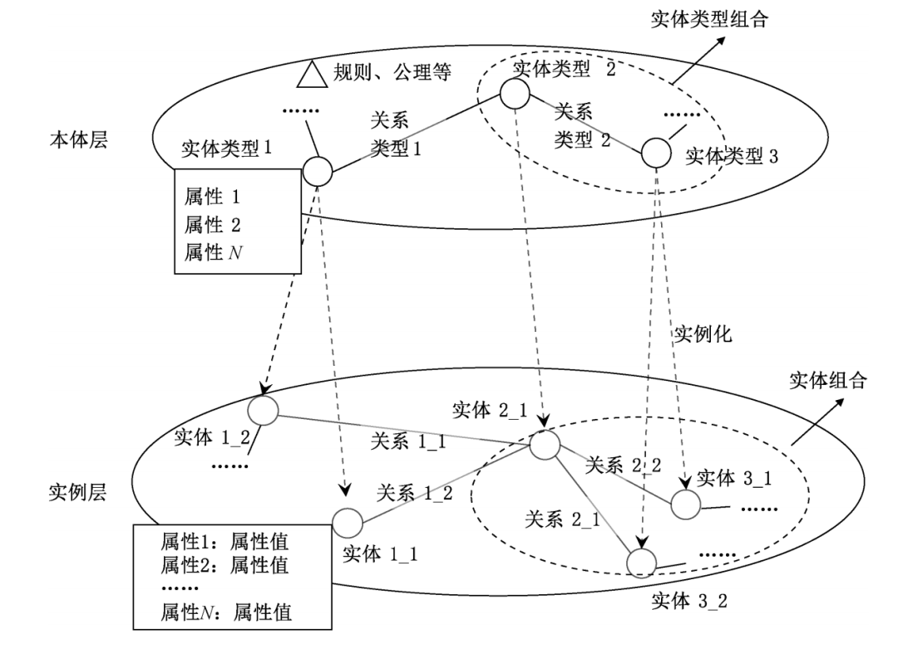
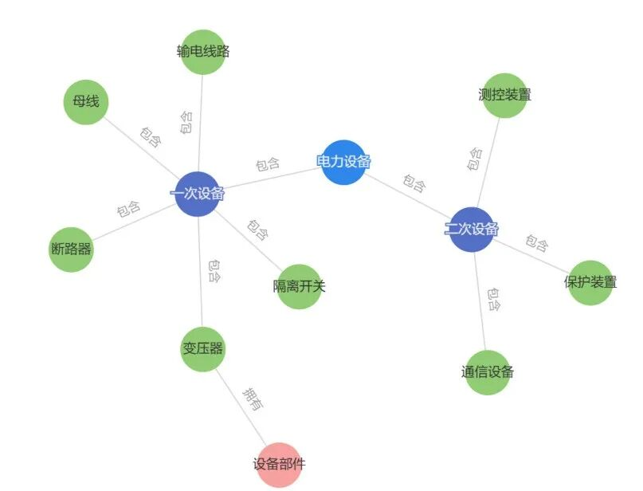
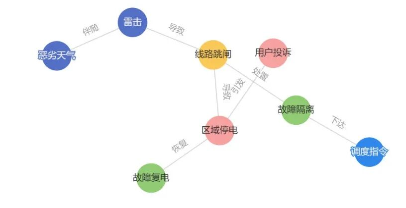
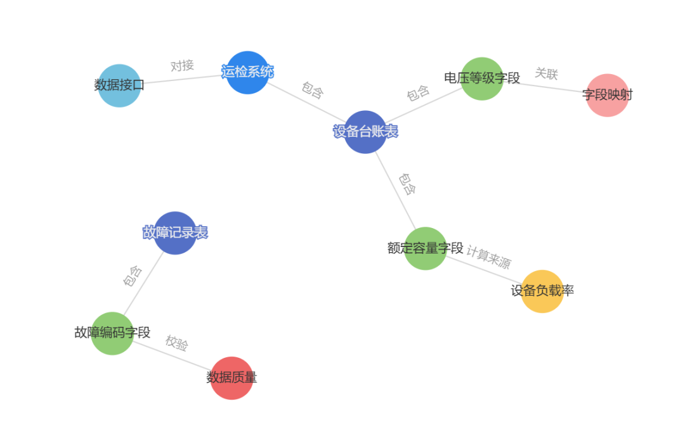
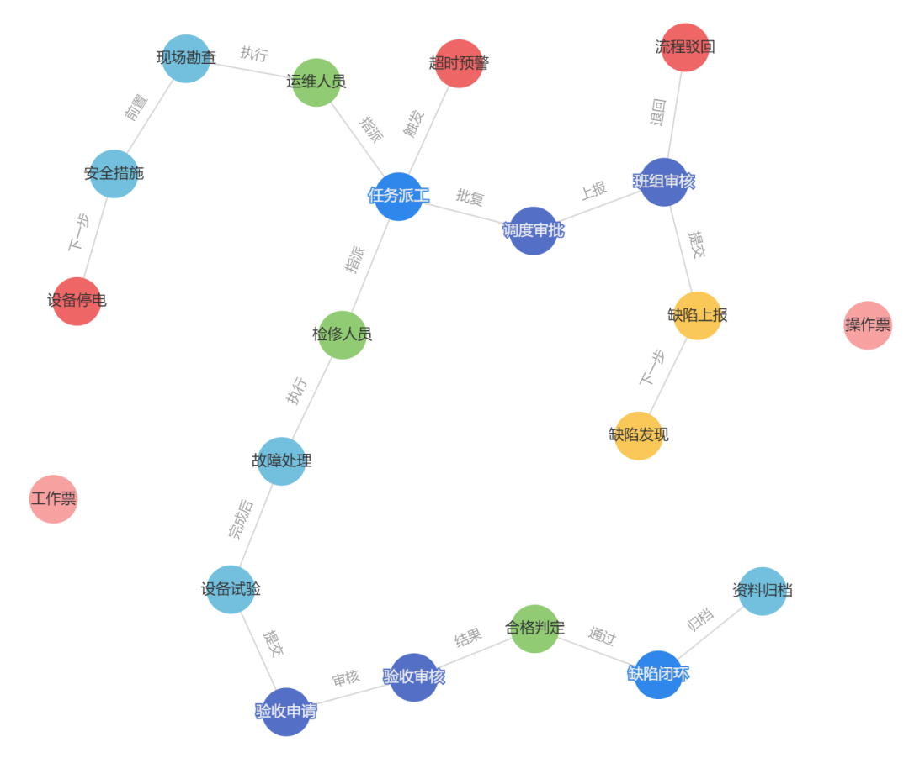

# 一文读懂｜本体（Ontology）：知识图谱的核心语义骨架

> **来源**：微信公众号「华力江海」
> **作者**：华力江海
> **发布日期**：2026-05-26
> **原文**：[点击查看](https://mp.weixin.qq.com/s?__biz=MzcxMDMyNTI4MQ==&mid=2247483673&idx=1&sn=d862b394c49ad1e05b028fb57ec82063&chksm=f519a457c26e2d4155c26566d7bae1426c12a34ea16c88e2c4a09864383cc94e2b8097175709#rd)
> **系列**：本体智能系列

在人工智能、知识图谱建设及电力行业数智化转型中，本体是规范领域知识、统一数据语义、支撑智能应用的核心基础。

它既源于哲学对“存在本质”的底层思考，又在工程实践中形成了标准化、专业化的定义，是打通原始数据到智能知识的关键核心载体。

## 01 本体本源：从哲学到工程应用

### 1. 哲学本源

本体（Ontology）最初是哲学核心分支，意为对存在本身的系统性研究。聚焦世间事物的本质、分类规则、结构特征与内在关联逻辑，是人类认知、归纳、梳理客观世界的底层思维框架。

### 2. 工程化内涵

在信息技术与行业数字化领域，本体完成工程化落地，转化为可被计算机识别、处理、共享的标准化领域知识模型。它是知识图谱的语义底座，也是各行各业实现数据标准化、消除语义歧义的核心依据。

## 02 国标与行业权威定义

### 1. 国家标准定义（GB/T 42131-2022）

本体（Ontology，又称本体模型），是用于统一规范实体类型、关系类型、属性类型、关联规则的标准化模型。

它是对领域知识明确、形式化、可共享的抽象表达，清晰界定领域核心概念、逻辑关系与属性规则，是原始数据转化为可理解、可推理知识的关键。

### 2. 电力行业定义（DL/T 2725-2023）

电力本体（电力领域本体模型），是对电力领域客观世界认知的规范化、形式化表达，具备共享性、概念化、明确性、形式化四大核心特征。

作为电力领域标准化建模模型，其统一规范电力实体、关系、属性与关联逻辑，为电力知识图谱搭建全域通用的统一语义框架。

## 03 核心定位：知识图谱的规范基石

完整知识图谱分为本体层与实例层两大核心层级。其中，本体是本体层的唯一核心载体与规范标准，决定了整套知识图谱的语义框架与逻辑体系。

知识图谱概念图

### 1. 本体层：知识图谱的语义骨架

本体层是本体模型的直接体现，是对领域知识的抽象、概括与约束性顶层设计。

核心构成：实体类型、实体属性、关系类型、规则公理（如电力设备、设备额定容量、设备包含关系、设备运行约束规则等）。

核心作用：明确领域“有什么概念、概念有什么特征、概念如何关联、遵循什么规则”，统一全域语义规范，彻底消除数据歧义。

核心特点：高度抽象、通用性强、稳定性高，可跨场景复用，支撑多套知识图谱建设。

### 2. 实例层：知识图谱的业务血肉

实例层是本体层的具象实例化，也就是知识图谱的真实业务数据层，所有内容严格遵循本体层规范。

核心构成：具体实体、实体属性值、具象业务关系（如#1主变、额定容量100MVA、主变发生线路跳闸故障等）。

核心作用：基于本体规范填充真实业务数据，形成可查询、可分析、可智能推理的完整知识网络。

核心特点：场景化、具象化、动态可更新，随业务数据迭代持续丰富。

### 3. 双层核心关联关系

抽象→具体映射：本体层抽象概念，一一对应实例层具体数据，所有实例数据严格匹配本体规范。

规范→数据约束：本体公理规则校验实例数据，规避逻辑冲突、数据错误，保障知识体系严谨性。

层级相对性：双层划分并非绝对，可根据建模粒度灵活适配，适配不同层级的业务建模需求。

## 04 本体核心构成要素

一套标准化、可落地的完整本体模型，由实体类型、关系类型、属性类型、规则公理四大核心要素组成，是全域知识建模的基础支撑。

实体类型：领域内同类客观对象的抽象集合，划定知识建模的核心概念边界与范围。

关系类型：规范不同实体之间的语义关联范式，定义各类概念的连接逻辑与对应规则。

属性类型：对应实体的通用特征、固有参数与动态特质，精准刻画实体完整信息。

规则公理：领域通用的客观逻辑与硬性约束，用于校验知识合理性，保障知识体系规范、无冲突、可推理。

## 05 电力领域典型本体模型

结合电力业务场景、建模粒度与应用侧重，电力本体可划分为行业知识图谱、业务事理图谱、元数据图谱、业务数据图谱和流程图谱这五大核心图谱本体模型，五类模型各司其职、互补协同，全面覆盖电力知识沉淀、数据治理、资产管控、故障推演、流程管控全场景。

### 行业知识图谱

行业知识图谱是通用性最强、抽象度最高的顶层本体模型，以电力行业静态常识、专业术语、分类体系、技术标准为核心建模对象，不绑定具体业务数据，是所有电力知识图谱的基础底座。

✅ 本体要素

1. 实体类型：电力设备、变压器、输电线路、保护装置、高压、特高压、短路故障、接地故障、运维规范、设备部件等。
2. 关系类型：包含、属于、拥有、分类，如：电力设备包含变压器、变压器属于一次设备。
3. 属性类型：分类编码、术语释义、适用范围、标准编号、类别层级、额定参数、投运时间、生产厂家、设备状态、运维周期、缺陷等级、电压等级等。
4. 规则公理：电力设备仅分为一次设备、二次设备两大类；电压等级包含高压、超高压、特高压三个子类；故障类型包含短路故障、接地故障等细分故障。

✅ 图谱示例

行业知识图谱示例

✅ 应用价值

- 统一电力行业术语、分类标准，消除跨系统、跨部门的语义歧义，构建全域统一的行业语义体系；
- 搭建标准化行业知识库，支撑专业检索、知识查询、员工培训等常态化知识应用场景；
- 作为下游各类图谱的上层基准模型，实现行业知识复用，降低重复建模成本；
- 固化行业技术规程与安全标准，形成可落地的规则约束，为电力业务建模提供合规依据。

### 业务事理图谱

业务事理图谱聚焦电力动态事件演化逻辑，突破传统静态建模局限，围绕故障、隐患、天气、处置动作等动态要素，刻画事件因果、时序、触发与传导规则，是电网智能研判、风险预警的核心载体。

✅ 本体要素

1. 实体类型：线路过载、雷击、鸟害、线路跳闸、变压器过热、接地故障、短路故障、区域停电、负荷骤降等。
2. 关系类型：导致、触发、处置、修复、引发、伴随，如：设备老化导致线路过载、线路跳闸引发区域停电、故障事件触发现场排查。
3. 属性类型：发生时间、故障区域、严重等级、持续时长、现象描述、设备类型、电压等级、故障诱因、处置人员、处置时长、复电时长、影响用户数、负荷损失量、天气状况等。
4. 规则公理：故障发生后必须执行现场排查与故障隔离；线路跳闸会直接引发区域停电；恶劣天气易伴随雷击、鸟害等外部诱因；区域停电大概率触发用户投诉。

✅ 图谱示例

业务事理图谱示例

✅ 应用价值

- 实现故障根因自动研判与全链路溯源，大幅缩短现场排查时长，提升故障应急处置效率；
- 依托电网事件演化规律，精准预判连锁事故、运行风险，提前规避电网安全隐患；
- 沉淀典型故障案例与标准化处置经验，实现行业经验数字化、可复用传承；
- 全方位支撑事故复盘、应急推演，智能输出科学合规的故障处置方案，赋能智能决策。

### 元数据图谱

元数据图谱是面向全域电力数据资产的专属建模体系，以“描述数据的数据”为核心，聚焦业务系统、数据表、字段、指标、接口等数据资源，实现数据标准化、血缘可视化、治理规范化。

✅ 本体要素

1. 实体类型：运检系统、营销系统、设备台账表、运行数据表、故障记录表、数据接口、数据标准、代码集、数据血缘、数据质量、字段映射、指标库、数据表分区等。
2. 关系类型：包含、来源、计算、隶属、约束、映射，示例：业务系统包含数据表、统计指标来源于原始数据、基础字段计算生成运维指标
3. 属性类型：字段类型、数据长度、统计口径、采集频率、数据密级、更新周期、数据来源、归属系统、字段释义、取值范围、校验规则、创建时间、维护人员等。
4. 规则公理：每个数据表必须归属至对应业务系统；故障编码与故障类型一一对应，编码唯一；统计指标必须由基础字段、原始数据表计算生成；所有字段需遵循统一数据标准约束。

✅图谱示例

元数据图谱示例

✅ 应用价值

实现全域数据资产可视化盘点，可视化梳理业务系统、数据表、指标体系，完成数据资产统一管控；

全链路数据血缘追踪，快速定位数据异常、报表口径不一致等问题，高效完成数据溯源整改；

落地统一数据标准与编码规范，统一字段、指标定义口径，推进跨系统数据标准化建设；

支撑数据质量监控、权限管理、跨系统数据集成与接口对接，保障数据合规、可用、互通。

### 业务数据图谱

业务数据图谱是衔接顶层标准与底层数据的落地型建模体系，聚焦电网设备、用户、班组、供电区域等实体业务数据，实现资产数据关联、全生命周期管控与多维分析。

✅ 本体要素

1. 实体类型：变电站、主变压器、断路器、高压出线、运维班组、检修班组、台区管理人员、居民电力用户、工业企业用户、输电线路、避雷设备、互感器设备、巡检资料等。
2. 关系类型：归属、运维、供电、连接、配套、关联、管理，示例：电力设备归属对应变电站、运维班组运维站内设备、输电线路为辖区用户供电
3. 属性类型：设备参数、投运时间、运行状态、负责人、地址、容量、电压等级、设备型号、生产厂家、检修周期、上次检修时间、缺陷状态、绝缘等级、负载阈值、环境参数、防护等级等。
4. 规则公理：所有设备必须归属至对应变电站；每座变电站配备专属运维班组；出线线路仅可为对应供电区域内用户供电；设备缺陷记录、巡检记录需与单台设备一一关联。

✅图谱示例

业务数据图谱示例

✅ 应用价值

- 实现变电站、设备、用户等资产全景可视化查询与台账管理，完成电网资产集中管控与直观展示；
- 串联设备投运、巡检、缺陷、检修全生命周期数据，形成完整的设备运维数据闭环链条；
- 支撑一线运维、营销人员快速查阅业务明细与历史记录，降低查询成本、提升作业效率；
- 依托实体关联关系，实现多维度数据钻取与联动分析，深度挖掘数据价值，支撑业务研判。

### 业务流程图谱

业务流程图谱聚焦电力作业与审批流转场景，针对检修、缺陷处置、停电作业、验收归档等全流程，标准化节点、权责、顺序与约束，实现流程规范化、智能化管控。

✅ 本体要素

1. 实体类型：缺陷发现、缺陷上报、班组审核、调度审批、任务派工、运维人员、检修人员、合格判定、缺陷闭环、工作票、操作票、资料归档、超时预警、流程驳回等。
2. 关系类型：下一步、指派、执行、审批、驳回、提交、归档、触发，示例：审批通过后指派作业人员、作业完成后提交验收、流程超时触发预警机制。
3. 属性类型：办理时限、岗位权限、单据编号、流程状态、前置条件、责任人、审批层级、流转节点、操作时间、办结时长、驳回原因、执行状态、归档状态、流程版本、业务类别、备注说明等。
4. 规则公理：缺陷上报完成后，必须经过班组审核、调度审批才可派工；现场作业前必须完成安全措施布置与设备停电；验收不合格则流程驳回，不得闭环；流程超时自动触发超时预警。

✅图谱示例

业务流程图谱示例

✅ 应用价值

- 固化电力检修、停电、缺陷处置等标准作业流程，统一全场景操作规范，实现流程标准化管控；
- 实时监控审批、作业全流程进度，精准识别卡顿、超时等异常节点，保障业务高效流转；
- 支持流程可视化复盘与节点优化，持续迭代流程体系，提升办公与现场作业整体效率；
- 提供标准化作业指引、支撑新人培训，同时满足行业内控、现场安全审计的合规要求。

## 06 本体的核心价值

### 1. 通用领域价值

统一语义标准：消除多系统、多场景术语歧义，搭建人机通用的统一知识认知体系，实现知识高效互通共享。

规范知识建模：为知识抽取、融合、存储全流程提供标准依据，规避建模杂乱、数据不统一等问题。

支撑智能推理：依托本体规则公理，挖掘海量数据隐性知识，为智能分析、辅助决策提供支撑。

降本高效复用：标准化本体模型可跨场景复用，大幅降低知识图谱重复建设成本，提升建模效率。

### 2. 电力行业价值

实现电网数据标准化：统一电力设备、缺陷、运维、营销等核心业务术语与数据口径，解决数据杂乱、语义混乱痛点。

赋能智能运检场景：依托本体业务规则与语义约束，支撑故障研判、风险预警、检修策略智能推荐等智能化应用。

破除数据孤岛壁垒：以统一语义框架打通调度、运维、营销多系统，实现跨系统数据融合与知识共享。

筑牢数字化建设底座：为数字电网、智慧电力、电力知识图谱建设提供核心语义支撑，赋能行业数字化转型。

## 07 全文总结

本体既是哲学层面对于事物本质的认知逻辑，更是知识图谱的核心语义骨架，也是电力行业标准化、数字化转型的核心底层支撑。它通过标准化定义实体、关系、属性与规则公理，将电力行业零散、杂乱、孤立的原始数据，梳理为有分类、有逻辑、可关联、能推理的结构化知识体系。
