# 本体智能 | 一文读懂—本体+大模型协同驱动的智能体架构

> **来源**：微信公众号「华力江海」
> **作者**：华力江海
> **发布日期**：2026-06-19
> **原文**：[点击查看](https://mp.weixin.qq.com/s?__biz=MzcxMDMyNTI4MQ==&mid=2247483813&idx=1&sn=e5a6462035c888e8afbc0c81864ef576&chksm=f519a4ebc26e2dfd16a33344f035c3cc8a38dcafd3ab5fee27aef9d53f6bcd8ebe2054cf97df#rd)
> **系列**：本体智能系列

当大模型的热度从 "参数比拼" 转向 "场景落地"，智能体（Agent）成了企业 AI 应用的标配。从客服问答、流程自动化到数据分析、业务辅助，智能体被寄予了 "重塑业务效率" 的厚望。但跑过一圈试点你会发现，绝大多数智能体都难以真正切入企业核心生产场景，落地效果远不及预期。

## 01 智能体落地之困：热闹试点背后的生产瓶颈

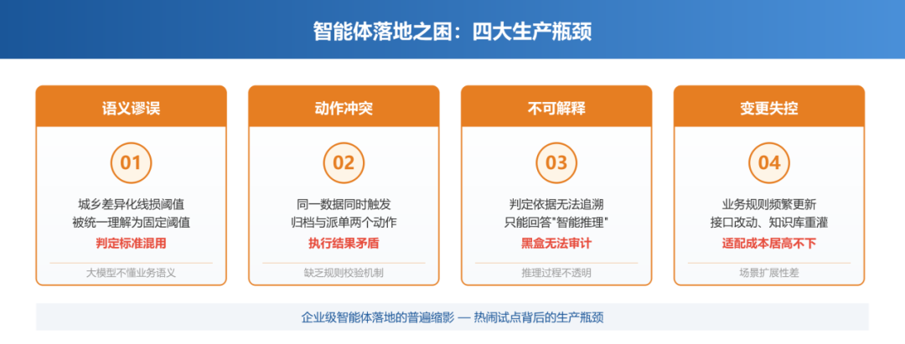

**场景切入**：某电网公司上线了【台区线损 AI 智能稽查 Agent】—— 大模型 + Skill + Function Calling，信心满满。结果运行 3 个月后 ——

❗️ 大模型把 "农村台区、城区台区差异化线损阈值" 统一理解为通用固定阈值，城乡判定标准混用（语义谬误）

❗️ Agent 排查同一台区数据时，同时触发了 "正常台账归档" 和 "高损异常派单" 两个矛盾执行动作（动作冲突）

❗️ 基层台区经理问 "为什么判定高损、标记窃电嫌疑的依据是什么？"，系统只能回答 "基于大模型智能推理"（不可解释）

❗️ 营销稽查业务规则、台区管理规范先后更新，技能接口反复改动、知识库多次重灌，场景适配成本居高不下（变更失控）

这并非单个企业的个案，而是当前企业级智能体落地的普遍缩影。

### 1.1 行业应用现状：轻量化普及，核心场景难深入

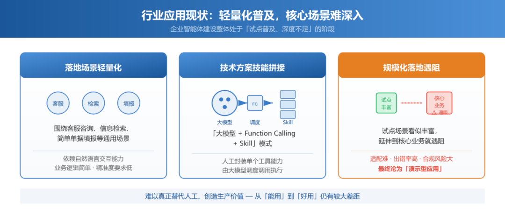

当前企业智能体建设整体处于 "试点普及、深度不足" 的阶段：

- 落地场景集中在轻量化领域：大多围绕客服咨询、信息检索、简单单据填报等通用场景，依赖大模型的自然语言交互能力，业务逻辑简单，对精准度和合规性要求不高。
- 技术方案以技能拼接为主：普遍采用 "大模型 + Function Calling + Skill" 的模式，通过人工封装单个工具能力，由大模型调度调用，实现简单的任务执行。
- 规模化落地遇阻：试点场景看似丰富，但一旦延伸到核心业务流程，就会出现适配难、出错率高、合规风险大等问题，最终沦为 "演示型应用"，难以真正替代人工、创造生产价值。

### 1.2 四大核心痛点：卡住智能体落地的关键堵点

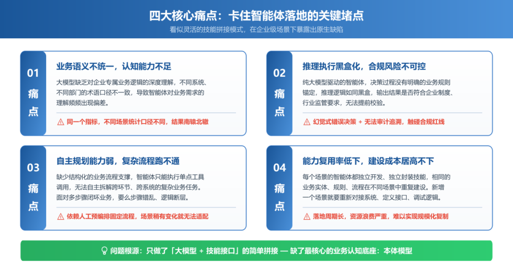

看似灵活的技能拼接模式，在企业级场景下暴露出原生缺陷，核心集中在四大痛点：

#### （1）业务语义不统一，认知能力不足

大模型缺乏对企业专属业务逻辑的深度理解，不同系统、不同部门的术语口径不一致，导致智能体对业务需求的理解频频出现偏差。同一个指标，不同场景下统计口径不同，大模型无法精准识别，最终输出的结果与业务实际需求南辕北辙。

#### （2）推理执行黑盒化，合规风险不可控

纯大模型驱动的智能体，决策过程没有明确的业务规则锚定，推理逻辑如同黑盒，输出结果是否符合企业制度、行业监管要求，无法提前校验。既容易出现幻觉式的错误决策，也无法满足全链路审计追溯的强监管要求，一旦触碰合规红线，后果难以估量。

#### （3）自主规划能力弱，复杂流程跑不通

缺少结构化的业务流程支撑，智能体只能执行单点工具调用，无法自主拆解跨环节、跨系统的复杂业务任务。面对多步骤的闭环业务，要么出现步骤错乱、逻辑断层，要么完全依赖人工预先编排好固定流程，场景稍有变化就无法适配，灵活性严重不足，更无法真正落地操作完整业务。

#### （4）能力复用率低下，建设成本居高不下

每个场景的智能体都独立开发、独立封装技能，相同的业务实体、规则、流程在不同场景中重复建设。新增一个业务场景，就要重新对接系统、重新定义接口、重新调试逻辑，不仅落地周期长，也造成大量的资源浪费，难以实现规模化复制。

\*\*💡\*\*问题的根源从来不是大模型不够聪明，而是绝大多数智能体架构，都只做了【大模型 + 技能接口】的简单拼接 ——**缺了一块最核心的业务认知底座：本体模型**。

\*\*💡\*\*企业级 AI 要从 "尝鲜试点" 走向 "生产落地"，必须走【本体模型 + 大模型 + 智能体】智能协同的路线：本体锚定业务边界与规则，大模型提供推理与规划能力，智能体完成执行与价值闭环。今天我们就从底层逻辑、架构设计、实战案例三个维度，把这套体系讲透。

## 02 厘清核心定位：本体、大模型、智能体为何缺一不可？

很多人对三者的认知是模糊的：觉得本体是知识图谱，大模型是大脑，智能体是工具。但要让三者协同，首先要明确各自的核心价值、天然短板，以及为什么 "单打独斗" 撑不起企业级场景。

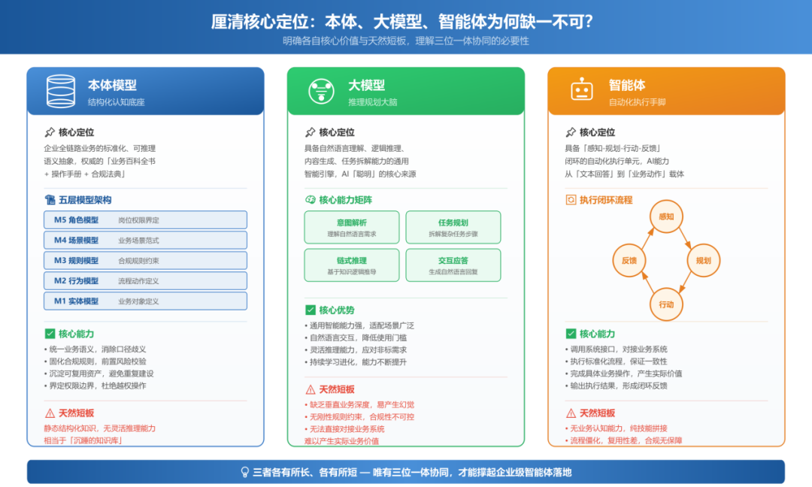

### 2.1 本体模型：企业业务的【结构化认知底座】

本体本质上是对企业全链路业务的**标准化、可推理语义抽象**，相当于给机器写了一套权威的【企业业务百科全书 + 操作手册 + 合规法典】。

它把企业里的业务对象、流程动作、规则约束、场景范式、岗位权限，全部用标准化的语义定义清楚，形成 M1 实体、M2 行为、M3 规则、M4 场景、M5 角色的五层模型，让所有系统、所有 AI 能力都基于同一套业务语言对话。

| 维度 | 内容 |
| **核心能力** | 统一业务语义、固化合规规则、沉淀可复用资产、界定权限边界 |
| **天然短板** | 本质是静态的结构化知识，不具备灵活推理和自然语言交互能力，没法自主响应非标需求，相当于 "沉睡的知识库" |

### 2.2 大模型：通用智能的【推理规划大脑】

大模型是具备自然语言理解、逻辑推理、内容生成、任务拆解能力的通用智能引擎，是 AI "聪明" 的核心来源。它能听懂用户的自然语言需求，能拆解复杂任务，能基于知识做链式推理。

但原生大模型的短板也非常明显：它是 "通用选手"，不是 "业务专家"—— 不懂垂直行业的专业术语，不知道企业内部的合规红线，也不清楚业务流程的先后依赖。如果没有约束，很容易出现幻觉、逻辑偏差，甚至触碰业务红线。

| 维度 | 内容 |
| **核心能力** | 意图解析、任务规划、链式推理、交互应答 |
| **天然短板** | 缺乏垂直业务深度知识，易产生幻觉；无刚性业务规则约束，合规性不可控；无法直接对接业务系统产生实际价值 |

### 2.3 智能体：业务价值的【自动化执行手脚】

智能体是具备【感知 - 规划 - 行动 - 反馈】闭环的自动化执行单元，是 AI 能力从 "文本回答" 落地到 "业务动作" 的最终载体。它能调用系统接口、执行标准化流程、完成具体业务操作，把大模型的决策转化为实际业务结果。

但如果没有本体底座，智能体就是 "零散工具的拼接"：每个技能都是孤立的，没有业务关联，也不懂流程逻辑，只能机械执行单点指令，没法自主完成跨环节的复杂业务闭环，更没法保证合规性。

| 维度 | 内容 |
| **核心能力** | 调用系统接口、执行标准化流程、完成具体业务动作、输出执行结果 |
| **天然短板** | 本身无业务认知能力，无自主规划能力；纯技能拼接模式下，流程僵化、复用性差、合规无保障 |

### 2.4 三者割裂的三大致命问题

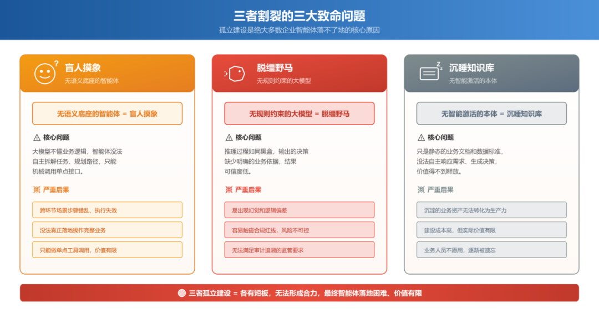

把三者孤立建设，是绝大多数企业智能体落不了地的核心原因：

| 问题 | 现象 | 本质 |
| **无语义底座的智能体** | 大模型不懂业务逻辑，智能体没法自主拆解任务、规划路径，只能机械调用单点接口，跨环节场景极易出现步骤错乱、执行失效，根本没法真正落地操作完整业务。 | **盲人摸象** |
| **无规则约束的大模型** | 推理过程如同黑盒，输出的决策缺少明确的业务依据，结果可信度低；没有刚性规则锚定，全靠自由发挥，很容易出现幻觉和逻辑偏差，触碰合规红线，也满足不了企业审计追溯的要求。 | **脱缰野马** |
| **无智能激活的本体** | 只是静态的业务文档和数据标准，没法自主响应需求、生成决策，沉淀的业务资产没法转化为实际生产力，价值得不到释放。 | **沉睡知识库** |

💡 企业级智能体的正确落地路径，不是 "大模型 + 技能"，而是 **"本体模型 + 大模型 + 智能体"** 三位一体智能协同 —— 本体定标准、大模型做决策、智能体执行业务。

## 03 协同运行机制：拆解智能协同的全链路闭环逻辑

本体驱动的智能体架构，核心就是让三者形成互补的闭环：**本体定标准、大模型做决策、智能体执行业务**。既有灵活的智能能力，又有严格的业务约束，既能快速适配场景，又能保证合规可控。

### 3.1 正向执行链路：从用户需求到业务结果的全流程协同

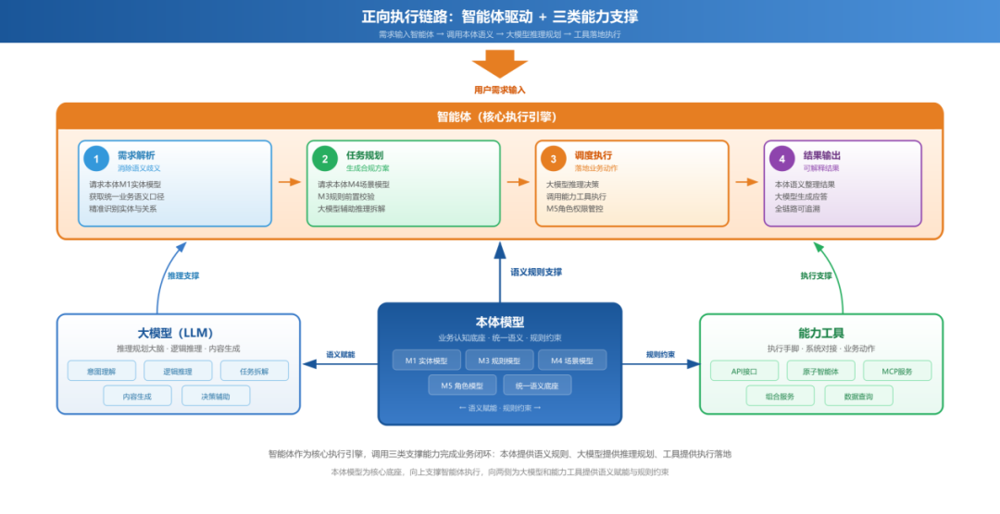

一个自然语言需求从输入到落地，三者会形成四步紧密配合的执行链路，全程有依据、有校验、可追溯：

#### 第一步：需求解析 —— 大模型 + 本体，消除语义歧义

用户提出需求（比如 "查一下 XX 台区上个月的线损异常情况"），大模型首先基于本体 M1 实体模型的统一语义做解析：精准识别 "台区""线损率""异常阈值" 这些专业术语的定义、统计口径，明确实体之间的关联关系，彻底避免 "鸡同鸭讲" 的理解偏差。

这一步解决的是大模型 "不懂业务" 的问题 —— 所有语义都以本体为唯一标准，不会出现不同场景、不同系统口径不一致的情况。

#### 第二步：任务规划 —— 大模型 + 本体，生成合规方案

理解需求后，大模型基于本体 M4 场景模型的标准化流程，自动拆解任务步骤、规划执行链路：比如先拉取台区基础信息，再调取抄表数据，接着比对阈值规则，然后排查异常用户，最后生成稽查工单。

同时，它会全程调用本体 M3 规则模型做前置校验：时限要求合不合规、数据权限有没有越界、操作流程符不符合制度，从源头就把违规的方案拦截掉，确保最终输出的执行方案完全符合业务规则。

#### 第三步：调度执行 —— 大模型 + 智能体 + 本体，落地业务动作

方案确认后，大模型向智能体执行层下发指令。智能体不需要重复对接系统，直接调度资源层标准化封装的原子智能体、MCP 服务接口，按照规划的步骤完成具体业务动作：调用数据查询接口拉取数据、调用规则引擎做异常比对、调用工单系统派发核查任务。

全程所有操作都受本体 M5 角色模型的权限管控：什么岗位能看什么数据、能执行什么操作，都由本体统一界定，从技术上杜绝越权操作。

#### 第四步：结果输出 —— 大模型 + 本体，整理可解释结果

智能体把执行结果返回后，大模型基于本体的业务语义，把零散的数据、状态整理成符合业务习惯的结构化结果，输出给用户。

更重要的是，**全程所有推理步骤、执行动作、校验依据，都能追溯到本体的对应规则和实体定义**，完全可解释、可审计 —— 再也不会出现 "大模型说这么做，但不知道为什么" 的黑盒问题。

### 3.2 反向迭代闭环：从业务数据到体系进化的自增长协同

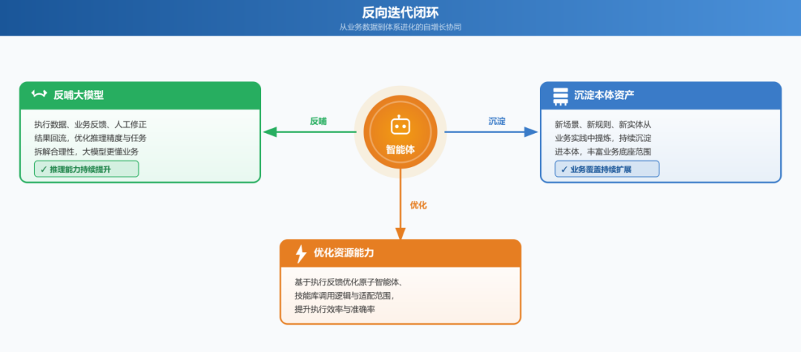

这套体系不是一次性建成就一成不变的，而是能通过业务数据回流，形成持续进化的正向循环：

| 闭环方向 | 机制 | 效果 |
| **反哺大模型** | 执行数据、业务反馈、人工修正结果回流大模型，优化推理精度、任务拆解的合理性 | 让大模型越来越懂企业的业务习惯 |
| **沉淀本体资产** | 新场景、新规则、新实体从业务实践中提炼出来，持续沉淀进本体模型 | 丰富业务底座的覆盖范围，让本体越来越完整 |
| **优化资源能力** | 基于执行反馈优化原子智能体、技能库的调用逻辑与适配范围 | 提升执行效率与准确率，让资源层能力越来越完善 |

### 3.3 协同的三大核心价值

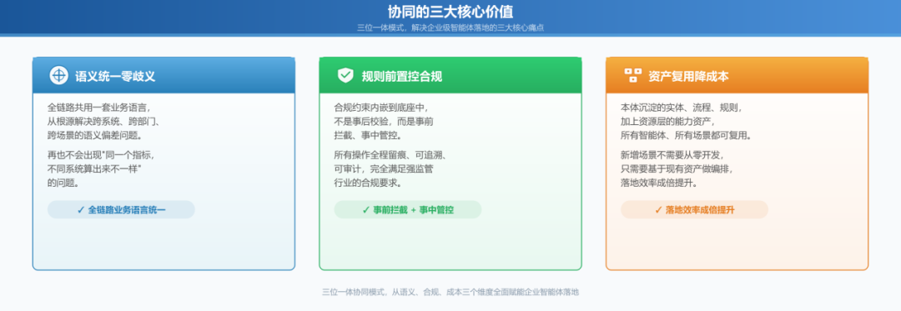

这套智能协同的模式，本质上解决了企业级智能体落地的三大核心痛点：

✅ **语义统一零歧义**：全链路共用一套业务语言，从根源解决跨系统、跨部门、跨场景的语义偏差，再也不会出现 "同一个指标，不同系统算出来不一样" 的问题。

✅ **规则前置控合规**：合规约束内嵌到底座中，不是事后校验，而是事前拦截、事中管控，所有操作全程留痕、可追溯、可审计，完全满足强监管行业的合规要求。

✅ **资产复用降成本**：本体沉淀的实体、流程、规则，加上资源层的能力资产，所有智能体、所有场景都可以复用。新增场景不需要从零开发，只需要基于现有资产做编排，落地效率成倍提升。

\*\*💡\*\*本体驱动的智能体架构不是简单的 "技术叠加"，而是一套完整的 **"语义标准 + 推理决策 + 执行闭环"** 协同运行体系。本体为决策和执行提供唯一权威的语义底座与规则约束，大模型在语义底座之上完成智能推理，智能体在规则约束下完成自动化执行，三者缺一不可。

## 04 架构全景：本体驱动的智能体协同运行体系

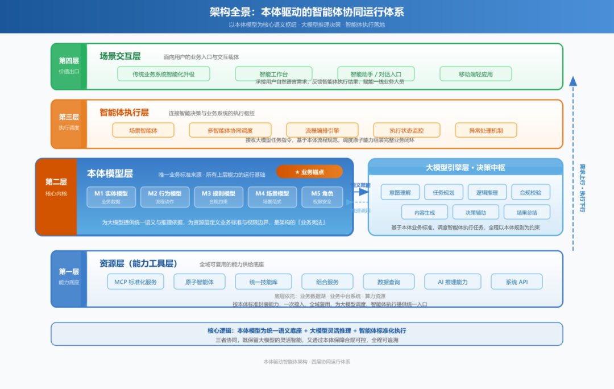

本体、大模型、智能体三者不是简单的堆叠，而是形成了以本体为核心语义枢纽的分层协同架构。从业务需求发起到最终落地执行，整体流转逻辑如下：

- 用户或业务系统通过自然语言或业务事件触发需求，首先到达大模型交互层完成意图理解、实体提取；
- 随后大模型将需求映射到本体模型层的统一语义体系中，由本体完成语义校验、规则匹配，明确执行边界与约束；
- 在此基础上，一方面智能体层基于本体的标准化流程完成任务编排与自动化执行，另一方面大模型层负责处理流程中的非标环节，完成灵活推理与决策；
- 最终二者共同调用底层能力工具层的 API、组合服务与 AI 能力，完成业务闭环。

| 层级 | 名称 | 核心定位 | 核心组成/能力 | 协同作用 |
| **第一层** | **基础资源层** | 全域可复用的能力供给底座，整个架构的能力地基 | 核心组成：MCP 标准化服务、原子智能体、统一技能库（企业公共技能、个人自定义技能）底层支撑：业务数据湖、业务中台系统、算力资源 | 为本体模型提供业务能力的标准化映射载体，为大模型调度、智能体执行提供统一的能力调用入口；所有能力按本体标准封装，实现一次接入、全域复用 |
| **第二层** | **本体模型层** | 三者协同的【业务锚点】（核心内核），整个架构唯一的业务标准来源 | 核心组成：M1 实体模型、M2 行为模型、M3 规则模型、M4 场景模型、M5 角色模型覆盖维度：业务数据、流程动作、合规约束、场景范式、权限安全 | 为大模型提供统一语义与推理依据，为资源层的能力资产定义业务标准与权限边界；是整个架构的 "业务宪法"，所有规则、流程、定义都以此为准 |
| **第三层** | **大模型引擎层** | 三者协同的【决策中枢】，架构的智能大脑 | 核心能力：意图理解、任务拆解规划、逻辑推理研判、规则合规校验 | 向上接收用户的自然语言需求，向下基于本体模型的业务标准，调度智能体执行层编排任务流程；全程以本体规则为约束，保证推理结果合规、可信、可解释 |
| **第四层** | **智能体执行层** | 场景落地的【执行调度单元】，连接智能决策与业务系统的执行枢纽 | 核心组成：场景智能体、多智能体协同调度引擎 | 接收大模型的任务指令，基于本体场景模型的流程规范，调度资源层的原子智能体、MCP 服务与技能能力，对接业务系统完成具体业务动作；负责多智能体的协同调度、流程串联，把零散的原子能力组装成完整的业务闭环 |
| **第五层** | **场景交互层** | 面向用户的【价值出口】，架构触达终端用户的最终载体 | 核心形态：传统业务系统智能化升级、智能工作台 | 面向终端用户提供业务入口与交互载体，承接用户自然语言需求、反馈智能体执行结果 |

\*\*💡\*\*这套架构以本体模型为统一语义底座与规则约束核心，既保留了大模型的灵活推理能力，又通过智能体实现了标准化的流程执行，全程可控可追溯。在此基础上，我们可以将其拆解为自下而上的五层落地架构，层层支撑、语义贯通。

## 05 实战落地：电网基层智能稽查场景全流程搭建

理论的价值最终要落到业务实效上。我们以电网营销核心的台区线损智能稽查场景为例，完整拆解从需求分析、本体构建、能力封装到智能体搭建、执行落地的全流程，直观呈现三者如何协同创造业务价值。

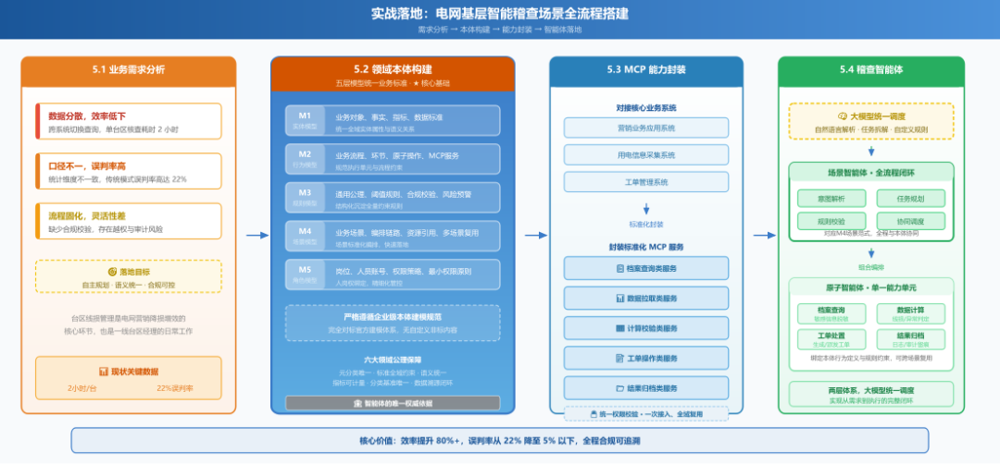

### 5.1 业务需求分析：直击一线稽查核心痛点

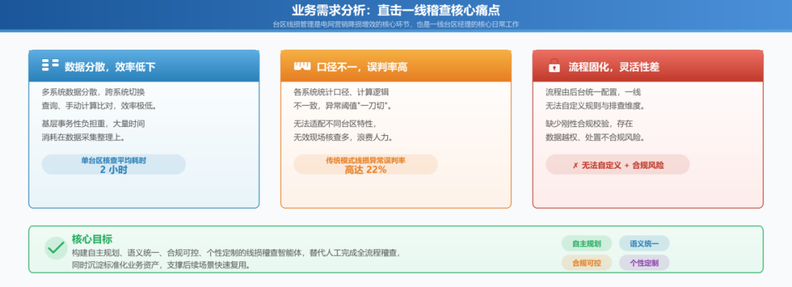

台区线损管理是电网营销降损增效的核心环节，也是一线台区经理的核心日常工作。传统稽查模式存在三类刚性痛点，也是本次智能体落地的核心目标：

| 痛点 | 现状 | 影响 |
| **数据分散，效率低下** | 台区档案、抄表数据、用户信息、工单系统分散在不同业务系统，一次完整的稽查需要跨系统切换查询、手动计算比对 | 单台区核查平均耗时 2 小时，基层事务性负担重 |
| **口径不一，误判率高** | 不同系统对线损率的统计维度、计算逻辑不一致，异常阈值采用 "一刀切" 标准，无法适配农村、城区、城中村等不同台区特性 | 传统模式线损异常误判率高达 22%，大量无效现场核查浪费人力 |
| **流程固化，灵活性差** | 传统稽查流程由后台统一配置，一线员工无法根据辖区特性自定义稽查规则与排查维度；同时全流程缺少刚性合规校验，存在数据越权访问、处置不合规的风险 | 无法满足审计追溯要求 |

基于以上痛点，本次落地的核心目标是：构建一套可自主规划、语义统一、合规可控、支持个性化定制的线损稽查智能体，替代人工完成全流程稽查工作，同时沉淀标准化业务资产，支撑后续场景快速复用。

### 5.2 领域本体构建：五层模型统一业务标准

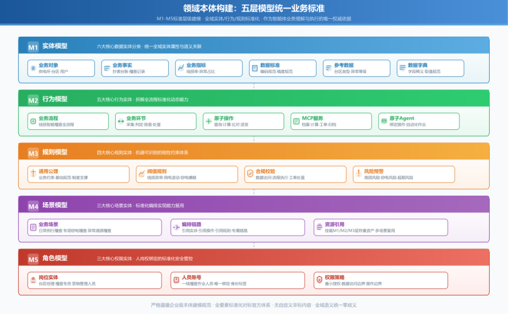

本体构建是整个落地过程的核心基础，严格遵循企业级本体建模规范，按照M1-M5标准层级完成线损稽查领域全要素标准化建模，所有实体、属性、语义关系、领域公理完全对标官方建模体系，无自定义非标内容，作为智能体业务理解、推理决策、自动化执行的唯一权威依据。

#### （1）本体模型清单

| 模型层级 | 核心定位 | 标准化实体分类及核心内容 | 标准化语义关系 | 领域公理 |
| **M1 实体模型** | 遵循企业级六大核心数据实体分类，完成线损稽查领域标准化建模，统一全域实体属性、语义关联与约束公理 | ① 业务对象：供电所、台区、台区经理、电力用户、计量装置，标准属性：对象编码、对象名称、业务域分类、归属组织、对象标签、生效状态 ② 业务事实：月度抄表台账、台区线损统计记录、稽查异常台账、用户用电异常记录，标准属性：事实编码、关联业务对象、发生时间、执行主体、业务结果、状态标识 ③ 业务指标：台区供电量、台区售电量、理论线损、实际线损、台区线损率、异常台区占比，标准属性：指标编码、指标名称、统计口径、计算规则、维度范围、数据周期、阈值标准 ④ 数据标准：台区编码规范、用户编号规范、线损数据统计规范、抄表数据精度规范，标准属性：标准编码、标准名称、数据类型、格式规范、精度要求、合规依据、生效范围 ⑤ 参考数据：台区类型分类（农村/城区/城中村）、线损异常等级、窃电嫌疑等级、工单状态枚举，标准属性：参考编码、分类名称、数据维度、适用业务域、更新时间、有效状态 ⑥ 数据字典：线损领域业务字段释义、异常标签枚举、判定项取值规范，标准属性：字典编码、字段名称、语义定义、数据类型、取值规范、业务释义 | ① 业务对象形成「供电所→台区→用户」三级拓扑归属关系，台区经理与管辖台区一一绑定 ② 所有业务事实精准溯源绑定对应业务对象 ③ 业务指标基于业务对象、业务事实量化统计，严格匹配数据标准 ④ 全域实体受数据标准刚性约束，参考数据统一业务分类基准，数据字典统一字段语义与取值规范 | ① 元分类唯一公理 ② 数据标准全域约束公理 ③ 语义统一公理 ④ 指标可计量公理 ⑤ 分类基准唯一公理 ⑥ 数据溯源闭环公理 |
| **M2 行为模型** | 遵循企业级五大核心行为实体分类，拆解线损稽查全流程标准化动态能力，规范执行单元、关联关系与流程约束 | ① 业务流程实体：台区线损智能稽查全流程，标准属性：流程编码、所属业务域、流程目标、节点清单、适用岗位 ② 业务环节实体：数据采集、异常判定、嫌疑排查、工单处置、结果归档，标准属性：环节编号、归属流程、前置依赖、环节输出、执行时效 ③ 原子操作实体：台区档案查询、抄表数据拉取、线损率计算、异常阈值比对、用户特征排查、工单生成派发、结果归档，标准属性：操作编码、入参出参、所属环节、对应系统功能 ④ MCP 服务实体：档案查询服务、数据同步服务、指标计算服务、工单调度服务、日志归档服务，标准属性：服务编号、对接系统、接口协议、数据访问范围 ⑤ 原子 Agent 实体：档案查询智能体、数据计算智能体、工单处置智能体、结果归档智能体，标准属性：Agent 编码、绑定操作、依赖服务、适配场景 | ① 业务流程聚合五大标准化业务环节，各环节集成专属原子操作 ② 原子操作依托对应 MCP 服务支撑运行 ③ 原子 Agent 绑定原子操作与底层服务，实现自动化作业，形成完整动态执行闭环 | ① 流程时序公理 ② 能力匹配公理 ③ 场景适配公理 |
| **M3 规则模型** | 遵循企业级四大核心规则实体分类，结构化沉淀线损稽查全量风控、业务、合规约束规则，形成机器可识别的刚性约束体系 | ① 通用公理实体：线损稽查通用业务约束、营销稽查基础规范，标准属性：规则编号、适用业务域、规则描述、制度出处 ② 阈值规则实体：台区线损异常阈值、用户用电波动阈值、窃电嫌疑判定阈值（农村台区线损率≥5%为高损、城区≥4%；窃电含用电量波动超50%、零电量超7天等维度），标准属性：规则 ID、管控指标、临界数值、触发条件、处置动作 ③ 合规校验实体：数据访问合规校验、流程执行合规校验、工单处置合规校验，标准属性：校验编码、管控对象、禁止操作、违规处置方案 ④ 风险预警实体：高损台区风险预警、疑似窃电风险预警、超期处置风险预警，标准属性：预警编号、触发条件、预警等级、接收岗位 | ① 全量规则全域约束 M1 静态实体数据与 M2 动态稽查执行行为 ② 阈值规则触发后联动合规校验、风险预警机制 ③ 通用公理为所有专项稽查规则提供底层制度支撑，构建层级化风控体系 | ① 制度溯源公理 ② 阈值唯一公理 ③ 违规必处置公理 |
| **M4 场景模型** | 遵循企业级三大核心场景实体分类，基于底层本体资产完成线损稽查场景标准化编排，实现能力复用、场景快速落地 | ① 业务场景实体：日常例行稽查、专项窃电稽查、异常溯源稽查，标准属性：场景编码、场景名称、所属业务域、上线状态 ② 编排链路实体：各稽查场景专属执行链路，标准属性：链路 ID、引用实体、引用操作、引用规则 ③ 资源引用实体：场景专属底层资产挂载单元，标准属性：资源类型、资源编码、执行次序、前置依赖 | ① 单个业务场景依托多条标准化编排链路实现业务闭环 ② 编排链路通过资源引用挂载 M1、M2、M3 层存量本体资产 ③ 底层本体资产支持多场景复用，杜绝重复建设 | ① 资产复用公理 ② 链路闭环公理 ③ 场景兼容公理 |
| **M5 角色模型** | 遵循企业级三大核心权限实体分类，搭建线损稽查人岗权绑定的标准化安全管控体系，实现精细化权限管控 | ① 岗位实体：台区经理、稽查专员、营销管理人员，标准属性：岗位编码、归属部门、岗位职责、适配业务域 ② 人员账号实体：一线稽查作业人员系统账号，标准属性：工号、绑定岗位、身份标签、账号状态 ③ 权限策略实体：各岗位专属稽查权限规则，标准属性：策略编号、适配岗位、可访问实体、可执行操作、受限范围 | ① 人员账号与核心稽查岗位唯一绑定，杜绝多岗挂靠 ② 各岗位匹配专属权限策略，精准界定数据访问、业务操作边界 ③ 权限策略全域约束所有本体实体访问与稽查作业行为 | ① 岗位权责唯一公理 ② 账号绑定唯一公理 ③ 最小权限公理 |

#### （2）本体模型图谱

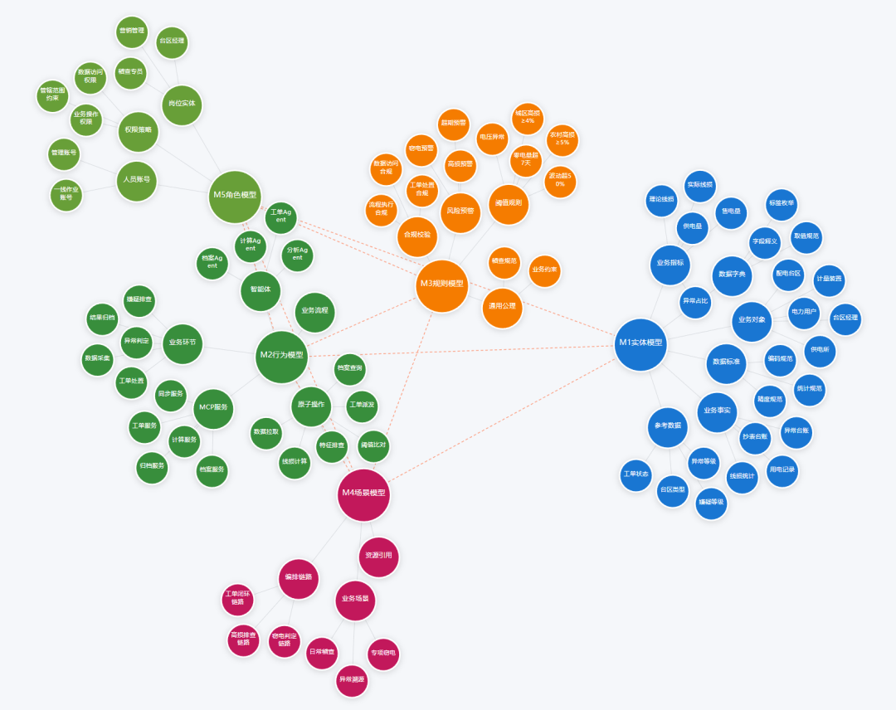

#### （3）本体模型服务

本体模型服务是线损智能稽查体系的业务语义中枢与唯一权威依据，严格对标企业级 M1-M5 五层本体建模规范构建，无自定义非标内容。服务向上为大模型引擎、多智能体执行体系提供标准化语义理解、规则推理、决策支撑能力；向下对接业务数据湖、MCP 业务服务，统一全链路业务语义口径与规则标准，从根源消除大模型幻觉、数据口径不一、流程执行非标等问题。

### ① 本体实体匹配服务

核心定位：将自然语言需求、异构业务数据中的非标准化业务对象，精准映射至本体标准化实体体系，完成业务语义初步对齐，是智能交互的入口基础。对标本体层级：核心基于 M1 实体模型，联动 M5 角色模型开展权限前置校验。

| 维度 | 内容 |
| **核心能力** | - 实体归一化匹配：支持口语化、简称、异名业务实体识别，自动映射至 M1 六大类实体的唯一标准实体，消除实体命名差异。 - 标准属性自动补全：匹配实体后自动关联本体定义的全量标准属性，保障数据字段完整性与规范性。 - 语义拓扑关联：自动还原实体间的拓扑归属与责任绑定关系，补全业务上下文。 - 权限前置校验：校验当前操作账号对目标实体的访问权限，无权限实体直接拦截，遵循最小权限公理。 |

### ② 本体语义清洗服务

核心定位：对异构系统数据、非标准表述、异名字段进行语义归一化处理，严格对齐本体标准定义，消除语义歧义，保障全链路数据口径统一。对标本体层级：核心基于 M1 实体模型的数据标准、数据字典、参考数据模块，联动 M2 行为模型的流程标准。

| 维度 | 内容 |
| **核心能力** | - 字段语义归一：将不同业务系统的异名字段统一映射为本体标准字段，同步对齐统计口径、计算规则与数据精度。 - 枚举值标准化：将非标枚举值统一对齐本体参考数据的标准枚举，保障分类基准唯一。 - 业务口径对齐：所有指标计算、统计维度严格遵循本体数据标准定义，杜绝口径偏差。 - 语义消歧校验：对多义词、歧义表述自动判别业务语境，匹配唯一正确本体语义，符合语义统一公理。 |

### （三）本体推理分析服务

核心定位：基于本体规则公理、流程逻辑、场景模板，实现自动化逻辑推理，输出标准化判定结果与执行方案，是智能体自动化作业的核心决策引擎。对标本体层级：核心基于 M3 规则模型、M2 行为模型、M4 场景模型，联动 M1 实体模型提供数据支撑。

| 维度 | 内容 |
| **核心能力** | - 阈值规则推理：严格遵循 M3 阈值规则的临界值与触发条件，自动完成高损判定、窃电嫌疑分级、异常等级标定，所有判定结果绑定对应规则 ID，符合阈值唯一公理。 - 合规性校验推理：自动校验数据访问、流程执行、工单处置的合规性，违规操作自动拦截并触发风险预警，符合违规必处置公理。 - 场景链路编排推理：基于 M4 场景模板自动编排最优执行链路，挂载对应原子操作与 MCP 服务，生成可直接执行的任务步骤，符合资产复用公理。 - 异常溯源推理：基于本体语义关联关系，反向追溯异常产生的关联实体与业务环节，定位异常根因。 |

### （四）本体决策问答服务

核心定位：面向业务人员的权威问答入口，所有回答严格基于本体标准化内容输出，全程可溯源，彻底解决大模型幻觉问题，为业务决策提供唯一权威依据。对标本体层级：M1-M5 五层本体全量协同。

| 维度 | 内容 |
| **核心能力** | - 业务术语释义：精准输出业务字段、指标、规则的标准定义，同步本体数据字典官方释义。 - 规则依据查询：输出异常判定、合规管理的规则标准与制度出处，所有结论绑定 M3 规则 ID，符合制度溯源公理。 - 流程步骤解答：输出各类稽查场景的标准执行流程、操作要求，同步 M2 行为模型标准化流程定义。 - 权限范围查询：输出岗位、账号的可访问数据范围、可执行操作权限，同步 M5 角色模型权限策略。 |

### （五）对外对接方式

| 对接方式 | 说明 |
| **MCP 标准化服务封装** | 所有本体能力封装为标准化 MCP 服务，纳入企业级 MCP 服务目录，供原子智能体、大模型调度引擎统一调用，接口协议、数据格式完全符合本体规范。 |
| **大模型插件接入** | 封装为大模型原生插件，大模型在语义理解、推理决策环节自动调用本体服务校验，保障输出内容 100% 符合业务标准。 |
| **业务系统嵌入** | 提供标准化 OpenAPI 接口，可直接嵌入营销稽查系统、智能工作台等业务系统，提供统一本体语义支撑。 |

### 5.3 MCP 能力封装：打通底层系统标准化调用

本体完成业务标准定义后，需要将底层异构系统的业务能力封装为标准化 MCP 服务，作为智能体执行的能力底座，实现 "一次接入、全域复用"。

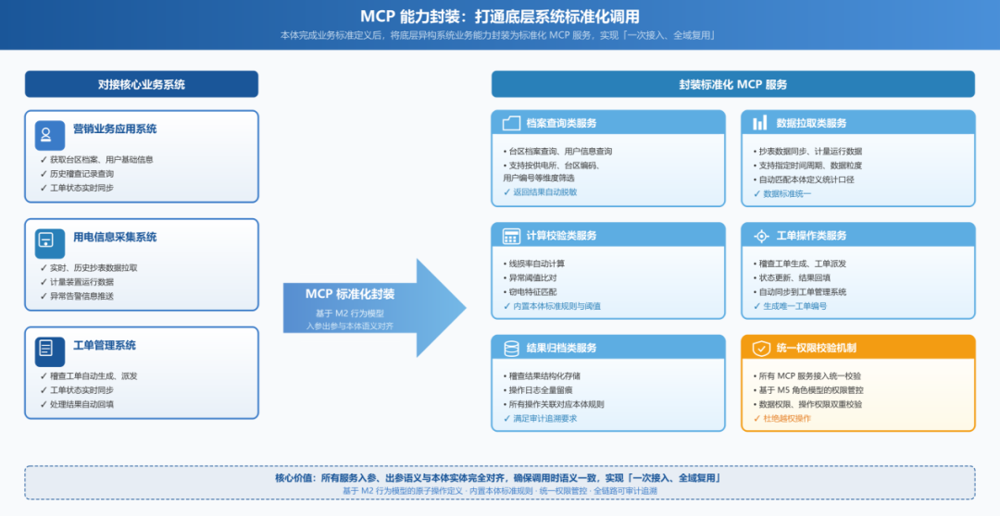

#### （1）对接核心业务系统

| 业务系统 | 对接内容 |
| **营销业务应用系统** | 获取台区档案、用户基础信息、历史稽查记录与工单状态。 |
| **用电信息采集系统** | 拉取实时、历史抄表数据，计量装置运行数据与异常告警。 |
| **工单管理系统** | 实现稽查工单的自动生成、派发、状态同步与结果回填。 |

#### （2）封装标准化 MCP 服务

基于 M2 行为模型的原子操作定义，将系统能力封装为 5 类标准 MCP 服务，所有服务的入参、出参语义与本体实体完全对齐，确保调用时语义一致：

| 服务类别 | 服务内容 | 关键特性 |
| **档案查询类服务** | 台区档案查询、用户信息查询 | 支持按供电所、台区编码、用户编号等维度筛选，返回结果自动完成敏感信息脱敏 |
| **数据拉取类服务** | 抄表数据同步、计量运行数据获取 | 支持指定时间周期、数据粒度，自动匹配本体定义的统计口径 |
| **计算校验类服务** | 线损率自动计算、异常阈值比对、窃电特征匹配 | 内置本体定义的标准规则与阈值，输出标准化的判定结果 |
| **工单操作类服务** | 稽查工单生成、工单派发、状态更新 | 自动同步到工单管理系统，生成唯一工单编号 |
| **结果归档类服务** | 稽查结果结构化存储、操作日志全量留痕 | 所有操作记录关联对应本体规则，满足审计追溯要求 |

所有 MCP 服务都接入统一的权限校验机制，调用时自动匹配本体 M5 角色模型的权限规则，无权限操作直接拦截并返回原因。

### 5.4 稽查智能体搭建：基于本体的分层智能体体系

完成本体与 MCP 能力准备后，搭建 "原子智能体 + 场景智能体" 的两层智能体体系，由大模型统一调度，实现从需求到执行的完整闭环。

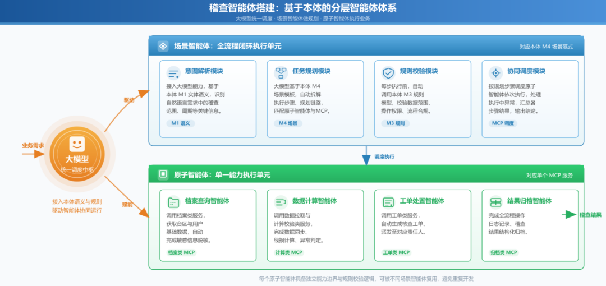

#### （1）原子智能体：单一能力执行单元

原子智能体对应单个 MCP 服务与业务动作，是最小的执行单元，每个智能体都明确绑定本体中的对应行为定义与规则约束：

| 原子智能体 | 职责 | 绑定能力 |
| **档案查询智能体** | 负责调用档案类服务，获取台区与用户基础数据 | 自动完成敏感信息脱敏 |
| **数据计算智能体** | 调用数据拉取与计算校验类服务，完成数据同步、线损计算、异常判定 | 严格遵循本体 M1 数据标准与 M3 阈值规则 |
| **工单处置智能体** | 调用工单类服务，自动生成核查工单、派发至对应责任人 | 自动匹配本体 M5 角色模型权限 |
| **结果归档智能体** | 完成全流程操作日志记录、稽查结果结构化归档 | 所有记录关联本体规则 ID |

每个原子智能体都具备独立的能力边界与规则校验逻辑，可被不同场景智能体复用，避免重复开发。

#### （2）场景智能体：全流程闭环执行单元

场景智能体对应本体 M4 的场景范式，是面向具体业务的完整执行智能体，核心由四大模块组成，全程与本体、大模型协同：

| 模块 | 功能 | 协同机制 |
| **意图解析模块** | 接入大模型能力，基于本体 M1 实体语义，识别用户自然语言需求中的关键信息 | 识别稽查范围、时间周期、重点排查方向等关键信息 |
| **任务规划模块** | 大模型基于本体 M4 场景模板，自动拆解执行步骤、规划执行链路 | 匹配对应的原子智能体与 MCP 服务，生成完整的执行方案 |
| **规则校验模块** | 每一步执行前，自动调用本体 M3 规则模型进行校验 | 校验数据范围、操作权限、流程合规性，违规操作直接拦截并给出原因 |
| **协同调度模块** | 按照规划的步骤，调度对应原子智能体依次执行 | 处理执行中的异常情况，汇总各步骤结果，最终输出完整的稽查结论 |

同时支持用户基于场景模板，通过自然语言自定义排查规则与维度，生成个人专属的稽查技能，沉淀到统一技能库中，后续直接调用。

### 5.5 全流程执行演示：从需求到结果的完整闭环

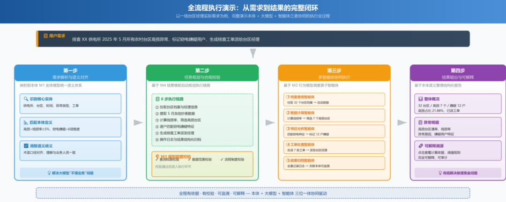

我们以一线台区经理的实际需求为例，完整演示三者协同下智能体的执行全过程：

用户需求：帮我排查 XX 供电所 2025 年 5 月所有农村台区的高损异常，重点标记窃电嫌疑用户，生成现场核查工单派给对应台区经理。

#### 第一步：需求解析与语义对齐

需求提交后，首先进入需求解析与语义对齐环节。这一步我们核心匹配了两类本体模型完成语义标准化处理：

一是匹配 M1 实体模型，自动识别供电所、农村台区、统计周期、高损异常、窃电嫌疑、核查工单等全部核心业务实体，同步匹配本体标准定义，锁定农村台区高损判定阈值、窃电嫌疑判定维度等业务规则，统一所有术语与指标口径，消除语义歧义；

二是联动匹配 M5 角色模型，自动匹配当前操作人员的管辖权限范围，完成权限初校验，确保系统对需求的理解与业务人员的认知完全一致。

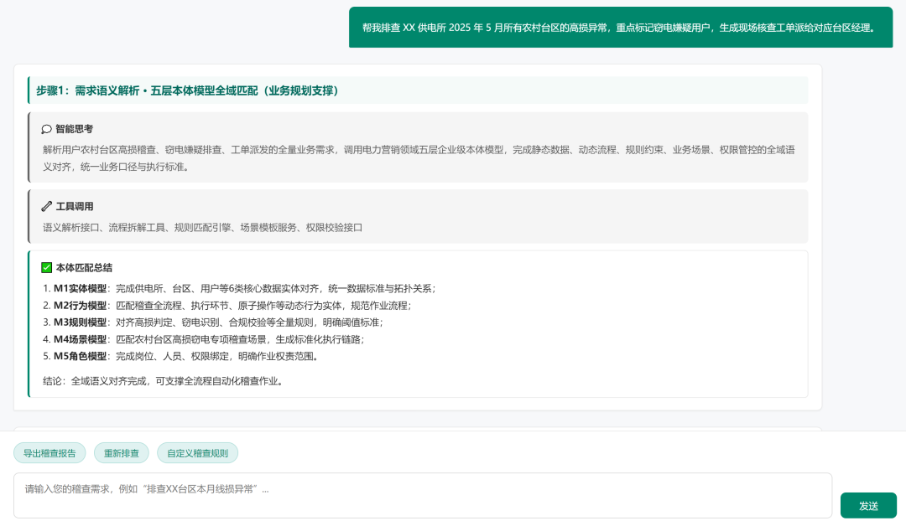

#### 第二步：任务自动规划与合规校验

完成语义对齐后，进入任务自动规划与合规校验环节。这一步我们基于本体模型完成全链路流程规划与前置风控校验。

一方面调用 M4 场景模型，匹配专项窃电稽查标准模板，完整规划了六步执行链路：

任务1：拉取目标供电所所有农村台区的基础档案与对应台区经理信息

任务2：提取 2025 年 5 月所有台区的供电量、售电量冻结抄表数据

任务3：计算每个台区的线损率，比对农村台区异常阈值筛选高损台区

任务4：针对高损台区逐户匹配窃电嫌疑特征，标记嫌疑用户并分析异常原因

任务5：生成对应现场核查工单，派发至对应台区经理并附上排查建议

任务6：完成全流程操作日志与结果的结构化归档

另一方面调用 M3 规则模型完成全链路前置合规校验，依次确认操作人员查询权限、数据访问范围、流程节点合规性三项内容，校验通过后自动触发执行，全程无需人工介入。

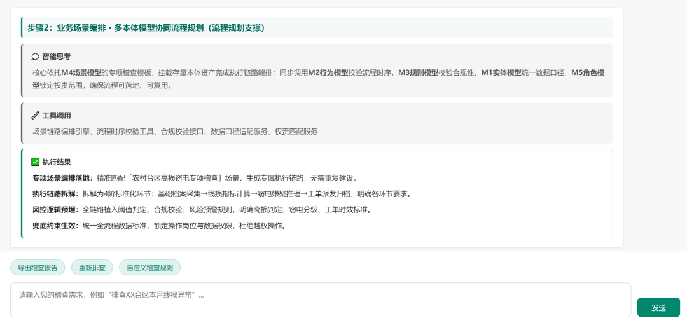

#### 第三步：多智能体协同自动化执行

校验通过后，进入多智能体协同自动化执行环节。智能体调度引擎接收执行指令后，严格基于 M2 行为模型的能力映射，调度各原子智能体与 MCP 服务按规划链路全自动完成作业，具体执行情况如下：

一是档案查询，调用 MCP 档案服务，成功拉取目标供电所全部 32 个农村台区的基础档案、用户清单与台区经理信息，同步自动完成用户敏感信息脱敏；

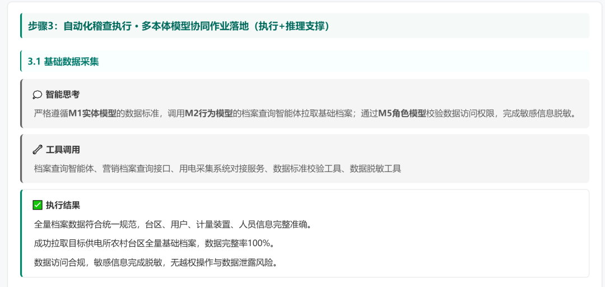

二是数据计算，调用 MCP 数据服务，完成 32 个台区 5 月冻结抄表数据同步，严格按照本体统一口径计算出台区线损率，经阈值比对筛选出 7 个高损台区；

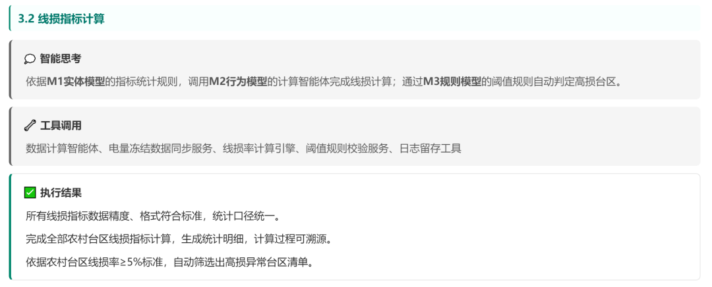

三是数据计算，针对 7 个高损台区逐户完成用电波动、电压电流异常、历史窃电记录等特征匹配，成功标记出 12 户窃电嫌疑用户并生成对应异常原因分析；

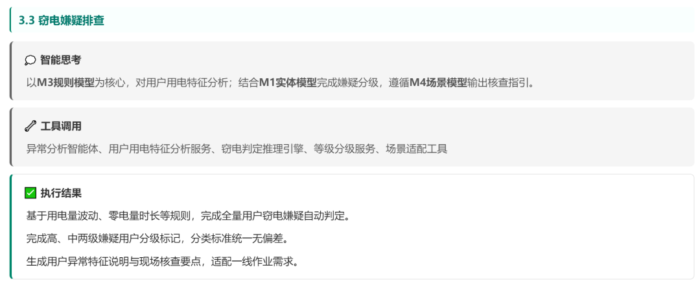

四是工单处置，调用 MCP 工单服务，自动生成 7 张现场核查工单，完整附带异常明细、嫌疑用户清单与排查建议，精准派发至对应台区经理账号，同步设置 24 小时处置时限；

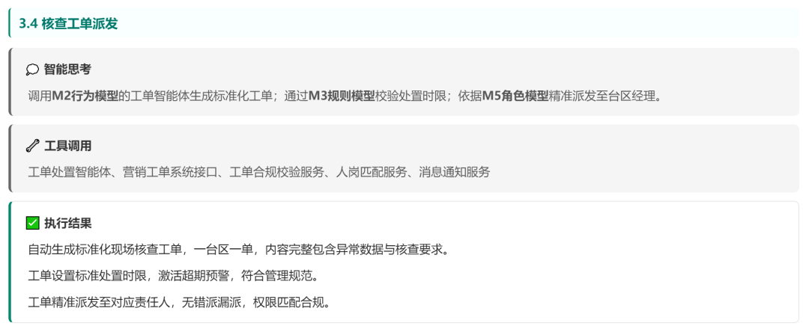

五是结果归档，完成全量操作日志、数据来源、判定依据与执行结果的结构化留存，所有记录均关联对应本体规则，全程可追溯、可审计。

#### 第四步：结构化结果输出与可解释说明

全流程执行完成后，进入结构化结果输出与可解释说明环节。

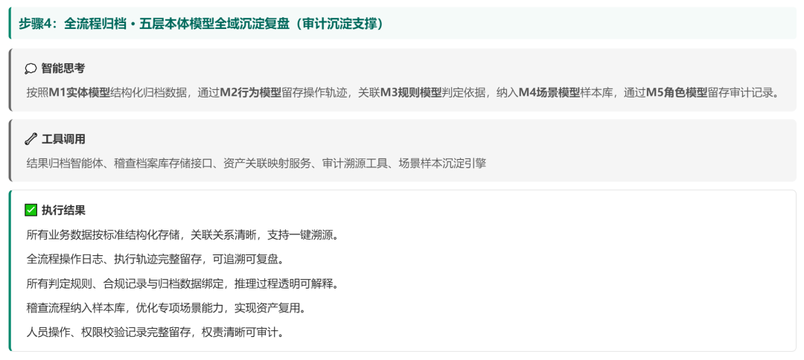

大模型基于本体标准业务语义，将零散的执行数据整理为业务人员易懂的结构化稽查报告，报告包含三部分核心内容：

一是整体稽查概况，清晰呈现本次排查台区总数、高损台区数量、高损占比、嫌疑用户数量、工单派发情况等核心指标；

二是异常明细信息，包含高损台区清单与对应线损率、异常原因分类、嫌疑用户明细与特征；

三是工单状态信息，包含工单编号列表、派发对象、处置时限、当前状态。

同时所有结论均支持全链路溯源，点击线损率数值即可查看计算依据、数据来源与对应统计口径，点击异常判定即可查看 M3 规则模型中对应的阈值规则与制度出处，真正实现全流程可解释、可审计，彻底解决大模型推理黑盒问题。

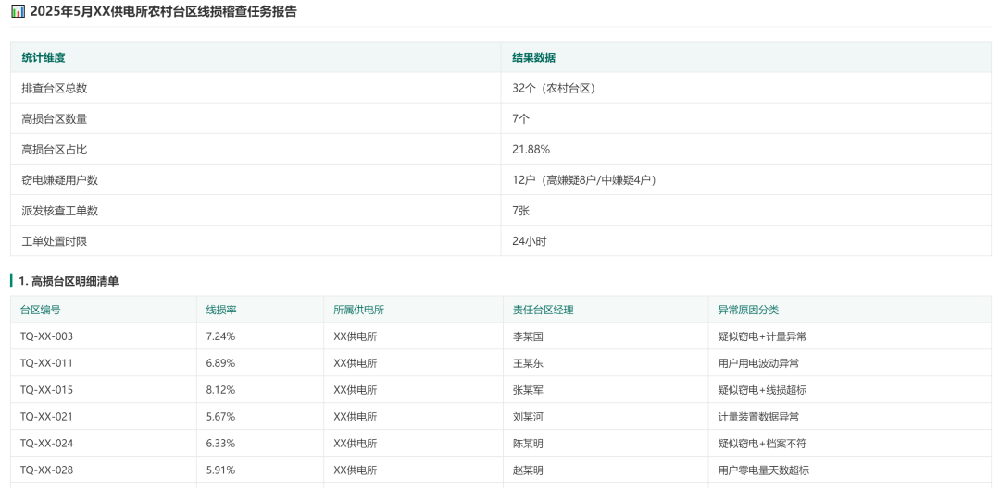

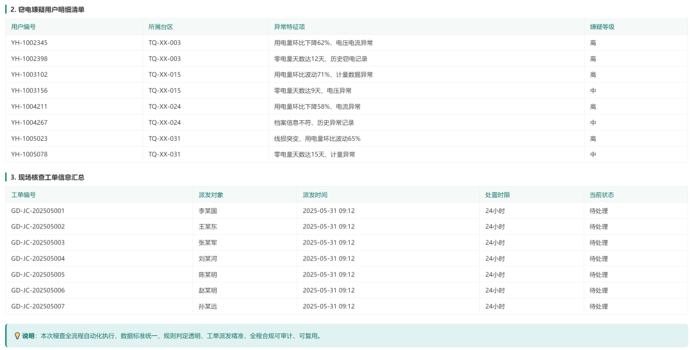

### 5.6 落地成效

这套协同模式落地后，一线稽查的效率与准确率都得到了质的提升：

| 指标 | 传统模式 | 本体+智能体模式 |
| **单台区稽查时间** | 2 小时 | 5 分钟 |
| **事务性工作量** | — | 减少 60% 以上 |
| **线损异常误判率** | 22% | 3% 以下 |
| **稽查技能数量** | — | 100+ 种 |
| **场景适配效率** | — | 提升 10 倍 |

💡 电网线损稽查场景的实践验证了 "本体 + 大模型 + 智能体" 智能协同架构的可行性：本体作为统一的业务语义底座，大模型在语义约束下完成推理决策，智能体在规则约束下完成自动化执行，三者形成完整的业务闭环。这种模式不仅显著提升了单场景的效率与准确率，更重要的是沉淀了标准化的业务资产，支撑后续场景的快速复用与规模化落地。

## 06 写在最后

企业级 AI 的竞争，早已不是大模型参数的比拼，而是业务深度与落地能力的较量。

很多企业热衷于追热点、堆工具，做了很多好看但没用的智能体试点，最终都卡在了 "不懂业务、不合规、没法复用" 这三道坎上。而本体 + 大模型 + 智能体智能协同的模式，本质上就是给 AI 装上了【业务的骨架】【智慧的大脑】【执行的手脚】，让 AI 真正扎根到企业的核心业务里。

未来的企业智能应用，必然会从【零散的单点智能体】走向【统一本体底座支撑的全域智能体系】。越早搭建起自己的业务本体底座，就越早形成 AI 规模化落地的核心壁垒，在智能化转型中占得先机。
