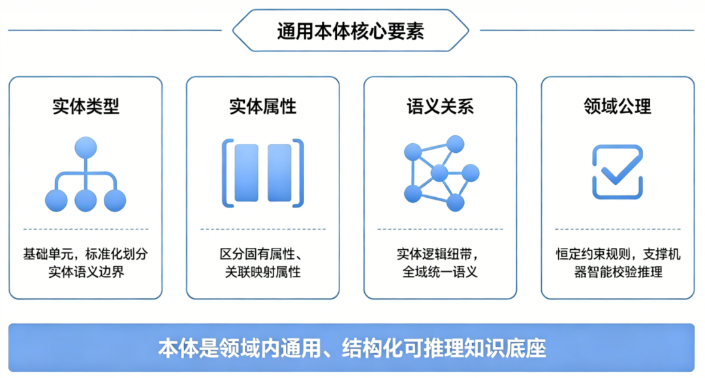
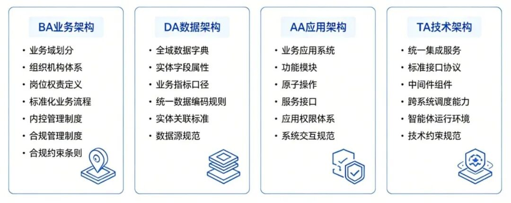
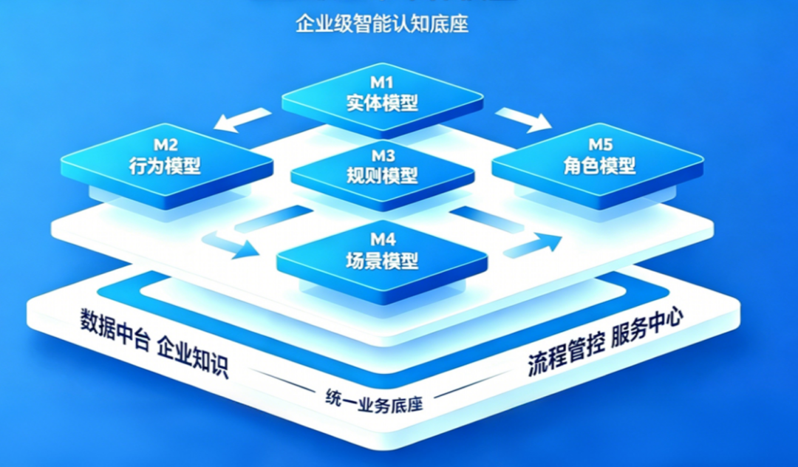

# 本体智能 | 一文读懂企业级本体模型

> **来源**：微信公众号「华力江海」
> **作者**：华力江海
> **发布日期**：2026-05-30
> **原文**：[点击查看](https://mp.weixin.qq.com/s?__biz=MzcxMDMyNTI4MQ==&mid=2247483753&idx=1&sn=dec18da14ad72d4cc53e0dd6ecf11dcb&chksm=f519a427c26e2d31ccfeeb3e89b628830e2422fecf84a378bcdf5379b1e74d1bc64a6e9c7ee6#rd)
> **系列**：本体智能系列

随着大模型在企业数字化领域深度落地，多数企业智能化建设普遍存在痛点：数据语义不统一、业务流程碎片化、合规规则散落各系统、AI无法理解真实业务语义，导致智能应用浮于表面、难以落地复用。企业级本体模型是适配企业实景的结构化智能认知底座，可将企业静态信息化资产转化为机器可解析、可推理、可编排的智能能力，是企业大模型规模化落地的核心底层支撑。

## 01 企业级本体模型定义

企业级本体模型，是面向企业全业务链路构建的全域结构化、可推理、可复用的智能认知底座。其核心价值是系统化沉淀企业全部业务资产，统一业务语义、固化业务流程、锁定合规规则、规范操作权限。

企业级本体模型完全以信息化建设为导向，打通数据孤岛与系统能力壁垒，为大模型提供标准化、可解析的业务逻辑依据，让AI摆脱零散接口单点调用的局限，可自主拆解业务目标、智能编排流程、依规完成合规决策，支撑企业智能应用标准化、常态化落地复用。

## 02 通用本体建模方法

本体核心要素是本体标准化底层定义，具备普适性、通用性，不绑定特定行业、业务场景与信息系统，是构建机器可理解、可解析、可推理本体体系的核心前提。企业级本体模型均基于实体类型、实体属性、语义关系、领域公理四大核心要素搭建，共同构成完整的结构化知识底层。

### 1. 定义实体类型

实体类型是本体建模最基础的核心单元，是对建模范围内所有独立客观、具备完整业务语义的对象进行标准化归类定义。

建模时需明确整体建模边界，全域梳理业务基础单元，依据语义内涵、业务特征划分实体类型，清晰界定各实体的语义边界与覆盖范围，剔除冗余、无效、重复的对象单元，搭建层级清晰、定义精准的实体体系，为后续属性、关系、规则的构建奠定基础。

### 2. 梳理实体属性

实体属性是刻画实体特征、标识、状态与业务特质的结构化字段集合，是精准定义实体、区分实体差异的核心支撑。

通用建模体系将属性分为两类：一是基础固有属性，描述实体与生俱来的静态参数与固有标识，独立存在、不依赖其他实体；二是关联映射属性，承载实体与其他实体的关联标识，是打通全域语义联动、实现跨实体协同的核心载体。所有属性均采用通用标准化定义，适配全业务场景。

### 3. 构建语义关系

语义关系是不同实体之间客观存在的通用逻辑关联，是搭建本体语义网络、实现逻辑结构化的核心纽带。

建模过程中，统一抽象定义实体间归属、包含、关联、依赖、联动、映射等通用逻辑关系，统一全域语义口径与关联规范，解决传统业务中语义碎片化、释义不统一、关联混乱的问题，搭建逻辑通顺、全域互通的本体语义网络，支撑本体整体逻辑联动与智能推理。

### 4. 录入领域公理

领域公理是本体体系底层恒定的逻辑准则、业务约束与通用推理依据，具备稳定性、普适性，不随场景变化随意改动，是保障本体逻辑自洽、可校验、可智能推理的核心支撑。

建模时需萃取行业通用准则、企业固有业务约束，将自然语言规则转化为机器可识别、可自动校验的标准化公理体系，依托公理实现本体逻辑自检、合规约束、智能推演与异常甄别，保障本体架构严谨规范、可落地可用。

## 03 企业级本体模型构成

企业级本体模型定义了企业信息化全域要素，参考4A顶层架构梳理企业信息化全域要素，在此基础上搭建分层、分级的五维本体架构。整体模型严格遵循通用本体建模方法论，五大维度均按照实体类型定义、实体属性梳理、语义关系构建、领域公理录入的标准化流程落地，全方位覆盖企业业务、数据、应用、技术全域数字化资产，实现零散信息化资源的结构化沉淀、标准化定义与可推理应用。

### 企业信息化核心要素

企业信息化体系要素繁杂、资源分散、口径多样，为实现全域要素无遗漏、标准化归集，依托行业通用的4A顶层架构体系，从业务、数据、应用、技术四个层级拆解全域信息化核心要素。现将所有架构要素统一汇总归类，清晰梳理各架构对应的信息化要素与详细释义，为后续五维本体建模提供完整、规范、统一的要素支撑。

全域信息化要素汇总如下表所示：

| 架构分类 | 信息化要素 | 要素释义 |
| **BA业务架构** | 业务域划分 | 按职能划分业务，界定建模边界 |
| 组织机构体系 | 企业组织层级与隶属架构关系 |
| 岗位权责定义 | 明确岗位工作职责与操作权限 |
| 标准化业务流程 | 标准化、全流程业务作业链路 |
| 内控管理制度 | 企业内部业务管控规范制度 |
| 合规约束条款 | 行业及企业硬性合规约束规则 |
| 业务风控规则 | 业务风险识别与处置管控标准 |
| **DA数据架构** | 全域数据字典 | 统一企业数据词汇与语义标准 |
| 实体字段属性 | 业务实体对应的结构化数据字段 |
| 业务指标口径 | 统一业务指标统计计算规则 |
| 统一数据编码规则 | 全域实体唯一标识编码规范 |
| 实体关联标准 | 业务实体间数据映射关联规范 |
| 数据源规范 | 业务数据采集与质量管控标准 |
| **AA应用架构** | 业务应用系统 | 承载数字化业务的软件系统载体 |
| 功能模块 | 应用系统拆分的标准化功能单元 |
| 原子操作 | 系统最小可复用标准化操作 |
| 服务接口 | 系统数据交互与能力调用端口 |
| 应用权限体系 | 系统功能与数据访问权限规则 |
| 系统交互规范 | 多系统数据与业务联动标准 |
| **TA技术架构** | 统一集成服务 | 全域系统能力聚合与调度中台 |
| 标准接口协议 | 系统数据传输与调用通用协议 |
| 中间件组件 | 支撑系统稳定运行的底层组件 |
| 跨系统调度能力 | 多系统业务与数据同步调度 |
| 智能体运行环境 | 智能Agent自动化运行基座 |
| 技术约束规范 | 企业技术建设与开发约束标准 |

### 本体模型分层及要素定义

### 1.  本体模型分层逻辑

本文提出的五层本体模型，以4A架构全域信息化核心要素为基础，结合各类要素的固有形态、业务特征与应用逻辑，通过要素归类、特征萃取、维度拆解、层级重构形成标准化分层体系。模型实现了企业信息化全要素与五层本体架构的精准映射，全程贴合企业业务实际，无要素遗漏、无逻辑冗余。整体分层遵循“静态基底→动态能力→规则约束→场景编排→权限管控”的递进逻辑，从基础资源到上层应用逐层搭建，形成完整的企业知识体系，具体分层构建过程如下：

第一步：全域信息化要素分类厘清

整合BA业务、DA数据、AA应用、TA技术四大架构的全部信息化要素，按照要素存在形态与核心作用，划分为五大类别：静态实体类要素、动态执行类要素、规则约束类要素、复合场景类要素、权限管控类要素，为五层本体架构搭建提供核心分类依据。

第二步：归集静态实体要素，构建M1实体模型

BA业务架构中的组织机构、客户、资产、工单等业务对象，以及DA数据架构中的数据字典、实体字段、编码标准等，均为企业客观存在、状态稳定的静态基础资源。通过萃取该类要素的实体对象、属性参数、关联关系，搭建M1实体模型，作为整个本体体系的底层静态数据底座。

第三步：归集动态执行要素，构建M2行为模型

BA业务架构的标准化流程环节、AA应用架构的系统功能与原子操作、TA技术架构的服务接口与调度能力，均为支撑业务运转的动态执行能力，具备流程化、可编排、可复用的特征。通过封装标准化作业动作与技术执行链路，搭建M2行为模型，承载企业全部数字化动态业务能力。

第四步：归集规则约束要素，构建M3规则模型

BA业务架构包含的内控管理制度、合规约束条款、业务风控阈值等内容，是规范业务作业、规避运营风险的硬性准则，具备规范性、强制性、可校验特征。将自然语言制度条款转化为机器可识别、可推理的标准化规则，搭建M3规则模型，实现全域业务合规校验与风险智能管控。

第五步：归集复合场景要素，构建M4场景模型

企业真实业务多为跨实体、跨流程、跨能力的复合型场景，无法依靠单一要素独立承载。基于BA业务架构的复合业务场景要素，复用M1实体、M2行为、M3规则的存量本体资产，进行模块化重组与流程智能编排，搭建M4场景模型，适配复杂业务场景的标准化、自动化落地需求。

第六步：归集权限管控要素，构建M5角色模型

结合BA业务架构的组织岗位、权责划分要素与AA应用架构的系统权限、数据访问规则要素，形成企业数字化安全管控体系。通过绑定人员、岗位、数据、操作的权限约束关系，搭建M5角色模型，实现企业数据访问、功能操作、业务执行的精细化分级管控。

综上，通过对4A架构信息化全要素的分层萃取、归类重构与精准映射，最终形成M1实体→M2行为→M3规则→M4场景→M5角色五层递进、相互联动的闭环本体架构。五层模型完整覆盖企业信息化全域资产，且各层级统一遵循“实体类型、实体属性、语义关系、领域公理”的标准化建模规范，构建出逻辑自洽、可复用、可推理、可落地的企业级全域业务知识网络。

### 2. 本体模型要素定义

实体模型、行为模型、规则模型、场景模型、角色模型五层本体模型统一遵循标准化建模规范，每层均按照要素来源、核心定位、实体类型及实体属性、语义关系、领域公理六大模块标准化构建，各层级详细要素构成如下：

### （1）M1 实体模型｜业务数字化档案库

■ 要素来源：基于BA业务架构全域静态业务资源要素、DA数据架构的元数据体系、数据规范、指标口径、参考编码、语义字典等全域数据核心要素，为企业数据元模型层级的核心建模基底。

■ 核心定位：M1实体模型属于本体企业数据元模型层面的底层抽象底座，是企业所有业务数据、资源数据的顶层模板与统一规范基准。该模型不聚焦具象业务单据，而是对企业全域数据资源做顶层抽象定义，统一全域数据实体分类标准、属性规范、语义关联与底层约束规则，标准化企业数据建模底层范式，为其余四层本体模型提供统一、规范的元数据支撑。

■ 实体类型：企业数据元模型层面统一抽象六类顶层核心数据实体，全覆盖企业全域静态业务与数据资源，包括：业务对象、业务事实、业务指标、数据标准、参考数据、数据字典。

■ 实体属性：针对六类数据元模型实体逐一定义标准化属性，统一企业全域元数据规范，具体如下：

① 业务对象：数据元模型层面抽象的企业经营资源、业务主体顶层数据实体，是各类具象业务载体的数据抽象统称。对应属性：对象编码、对象名称、业务域分类、归属组织、对象标签、生效状态。

② 业务事实：数据元模型层面抽象的业务执行、经营行为台账数据实体，用于客观沉淀、记录全量业务运行过程数据。对应属性：事实编码、关联业务对象、发生时间、执行主体、业务结果、状态标识。

③ 业务指标：数据元模型层面用于量化衡量业务运行状态、经营成效的核心统计数据实体。对应属性：指标编码、指标名称、统计口径、计算规则、维度范围、数据周期、阈值标准。

④ 数据标准：数据元模型层面规范全域数据建设的基准规则实体，约束各类数据的建设规范。对应属性：标准编码、标准名称、数据类型、格式规范、精度要求、合规依据、生效范围。

⑤ 参考数据：数据元模型层面的业务基准分类、编码分级标准数据实体，是全域业务分类、数据维度统计的统一基准。对应属性：参考编码、分类名称、数据维度、适用业务域、更新时间、有效状态。

⑥ 数据字典：数据元模型层面全域数据语义标准化实体，统一所有业务字段的口径、释义与取值规范。对应属性：字典编码、字段名称、语义定义、数据类型、取值规范、业务释义。

■ 语义关系

基于业务对象、业务事实、业务指标、数据标准、参考数据、数据字典六类数据元实体，构建企业数据元模型层级标准化语义关联网络，各实体间标准化语义关系如下表所示：

| 主体实体 | 关联实体 | 核心语义关系说明 |
| 业务对象 | 业务对象 | 业务对象间存在隶属、协同、关联等拓扑业务关系 |
| 业务事实 | 业务对象 | 业务事实绑定业务对象，实现全链路业务数据溯源 |
| 业务指标 | 业务对象、业务事实 | 依托业务主体与过程数据，支撑指标量化统计计算 |
| 全部数据元实体 | 数据标准 | 全域数据元实体，全部严格遵循统一数据标准约束 |
| 业务对象、业务事实、业务指标 | 参考数据 | 参考数据为业务数据提供统一分类与统计基准支撑 |
| 全部数据元实体 | 数据字典 | 数据字典统一全域实体字段语义、口径与取值规范 |

通过以上标准化语义关联，六类数据元实体相互约束、相互支撑，形成完整闭环、逻辑自洽的企业全域数据语义关联体系。

■ 领域公理

针对六类数据元模型实体固化顶层恒定规则，保障企业全域数据元建模规范统一、逻辑自洽，具体公理如下：

- 元分类唯一公理：企业所有静态业务、数据实体，仅归属六类数据元实体之一，无交叉归属、无重复定义。
- 数据标准全域约束公理：全域所有数据元实体的格式、精度、存储、取值建设，均严格遵循对应数据标准规范，杜绝非标数据建设。
- 语义统一公理：六类数据元实体的全部字段释义、数据口径、取值规范，严格匹配数据字典定义，实现全域数据语义统一、无歧义。
- 指标可计量公理：所有业务指标实体均具备明确、唯一的统计口径与计算规则，支持可量化、可追溯、可校验。
- 分类基准唯一公理：参考数据作为全域业务分类、数据维度统计的唯一基准，禁止自定义非标分类维度。
- 数据溯源闭环公理：所有业务事实关联对应业务对象，所有业务指标可溯源至业务事实，实现全域数据全链路溯源。

### （2）M2 行为模型｜标准化业务能力中枢

■要素来源：基于BA业务架构标准化流程要素、AA应用架构系统功能与原子操作要素、TA技术架构服务接口与调度能力等全域动态执行类要素，为行为模型的核心建模基底。

■核心定位：M2行为模型属于本体动态能力层核心模型，是企业所有数字化业务行为、执行操作、技术能力的标准化抽象底座。聚焦动态流程与执行逻辑，将零散的人工、系统、技术作业行为封装为标准化、可复用、可编排的原子业务能力，刻画本体动态执行规则，为场景化业务落地提供动态能力支撑。

■实体类型：动态能力层面统一抽象五类顶层核心行为实体，全覆盖企业全域动态业务与技术执行资源，包括：业务流程实体、业务环节实体、原子操作实体、MCP服务实体、原子Agent实体。

■实体属性：针对五类行为元实体逐一定义标准化属性，统一企业全域动态能力规范，具体如下：

① 业务流程：动态层面抽象的企业完整标准化业务作业链路实体。对应属性：流程编码、所属业务域、流程目标、节点清单、适用岗位。

② 业务环节：业务流程拆解的细分执行单元实体，具备前置后置约束。对应属性：环节编号、归属流程、前置依赖、环节输出、执行时效。

③ 原子操作：业务最小标准化执行单元，是可复用的基础作业能力。对应属性：操作编码、入参出参、所属环节、对应系统功能。

④ MCP服务：支撑系统交互、能力调用的底层技术服务单元。对应属性：服务编号、对接系统、接口协议、数据访问范围。

⑤ 原子Agent：智能化自动作业执行单元，依托服务能力完成作业。对应属性：Agent编码、绑定操作、依赖服务、适配场景。

■语义关系

基于五类行为元实体，构建动态能力层标准化语义关联网络，各实体间标准化语义关系如下表所示：

| 主体实体 | 关联实体 | 核心语义关系说明 |
| 业务流程 | 业务环节 | 业务流程聚合多个业务环节，形成完整执行链路 |
| 业务环节 | 原子操作 | 业务环节集成多项原子操作，完成环节作业闭环 |
| 原子Agent | MCP服务、原子操作 | 智能Agent依托服务能力，调用原子操作执行作业 |

■领域公理

针对五类行为元实体固化动态执行层恒定规则，保障全域业务执行规范统一、逻辑自洽，具体公理如下：

- 流程时序公理：所有业务环节严格遵循前置依赖关系，禁止逆向、无序执行。
- 能力匹配公理：原子操作必须依托对应系统服务能力，无支撑能力不可执行。
- 场景适配公理：原子Agent仅可在绑定适配的业务场景中触发自动化作业。

### （3）M3 规则模型｜企业合规风控标尺

■要素来源：基于BA业务架构内控管理制度、合规约束条款、业务风控阈值等全域管控类要素，为规则模型的核心建模基底。

■核心定位：M3规则模型属于本体合规风控层核心模型，是企业所有业务约束、合规校验、风险管控的标准化规则底座。将非结构化制度规范转化为机器可识别、可校验、可推理的标准化规则，全域约束业务数据与作业行为，实现合规风控智能化管控。

■实体类型：规则约束层面统一抽象四类顶层核心规则实体，全覆盖企业全域合规风控资源，包括：通用公理实体、阈值规则实体、合规校验实体、风险预警实体。

■实体属性：针对四类规则元实体逐一定义标准化属性，统一企业全域合规风控规范，具体如下：

① 通用公理：企业全域业务通用基础性约束规则实体。对应属性：规则编号、适用业务域、规则描述、制度出处。

② 阈值规则：业务指标数值管控、临界约束的规则实体。对应属性：规则ID、管控指标、临界数值、触发条件、处置动作。

③ 合规校验：业务合规性核查、违规约束的规则实体。对应属性：校验编码、管控对象、禁止操作、违规处置方案。

④ 风险预警：业务风险识别、预警提示的管控规则实体。对应属性：预警编号、触发条件、预警等级、接收岗位。

■语义关系

基于四类规则元实体，构建合规风控层标准化语义关联网络，各实体间标准化语义关系如下表所示：

| 主体实体 | 关联实体 | 核心语义关系说明 |
| 全部规则实体 | M1实体、M2行为 | 全域规则约束静态实体与动态业务执行行为 |
| 阈值规则 | 风险预警、合规校验 | 指标阈值触发校验规则，联动风险预警机制 |
| 通用公理 | 各类规则实体 | 通用公理为所有专项规则提供底层约束依据 |

■领域公理

针对四类规则元实体固化合规风控层恒定规则，保障全域约束规范统一、逻辑自洽，具体公理如下：

- 制度溯源公理：所有合规风控规则均对应明确企业制度或行业规范依据。
- 阈值唯一公理：同一业务指标全域管控阈值标准统一，无差异化自定义阈值。
- 违规必处置公理：触发违规、超限条件必须执行标准化处置流程。

### （4）M4 场景模型｜复杂业务标准化编排载体

■要素来源：基于BA业务架构复合型业务场景要素，复用M1实体、M2行为、M3规则的存量本体标准化资产，为场景模型的核心建模基底。

■核心定位：M4场景模型属于本体业务落地层核心模型，是复杂复合型业务的标准化编排底座。依托底层标准化本体资产，对跨领域、跨流程、多要素的复杂业务进行模块化组合与流程编排，实现零散基础能力的场景化复用，支撑复杂业务自动化、标准化落地。

■实体类型：场景编排层面统一抽象三类顶层核心场景实体，全覆盖企业全域复合型业务资源，包括：业务场景实体、编排链路实体、资源引用实体。

■实体属性：针对三类场景元实体逐一定义标准化属性，统一企业全域业务编排规范，具体如下：

① 业务场景：企业复合型完整业务场景的顶层承载实体。对应属性：场景编码、场景名称、所属业务域、上线状态。

② 编排链路：复杂业务场景的流程组合与执行链路实体。对应属性：链路ID、引用实体、引用操作、引用规则。

③ 资源引用：场景编排挂载的底层资产适配单元实体。对应属性：资源类型、资源编码、执行次序、前置依赖。

■语义关系

基于三类场景元实体，构建业务场景层标准化语义关联网络，各实体间标准化语义关系如下表所示：

| 主体实体 | 关联实体 | 核心语义关系说明 |
| 业务场景 | 编排链路 | 业务场景依托多条编排链路，实现完整业务落地 |
| 编排链路 | 资源引用 | 编排链路通过资源引用，挂载各类本体基础资产 |
| 场景全量实体 | M1/M2/M3模型实体 | 场景实体复用底层资产，实现能力模块化组合 |

■领域公理

针对三类场景元实体固化业务编排层恒定规则，保障全域场景建模规范统一、逻辑自洽，具体公理如下：

- 资源复用公理：底层本体资产支持多场景复用，杜绝同质化重复建设。
- 链路闭环公理：完整业务场景需覆盖起止全流程，无逻辑断点与缺失环节。
- 场景兼容公理：同一业务域场景编排规则统一，相互兼容无逻辑冲突。

### （5）M5 角色模型｜数据安全管控屏障

■要素来源：基于BA业务架构组织岗位、权责要素，结合AA应用架构系统权限、数据访问管控要素，为角色模型的核心建模基底。

■核心定位：M5角色模型属于本体安全管控层核心模型，是企业人员权责、系统权限、数据安全的标准化管控底座。构建人员、岗位、权限的绑定约束体系，明确数字化作业与数据访问边界，实现精细化、规范化安全管控，筑牢全域数字化安全防线。

■实体类型：安全管控层面统一抽象三类顶层核心角色实体，全覆盖企业全域权限管控资源，包括：岗位实体、人员账号实体、权限策略实体。

■实体属性：针对三类角色元实体逐一定义标准化属性，统一企业全域权限管控规范，具体如下：

① 岗位：企业职能权责划分的基础组织管控单元。对应属性：岗位编码、归属部门、岗位职责、适配业务域。

② 人员账号：企业人员身份标识与作业主体单元。对应属性：工号、绑定岗位、身份标签、账号状态。

③ 权限策略：岗位与人员的访问、操作权限约束单元。对应属性：策略编号、适配岗位、可访问实体、可执行操作、受限范围。

■语义关系

基于三类角色元实体，构建安全管控层标准化语义关联网络，各实体间标准化语义关系如下表所示：

| 主体实体 | 关联实体 | 核心语义关系说明 |
| 人员账号 | 岗位 | 人员账号唯一绑定对应岗位，明确作业身份权责 |
| 岗位 | 权限策略 | 岗位适配专属权限策略，界定操作访问范围 |
| 权限策略 | 全域本体实体/行为 | 权限策略约束实体访问与业务操作行为 |

■领域公理

针对三类角色元实体固化安全管控层恒定规则，保障全域权限管控规范统一、逻辑自洽，具体公理如下：

- 岗位权责唯一公理：单一岗位权责与权限范围固定，无默认越权操作权限。
- 账号绑定唯一公理：人员账号仅可绑定一个核心岗位，杜绝多岗混乱绑定。
- 最小权限公理：所有权限策略遵循最小授权原则，严禁超范围赋权。

## 04 总结

本文构建了完整的企业本体建模体系，明确本体四大核心构成要素，弥补了传统学术本体贴合业务不足的缺陷。文章依托4A顶层架构归集企业全域信息化资源，搭建M1至M5五层联动的五维本体架构，分别从静态数据、动态能力、合规规则、场景编排、权限管控维度，实现企业数字化资产的结构化、标准化、语义化沉淀。该架构打通了企业数据与业务壁垒，统一全域业务语义规范，可为企业大模型智能应用落地提供核心知识底座，有效赋能企业数字化与智能化转型升级。
