# 本体智能 | 企业级本体智能：业务从 GUI 转向 LUI 的落地关键

> **来源**：微信公众号「华力江海」
> **作者**：华力江海
> **发布日期**：2026-07-17
> **原文**：[点击查看](https://mp.weixin.qq.com/s?__biz=MzcxMDMyNTI4MQ==&mid=2247485128&idx=1&sn=405e28c24934c9af0b89a08f3db50a55&chksm=f519a386c26e2a9033cf2b730dc4c629499bd7e3833d93292f81597f35c728c603f2e5b6ade7#rd)
> **系列**：本体智能系列

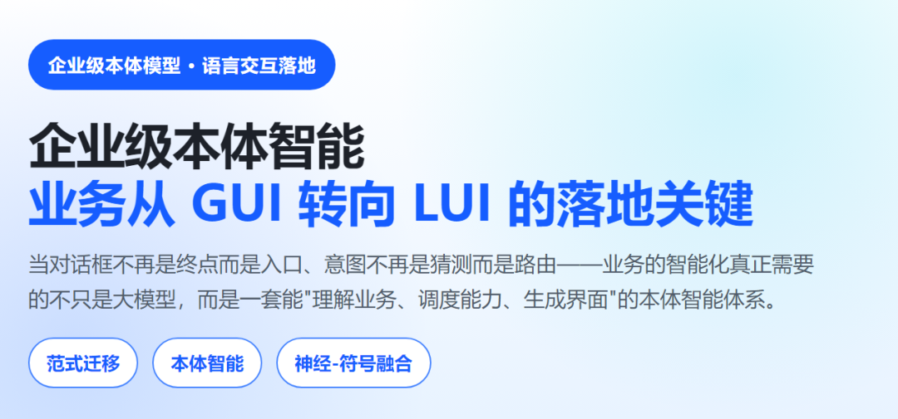

**📌 本文导读** \*\*本文摘要：\*\*业务从 GUI 转向 LUI，不是把界面换成聊天框，而是一次系统结构的重构。本文从范式迁移的被低估之处切入，系统论述本体智能的内涵、GUI→LUI 迁移的四大挑战、本体智能作为落地关键的四个维度、技术架构与工程实现、电力/银行/办公等典型场景，以及混合界面长期主导的未来趋势——核心一句话：**大模型（神经）+ 本体（符号）融合，才是企业可信 AI 的主流路线。**

过去二十年，企业级软件的设计逻辑一直围绕着复杂的菜单、多层级的表单和冗长的导航栏展开，本质上是"人适应机器"的结构化交互逻辑。然而，这种以图形用户界面（GUI）为核心的范式正在触及天花板：体验优化陷入内卷化、操作效率存在结构性瓶颈、静态界面无法适配动态个性化需求。据行业观察，知识工作者相当一部分工作时间被消耗在软件操作与跨系统导航上，构成巨大的隐性成本。

随着大型语言模型（LLM）的成熟，业界普遍预言一种从 GUI 向语言用户界面（LUI）的范式转移：让复杂的企业级操作简化为一个简单的 `Prompt`。然而，纯对话框式的交互在企业场景中迅速暴露出致命缺陷——"空白画布综合征"与认知负荷过载。要求员工通过敲击大段自然语言来执行复杂的结构化业务，是对生产力的巨大破坏。

真正的范式跃迁，并非简单地把 GUI 换成 `Chat`，而是需要一套能够桥接"自然语言的开放性"与"业务系统的确定性"的中介结构。这套中介结构，就是**本体智能**——它将业务的实体、关系、规则、行为以本体模型的形式显式化，使大模型不再面对一个"黑盒系统"，而是面对一个可理解、可推理、可调用的能力网络。本文将系统论述：为什么本体智能是业务从 GUI 转向 LUI 落地的关键，以及它如何在架构、交互、工程三个层面重塑企业软件的形态。

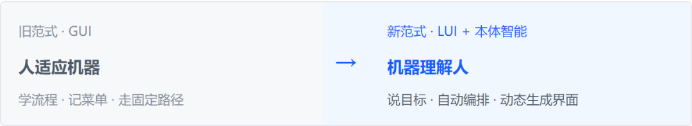

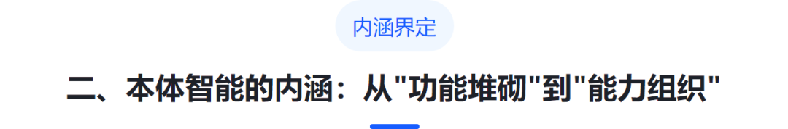

■2.1 何谓"本体智能"

2026 年 6 月，中国人工智能产业发展联盟（AIIA）联合大数据技术标准推进委员会（CCSA TC601）发布《本体智能研究报告（1.0）》，将**本体智能（Ontology Intelligence）****定义为：以****本体为语义基座**，融合**语义推理与知识计算**，使信息系统具备**深层理解、逻辑推理与行动执行能力**的一种智能范式；其概念体系为"**本体论 + 本体 + 本体建模**"三位一体。

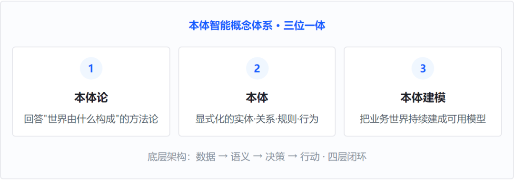

落到企业实践，在传统的"业务 + AI"嵌入式升级中，模型只是局部工具，系统仍然围绕功能模块搭建。AI 原生架构则以能力为核心，通过 `MCP`（Model Context Protocol）实现工具与数据的协议化连接，通过 `A2A`（Agent-to-Agent）支持多智能体协同，通过 `Skills` 沉淀可复用能力单元。这种"能力组织方式的重构"，本质上就是本体智能在工程侧的体现。

本体智能的核心，是用一个显式的、机器可理解的本体模型来描述业务世界：它定义了有哪些实体（合同、订单、客户）、实体之间有哪些关系、每个实体可以执行哪些行为（`COMMAND`/`QUERY`）、每个行为的输入输出约束是什么、哪些规则约束着状态变更、哪些权限控制着访问边界。当这套本体被大模型"看见"，业务系统就从一堆晦涩的 API 变成了一个有语义、有逻辑、有边界的可对话对象。

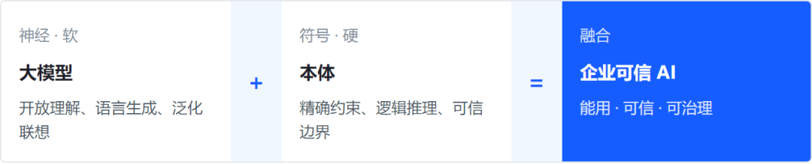

■2.2 电力工业的先行实践

电力系统作为世界上最复杂、规模最大的工业系统之一，其原生 AI 建设已经深刻体现了本体智能的思想。电力业务本体建模被视为原生 AI 体系的认知基础：通过数据资产化和统一语义建模，将分散的多源异构数据（`SCADA`、`PMU`、设备台账、检修记录、图像点云、气象地理信息等）转化为机器可理解、可推理、可调用的资源，并借助业务本体对设备对象、拓扑关系、运行约束和风险规则进行标准化描述，进一步沉淀知识图谱和规则体系。

这一实践揭示了一个关键命题：\*\*没有本体，就没有真正可信赖的智能。\*\*电力系统的高连续性、强约束、强耦合特征，决定了只有真正内生于系统运行机理的 AI，才能长期稳定发挥作用。这一逻辑同样适用于金融、制造、政务等所有高复杂度业务领域。

■2.3 本体智能的 AI 原生四维

在"三位一体"的概念体系与"数据—语义—决策—行动"总体架构之上，若从 AI 原生的落地视角观察，本体智能还可被概括为四个维度：

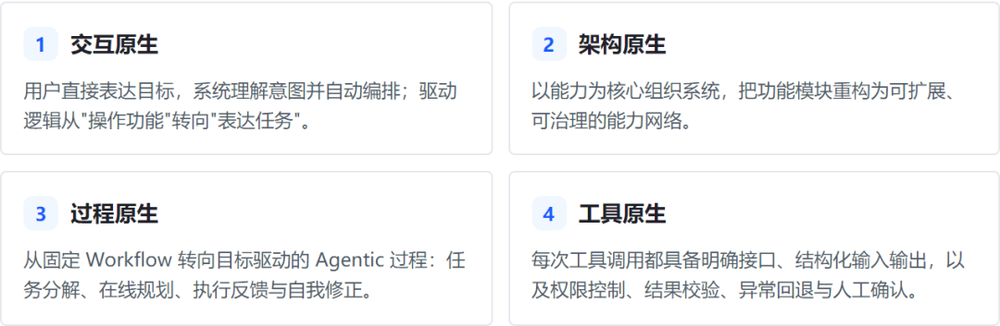

需要说明的是，这四个维度是本体智能在 AI 原生应用中呈现的"外在样态"，其内核仍是"本体论 + 本体 + 本体建模"三位一体的概念体系与"数据—语义—决策—行动"的闭环架构。它不仅是一种建模方法，更是一种系统重构哲学。

要理解本体智能为何是落地关键，必须先看清这场迁移的真正难点。用友在提出"本体智能"时，把企业 AI 落地的障碍概括为三大挑战——**语义模糊、智能体孤岛、逻辑幻觉**，它们共同构成了 LUI 落地的"语义断层"。下面从四个更具体的层面展开。

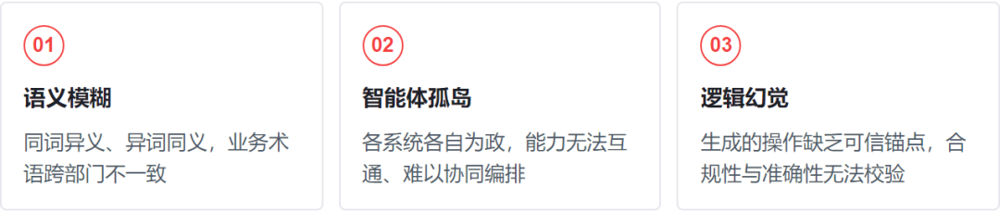

■3.1 LUI 的概率性与业务的确定性之争

GUI 是高度"确定性"的，屏幕上的按钮、日历控件定义了极其严格的边界，用户只能在系统允许的范围内操作，这种"约束"大大降低了出错率。而 LUI 是高度"概率性"和发散的，系统必须去猜测用户的真实意图。企业软件要求接近 100% 的准确率，而 LLM 仍存在幻觉风险。这种根本性的张力，使得纯对话框式交互在涉及财务转账、合同审批、生产调度等高错误成本场景中几乎不可用。

■3.2 意图路由的精确性风险

用户的自然语言表达和系统底层行为之间的语义匹配，是运行时最核心的挑战。当意图描述模糊时，系统可能路由到错误的行为，导致非预期的数据变更；在涉及写操作的场景下，这个风险尤为严重。例如，用户说"清理一下"，是指删除媒体文件还是清理数据库？这种歧义如果不能在本体层面被显式建模和消解，LUI 就只能停留在玩具阶段。

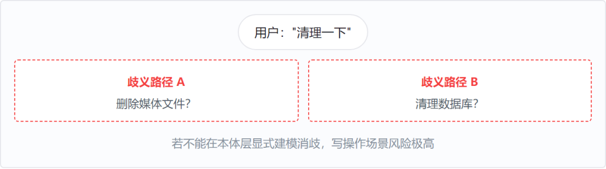

■3.3 能力可发现性的缺失

GUI 的菜单本身就是一个功能目录，它告诉用户"系统能做什么"；而 LUI 的空白输入框则像一片未知的海洋，用户不知道该说什么。这一"发现能力缺失"问题，本质上是本体没有暴露给用户：用户看不到系统的能力边界，自然无法有效地发起请求。

■3.4 结果呈现的低效性

纯文本输出格式极难承载高信息密度的数据。当要求系统比对两份上百页的合同时，AI 若只在对话框里回复一段长达两千字的文字说明，人类的阅读效率将趋近于零。这意味着 LUI 必须有能力根据任务上下文动态生成最适合的 UI 组件，即所谓的 `Agentic UI` 或生成式 UI。

面对上述挑战，本体智能提供了一条系统性路径。它不是把模型变得更聪明，而是让模型在一个"结构化的业务世界"中工作。

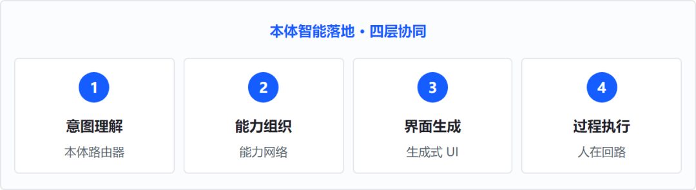

■4.1 意图理解层：本体路由器

在基于本体模型和大模型驱动的 AI 原生应用架构中，本体路由器承担着关键职责：它把识别出的意图映射到本体模型中的具体行为，加载相应的数据权限过滤规则，检查当前用户是否具备相应权限，生成执行计划。

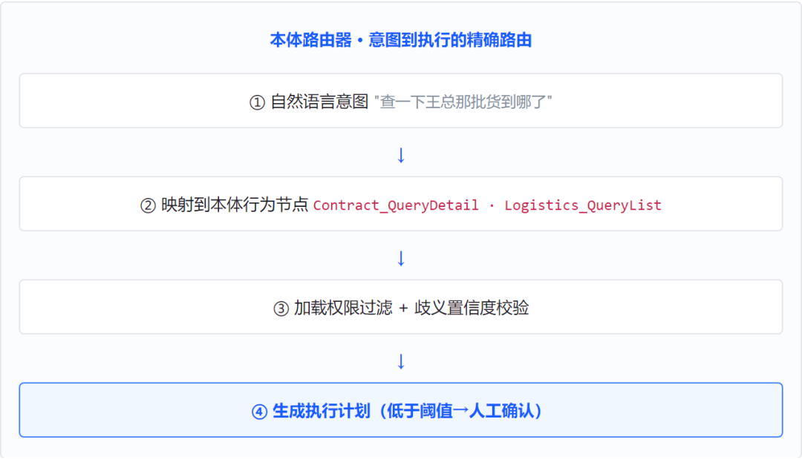

这一设计的革命性在于：意图不再是对 API 的"模糊匹配"，而是对本体内"行为节点"的精确路由。例如，用户说"查一下王总那批货到哪了"，本体路由器会识别出意图对应 `Contract_QueryDetail` 和 `Logistics_QueryList` 两个 `QUERY` 行为，而非漫无目的地搜索数据库。这种基于本体的路由机制，从根本上降低了幻觉和误操作的风险。

更进一步，本体路由器可以引入"歧义置信度"机制：对每个抽取出的实体、关系和约束标注置信度分值，低于阈值的节点强制触发人工确认流程。这种机制将"概率性的 LLM"与"确定性的业务规则"有机融合，使 LUI 在保持自然性的同时获得工程级的可靠性。

■4.2 能力组织层：从功能集合到能力网络

传统系统围绕功能模块搭建，模型只是局部工具；AI 原生架构则以能力为核心，通过 MCP 实现工具与数据的协议化连接，通过 A2A 支持多智能体协同，通过 Skills 沉淀可复用能力单元。本体智能在这一层的价值，是为这些能力提供统一的语义描述。

具体而言，每一个工具、API、RPA 脚本都被注册为本体中的一个"行为节点"，具备明确接口、结构化输入输出，以及权限控制、结果校验、异常回退机制。这就构成了一套严格的"内部动作库"（Tool Inventory）：定义 `query_inventory(sku_id)`、`apply_leave(date_range)` 这样边界清晰的工具集，限制 AI 的自由度，反而提升了业务的确定性。

华为在代理银行框架中提出的"三层技术栈"也呼应了这一思路：第一层专注客户体验，从 GUI 过渡到 LUI，依赖意图识别和长期记忆；第二层管理多智能体协作；第三层重新定义决策模型，从基于规则和结构化数据转向基于本体和知识的决策。三层结构中，本体贯穿始终，是连接体验、协作与决策的语义中枢。

■4.3 界面生成层：轻 UI 自适应响应

本体智能的第三个关键贡献，是让"生成式 UI"有了依据。在没有本体的情况下，大模型生成 UI 只能依赖对用户意图的猜测，结果往往不可控。而当本体显式定义了每个行为的结果结构后，系统就可以根据执行结果自适应地决定响应形式：结果简单就用自然语言回答；涉及列表数据就渲染数据卡片；需要确认敏感操作就弹出确认面板；存在异常就给出告警提示和建议的下一步操作。

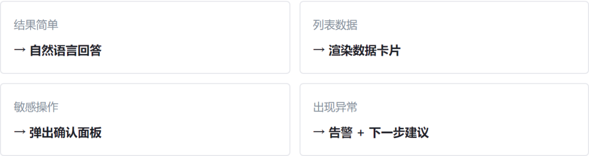

这就是 Agentic UI 的工程实现：大模型不再直接返回字符串，而是被强制要求按照预定义的 `Schema` 返回标准化的 `JSON` 数据负载，前端接收后映射到本地"原子组件库"，在对话流中即时渲染出可交互的卡片。本体模型为这种 Schema 提供了"源头活水"——每一个行为的输出结构都是本体中预先定义的，前端组件库可以与本体行为一一对应，形成稳定的渲染契约。

在这种架构下，UI 不再是主要的交互路径，而是执行结果的辅助呈现方式。用户的学习成本趋近于零——只需要用自然语言描述想做什么，系统负责找到正确的执行路径并以最合适的界面呈现结果。

■4.4 过程执行层：人在回路与可回溯

企业业务的高错误成本决定了 Agent 不能完全自主执行。本体智能通过"人在回路"（Human-in-the-loop）机制提供安全保障：在 Agent 执行关键动作前，系统会提示用户进行确认。架构准则是"**Agent 负责填表，用户负责签名**"，这极大降低了初期模型不确定性带来的风险。

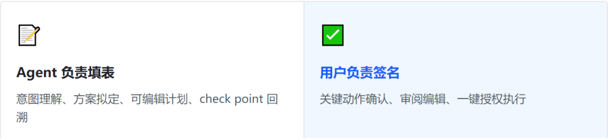

更精细的设计是"可编辑计划与 `check point` 回溯"：在 Agent 开始执行任务之前，UI 会展示其完整的行动计划，用户可以审阅、编辑、重新排序甚至取消计划中的某些步骤；通过 check point，用户可以回溯到 Agent 执行过程中的任一历史状态，并从该点开始探索不同的执行路径。这种设计之所以可行，正是因为本体模型为每一步执行提供了明确的"行为节点"和"状态变更"定义，使整个过程可监控、可回溯、可干预。

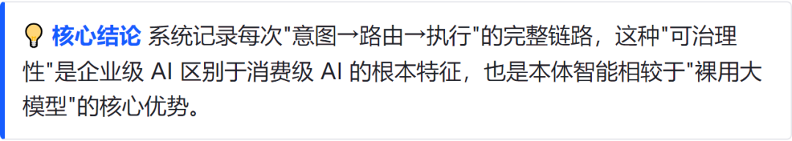

■5.1 语义网关模式：不推翻旧系统，而是加一层"翻译官"

对于绝大多数企业而言，最切实际的落地策略不是推翻旧系统，而是通过 AI Agent 在复杂的 GUI 之上构建一层 LUI。这种"语义网关"模式由三层构成：

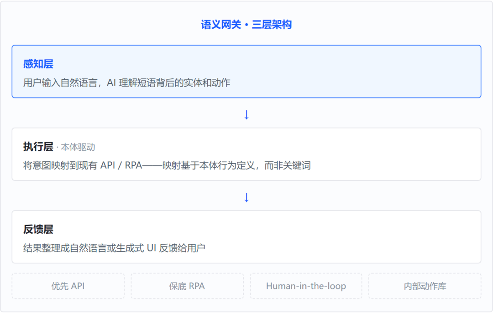

这一模式的关键技术建议包括：优先 API，保底 RPA；引入 Human-in-the-loop；构建内部"动作库"。其中"动作库"本质上就是一个轻量级的业务本体，它是语义网关能够稳定工作的语义基础。

■5.2 混合渲染：静态界面与生成式 UI 的协同

生成式 UI 并非要消灭现有的菜单和页面，而是作为一种高维度的补充。未来 ToB 软件的界面，可能不再是密密麻麻的菜单和按钮，而是一个全局的、智能的 LUI 作为最高优的交互入口，GUI 则演化为三种角色：歧义消除与能力展示区、过程的监控区、结果的呈现区。

在工程上，这要求前端开发的重心从"构建静态页面"转向"定义组件能力"。前端工程师预先构建一个"原子组件库"，每个组件对应本体中某一类行为的输出结构；大模型在运行时根据用户意图和本体路由结果，输出一段包含组件类型和 `Props` 的 JSON 描述，前端接收后即时渲染出可交互的卡片。这种"富交互组件的流式渲染"模式，已经在 `Ant Design X` 等框架中得到实践。

■5.3 模型完备性校验与增量演进

本体模型不是一次性构建完成的，它必须能够随业务演进而增量更新。AI 生成的本体模型可能存在结构缺失，例如忘记为有状态变更的行为定义事件，或者遗漏跨实体的完整性约束。应对策略是建立基于规范的模型完备性校验引擎，类似编译器的静态分析，在模型生成后自动执行一组检查规则（可由 `SHACL` 承载机器可执行的约束）。

同时，业务需求必然持续变化。当业务提出"给合同加一个审批流程"时，这涉及实体增加状态、行为增加、场景增加、权限增加的联动变更，以及已有代码的局部重生成和数据库的迁移脚本生成。因此需要建立模型变更影响分析机制，任何一个模型节点的变更都能自动推导出影响到的其他节点，生成完整的变更影响图，供人工审查确认范围。

■5.4 大小模型与智能体协同

电力工业 AI 的实践表明，大小模型与智能体协同是自适应 AI 的核心架构：大模型负责复杂语义理解、任务规划和跨系统信息整合，小模型承担潮流计算、状态评估、故障诊断和风险预测等专业分析，智能体负责流程编排、工具调用和能力调度。这一思路同样适用于一般企业级场景：大模型负责意图理解和本体路由，专业小模型负责具体的预测、分类、计算任务，智能体负责跨系统协同。

结合行业级物联底座或企业级数据中台，本体智能还可向边端延伸，形成"云侧持续学习、边端实时决策、协同可靠决策"的闭环能力体系。

Gartner 将 2025 年称为"AI 智能体元年"，并预测到 2028 年约 **33%** 的企业软件将内嵌代理型 AI、**15%** 的日常工作决策将由智能体自主完成。在这场转换里，"语义底座 + 语言入口"这条路，已经成了头部厂商不约而同的选择。

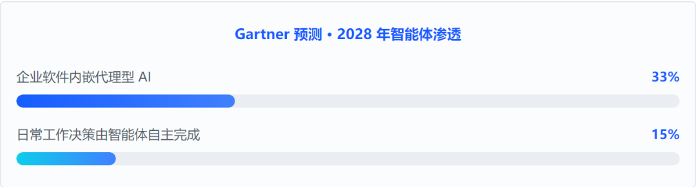

■6.1 内部系统 AI 化：从单一高频操作切入

对于内部系统 AI 化项目，最切实际的落地路径是从"多系统交叉查询与录入"这一高频痛点切入。例如销售订单状态追踪：销售人员原本需要打开 CRM 查客户 ID，再打开 ERP 查发货状态，最后去物流系统查快递位置；通过语义网关模式接入 Agent 后，销售只需输入"查一下王总那批货到哪了"，Agent 自动调用 CRM、ERP、物流接口完成全流程。

■6.2 银行业：从 80/20 法则到人人 VIP

华为代理银行框架提供了一个更高维度的案例。传统银行严重依赖 80/20 法则，即 20% 的客户创造了 80% 的利润；当智能体人工智能到来时，每个人都可以被视为 VIP 客户，超个性化服务最终将成为现实。这一愿景依赖三层技术栈协同：LUI 层依赖意图识别和长期记忆，能保留数年历史客户交互上下文；多智能体协作层使专业 AI 智能体自动协作执行复杂流程；决策模型层将资深风险管理专家数十年的经验转化为可复现的数字知识模型。本体智能在此处的作用，是把"银行业务知识"和"风险管理经验"显式化为本体模型，使 AI 的决策不再是黑盒，而是可解释、可审计、可复现的。

■6.3 电力系统：高约束下的智能原生

电力系统的原生 AI 探索，是本体智能在高约束工业场景下的极致实践。作为关键基础设施，任何智能能力引入都必须满足严格的可控要求和安全约束：需要通过规则校验、权限控制和人机协同机制，确保智能体决策始终处于可监控、可回溯、可干预的工程边界内。对电力行业而言，原生 AI 体系建设必须坚持自主可控原则，在安全架构、数据治理和模型部署等层面形成系统化保障。这一警示对所有关键基础设施行业的 AI 化都具有普适意义。

■6.4 标杆共识：LUI 是入口，本体与知识图谱是底座

跳出单一行业看，头部实践正殊途同归：

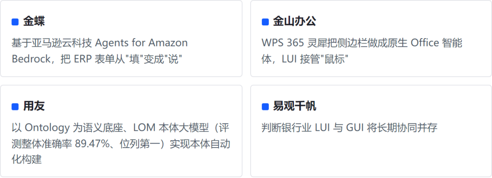

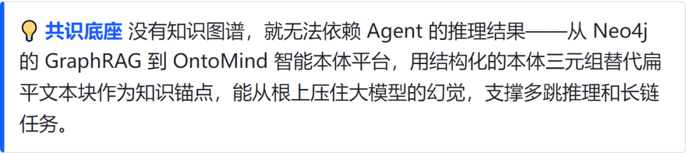

■7.1 AI 竞争核心从模型能力转向系统结构

正如深度学习之父 Geoffrey Hinton 所指出，当智能体在目标优化框架下运行，可能自然衍生"避免被关闭"的倾向；强化学习之父 Richard Sutton 认为，当下大模型本质上仍是"weak minds"，其能力主要来自人类数据训练，而非基于环境交互的持续学习。两位学者观点虽有差异，却共同说明：未来竞争的关键，不在单一模型上限，而在智能系统的组织方式。本体智能正是这种"系统组织方式"的核心——它不是让模型变得更聪明，而是让模型在一个结构化的业务世界中工作，使智能能力既能持续演进，也始终服务于业务的可靠运行。

■7.2 混合界面将长期主导

站在 2026 年的当下回望，绝大多数成功的商业化 AI 产品，依然是"GUI 主体 + LUI 能力层"的结构。纯 Chat 没能一统天下，原因在于模型局限、客户诉求、商业规律和心理门槛四重制约。未来三个趋势值得期待：**Prompt 会被"结构化"**，长篇大论的咒语最终会被封装成 GUI 里的小组件或预设按钮；**Chat 会"隐身"**，LUI 会化作水和电，无缝嵌入日常工作流；**UI 将变成"监督层"**，不再为输入指令而设计，而是为监督结果、纠正偏差和一键确认而设计。这三个趋势的共同基础，正是本体智能。

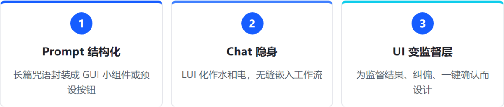

■7.3 从"人适应机器"到"机器理解人"

这场范式迁移的终极意义，在于重新定义人与机器的关系。传统 GUI 体系的底层逻辑是结构化、标准化、机器优先，人类被迫学习操作流程、适应界面层级、遵循固定路径；新一代 LUI + 生成式 UI 的底层逻辑是自由化、个性化、人优先，机器主动理解人类自然表达、适配人类思维习惯、根据人类需求动态构建服务形态。这不是简单的产品升级，而是人机交互文明的根本性范式迁移——而本体智能，正是这场迁移能够"落地"而非"空转"的关键。

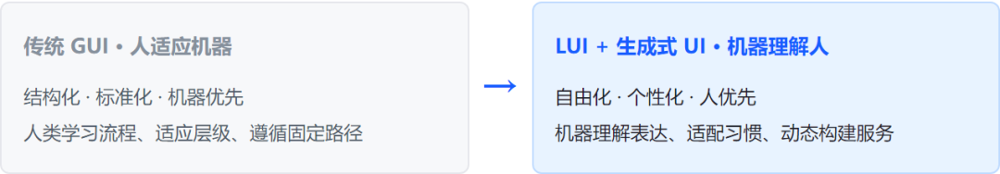

业务从 GUI 转向 LUI，不是一次界面的替换，而是一次系统结构的重构。在这场重构中，大模型提供了"理解"的能力，Agent 提供了"执行"的能力，生成式 UI 提供了"呈现"的能力，但真正让这三者能够在一个真实业务世界中协同运转的，是本体智能——它把业务的实体、关系、规则、行为显式化为一个机器可理解的本体模型，使意图有路由、能力有组织、界面有依据、过程有边界。

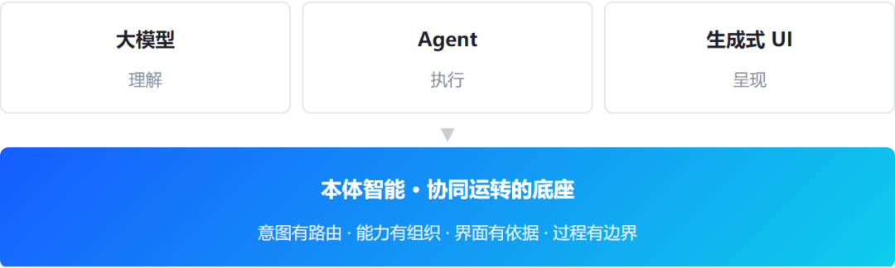

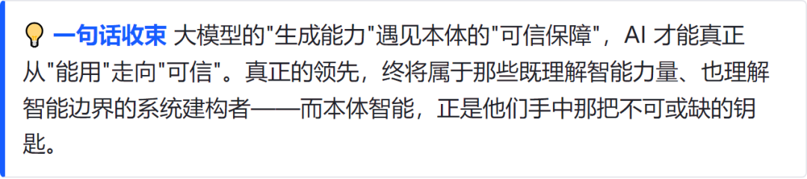
