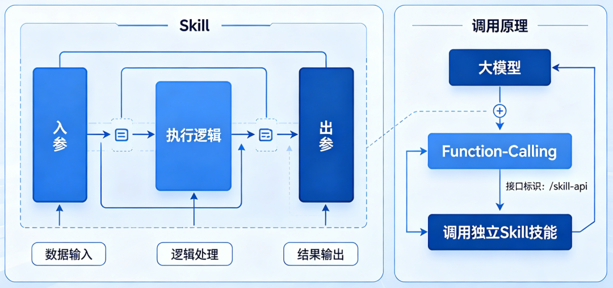
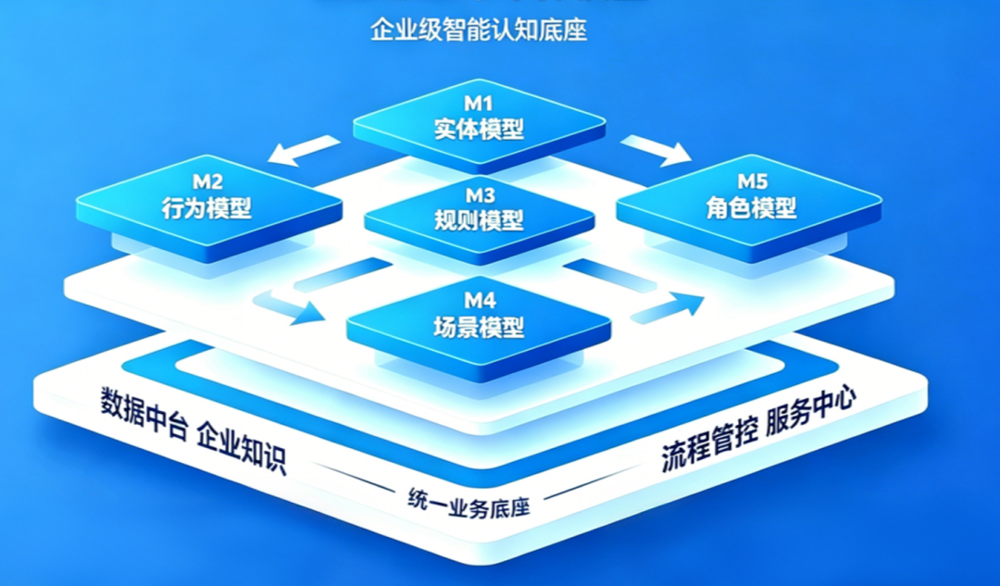
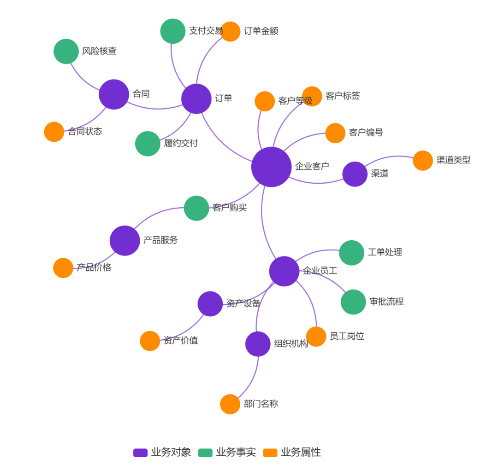
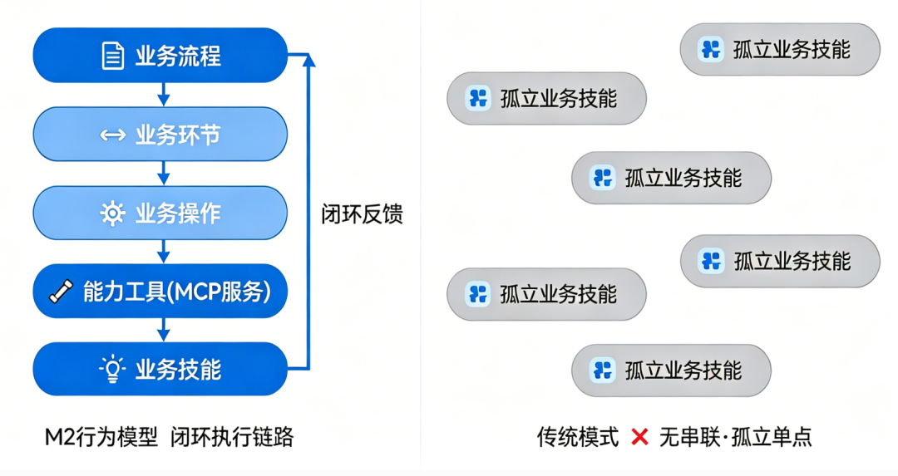
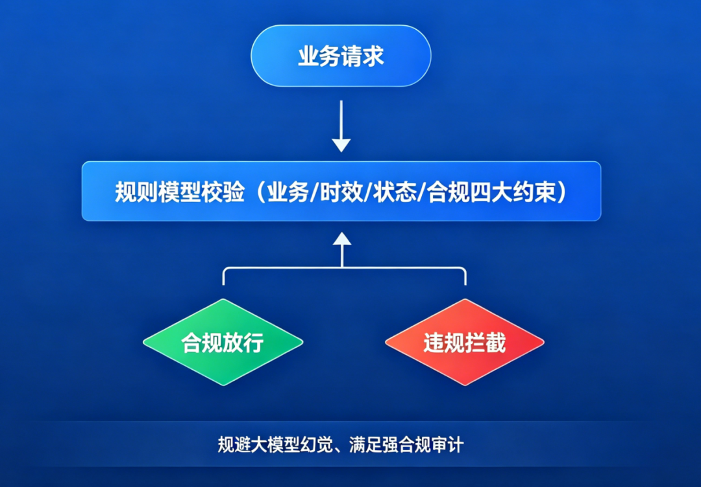

# 本体智能 | 企业级本体模型 VS Skills—企业数智化架构落地选型

> **来源**：微信公众号「华力江海」
> **作者**：华力江海
> **发布日期**：2026-05-29
> **原文**：[点击查看](https://mp.weixin.qq.com/s?__biz=MzcxMDMyNTI4MQ==&mid=2247483743&idx=1&sn=7b9396c681fc5e4607f7c65236aec4e2&chksm=f519a411c26e2d07378e92adf1896a33823ae836d7fb1d67a445c231ba047ce8b7fb4789b2db#rd)
> **系列**：本体智能系列

为支撑企业智能应用的标准化构建、场景化落地与灵活复用调用，当前企业数字化团队始终面临核心选型难题：到底该采用轻量化、适配互联网生态的Skills工具体系，还是依托重标准化、强业务适配的企业级本体模型搭建智能底座？

答案其实非常清晰：Skills是互联网通用场景的最优解，而企业级本体模型，才是能源、金融、政务等强合规、强业务、高复杂行业的终极架构，也是企业级智能架构中用来全面替换Skills的核心方案。

Skills凭借跨平台通用性、跨应用集成灵活性，完美适配互联网轻量化、快迭代、无强业务约束的场景；但落地到大型企业复杂核心业务，纯Skills体系的短板会被无限放大。本文将聚焦企业级五维本体模型 VS Skills能力体系核心差异，讲清为什么企业级数智化架构必须用本体模型替换Skills，最后结合电网营销实战案例落地佐证。

## 01 核心概念：两种范式，适配完全不同的场景

### 1. Skills能力体系：互联网轻量化通用工具



Skills是人工封装的原子化工具能力，依托大模型Function-Calling机制实现调用，是互联网产品AI落地的主流方案。每个Skill对应一项独立、固定的执行动作，仅定义调用入参、出参和简单执行逻辑，技能之间相互独立、无业务关联、无规则约束、无流程编排能力。

✅ 核心优势（互联网专属）：具备极强的跨平台通用性、跨应用集成能力，轻量化、易部署、迭代快，无需业务建模，适配互联网产品快速试错、轻量化交互、通用化集成的业务特点。

❌️ 核心短板（企业级致命缺陷）：无语义认知、无业务逻辑、无合规规则、无流程体系，只能机械执行单一动作，无法自主推理、无法场景泛化、无审计溯源能力，完全不满足大型企业强合规、复杂业务、闭环管控的落地要求。

### 2. 企业级本体模型：行业专属全域业务智能认知大脑



企业级五维本体模型是专为大型企业复杂业务、合规管控、智能推理打造的全域结构化业务知识底座，摒弃传统晦涩架构，采用贴合实战的五维闭环设计，完整覆盖业务认知、能力执行、合规风控、场景编排、权限安全全维度，是支撑大模型实现企业级自主推理、自主流程编排、合规可控落地的核心架构。

五大模型各司其职、闭环联动，从根源解决Skills体系的所有企业级落地痛点：

### M1 实体模型—业务全景“数据语义底座”



统一建模企业全域业务实体、属性与语义关联，包含企业客户、业务资源、经营数据、审批工单、风险核查任务、业务账号等核心对象，定义客户-归属-业务场景、工单-关联-客户、核查-校验-业务数据等标准化业务关系。让大模型真正读懂企业通用业务逻辑，彻底解决Skills“不懂业务、只懂调用”的问题。

### M2 行为模型—标准化业务“能力执行中枢”



作为替换零散Skills能力的核心执行体系，标准化定义五大核心要素：业务流程、业务环节、业务操作、能力工具（MCP服务）、业务技能（原子级Agent），自上而下形成完整、规范、可编排、可复用的企业级业务执行闭环，彻底替代Skills零散、无序、孤立的工具调用模式：

① 业务流程：定义企业标准化顶层闭环业务链路，如经营风险核查、业务合规处置、流程隐患排查等完整业务流程，明确企业级业务闭环标准；

② 业务环节：对顶层流程标准化拆解，拆分出数据采集、风险校验、等级判定、工单下发、结果归档等规范作业环节；

③ 业务操作：每个环节对应的最小原子执行动作，是业务落地的基础单元，替代传统零散Skill单点动作；

④ 能力工具（MCP服务）：底层企业级统一底座，负责跨系统接口调度、数据拉取、资源统筹，屏蔽异构系统差异，实现企业内部全域能力打通，远超Skills单一跨应用集成能力；

⑤ 业务技能（原子级Agent）：场景化智能执行单元，封装完整流程、环节、操作逻辑，可独立完成企业级复杂场景闭环作业，具备自主执行、自主校验、自主闭环的智能能力，是Skills工具的智能化升级形态。

简言之：M2行为模型以标准化企业级业务体系，全方位替代零散Skills工具体系，实现从“被动工具调用”到“主动业务智能执行”的升级。

### M3 规则模型—合规风控“红绿灯”



内置企业专属业务公理、硬性约束与推理规则，包含业务约束、时效约束、状态互斥约束、合规底线约束，如“款项未结清不可执行闭环操作”“业务数据异常需触发核查流程”“工单必须完整闭环归档”等，从源头规避大模型幻觉、违规操作，满足大型企业强合规、强审计的核心要求，这是无规则、无约束的Skills体系完全不具备的能力。

### M4 场景模型—复杂业务“编排剧本”

场景模型依托实体模型、行为模型与规则模型的底层能力沉淀，固化企业各类复杂业务的标准化流程范式，支持大模型自主拆解业务目标、动态重组执行步骤，无需人工硬编码适配场景变化，可灵活适配企业多元化、组合式的经营、风控类复杂场景，从根源上解决Skills体系场景泛化能力弱、复杂业务依赖人工编码适配的核心痛点。

### M5 角色模型—数据安全“权限锁”

依托角色模型搭建企业级细粒度权限管控体系，精准界定一线业务人员、风控人员、运维管理人员的操作与用数边界，从源头杜绝跨权限、跨场景违规操作、越权用数等风险，全方位筑牢企业数据安全与业务合规底线，有效补齐Skills体系无权限管控、无安全约束的核心企业级漏洞。

## 02 核心差异硬核对比：企业级本体模型 VS Skills

二者的核心差距，本质是互联网通用轻量化架构与行业企业级标准化智能架构的代差，从业务认知、执行体系、规则推理、场景能力、合规性全方位拉开差距：

| **对比维度** | **Skills能力体系** | **企业级本体模型** |
| **适配场景定位** | 互联网通用场景，主打跨平台、跨应用轻量化集成，无复杂业务、无强合规要求 | **大型企业核心场景，适配复杂业务、强合规管控、闭环审计、全域协同作业** |
| **业务认知能力** | **无业务实体、无语义关系，仅为抽象工具函数，完全不懂行业专属业务逻辑** | **M1实体模型全覆盖企业业务对象与关联关系，大模型具备完整行业业务认知** |
| **能力执行体系** | **零散原子工具，无流程、无环节、无层级，能力孤立无序，仅支持单点调用** | **M2五维标准化行为体系，流程、环节、操作、MCP底座、原子Agent全闭环，可自主编排联动** |
| **规则推理能力** | **无原生业务约束、无行业公理，合规靠大模型脑补，无因果推理、冲突检测能力** | **M3内置企业级硬核规则，支持跨域演绎、因果关联、冲突校验，合规前置可控** |
| **场景泛化能力** | **仅支持预设调用或人工硬编码组合，新场景必须新增Skill，无法自主生成业务流程** | **M4支持自主流程重组，可变复杂场景无需改造底层能力，即可自主适配执行** |
| **合规与可追溯性** | **无权限管控、无业务溯源，操作链路无记录，不满足企业审计监管要求** | **M5细粒度权限管控，全链路推理、执行可追溯、可解释、可审计** |
| **企业级适配性** | **极低，仅适合轻量化通用交互，无法支撑企业复杂生产、经营核心业务** | **极高，专为企业级复杂业务、合规管控、长期迭代设计，可全域赋能基层用数** |

## 03 优劣势深度拆解：为什么企业必须用本体替换Skills？

### 1. Skills体系：互联网好用，但企业级完全不够用

✅ 核心优势（仅限互联网场景）

- 跨平台通用性强，适配各类互联网应用、小程序、轻量化产品集成；
- 跨应用集成灵活，无需复杂建模，快速对接各类通用系统；
- 接入成本低、单点响应快，适配互联网快速迭代、轻量化交互需求。

❌️ 核心劣势（企业级致命短板）

- 无业务语义认知，工具之间孤立无关联，复杂业务极易出现步骤错乱、无效调用；
- 无合规约束、无行业规则，大模型推理易出现违规操作，触碰企业安全生产、合规经营红线；
- 无自主编排能力，所有复杂组合场景必须人工硬编码，迭代成本极高、扩展性极差；
- 无溯源、无解释性，完全不满足企业审计、监管、追责的闭环要求。

### 2. 五维本体模型：牺牲部分轻量化，换来企业级全能力升级

✅ 核心优势（企业级专属价值）

- 具备完整行业业务认知，告别Skills“盲人操作”，大模型可基于业务目标自主拆解复杂任务；
- 标准化行为体系彻底替代零散Skills，实现企业业务执行的规范化、智能化、可复用化；
- 规则+权限双重前置管控，从源头杜绝违规操作，适配大型企业强合规、强监管的核心诉求；
- 支持跨实体、跨维度复杂推理，适配风险稽查、隐患排查、业务合规核查等企业级复合业务场景；
- 全链路可追溯、可解释，完美匹配企业安全生产、审计监管体系。

❌️ 相对劣势

- 前期需要业务+技术协同建模，初期落地成本高于纯Skills快速搭建；
- 复杂任务需经过语义校验、规则推理、流程编排，响应速度略慢于单点Skill调用。

但对于所有重合规、重安全、重稳定、重闭环的大型企业场景，轻量化、快迭代的优先级，远低于合规性、稳定性、智能化、可管控性，本体模型的劣势完全可以被长期价值覆盖。

## 04 实战场景：高下立判的落地差距

我们以企业通用客户经营合规风险核查场景为落地案例，同时结合多技能代码实操对比，直观展示互联网多Skills碎片化架构与企业级本体智能架构的本质落地鸿沟：

### 1. Skills模式落地效果

人工封装5项完全独立、互不关联的Skill工具：查询客户基础信息、查询业务流水数据、核查异常操作日志、查询信用合规状态、生成风险预警通知。所有技能单独开发、单独调用，彼此无业务关联、无逻辑联动、无统一调度。

业务致命痛点：多Skills体系下所有技能相互孤立、信息割裂，大模型仅能实现单点逐一调用，无法自主联动多维度数据、无法推理多技能组合的复合型风险场景；无法自主完成“多维度数据采集→综合风险研判→分级预警→结果归档”全业务闭环；无企业级合规规则沉淀，所有组合判断、业务流程均需人工硬编码拼接；每新增一项核查维度，就需要新增独立Skill并改写业务代码，迭代成本极高、完全无法适配企业复杂多变的合规风控场景。

### 2. 本体模型落地效果

- M1实体层：统一建模企业客户、经营流水、操作日志、信用档案、风险任务等全域业务实体与语义关联，打通多维度数据壁垒，让AI完整理解客户合规核查全业务逻辑；
- M2行为层：依托MCP企业统一能力底座，整合所有零散工具能力，标准化定义合规核查全流程、作业环节与原子操作，封装通用客户合规核查原子Agent，彻底替代多技能孤立调用、人工拼接的Skills模式；
- M3规则层：固化企业通用合规风控推理规则，实现多维度数据综合研判、风险自动分级、违规操作自动拦截，规则全局沉淀、可复用可审计；
- M4场景层：支持大模型自主拆解多维度核查步骤、重组业务流程，新增核查维度无需新增工具、无需人工编码，自主适配复杂风控场景；
- M5角色层：配置细粒度人员权限与业务管辖边界，杜绝越权核查、跨客户数据调取，筑牢企业数据安全与业务合规底线。

最终效果：彻底解决多Skills碎片化、孤立化、硬编码的痛点，AI可自主完成多维度经营合规风险的全链路智能研判、流程编排、合规校验与闭环执行，具备可解释、可追溯、可复用、可泛化的企业级能力。

### 3. 核心代码实现对比

### Skills模式：孤立调用、智能体编排

整个Skills架构由5个完全独立、互不依赖、无业务联动的业务技能组成，每个技能单独封装、单独部署、单独调用，彼此无数据互通、无逻辑关联，完美体现碎片化架构特征，各技能独立代码如下：

Skill 1：查询客户基础信息（独立技能）

```
def get_customer_basic_info(customer_id: str) -> dict:
    """Skill1：独立技能-查询客户基础信息"""
    return {
        "customer_id": customer_id,
        "customer_type": "enterprise",
        "register_time": "2024-01-15"
    }
```

Skill 2：查询客户业务流水数据（独立技能）

```
def query_business_flow_data(customer_id: str) -> dict:
    """Skill2：独立技能-查询客户业务流水数据"""
    return {
        "customer_id": customer_id,
        "monthly_flow": 12600,
        "flow_fluctuation_rate": 0.52
    }
```

Skill 3：核查客户异常操作日志（独立技能）

```
def check_customer_operation_log(customer_id: str) -> dict:
    """Skill3：独立技能-核查客户异常操作日志"""
    return {
        "customer_id": customer_id,
        "abnormal_operation_times": 5,
        "latest_operation_time": "2026-04-28"
    }
```

Skill 4：查询客户信用合规状态（独立技能）

```
def query_customer_credit_status(customer_id: str) -> dict:
    """Skill4：独立技能-查询客户信用合规状态"""
    return {
        "customer_id": customer_id,
        "credit_level": "B",
        "has_dishonest_record": True
    }
```

Skill 5：生成客户风险提醒通知（独立技能）

```
def generate_risk_notice(customer_id: str, risk_level: str) -> str:
    """Skill5：独立技能-生成客户风险提醒通知"""
    return f"【{risk_level}风险预警】客户{customer_id}存在经营合规异常，请及时核查处置"
```

多Skill组合业务执行（智能体编排）

```

```

```python
# 智能体编排模式（纯Skills架构）：无业务模型、无固化规则，仅靠Prompt指令机械调用技能
# 核心痛点：智能体无法自主理解业务，只能按照预设提示词串行调用孤立Skill
# 所有业务逻辑、组合条件、执行顺序，完全依赖人工prompt约束，无自主推理能力
def agent_risk_check_orchestrate(customer_id: str):
    """
    纯Skills架构下智能体编排逻辑
    智能体无业务认知，仅根据人工预设指令逐一点位调用独立技能
    """
    # 人工固定编排执行顺序，智能体无法自主调整、无法动态重组
    base_info = get_customer_basic_info(customer_id)
    flow_data = query_business_flow_data(customer_id)
    op_log = check_customer_operation_log(customer_id)
    credit_status = query_customer_credit_status(customer_id)
    # 风险判断规则人工写死在编排代码中，无全局沉淀、不可复用
    if (flow_data["flow_fluctuation_rate"] > 0.4
        and op_log["abnormal_operation_times"] >= 4
        and credit_status["has_dishonest_record"]):
        return generate_risk_notice(customer_id, risk_level="high")
    else:
        return generate_risk_notice(customer_id, risk_level="normal")
if __name__ == "__main__":
    # 智能体被动执行人工编排逻辑，无自主业务决策能力
    cust_id = "CUS2026052901"
    result = agent_risk_check_orchestrate(cust_id)
    print(result)
# 本质痛点：
# 1. 所有Skill依旧完全孤立，智能体仅做简单调用拼接，无业务关联认知
# 2. 风险规则、流程顺序全部依赖人工硬编码/prompt定义，无规则沉淀
# 3. 新增核查维度、新增Skill，必须重新编排改写代码，无法自主泛化迭代
# 4. 无合规校验、无流程溯源，属于“工具堆砌式编排”，并非真正业务智能
```

### 本体模式：统一语义+标准化行为+智能推理

```python
# 1. MCP底层企业级能力底座：统一整合所有工具能力，替代零散独立Skill接口
def mcp_customer_base_query(customer_id: str):
    """MCP统一调度客户基础信息查询"""
    return get_customer_basic_info(customer_id)
def mcp_business_flow_query(customer_id: str):
    """MCP统一调度业务流水数据查询"""
    return query_business_flow_data(customer_id)
def mcp_operation_log_query(customer_id: str):
    """MCP统一调度操作日志核查"""
    return check_customer_operation_log(customer_id)
def mcp_credit_query(customer_id: str):
    """MCP统一调度信用状态查询"""
    return query_customer_credit_status(customer_id)
# 2. 本体实体建模：沉淀标准化业务对象与语义关系，打通数据壁垒
class BusinessOntologyEntity:
    def __init__(self, entity_type, props):
        self.entity_type = entity_type
        self.props = props
# 3. 企业级规则固化（本体全局沉淀，无需反复人工硬编码）
def customer_compliance_risk_rule(flow_data: dict, op_log: dict, credit_data: dict) -> str:
    """企业通用客户合规风险分级推理规则（可全局复用、迭代更新）"""
    if flow_data["flow_fluctuation_rate"] > 0.4 and op_log["abnormal_operation_times"] >= 4 and credit_data["has_dishonest_record"]:
        return "high"
    return "normal"
# 4. 原子级业务Agent（M2行为模型落地：统一编排多维度能力，替代零散Skills）
class CustomerComplianceInspectAgent:
    def __init__(self, customer_id):
        self.customer_id = customer_id
        # 统一调用MCP底座能力，无需单独对接零散Skill
        self.base_info = mcp_customer_base_query(customer_id)
        self.flow_data = mcp_business_flow_query(customer_id)
        self.op_log = mcp_operation_log_query(customer_id)
        self.credit_data = mcp_credit_query(customer_id)
    def auto_risk_inspect(self):
        # 本体自主多维度推理、自动风险分级、全流程闭环执行
        risk_level = customer_compliance_risk_rule(self.flow_data, self.op_log, self.credit_data)
        return generate_risk_notice(self.customer_id, risk_level)
# 企业级全自动智能执行，新增业务维度仅需更新本体规则，无需新增Skill、无需改主流程
if __name__ == "__main__":
    agent = CustomerComplianceInspectAgent("CUS2026052901")
    print(agent.auto_risk_inspect())
```

## 05 最终落地结论：企业级数智化架构，必然是本体替换Skills

通过全文对比，我们可以得出一个明确的行业结论：Skills与企业级本体模型不存在融合互补，而是场景替代关系。

1. Skills的精准定位：互联网轻量化通用工具

Skills的核心价值是跨平台通用性、跨应用快速集成，适配互联网产品轻量化、快迭代、无强业务约束、无严格合规要求的通用场景，是互联网AI落地的最优选择。

1. 企业级本体的精准定位：行业复杂业务智能底座

能源、金融、政务等大型企业，核心诉求是业务标准化、合规可控、推理智能、全程可追溯，轻量化、无逻辑、无约束的Skills体系完全无法满足企业级核心需求。

1. 终极落地范式

在企业级大模型智能架构中，须完成本体模型对传统Skills体系的全面替换：以本体M1-M5五维体系为核心，用MCP底层能力、标准化业务行为、原子级场景Agent，彻底替代零散、无序、不可控的Skills工具调用模式，真正实现大模型从“工具调用”向“业务自主智能”的企业级升级。

## 06 写在最后

很多企业AI落地踩坑，本质是用互联网的轻量化Skills架构，去承载企业的重业务、重合规场景。适配场景错了，再灵活的工具都是无用功。唯有以企业级本体模型为核心，重构标准化、智能化、合规化的业务执行体系，才能让大模型真正扎根企业核心业务，赋能基层高效、安全、智能用数。
