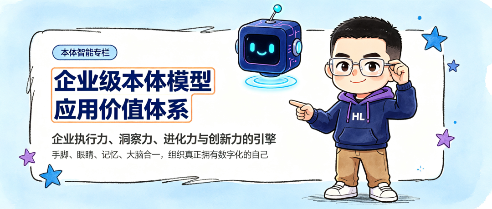

# 本体智能 | 企业级本体模型应用价值

> **来源**：微信公众号「华力江海」
> **作者**：华力江海
> **发布日期**：2026-09-11
> **原文**：[点击查看](https://mp.weixin.qq.com/s?__biz=MzcxMDMyNTI4MQ==&mid=2247485970&idx=1&sn=7d90b666146a5d35f41e3dfd4c0c1aaa&chksm=f519af5cc26e264a2d97c5844f29905c30b418ce33bdc1170f53487c5fcd188a52c6de013ce4#rd)
> **系列**：本体智能系列

**本体智能 · 应用价值**

**企业级本体模型**应用价值

**执行|洞察|进化|创新的引擎**

企业级本体的价值，不在于建了一个更聪明的知识库，而在于它同时是企业执行力的载体、洞察力的中枢、进化力的容器与创新力的引擎——手脚、眼睛、记忆、大脑合一，组织才真正拥有"数字化的自己"。

**数字员工** **跨业务分析** **技能固化** **AI4S**

**📌 本文导读** \*\*本文摘要：\*\*从"知识库"到"组织数字化身"，企业级本体的价值是一条由浅入深的递进链：数字员工让流程自己会跑（手脚·效率），跨业务分析算清一本总账（眼睛·洞察），节点深化决策把经验资产化（记忆·复利），AI4S 让组织自己生产知识（大脑·创新）。四层价值共享同一个底座——对象、规则、行动三类本体要素。本文将逐层拆解四层价值的机理、落地与边界，并给出由浅入深的实施路线图。

### 总论

## 01 为什么是本体：从"知识库"到"组织数字化身"

### 1.1 知识库解决了"找得到"，却解决不了"用得上、用得对"

先看一张总览图——企业级本体的四层价值如何围绕同一个底座生长：

企业级本体模型1数字员工流程自动流转手脚 · 效率（快）价值一2跨业务分析LCC·根因追溯眼睛 · 洞察（深）价值二3技能固化经验资产化记忆 · 复利（久）价值三4AI4S发现新机理大脑 · 创新（新）价值四同一底座 · 三类本体要素                            对象 · 统一语义规则 · 规则前置行动 · 行动封装数据通（统一语义）→ 行为信（规则前置）→ 结论落（行动封装）

过去十余年的数字化进程中，绝大多数企业把"知识管理"理解为建设知识库：把制度文件、操作规程、历史案例、专家经验收集起来，放到一个可检索的平台上。知识库解决了"找得到"的问题，却始终没有解决两个更本质的问题——**"用得上"和"用得对"**。

知识库里的知识是**静态的**。一段设备检修规程被收录进系统，它不会自己判断当前哪台设备处于告警状态；一份故障案例被编入档案，它不会自动出现在下一次同类故障的研判现场；一位老师傅总结的缺陷处理经验被电子化，却仍然只存在于文档里，无法变成可执行的动作。企业投入大量成本建设知识库，得到的往往是一个"更大的书架"，而不是一个"更聪明的组织"。

**01**

### 知识是静态的

规程、案例、经验被收录，却不会自己"发生作用"。

**02**

### 无法执行

知识只存在于文档里，变不成可执行的动作。

**03**

### 不可推理

知识没有结构，机器无法沿语义去检索、推理、执行。

**04**

### 更大书架

投入越多，得到的越像一个"更大的书架"。

### 1.2 本体不是知识库的替代品，而是语义层与执行层

企业级本体模型的提出，正是为了跨越这道鸿沟。本体不是知识库的替代品，而是知识库之上的**语义层与执行层**：它把碎片化的知识组织成一张有结构的网——对象是什么、属性有哪些、对象之间什么关系、业务上有哪些规则、规则如何编排成流程、流程又如何落成可执行的动作。更重要的是，这张网不是给人读的，而是**给机器读的**：智能体可以沿着本体定义的语义结构去检索、去推理、去执行。

**💡 核心结论** 由此，企业数字化的对象发生了根本转变：过去我们建设的是"信息化的系统"，今天我们要构建的是"数字化的自己"——一个能够替人干活、替人看清因果、替人沉淀经验、甚至替人发现新知识的组织实体。

本价值体系讨论的"本体"，特指**企业级业务本体**：以业务对象、属性、关系、规则、流程、动作为核心要素，面向具体业务场景构建、与业务系统数据打通、可支撑智能体运行的工程化本体模型。它区别于学术意义上的通用本体研究，也区别于单纯的文档级知识图谱，它强调的是**能够被智能体调用、能够在业务流程中产生确定性行为的可运行资产**。

### 1.3 一条价值递进链：手脚 · 眼睛 · 记忆 · 大脑

企业级本体的应用价值，最容易被误读为"并列的若干功能"。实际上，围绕本体展开的典型应用场景之间存在清晰的递进关系——它们不是四件并列的事，而是一条**价值递进链**，对应着企业四种核心能力从"人身上"向"模型上"的迁移：

| **层级** | **典型场景** | **迁移能力** | **价值性质** |
| 价值一 | 数字员工：流程自动流转 | 手脚 · 执行力 | 效率（快） |
| 价值二 | 跨业务分析：LCC、根因追溯 | 眼睛 · 洞察力 | 洞察（深） |
| 价值三 | 节点深化决策 + 技能固化 | 记忆 · 进化力 | 复利（越用越值钱） |
| 价值四 | AI4S：发现新机理新模型 | 大脑 · 创新力 | 发现（新） |

这条链的递进逻辑清晰而深刻：

\*\*第一步，先让 AI 替人干活（价值一）。\*\*这是最低门槛、也最容易被验证的价值。业务规则明确、流程路径清晰的重复性工作，交给数字员工自动流转，把人的时间从"跑流程"中释放出来。此阶段解决的是"快不快"的问题。

\*\*第二步，再让 AI 看见人看不见的因果（价值二）。\*\*当数据以设备为锚点被语义统一之后，分散在采购、运检、财务、物资等系统里的信息被重新关联起来，全寿命周期成本、跨专业根因、供应链责任评价等过去算不清、追不到的分析成为可能。此阶段解决的是"深不深"的问题。

\*\*第三步，让组织在干活和看见的过程中不断变聪明（价值三）。\*\*深化分析产生的结论经过业务人员确认后固化下来，形成可复用的技能资产。老师傅的经验第一次有了载体、版本和生命周期，不再随人走、随人老。此阶段解决的是"值不值"的问题——知识开始产生复利。

\*\*第四步，最终让组织自己发现未知的新知识（价值四）。\*\*当本体承载了足够的对象、关系、规则和历史数据，它就编织出一张可穷举的分析路径网络。大模型沿路径批量挖掘数据规律，在设备可靠性、故障研判等领域发现新的机理与模型，并经确认后回写本体。此阶段解决的是"新不新"的问题——组织从消费知识走向生产知识。

### 1.4 价值体系的统一底座：同一个"因"

四个价值场景表面上看分属执行、分析、决策、科研四个领域，但深入拆解会发现，它们底层依赖完全一致——这正是"为什么是本体"的答案所在。四个价值共享同一个"因"，这个"因"由三类本体要素构成：

✦

**对象要素 · 统一语义**　数字员工要跨系统流转、LCC 要跨专业归集、深化分析要跨数据推理、AI4S 要跨路径挖掘规律——四者都要求"同一套业务语言"。

✦

**规则要素 · 规则前置**　四层价值都需要"可信"。规则不是事后校验，而是事前拦截、事中管控——自动流转不能违规、评价体系口径一致、深化决策可解释可复核、科学发现可复现可验证。

✦

**行动要素 · 行动封装**　价值不止于"分析出结论"，而在于"结论能落成动作"。深化分析"确认后固化技能"、AI4S"发现后沉淀模型"，都依赖这一前提。

三类要素共同回答了"为什么是本体而不是其他技术"：因为只有本体同时具备**语义的统一性**（让数据讲同一种语言）、**规则的确定性**（让机器行为可信可约束）和**行动的可执行性**（让结论能变成动作）。这三个特性，恰好对应了智能体落地过程中的三大痛点：数据不通、结果不可信、分析不落地。

**价值一 · 效率**

## 02 数字员工：让业务流程自己会跑

### 2.1 价值定义：把"流程知识"变成"可执行能力"

**一句话定义**：基于本体，把"流程知识"变成"可执行能力"——让业务流程按照本体定义的标准自动流转，数字员工自主完成从感知到执行的全链路任务，实现效率价值（快）。

**业务画像**：任何一个企业里都存在着大量"规则明确、步骤固定、重复发生"的业务流程：设备缺陷的登记与流转、检修工单的派发与闭环、告警的初判与上报、报表的生成与核对。过去这些流程依赖人工逐环节推动，人的注意力、工作节奏和交接效率成为流程的瓶颈。数字员工要解决的问题，就是把这些流程从"人推着走"变成"系统自己走"。

**价值锚点**：效率价值的本质不是"快一点点"，而是**流程响应时间的量级跃迁**。从人工处理的小时级、天级，压缩到智能体处理的分钟级、秒级；同时把人的精力从流程执行中解放出来，投入到需要判断力和创造力的工作中去。

**💡 数字员工的三位一体** \*\*本体定标准、大模型做决策、智能体执行业务。\*\*本体负责"懂业务"（业务操作系统），大模型负责"会思考"（认知引擎），智能体负责"能干活"（执行机构）。

| **组合** | **短板** |
| 只有大模型、没有本体 | 脱缰野马——能说会道但不懂业务边界，回答随意、不可信、不落地 |
| 只有本体、没有智能体 | 沉睡知识库——结构再清晰也没有人把它变成动作 |
| 只有智能体、没有规划能力 | 盲人摸象——能干零散活，但不知道整体流程该怎么走 |

### 2.2 自动流转的机理：行为、流程、规则三类要素

为什么只有本体能支撑业务流程的自动流转？拆开来看，自动流转需要回答三个问题：\*\*有什么活可干？活按什么顺序干？干的过程中受什么约束？\*\*本体中的三类要素恰好一一对应：

▪ **行为要素**：定义"有哪些业务动作"。例如故障上报、缺陷登记、工单派发、检修执行、缺陷销号——每一个动作都有明确的输入、输出和责任人定义。

▪ **流程要素**：定义"动作怎么编排成流程"。行为要素是零件，流程要素是装配图——它规定动作的前后顺序、并行关系、分支条件和回退路径。

▪ **规则要素**：做前置校验与过程管控。例如"三级缺陷必须 24 小时内派工""检修完成后必须附试验报告才能销号"——规则在动作发生之前拦截违规，在动作进行中约束行为。

### 感知

→

### 认知

→

### 决策

→

### 执行

→

### 反馈

💡 三类要素合起来，一个自然语言指令或异常事件，才能触发完整的"感知—认知—决策—执行—反馈"全链路闭环。

以电网设备故障处理为例：设备故障智能体按照本体定义的"故障上报→研判→派工→检修→销号"流程，自主完成全流程任务推进。感知层接收监测告警，认知层结合本体语义理解故障含义，决策层依据规则判定响应级别，执行层调用业务系统完成派工与跟踪，反馈层将处理结果回写台账——全程无需人工干预。

### 2.3 触发方式的变革：从"人发现"到"事件发生"

数字员工带来的一个常被忽略、却极具价值的深层变化，是**流程触发方式的变革**。

在传统模式下，任何业务流程的起点都是"人发现"：巡检员发现缺陷、调度员发现告警、班组长发现异常——然后由人发起流程。这意味着流程的响应速度受制于人的发现速度，而人的注意力是稀缺的、有盲区的。

在本体驱动的模式下，流程的起点变成了"事件发生"：监测数据入库这个业务事实本身，就能通过本体中的"规则触发"关系自动驱动研判链路。数据到了，研判就开始了；阈值超了，处置就启动了。流程的启动不再依赖有人看见，实现了真正意义上的"无人值守"形态。

**✅ 变革的意义** 流程响应时间不再受人的注意力周期约束，而只受数据产生周期约束。过去是"巡检到才发现，发现到才处理"，现在是"数据一变化，处置即开始"。

### 2.4 数字员工的组织化管理：全生命周期运营

数字员工区别于"软件工具"的质变，在于它可以被**组织管理**——它进入了组织的人力资源管理体系。一个数字员工拥有与人类员工类似的完整生命周期：

| **阶段** | **数字员工操作** |
| 招聘 | 创建数字员工模板，定义岗位职责与能力要求 |
| 上岗 | 为数字员工挂载能力（技能、工具、数据权限） |
| 评估 | 双向评分、贡献量化，衡量数字员工的业务产出 |
| 进化 | 随业务变化挂载新技能、更新规则 |
| 退岗 | 闲置下线、资产留存，经验不丢失 |

组织化管理带来一个深远的结果：**发账号、绑岗位、圈边界，授权、追责、审计的逻辑，在数字员工身上与在人类员工身上完全复用**。数字员工不再是一个游离于管理体系之外的"工具"，而是组织编制中的一个"岗位实体"——它干没干活、干得对不对、权限边界在哪，都清晰可查。

### 2.5 反向闭环：执行数据的三个回流

数字员工的价值不是单向消耗，而是**越用越有价值**——关键在于执行数据的反向闭环。数字员工每执行一次任务，都会产生执行数据，这些数据沿三条路径回流：

➤ **反哺大模型（优化推理）**：执行过程中的成功经验与失败案例进入大模型的优化回路，让后续的意图理解与推理更贴合业务实际。

➤ **沉淀本体资产（扩充知识）**：执行中发现的新场景、新规则、新关系经确认后写入本体，让本体资产随使用而增长。

➤ **优化资源能力（迭代技能）**：执行效果反馈到技能库，驱动技能的迭代优化，让技能库中的每个技能都越来越"趁手"。

这三条回流路径的意义在于：**执行数据不白流**。每一次数字员工的作业，都在为系统下一轮的更好表现积累素材。这正是"数字员工"与"自动化脚本"的本质区别——自动化脚本的价值随时间衰减（环境一变就要返工），而数字员工的价值随时间增长（执行越多，本体越厚，技能越精）。

### 2.6 对照价值：没有本体的智能体是"零散工具的拼接"

为了更清楚地说明本体的必要性，我们做一个对照实验：在没有本体的条件下建设智能体，会得到什么？答案是"零散工具的拼接"——智能体可能拥有若干孤立的能力（能查台账、能算指标、能生成报告），但——

**01**

### 技能孤立

每个技能只知道自己的一亩三分地，互相之间没有语义关联。

**02**

### 不懂流程逻辑

不知道"先研判后派工、先检修后销号"的顺序约束，可能跳过必要环节。

**03**

### 无法跨环节闭环

单点能力再强，也无法自主完成从告警到销号的全链路。

**04**

### 合规无保障

没有规则前置校验，智能体的每一步动作都没有"边界检查"，出错后也难以追责。

对照实验的结论很直接：没有本体的智能体，是"能干活但不会干对活"的智能体；有了本体的智能体，才是"知道该干什么、按什么顺序干、受什么约束"的智能体。本体的价值，恰恰体现在那些看不见的地方——它让智能体的每一次动作都有语义依据、有流程顺序、有规则约束。

### 2.7 典型落地：综合研判多步骤自动闭环

以变电设备健康综合研判场景为例，可以直观看到价值一的完整形态：值班人员发现某台主变压器在线监测数据存在告警后，向数字员工下达综合研判指令。数字员工随即进入自主作业状态：

**1**

### 意图识别

理解并拆解指令

→

**2**

### 本体检索

获取对象规则动作

→

**3**

### 任务规划

规划多阶段计划

→

**4**

### 按步执行

查询台账监测数据

→

**5**

### 规则研判

气体异常增长分析

→

**6**

### 输出报告

故障判定与检修建议

整个过程从"人工逐环节查询、逐条对照规程"的耗时模式，转变为"指令下达、自动执行、报告直出"的分钟级模式。效率价值的兑现，不在于某一个环节变快了，而在于**整条链路的响应时间被系统性压缩**。

### 2.8 价值一的适用边界：三个问题快速筛选

价值一不是万能的，明确它的适用边界，反而能让投入产出比更高。判断一个流程是否适合建设数字员工，可以用三个问题快速筛选：

▪ \*\*第一，流程是否"规则明确"？\*\*流程的每一步是否有清晰的判定标准？"缺陷三级以上必须上报""检修完成须附试验报告"这类规则明确的流程，适合数字员工；而"根据现场情况酌情处理"这类依赖模糊判断的环节，则不宜强行自动化。

▪ \*\*第二，流程是否"高频重复"？\*\*数字员工的建设有固定成本（建模、联调、测试），只有高频重复的流程才能摊薄这些成本。每天发生几十次的流程，才是优先场景。

▪ \*\*第三，流程是否"数据可达"？\*\*流程依赖的数据是否都能通过系统获取？如果关键数据仍依赖人工线下传递，数字员工就会在数据断点处"卡壳"。

| **特征** | **适合数字员工** | **暂缓建设** |
| 规则 | 明确、可枚举 | 模糊、依赖现场判断 |
| 频次 | 高频、重复 | 低频、偶发 |
| 数据 | 系统可达、质量可控 | 线下传递、质量不可控 |
| 责任 | 合规要求明确的标准化动作 | 需要人工签批与主观裁量的环节 |

**💡 本节小结** 价值一是四层价值中最先落地、最容易见效的一层，但它的成功建立在"场景选得准、边界划得清"之上。以"规则明确、高频重复、数据可达"为选型铁律，价值一就能稳健起步，为后续三层价值奠定数据与流程基础。

**价值二 · 洞察**

## 03 跨业务分析：算清一本"总账"

### 3.1 传统 BI 做不到的事

如果说价值一解决的是"流程快不快"，那么价值二解决的是"分析深不深"。而这一层价值，恰恰是本体最容易被低估的部分——因为它解决的是**传统 BI（商业智能）根本做不到的事**。

传统 BI 的分析框架建立在"系统分账、年度统计"的基础上：采购系统算采购账，财务系统算财务账，运检系统算运行账，物资系统算库存账。每个系统都有自己的数据口径、编码体系和统计维度。当企业试图回答一个跨系统的问题——"一台设备从购入到报废，到底花了多少钱？""这台设备的故障，到底是设计问题还是运维问题？"——传统 BI 就无能为力了：数据散落在不同系统里，口径不一致，编码不统一，根本无法在"设备"这个粒度上对齐。

本体给出的解法完全不同：**先统一语义，再关联数据**。本体中的对象要素把分散在采购、财务、运检、物资等不同系统里的数据，通过"设备"这个统一对象锚点关联起来。数据还是那些数据，系统还是那些系统，但因为有了共同的语义锚点，原本割裂的数据被编织成一张以设备为中心的关联网络——分析就不再受限于单个系统的边界。

**💡 一句话概括价值二** **把全生命周期数据变成"一本总账"**。这"一本总账"不是财务意义上的合并报表，而是以业务对象为纲、以全生命周期为时间轴的统一数据视图——任何跨业务的分析问题，都能在这张视图上找到答案。

### 3.2 对象要素：统一语义锚点

对象要素是价值二的基石。所谓"设备为锚"，指的是在本体模型中，"设备"不再只是某个系统中的一条记录，而是被定义为具有完整语义的业务对象：

▪ **对象身份**：设备名称、电压等级、设备型号、厂家、批次、投运日期、关键部件构成等属性；

▪ **对象关系**：设备与资产的从属关系、与运维记录的操作关系、与缺陷工单的关联关系、与备件消耗的消耗关系；

▪ **对象数据连接**：对象属性与各业务系统数据表字段的映射关系，让本体对象"看得见"真实数据。

有了这层锚定，同一台设备的采购记录、技术协议、投运试验、缺陷工单、故障停运、维护成本、备件消耗等数据，才能跨越系统边界被统一归集。没有这层关联，LCC 就只能"按系统分账、按年度统计"，永远算不出一台设备的真实全寿命成本。

### 3.3 全寿命周期成本（LCC）五段归集

全寿命周期成本（Life Cycle Cost，LCC）是价值二最典型的落地场景。一台设备的成本不是一个时间点的采购价，而是从购置到报废全过程中的成本总和。本体按五大段归集设备全寿命周期成本：

| **成本段** | **包含内容** | **归集难点** |
| 初始投资 | 购置费、安装建设费 | 分布在采购、财务、工程系统 |
| 运维成本 | 操作、维护、巡视、检测 | 分布在运检、生产管理系统 |
| 检修成本 | 例行检修、消缺、试验、大修 | 分布在检修计划、工单系统 |
| 故障处置成本 | 抢修费、损失费 | 分布在应急、财务系统 |
| 报废成本 | 处置收入、处置成本 | 分布在物资、资产系统 |

五段成本跨越五个以上业务系统，只有通过本体把各系统中的数据归集到"设备"对象之下，才能计算出一台设备的真实全寿命成本，进而实现全站设备资产 LCC 总评估，并输出随时间变化的价值曲线——设备资产的价值不是静态的，而是在购置、使用、老化、处置过程中动态变化的，LCC 曲线让这种变化清晰可见。

### 3.4 根因追溯与各方评价体系

LCC 只是"算清账"，价值二更深的层面是**追根因、评各方**——这是传统管理模式的又一个盲区。

以设备厂家、型号、批次、关键部件为统一分析对象，关联采购记录、技术协议、投运试验、缺陷工单、故障停运、维护成本、备件消耗和同类设备历史表现，可以形成面向全生命周期的设备选型画像。沿着本体关系链回溯，一个故障可以一路追溯到它的责任源头：

➤ 缺陷数据回流后，可以区分\*\*"设计缺陷"**（设备设计本身存在缺陷）、**"制造缺陷"**（生产制造环节质量问题）与**"运维不当"\*\*（运行维护环节操作问题）；

➤ 同类设备的故障模式横向对比，可以定位是某厂家、某型号、某批次的**系统性问题**，还是个别设备的偶发问题；

➤ 运维成本与检修成本的归因分析，可以评价**运维厂商的服务质量**与检修策略的合理性。

由此，设计方、供应商、运维厂商等各方的评价体系，第一次建立在**同一份数据、同一套口径**之上。过去"设备出了问题各说各话"的局面，被"数据说话、关系链归因"取代——评价不再是主观印象的博弈，而是可追溯、可复核的事实呈现。

### 3.5 选型画像与采购准入

根因追溯的成果，最直接地反哺到采购环节，形成"选型画像"与"采购准入"机制：

▪ **设备选型画像**：将设备厂家、型号、批次的历史表现（缺陷率、故障率、运维成本、可用率）聚合成选型画像，让采购决策不再依赖厂家自述与短期价格；

▪ **采购准入评分**：基于历史表现数据输出采购准入评分，对高风险厂家、型号、批次实施准入限制；

▪ **候选方案排序**：在同类设备中，按全寿命周期成本与可靠性指标对候选方案排序，为采购决策提供量化依据。

**✅ 深层价值** 这一机制的深层价值在于：**历史缺陷经验第一次能够回流采购**。过去，"设备一旦被选入，风险不是消失，而是被带入后续数年的运行检修技改阶段"。选型画像让采购决策从"一次性价格比较"升级为"全生命周期综合判断"，从源头降低设备的全寿命成本。

### 3.6 三类传统管理模式的无解问题

| **无解问题** | **本体解法** |
| 历史缺陷经验难以回流采购 | 对象锚点打通采购-运检，缺陷数据回流选型画像 |
| 同类设备选型缺少统一对比依据 | 统一语义口径，同类设备同尺度对比 |
| 采购、运检、技术评价口径不一致 | 同一份数据、同一套规则、同一套评价体系 |

这三类问题有一个共同根源：**数据语义不统一**。本体的价值就在于从根本上消除这个根源——不是靠一次数据治理项目，而是靠对象要素把语义统一固化在模型层，随业务演进持续维护。

### 3.7 从"算清账"到"管好资产"

价值二的最终价值表述，可以升华为八个字：**从"算清账"到"管好资产"**。

采购决策由此从"一次性价格"转向"兼顾可靠性、维护性和全寿命周期成本"的综合判断。设备资产管理也从"被动应对故障"转向"主动经营资产"——每一笔运维投入、每一次检修安排，都有了成本视角与长期视角的双重依据。

### 3.8 价值二建设的四个常见误区

◈ **误区一：把价值二当成"数据中台建设"来立项。****价值二的核心不是搬数据、建数仓，而是建语义——对象锚点、关系链、口径规则。正确做法是****语义先行、数据随后**：先在本体层定好对象与口径，再有针对性地打通数据。

◈ \*\*误区二：追求"全量全口径"的完美账本。\*\*LCC 分析的价值在"比较"而不在"绝对精确"——先选一类重点设备、先打通五段成本的主干口径，跑通分析闭环，再逐步扩展。闭环优先于完美。

◈ \*\*误区三：根因追溯"归因过度"。\*\*归因必须建立在证据充分的基础上——数据缺失、样本不足时强行归因，会得出误导性结论。正确做法是：**归因必带证据置信度**，证据不足时明确标注"待补充数据"。

◈ **误区四：评价体系"一建了之"。****设备的技术水平、运维模式、供应商结构都在变化，评价指标与口径必须随业务演进定期修订。建议建立评价体系的****年度评审机制**。

**💡 本节小结** 价值二的建设本质是"语义工程 + 数据工程 + 分析工程"的三合一。避开学错对象、拒绝完美主义、守住归因边界、保持体系活力，价值二就能从"算清账"稳步走向"管好资产"。

**价值三 · 复利**

## 04 节点深化决策 + 技能固化：经验资产化

### 4.1 人机协同进化的最小闭环

价值一让流程自动流转，价值二让数据跨域贯通，这两层解决的是"现有知识的高效使用"。而价值三触及了一个更本质的问题：**组织如何把正在发生的优秀实践，变成可以复用的组织能力？**

答案藏在"节点深化决策"这个看似不起眼的场景里。业务流程由一个个节点构成——缺陷登记、等级确认、方案审批、结论认定。这些节点往往是业务专家经验最集中的地方：老师傅凭多年积累，能在几分钟内判断一个缺陷该定什么等级、该采取什么处置。这种判断，既不完全来自规程条文（规程给的是原则），也不完全来自数据（数据给的是事实），而是来自经验与规则的融合。

**💡 价值三的完整形态是一个四步闭环** **业务人员下达指令 → 智能体展开深化分析 → 业务人员确认 → 分析逻辑固化技能**。这个闭环实现了"人机协同进化"的最小单元：机器辅助人做深度分析，人对结果负责并确认，确认后的优秀逻辑沉淀为技能。每一轮闭环，都是组织知识的一次增量——这就是复利价值（越用越值钱）的来源。

### 4.2 规则要素：可执行、可解释、可复核

节点深化决策之所以能成立，前提是本体中的规则要素把专家经验变成了**可执行、可解释、可复核**的机器逻辑——而不是一条模糊提示。

以缺陷定级为例。传统模式下，缺陷等级判定依赖人工经验：看一眼缺陷描述，凭经验定一个等级。这种判定的问题是：经验不可见、标准不统一、结论难复核。在本体驱动模式下，规则要素把定级逻辑结构化：逻辑层读取检验项目、规格上下限、偏差幅度、缺陷类型、物料关键性、历史质量记录等输入，输出"一般、严重、重大"等等级结论，同时给出——

▪ **影响范围**：该缺陷可能影响哪些设备、哪些业务；

▪ **处置建议**：建议采取的处理措施与时限；

▪ **审批边界**：哪些动作不允许自动执行、必须进入人工审批。

**可执行**（机器能按它干活）、**可解释**（每一步都有依据可讲）、**可复核**（任何结论都能回溯到输入与规则）——这三个特性，是把"专家经验"从人脑迁移到模型的前提。没有规则要素的显式建模，深化决策就只是大模型的"自由发挥"，既不保证正确，也无法沉淀复用。

### 4.3 "深化分析指令"四步闭环详解

**1**

### 业务人员下达指令

基层人员用自然语言描述深化分析需求，系统通过意图理解解析需求，依托本体模型拆解任务、规划分析流程。智能体自主规划引擎支撑自定义流程——业务人员不写代码、不画流程图，用自己的语言就能驱动深度分析。

**2**

### 智能体展开深化分析

智能体按本体规则开展链式推理。以线损异常分析为例：发现"线损率异常"后，智能体依次关联抄表数据、排除已报停用户、锁定疑似窃电用户——每一步推理都有数据支撑、都有规则依据，全流程可解释、可追溯。变压器故障研判从两三个小时压缩至分钟级。

**3**

### 业务人员确认

分析结果不是直接生效的"黑盒结论"，而是带证据、带路径的"白盒报告"。业务人员复核证据链与推理路径后确认结果。这一步保证了"机器分析、人来把关"——机器提供效率与广度，人提供经验与责任。

**4**

### 固化技能

确认后的分析逻辑沉淀进个人技能库。基层人员结合岗位经验与本地业务特点，基于本体标准自定义技能，实现"千人千策、按需赋能"。这一步，把一次性的优秀分析，变成了可持续复用的组织能力。

### 4.4 技能固化的价值跃迁

"固化"这一步的价值，怎么强调都不过分。对比传统模式与本体驱动模式：

**传统模式下**，辖区知识、专家经验只能活在老师傅的脑子里——他休假，业务质量就波动；他调走，知识清零。组织的知识积累与个人高度绑定，知识的稳定性与组织的稳定性一样脆弱。

**本体驱动模式下**，技能库让这些知识第一次有了载体、版本和生命周期：

▪ **载体**：经验从"人脑"迁移到"技能库"，不再随人走；

▪ **版本**：技能可以迭代更新，旧版本可追溯、可对比；

▪ **生命周期**：技能有创建、使用、优化、退役的完整过程，资产化管理。

"一百种自主定制技能"的真正含义，不是一百个功能开关，而是**一百份被资产化的辖区经验**——每一份都是业务人员长期积累的分析智慧的结晶，每一份都能脱离原创者独立运转。组织的知识从此有了"存储介质"。

### 4.5 公私双层结构：企业给底座，基层盖房子

技能库建设面临一个天然的张力：技能既要"统一可控"，又要"百花齐放"。解决这个张力的，是"公私双层"结构：

### 公

### 企业公共资产池

保证下限——统一的口径、统一的权限、统一的规则基础。公共池中的技能由企业统一维护，确保任何人在任何时候使用，结论口径都不乱、权限边界都不破。

### 私

### 个人技能沉淀区

释放上限——每个业务人员、每个班组、每个辖区都可以在公共底座之上，沉淀自己个性化的分析技能。

这个结构的最佳比喻是：**"企业给底座，基层盖房子"**。企业提供统一的地基与规范（对象标准、规则基础、权限框架），基层在自己的地盘上盖个性化的房子（辖区技能、专业技能、个人技能）。公共底座保证系统不乱，个人空间释放创新活力——两者缺一不可。

### 4.6 自演进飞轮：越用越聪明的代谢系统

价值三的最终形态，是一个**自演进飞轮**：

### 规则沉淀本体

→

### 本体生成 Skill

→

### 智能体使用 Skill

→

### 使用中自演进优化

💡 优化后的规则再次沉淀回本体，开启下一轮循环。叠加执行数据反哺大模型、沉淀本体资产、优化技能库三条回流路径，企业就获得了一个"越用越聪明"的代谢系统。

### 4.7 技能库治理机制

技能库是价值三的载体，而任何资产库都需要治理——技能库尤其如此，因为技能同时具有"知识属性"与"代码属性"：它是业务经验的结晶，也是可执行的分析逻辑。治理不到位，技能库会从"资产池"退化为"垃圾场"。

▪ \*\*第一要务是质量分级。\*\*并非所有技能都值得进入公共池。建议按成熟度将技能分为三级：试用级（个人沉淀、未经充分验证，仅个人空间可见）、发布级（经业务专家确认、多次使用有效，进入专业共享区）、标准级（高频使用、验证充分、纳入培训，进入企业公共池）。

▪ \*\*第二要务是生命周期管理。\*\*技能有创建、使用、优化、退役的生命周期。长期闲置的技能提示归档，效果下降的技能提示复审，被新技能替代的技能提示退役。技能库要"有进有出"，而不是只进不出。

▪ \*\*第三要务是依赖管理。\*\*技能通常引用公共资产池中的对象、规则与其他技能。当被引用的规则更新时，依赖它的技能必须重新验证——建议在技能元数据中显式记录依赖关系，规则更新时自动触发依赖技能的"重验证"提示。

▪ \*\*第四要务是安全与合规。\*\*技能可能涉及敏感数据与关键决策，必须建立访问控制与审计机制：谁能创建技能、谁能发布技能、谁能使用技能、技能执行过什么操作，全部留痕可查。

**💡 本节小结** 技能库的价值不在"数量多"，而在"质量好、用得对、管得住"。质量分级守住底线，生命周期管理保持活力，依赖管理防止失真，安全审计守住合规——四者齐备，技能库才能真正成为企业知识的"复利引擎"。

**价值四 · 创新**

## 05 AI4S：让组织自己生产知识

### 5.1 从"消费知识"走向"生产知识"

前三层价值解决的，都是"如何更好地使用已有知识"：让流程跑得更快（价值一），让分析看得更深（价值二），让经验存得更牢（价值三）。而第四层价值触及了一个全新的维度——**知识的生产**。

AI for Science（AI4S）近年来在基础科研领域引发了广泛关注：AI 辅助蛋白质结构预测、材料性质发现、药物分子设计……其共同特征是：**让机器在海量数据中发现人类尚未总结出的规律**。企业级本体将这一范式引入业务领域，形成了 AI4S 的企业形态：不是研究"宇宙的规律"，而是研究"自己业务世界的规律"——设备为什么以这种方式劣化？故障为什么呈现这种模式？数据背后隐藏着什么关联？

**💡 第四层形态的本质** 让组织从"消费知识"走向"生产知识"。前三层是存量知识的经营，第四层是增量知识的创造。一个能自己发现新知识的组织，才真正拥有了"大脑"——它不再只回答已知的问题，而是开始提出并回答未知的问题。

### 5.2 分析路径网络：可穷举、可组合

AI4S 在企业场景落地，最关键的机制是**分析路径网络**。本体把业务知识结构化之后，天然形成一张可穷举、可组合的分析路径网络：

▪ **对象要素锚定研究客体**：要研究什么——设备、部件、故障、工况，对象要素把研究范围界定清楚；

▪ **规则要素约束分析口径**：按什么规则分析——健康指数如何计算、状态如何判定，规则要素把分析标准锁定；

▪ **行动要素封装分析动作**：有哪些分析动作可用——比值分析、趋势分析、特征提取，行动要素把分析能力组织起来。

三者组合，就生成了海量的数据分析路径：对象 A 的数据 × 规则 B 的算法 × 动作 C 的组合，就是一条分析路径；换一个对象、换一组规则、换一种动作，又是一条新的路径。穷举这些组合，就得到一张覆盖业务知识空间的分析路径网络。

| **维度** | **传统研究模式** | **AI4S 模式** |
| 路径 | 假设—验证，逐条试错 | 沿分析路径网络批量挖掘 |
| 并行度 | 人脑一次只能并行少数几条 | 同一批数据同时沿数百条路径展开 |
| 可复现 | 依赖研究者记录 | 每条路径结果可复现、可对比、可归因 |
| 发现概率 | 走得很深但走得很窄 | 广度与深度同时提升，发现概率数量级上升 |

### 5.3 设备可靠性、故障研判等领域的落地

**设备可靠性领域**：从海量缺陷、停运、检修记录中挖掘失效模式与可靠性规律。传统可靠性分析依赖专家设定的失效模式清单——清单之外的失效模式，是分析盲区。AI4S 让机器沿分析路径自主组合工况、环境、负载、检修史等多维数据，发现尚未被认识到的劣化机理——例如某种特定工况组合下，某类部件的劣化速度显著异于常规，而这种组合过去从未被纳入分析维度。新发现的劣化机理，反过来可以反哺检修策略优化与选型评价更新。

**故障研判领域**：跨越台账、试验、在线监测等多源数据组合分析，发现新的故障特征与诊断模型。传统诊断模型基于已知故障类型设计特征量——未知的故障特征，模型无法捕捉。AI4S 沿本体路径对多源数据进行大规模组合分析，可能发现新的故障特征量——例如某两个监测指标在特定工况下的联合异常，比任一单指标更能预示某类故障。这些新特征可以固化进诊断模型，让"经验判断"升级为"数据发现"。

**✅ 共同逻辑** 两个领域的共同逻辑是：**机器负责"广撒网"（批量挖掘潜在规律），专家负责"深收网"（验证与确认真规律）**。AI4S 不是取代专家，而是把专家的注意力从"逐个试"解放出来，集中在"判断哪些发现是真的"。

### 5.4 发现—验证—沉淀—再发现

AI4S 的成果要真正成为组织的资产，必须走完一个完整闭环：**发现—验证—沉淀—再发现**。

| **💡 发现**  AI 沿分析路径挖掘数据，输出候选规律——包括统计上显著的关联、异常模式、新特征组合等。 |
| **💡 验证**  业务专家对候选规律进行验证——在业务上是否合理？在物理/机理上是否可解释？在样本外数据上是否稳定？验证通过者进入下一步。 |
| **💡 沉淀**  验证通过的新机理、新模型、新规则回写本体——新增规则、关系或模型，成为本体资产的组成部分。 |
| **💡 再发现**  沉淀后的新知识扩充了本体，分析路径网络随之扩展，下一轮的挖掘拥有更厚的底座、更多的路径——开启新一轮发现。 |

### 5.5 AI4S 与前三层的关系：互相喂养的增强回路

AI4S 不是与前三层并列的独立功能，而是站在前三层之上的自然延伸：

▪ **手脚干出数据（价值一）**：数字员工的持续作业，产生了海量真实执行数据——这是 AI4S 的原料；

▪ **眼睛看清关联（价值二）**：跨业务分析打通的数据关联，为 AI4S 提供了语义对齐的数据底座；

▪ **记忆留住经验（价值三）**：沉淀的规则与技能，为 AI4S 提供了可组合的分析路径；

▪ **大脑发现新知（价值四）**：在数据、底座、路径齐备之后，组织才具备发现新知识的能力。

反过来，AI4S 的成果回写本体后，又让前三层更聪明：新机理让数字员工的研判更准（价值一升级）、新模型让跨域分析更深入（价值二升级）、新规则让技能库更厚实（价值三升级）——**四层价值由此形成互相喂养的增强回路**。这也回答了"先做什么、后做什么"的问题：正确的建设顺序，永远是"先手脚、再眼睛、后记忆、终大脑"。

### 5.6 AI4S 的边界与审慎原则

AI4S 开启了知识生产的新范式，但正因为它的产出是"新知识"，它带来的风险也不同于前三层——前三层的错误是"做错已知的事"，AI4S 的风险是"把未知的巧合当成规律"。因此，AI4S 的建设必须伴随审慎原则。

### 边界一：统计相关不等于业务因果

凡进入业务决策的新规律，必须经过机理层面的可解释性审查——能解释为什么的规律才可沉淀，解释不了的只能作为候选线索继续观察。

### 边界二：数据范围决定结论边界

每条发现的元数据中必须记录其数据范围（设备类型、时间区间、工况条件），应用时严格限定在该范围内，跨范围使用需重新验证。

### 边界三：发现的速度不能超过验证的能力

限制并发发现的数量，让发现速度与验证能力匹配——慢一点，稳一点，避免"待验证垃圾山"。

### 边界四：新知识不能绕过既有治理

机器发现的知识没有"免检通道"——它比人工经验更需要验证，因为机器不会为错误负责，而组织必须。

**审慎原则的总结**：AI4S 的边界不是"少做"，而是"规范地做"。可解释性审查守住因果底线，数据范围记录守住外推边界，速度匹配守住验证质量，知识治理守住变更规范——四条审慎原则齐备，AI4S 才能从"实验室里的兴奋"变成"可托付的组织能力"。

### 统一之因

## 06 价值体系的统一之因：同一个底座

四层价值场景各有各的业务语言：数字员工讲流程语言，LCC 分析讲成本语言，深化决策讲规则语言，AI4S 讲规律语言。但它们的底层，都需要同一个前提——**同一套业务语言**。这背后，是三类本体要素构成的统一底座。

| **要素** | **解决什么** | **对应痛点** |
| 对象要素 · 统一语义 | 数据通不通——讲同一种语言 | 数据不通 |
| 规则要素 · 规则前置 | 行为信不信——可信可约束 | 结果不可信 |
| 行动要素 · 行动封装 | 结论落不落——封装为动作 | 分析不落地 |

当"设备"在采购系统、运检系统、财务系统、物资系统里被统一为同一个语义对象时：价值一的智能体才能跨系统流转——它查到的台账、监测、试验数据，都是"同一台设备"的数据；价值二的账才能对得上——一台设备的采购成本、运维成本、检修成本、故障成本才能归集到同一张账上；价值三的推理才有依据——深化分析的每一步引用，指向的都是语义明确的对象与关系；价值四的发现才有路径——分析路径网络中的每一条路径，都建立在对象语义一致的数据底座上。

知识界有一个著名的鸿沟：知道不等于做到。本体跨越这道鸿沟的关键，是行动要素——它把"结论"封装为"动作"。价值三的"确认后固化技能"——分析结论确认后，要能固化为可执行的分析技能，前提是分析过程已经被行动要素封装；价值四的"发现后沉淀模型"——新发现的规律确认后，要能沉淀为本体中的行动定义，前提是发现过程可映射为可执行的路径。行动要素让本体从"认知资产"升级为"执行资产"：智能体不是"看着本体理解业务"，而是"调用本体执行业务"。

**💡 "为什么是本体"的最终答案** 三个"因"分别对应了智能体落地过程中的三大痛点：数据不通、结果不可信、分析不落地。**只有本体同时具备语义的统一性、规则的确定性、行动的可执行性**，四层价值才能在同一个底座上生长——不是因为它更聪明，而是因为它更根本。

### 落地路线

## 07 应用价值的分层落地路线图

### 7.1 由浅入深的实施路径：四阶段

价值体系的价值，不仅在于"知道有哪些价值"，更在于"知道先做哪个、后做哪个"。四层价值有清晰的递进关系，实施也应遵循由浅入深的路径：

**1**

### 第一阶段：价值一打底（效率价值）

选择规则明确、步骤固定、重复发生的高频流程，建设第一批数字员工。验证本体驱动的自动化闭环、建立对象/规则/流程的基础模型、积累执行数据与组织信心。**里程碑：至少 1\~****2 个流程实现全自动闭环，响应时间量级提升。**

**2**

### 第二阶段：价值二扩面（洞察价值）

在第一阶段建立的对象底座上，打通跨系统数据关联，建设 LCC 归集与根因追溯能力。让数据在统一语义上流动起来，形成以设备为锚点的全生命周期数据视图。**里程碑：至少 1 类设备实现五段成本归集与根因追溯，形成选型画像初版。**

**3**

### 第三阶段：价值三深化（复利价值）

建设节点深化决策与技能固化机制，启动"企业公共资产池 + 个人技能沉淀区"双层技能体系。让业务专家的经验开始资产化，让组织知识产生复利。**里程碑：至少 1 个专业领域形成成熟的技能固化闭环，公共池技能数量形成规模。**

**4**

### 第四阶段：价值四跃升（发现价值）

在前三阶段积累的对象、规则、行动与数据基础上，开放分析路径网络，开展 AI4S 探索。从"使用知识"走向"生产知识"，形成发现—验证—沉淀的正循环。**里程碑：至少在设备可靠性或故障研判领域完成 1 个新机理/新模型的发现与回写。**

**节奏建议**：四个阶段不必严格串行，可以"一为主、其余试点"的方式并行推进——但每个阶段的**验收标志**必须达成后才扩大投入，避免"四层同步铺开、四层都浅尝辄止"。

### 7.2 组织准备度评估

价值体系的落地，不仅是技术工程，更是组织变革。建设前应对组织准备度做系统评估，识别短板、提前补课：

| **评估维度** | **关键问题** | **低准备度信号** |
| 数据基础 | 跨系统数据是否可获取、质量是否可控 | 数据散落、口径混乱、无数据治理 |
| 业务参与 | 业务专家是否深度参与建模与确认 | 建模靠IT包办、专家只在验收时出现 |
| 流程规范化 | 业务流程是否有显式标准与版本 | 流程靠人记忆、一岗一做法 |
| 知识资产意识 | 组织是否重视经验沉淀与复用 | 知识随人走、无资产化管理 |
| 变革接受度 | 一线是否愿意与数字员工协同作业 | 把智能体当对手、抵触留痕与审计 |

**评估方法建议**：采用"自评 + 访谈 + 试点验证"三结合。自评快速摸底，访谈校准认知，小范围试点用真实结果验证准备度——试点是准备度最诚实的考官。

### 7.3 价值度量与成效评估

价值体系需要可度量的成效评估，避免"价值停留在概念层"。建议按四层价值分别设定度量指标：

| **价值层** | **关键度量指标** |
| 价值一 | 流程响应时间、自动化率、人工介入率、差错率 |
| 价值二 | LCC 归集完整度、根因定位准确率、评价覆盖率 |
| 价值三 | 技能数量、技能复用率、技能命中准确率、专家工作量 |
| 价值四 | 发现候选数、验证通过率、回写本体数、机理可解释率 |

**评估原则**：纵向对比（每个指标与上线前基线对比，量化价值增量）；横向对标（同类场景、同类设备之间对比，识别薄弱环节）；周期复盘（按月/按季复盘指标，驱动价值体系的持续迭代）；成本核算（将价值增量与本体建设、维护成本对照，评估投入产出比）。

**📌 特别提示** 价值体系的收益具有"延迟显现"特征——价值一立竿见影，价值二季度显现，价值三以年计，价值四的收益周期更长且不确定性更高。评估时要有耐心，避免用短期指标否定长期价值。

### 总结展望

## 08 总结与展望

### 8.1 一句话收束

“

**企业级本体的应用价值，不在于建了一个更聪明的知识库，而在于它同时是企业执行力的载体（流程自动流转）、洞察力的中枢（跨域根因归因）、进化力的容器（经验固化复利）与创新力的引擎（AI4S 机理发现）——手脚、眼睛、记忆、大脑合一，组织才真正拥有"数字化的自己"。**

这四重身份缺一不可：

▪ 只有手脚、没有大脑，组织只是"自动化"而非"智能化"；

▪ 只有眼睛、没有手脚，组织只是"看得清"而"做不了"；

▪ 只有记忆、没有眼睛，组织只是"存得多"而"看不见"；

▪ 只有大脑、没有记忆，组织只是"想得到"而"留不住"。

### 8.2 面向未来的四个演进方向

**1**

### 从"单域本体"走向"企业级本体网络"

各专业本体在统一的对象语义之上互联互通，形成覆盖企业全域的知识与执行底座。

**2**

### 从"本体驱动智能体"走向"共生演化"

执行数据持续回写本体，本体演进持续赋能智能体——两者互为因果、共同进化。

**3**

**从"业务知识资产"走向"产业知识资产"**

设备可靠性规律、故障机理模型、全寿命成本模式，将成为行业级公共知识底座。

**4**

**从"人工主导建模"走向"AI 辅助建模"**

AI 辅助建模工具自动抽取对象、关系、规则，与专家建模结果比对评估，建模周期从月级压缩到天级。

### 8.3 给建设者的最后建议

价值体系的落地没有捷径，但有方法论。给正在或将要建设企业级本体的团队四条建议：

▪ **从价值出发，不从技术出发**。先想清楚要解决哪个业务问题（效率、洞察、复利、发现），再决定建什么本体——本体是手段，价值才是目的。

▪ **小步快跑，闭环优先**。每个阶段都追求"能跑的闭环"而不是"完美的模型"——一个能自动流转的流程，胜过十份停留在纸面的设计。

▪ **业务专家是价值的一半**。建模要业务专家主导，规则要业务专家确认，成果要业务专家验收——没有业务专家深度参与的"本体"，只是一张漂亮但不通电的网。

▪ **耐心等待复利**。价值一立竿见影，价值二需要数据积累，价值三需要使用规模，价值四需要时间沉淀。价值体系的收益曲线是"前期陡、中期平、后期指数"——坚持过平台期，才能收获复利。

**💡 最后的话** **手脚、眼睛、记忆、大脑合一，组织才真正拥有"数字化的自己"——这不是一句口号，而是一条可以一步步走到的路。**

### 关注「本体智能」

手脚、眼睛、记忆、大脑合一

### 立即关注\*\* \*\*华力江海

关注我们 · 不错过每一次更新
