# 本体智能 | 企业级本体模型构建案例—电网营销业扩接入业务

> **来源**：微信公众号「华力江海」
> **作者**：华力江海
> **发布日期**：2026-06-01
> **原文**：[点击查看](https://mp.weixin.qq.com/s?__biz=MzcxMDMyNTI4MQ==&mid=2247483776&idx=1&sn=bfa014774896ce4abfd741065a1f3643&chksm=f519a4cec26e2dd805c8a5d60bf7c58c8149af32e2fc591f1ada8dcdb95e1cb05e0a08c21c85#rd)
> **系列**：本体智能系列

**上一篇《本体智能 | 一文读懂企业级本体模型》给出了**企业级M1-M5五维本体模型的框架定义，但止步于"是什么"，未回答"长什么样"和"怎么建"。本文以电网营销系统中业扩接入业务为实例，完整呈现企业级本体模型的样貌，并给出从零构建的落地路径。

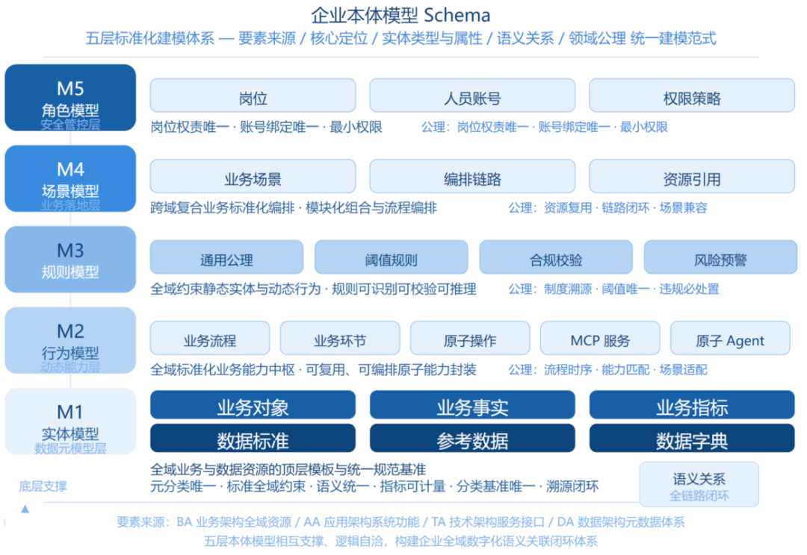

**图** **1**：\*\* \*\*企业级本体模型标准

## 01 为什么选 电网营销 业扩业务做示例

业扩业务是电网营销域最核心、最复杂的业务之一，覆盖"客户申请用电→供电方案制定→工程施工→装表接电→合同签订"全链路。选择它有三个理由：

✅ 业务跨度大：涉及客户、用电设备、供电方案、计量装置、合同、工单等多类实体，天然适合展示M1实体模型

✅ 流程环节多：高压新装增容涉及17个业务环节，低压居民新装仅4个环节，流程差异正好展示M2行为模型和M4场景模型的编排逻辑

✅ 合规约束强：供电方案答复时限、合同签订规范、用电类别校验等规则散落在制度文件中，是M3规则模型的绝佳素材

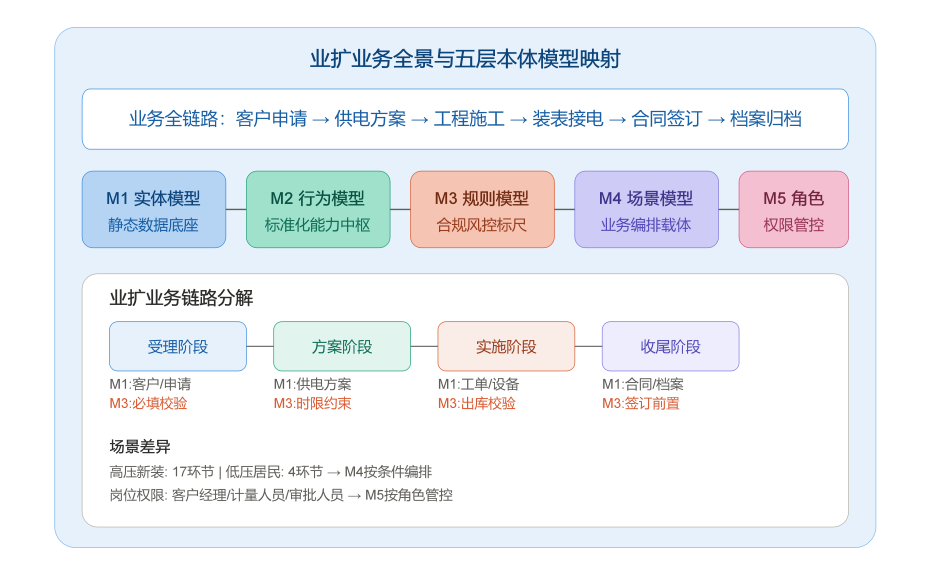

**图** **2**：业扩业务全景与五层本体模型映射图

## 02 本体模型长什么样—五层模型实例

以下逐层展示业扩业务本体模型的实际内容。所有实例来自业务和技术文档，包括需求规格说明书、业务模型设计说明书、校验规则清单、数据模型字典等。

### 2.1 M1 实体模型｜业务数字化档案库

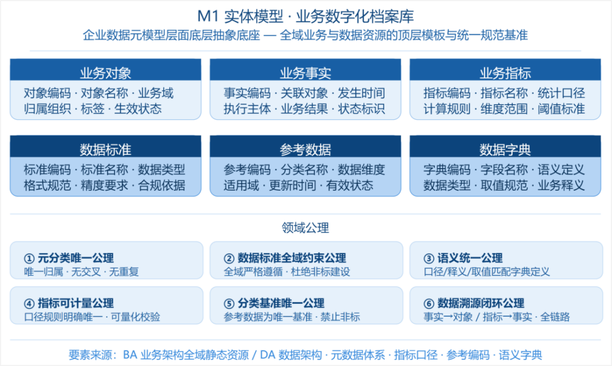

**图** **3**：\*\* \*\*M1实体模型标准定义图

M1是本体体系的静态数据底座。在业扩业务中，核心实体来源于客户、用电设备、供电方案、合同、计量装置等业务对象。

### 1 实体类型定义

| **实体类型** | **实例** | **编码规则** | **来源** |
| 业务对象 | 用电客户、供电方案、供用电合同、计量设备、工单 | cust、ps\\\_sch、contract、met\\\_dev、wk\\\_order | Ba 业务架构 |
| 业务事实 | 业务受理记录、现场勘查记录、竣工验收记录、装表接电记录 | app\\\_rec、survey\\\_rec、accept\\\_rec、connect\\\_rec | Ba 业务架构 |
| 业务指标 | 供电方案答复及时率、业扩报装平均接电时长、合同签订率 | ps\\\_sch\\\_reply\\\_rate、avg\\\_connect\\\_days、contract\\\_sign\\\_rate | Da 数据架构 |
| 数据标准 | 用电类别编码标准、电压等级编码标准、客户类型编码标准 | elec\\\_cons\\\_type\\\_std、voltage\\\_level\\\_std、cust\\\_type\\\_std | Da 数据架构 |
| 参考数据 | 用电类别字典、电压等级字典 | ref\\\_elec\\\_cons\\\_type、ref\\\_voltage\\\_level | Da 数据架构 |
| 数据字典 | 业务域字段定义、状态码定义、操作类型定义 | 见下表 | Da 数据架构 |

### 2 核心实体属性实例

**用电客户（业务对象）：**

| **属性编码** | **属性名称** | **数据类型** | **语义定义** | **取值规范** |
| Cust\\\_id | 客户标识 | Number(16) | 客户唯一标识 | 系统自动生成 |
| Cust\\\_name | 客户名称 | Varchar2(256) | 客户全称 | 与营业执照/身份证一致 |
| Cust\\\_type | 客户类型 | Varchar2(8) | 客户分类 | 参考数据：居民/非居民/特殊 |
| Elec\\\_cons\\\_type | 用电类别 | Varchar2(8) | 用电性质分类 | 参考数据：大工业/一般工商业/居民/农业 |
| Voltage\\\_level | 电压等级 | Varchar2(8) | 接入电压等级 | 参考数据：220v/380v/10kv/35kv/110kv |
| Mgt\\\_org\\\_code | 管理单位编码 | Varchar2(16) | 所属供电单位 | 组织机构编码 |
| Cust\\\_status | 客户状态 | Varchar2(8) | 档案状态 | 数据字典：有效/暂停/销户 |

**供电方案（业务对象）：**

| **属性编码** | **属性名称** | **数据类型** | **语义定义** | **取值规范** |
| Ps\\\_sch\\\_id | 供电方案标识 | Number(16) | 方案唯一标识 | 系统自动生成 |
| App\\\_no | 申请编号 | Varchar2(16) | 关联业务申请 | 引用业扩申请编号 |
| Supply\\\_mode | 供电方式 | Varchar2(8) | 单电源/双电源/多电源 | 固定枚举值 |
| Subst\\\_name | 接入变电站 | Varchar2(256) | 接入点变电站名称 | 标准变电站名称 |
| Capacity | 供电容量 | Number(16,6) | 批准供电容量(kva) | 非负数值，保留6 位小数 |
| Reply\\\_deadline | 答复时限 | Date | 方案答复截止日期 | 晚于申请受理日期 |
| Approve\\\_status | 审批状态 | Varchar2(8) | 待审批/已审批/已退回 | 固定枚举值 |

**业务受理记录** **（业务** **事实** **）：**

| **属性编码** | **属性名称** | **数据类型** | **语义定义** | **取值规范** |
| Rec0528 | 记录id | Number(16) | 业扩受理记录主键 | 系统自动生成 |
| App\\\_no | 申请单号 | Varchar2(20) | 新装用电申请编号 | 20250528001 |
| Cust\\\_id | 客户id | Number(16) | 关联用电客户编号 | 引用客户主数据 |
| Acc\\\_time | 受理时间 | Date | 前台受理操作时间 | 2025/5/28 |
| Acc\\\_sts | 受理状态 | Varchar2(8) | 单据当前流程节点 | 数据字典：已受理 |
| Rec0528 | 记录id | Number(16) | 业扩受理记录主键 | 系统自动生成 |
| App\\\_no | 申请单号 | Varchar2(20) | 新装用电申请编号 | 20250528001 |

**业务指标** **：**

| **指标标识** | **指标名称** | **计算公式** | **统计周期** | **计量单位** |
| Ind001 | 供电方案答复及时率 | 按期答复方案数÷ 应答复方案总数 ×100% | 月度 | % |
| Ind002 | 业扩平均接电时长 | 总接电时长÷ 完成接电户数 | 月度 | 天 |
| Ind003 | 供用电合同签订率 | 已签订合同数÷ 应签订合同总数 ×100% | 月度 | % |
| Ind004 | 高压业扩办理时长 | 高压业务总时长÷ 高压业务办结数 | 月度 | 天 |
| Ind005 | 低压业扩办理时长 | 低压业务总时长÷ 低压业务办结数 | 月度 | 天 |
| Ind006 | 供电方案审批通过率 | 审批通过方案数÷ 送检方案总数 ×100% | 月度 | % |

**数据标准** **：**

| **标准编码** | **标准名称** | **适用对象** | **约束规则** | **发布版本** |
| Std001 | 用电类别编码标准 | 用电客户 | 2 位数字编码，唯一非空 | V2.0 |
| Std002 | 电压等级编码标准 | 供电方案 | 固定枚举值，禁止自定义 | V2.0 |
| Std003 | 设备型号命名标准 | 计量 / 供电设备 | 厂家缩写 + 型号编码组合 | V1.5 |
| Std004 | 业务类型编码标准 | 业扩申请 | 3 位数字编码，分类唯一 | V1.5 |
| Std005 | 客户编号编码标准 | 用电客户 | 16 位数字，系统自动生成 | V2.0 |

**参考数据** **：**

| **参考数据编码** | **设备型号** | **设备类型** | **生产厂家** | **启用状态** |
| Ref\\\_eq001 | Dtz862 - c | 三相智能电能表 | 威胜集团 | 启用 |
| Ref\\\_eq002 | Ddzy668 - z | 单相智能电能表 | 宁波三星 | 启用 |
| Ref\\\_eq003 | Lzzbj9 - 10 | 电流互感器 | 正泰电气 | 启用 |
| Ref\\\_eq004 | Jdzx9 - 10 | 电压互感器 | 德力西电气 | 启用 |
| Ref\\\_eq005 | Zw32 - 12 | 户外真空断路器 | 平高电气 | 启用 |
| Ref\\\_eq006 | S11 - m - 100 | 油浸式变压器 | 特变电工 | 启用 |

### 3 语义关系实例

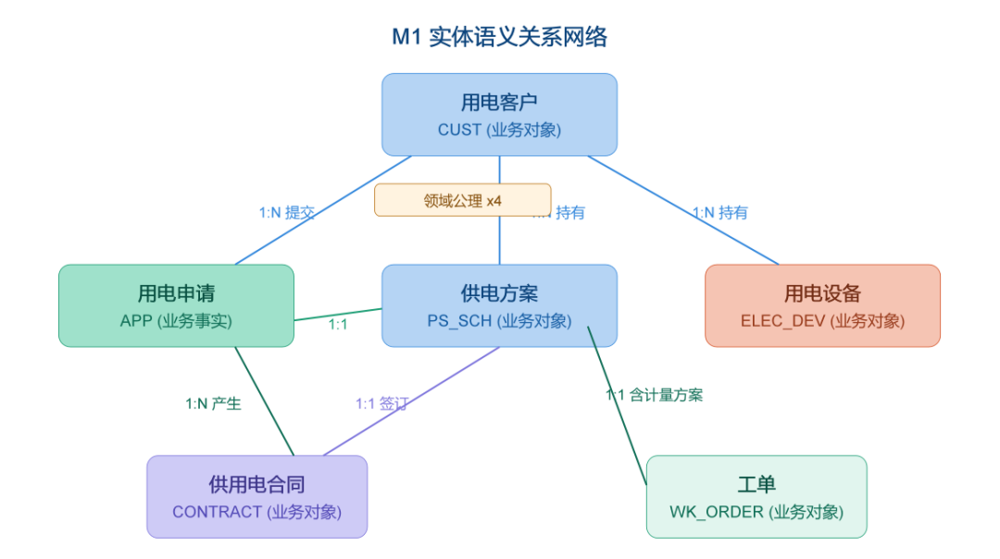

**图** **4**：\*\* **M1** \*\*实体语义关系网络图

| **主体实体** | **关联实体** | **语义关系** | **关系说明** |
| 用电客户 | 用电申请 | 一对多 | 一个客户可提交多次用电申请 |
| 用电申请 | 供电方案 | 一对一 | 一个申请对应一个供电方案 |
| 供电方案 | 供用电合同 | 一对一 | 方案确定后签订对应合同 |
| 用电客户 | 用电设备 | 一对多 | 一个客户可有多个用电设备 |
| 用电申请 | 工单 | 一对多 | 一个申请流转产生多个工单 |
| 供电方案 | 计量方案 | 一对一 | 方案包含计量点配置 |

### 4 领域公理实例

| **公理名称** | **自然语言表述** | **形式化表达** |
| 客户唯一公理 | 同一证件号的客户，系统中仅存在一条有效档案 | Unique(cust where id\\\_no, cust\\\_status='有效') |
| 申请客户绑定公理 | 每条用电申请必须关联一个有效客户 | Not null(app.cust\\\_id) and exists(cust where cust\\\_id=app.cust\\\_id) |
| 方案申请对应公理 | 供电方案必须关联一条已受理的用电申请 | Exists(app where app\\\_no=ps\\\_sch.app\\\_no and app.status='已受理') |
| 容量匹配公理 | 供电方案批准容量≥ 客户申请容量 | Ps\\\_sch.capacity \>= app.apply\\\_capacity |

### 2.2 M2 行为模型｜标准化业务能力中枢

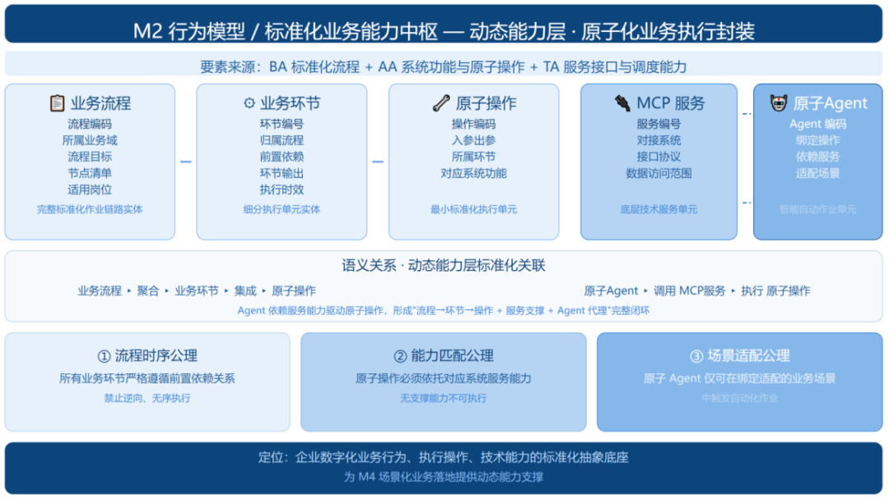

**图** **5**：\*\* \*\*M2行为模型标准定义图

M2封装了业扩业务全流程中的动态执行能力。从需求规格说明书中可以提取出完整的业务环节和原子操作。

### 1 业务流程与环节定义

以高压新装增容为例，完整业务流程包含17个环节：

| **环节编号** | **环节名称** | **前置依赖** | **执行主体** |
| 01 | 上门业务受理 | 无 | 客户经理 |
| 02 | 营业厅受理 | 无 | 营业厅人员 |
| 03 | 电话受理 | 无 | 电话坐席 |
| 04 | 在线交谈受理 | 无 | 网络坐席 |
| 05 | 网上自助 | 无 | 客户自助 |
| 06 | 现场勘查 | 受理完成 | 客户经理 |
| 07 | 接入系统设计服务 | 现场勘查完成 | 发展部专职 |
| 08 | 方案拟定 | 现场勘查完成 | 客户经理 |
| 09 | 方案审批 | 方案拟定完成 | 审批人员 |
| 10 | 供电方案通知 | 方案审批通过 | 客户经理 |
| 11 | 图纸审查服务 | 方案通知后 | 建设部专职 |
| 12 | 中间检查服务 | 施工期间 | 客户经理 |
| 13 | 竣工报验 | 施工完成 | 客户经理 |
| 14 | 计量设备装拆 | 竣工验收通过 | 计量人员 |
| 15 | 合同起草/签订 | 方案确定后 | 客户经理 |
| 16 | 送电 | 全部环节完成 | 客户经理 |
| 17 | 档案归档 | 送电完成 | 归档人员 |

对比低压居民新装增容仅4个环节：营业厅受理 → 上门服务 → 客户确认 → 档案归档。这种流程差异是M4场景模型需要编排的核心逻辑。

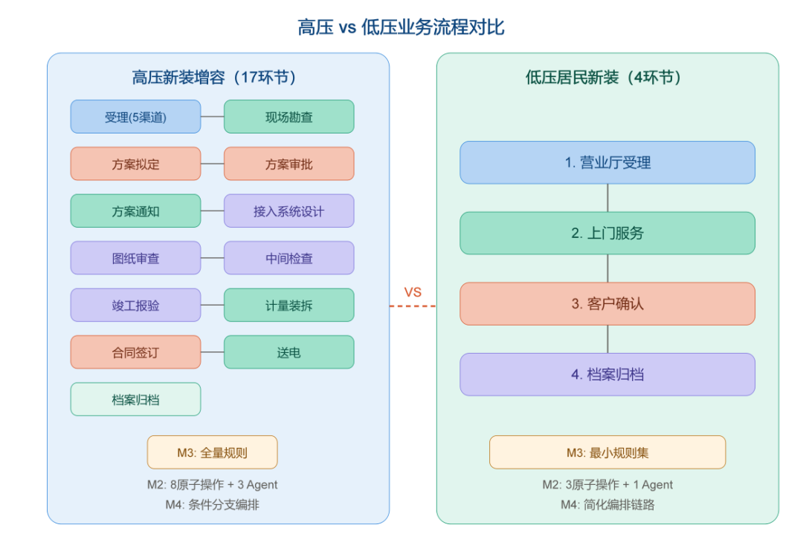

**图** **6**：高压 vs 低压业务流程对比图

### 2 原子操作定义

| **操作编码** | **原子操作** | **入参** | **出参** | **所属系统** |
| Atom\\\_001 | 校验客户身份信息 | 证件号码 | 客户档案/校验结果 | 客户中心系统 |
| Atom\\\_002 | 创建用电申请 | 客户id/用电类别/申请容量 | 申请编号 | 营销业务系统 |
| Atom\\\_003 | 生成供电方案 | 申请编号/勘查结果 | 方案id | 营销业务系统 |
| Atom\\\_004 | 方案审批流转 | 方案id/审批意见 | 审批状态 | Oa 系统 |
| Atom\\\_005 | 发送供电方案通知 | 方案id/客户联系方式 | 通知回执 | 通知平台 |
| Atom\\\_006 | 起草供用电合同 | 方案id/客户id/合同模板id | 合同id | 合同管理 |
| Atom\\\_007 | 派发计量装拆工单 | 申请编号/计量方案 | 工单编号 | 工单系统 |
| Atom\\\_008 | 执行送电操作 | 工单编号/设备编号 | 送电状态 | 调度系统 |

### 3 mcp 服务与 agent 定义

| **服务编号** | **Mcp 服务** | **对接系统** | **接口协议** |
| Mcp\\\_cust\\\_01 | 客户档案查询 | 客户中心 | Rest |
| Mcp\\\_ps\\\_01 | 供电方案智能编审 | 方案编制引擎 | Rest |
| Mcp\\\_met\\\_01 | 计量设备库存查询 | 计量管理 | Rest |
| Mcp\\\_contract\\\_01 | 合同模板渲染 | 合同管理 | Rest |
| Mcp\\\_notify\\\_01 | 方案通知推送 | 通知平台 | Mq |

| **Agent 编码** | **原子 agent** | **绑定操作** | **依赖服务** | **适配场景** |
| Agent\\\_ps\\\_01 | 供电方案自动编制 | Atom\\\_003 | Mcp\\\_ps\\\_01, mcp\\\_cust\\\_01 | 高压/低压新装 |
| Agent\\\_met\\\_01 | 计量设备自动匹配 | Atom\\\_007 | Mcp\\\_met\\\_01 | 全量新装增容 |
| Agent\\\_notify\\\_01 | 方案通知自动推送 | Atom\\\_005 | Mcp\\\_notify\\\_01 | 全量新装增容 |

### 2.3 M3 规则模型｜企业合规风控标尺

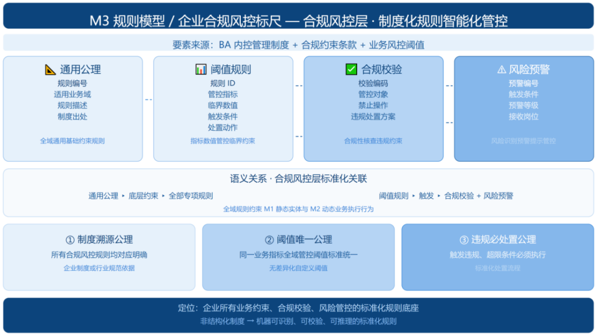

**图** **7**：\*\* \*\*M3规则模型标准定义图

M3将散落在制度文件、需求文档中的业务约束转化为机器可校验的规则。以下是来自校验规则清单和需求规格说明书的规则实例。

### 1 通用公理实例

| **规则编号** | **规则名称** | **规则描述** | **制度出处** |
| Axiom\\\_001 | 受理必填校验 | 高压新装增容受理时，业务类型、客户名称、用电地址、客户类型、用电类别为必填项 | 需求规格说明书 |
| Axiom\\\_002 | 供电方式完整性 | 如果供电方式为公网供电，必须填写供电方案数据 | 需求规格说明书 |
| Axiom\\\_003 | 联系方式校验 | 受理时必须准确录入客户联系方式 | 需求规格说明书 |
| Axiom\\\_004 | 身份证件唯一性 | 新增或修改客户证件信息时，不得与系统中已有证件信息重复 | 需求规格说明书 |

### 2 阈值规则实例

| **规则编号** | **管控指标** | **临界条件** | **触发动作** | **制度依据** |
| Thresh\\\_001 | 供电方案答复时限 | 高压单电源≤15工作日；高压双电源≤30工作日；低压居民≤3工作日；低压非居民≤7工作日 | 超期自动预警推送督办 | 供电监管办法 |
| Thresh\\\_002 | 业扩报装超时 | 系统每日4次检测超时记录 | 超时预警推送督办 | 省级定制规则 |
| Thresh\\\_003 | 价款退回上限 | 超过3次退回需客户确认后再提交 | 阻止提交 | 省级定制规则 |
| Thresh\\\_004 | 合同签订时效 | 合同信息确认后方可进行下一步 | 阻止流程推进 | 需求规格说明书 |

### 3 合规校验实例

| **规则编号** | **校验名称** | **管控对象** | **合规要求** | **违规处置** |
| Comply\\\_001 | 用电类别与电压等级匹配 | 用电类别+电压等级 | 低压时电压等级只能选220v/380v | 阻止提交 |
| Comply\\\_002 | 供电方案签订规范 | 合同签订环节 | 合同版本号应一致，专用用户合同信息不能为空 | 强制校验 |
| Comply\\\_003 | 合同签订前置条件 | 合同签订环节 | 必须为方案签订后才能发送 | 阻止提交 |
| Comply\\\_004 | 业务费收取完整性 | 业务费收取环节 | 业务费必须一次性缴清 | 阻止提交 |
| Comply\\\_005 | 计量设备出库校验 | 计量设备装拆环节 | 计量设备必须先配置出库才能装拆 | 阻止操作 |

### 4 风险预警实例

| **规则编号** | **预警名称** | **触发条件** | **预警等级** | **接收岗位** |
| Risk\\\_001 | 业扩报装超24h未归档 | 已送电工单超过24小时未归档 | 一般 | 客户经理 |
| Risk\\\_002 | 供电方案超期未答复 | 距离答复时限不足2工作日仍未审批 | 紧急 | 客户经理+督办 |
| Risk\\\_003 | 非法价款预警 | 同一客户累计退回价款≥3次 | 较高 | 专职+主管 |
| Risk\\\_004 | 线损异常 | 高压用户线路线损为0且采集示数异常 | 紧急 | 用检人员 |

### 2.4 M4 场景模型｜复杂业务标准化编排载体

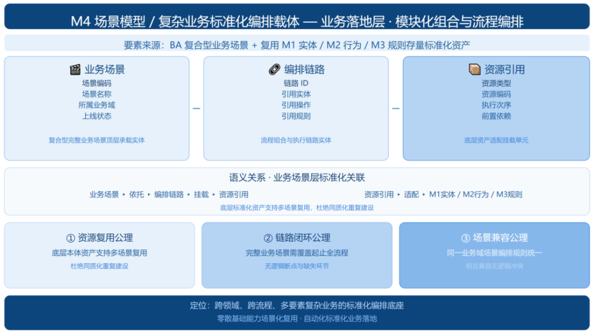

**图** **8**：\*\* \*\*M4场景模型标准定义图

M4是本体中"活"的部分——它将M1的实体、M2的行为、M3的规则组装成可执行的业务场景。

### 1 业务场景定义

| **场景编码** | **场景名称** | **所属业务域** | **上线状态** |
| Scene\\\_hv\\\_new | 高压新装增容 | 业扩接入-获得电力 | 已上线 |
| Scene\\\_lv\\\_nres\\\_new | 低压非居民新装增容 | 业扩接入-获得电力 | 已上线 |
| Scene\\\_lv\\\_res\\\_new | 低压居民新装增容 | 业扩接入-获得电力 | 已上线 |
| Scene\\\_comm\\\_new | 小区配套新装 | 业扩接入-获得电力 | 已上线 |
| Scene\\\_lv\\\_batch | 低压批量新装 | 业扩接入-获得电力 | 已上线 |
| Scene\\\_temp\\\_new | 无表临时用电新装 | 业扩接入-获得电力 | 已上线 |
| Scene\\\_reserve\\\_in | 项目储备入库 | 业扩接入-项目储备 | 已上线 |
| Scene\\\_reserve\\\_out | 项目储备出库 | 业扩接入-项目储备 | 已上线 |

### 2 编排链路实例：高压新装增容

| **链路id** | **次序** | **引用实体(** **M1** **)** | **引用操作(** **M2** **)** | **引用规则(** **M3** **)** |
| Link\\\_hv\\\_01 | 1 | 用电客户、用电申请 | 身份校验、创建申请 | 必填校验、联系方式校验、类别匹配 |
| Link\\\_hv\\\_02 | 2 | 供电方案 | 方案编制 | 答复时限 |
| Link\\\_hv\\\_03 | 3 | 供电方案 | 方案审批、方案通知 | 合同规范 |
| Link\\\_hv\\\_04 | 4 | 工单 | 图纸审查、中间检查、竣工报验 | — |
| Link\\\_hv\\\_05 | 5 | 计量设备、工单 | 派发装拆工单 | 出库校验 |
| Link\\\_hv\\\_06 | 6 | 供用电合同 | 合同起草、签订 | 签订前置条件 |
| Link\\\_hv\\\_07 | 7 | — | 送电操作 | 超时预警 |
| Link\\\_hv\\\_08 | 8 | 档案 | 档案归档 | 归档预警 |

### 3 不同场景的编排差异

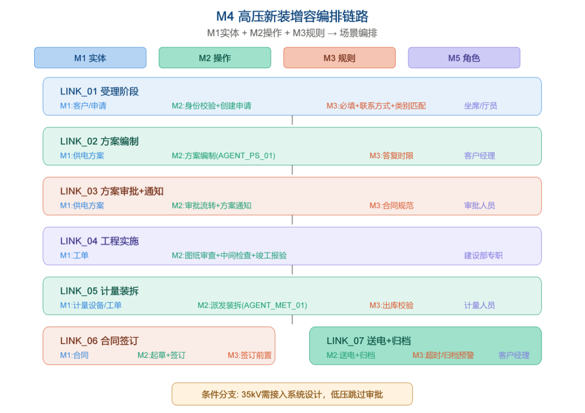

**图** **9**：高压新装增容编排链路图（\*\* **M1** \*\*+**M2** \*\*+**M3** \*\*组装）

| **维度** | **高压新装增容** | **低压非居民新装** | **低压居民新装** | **小区配套新装** |
| 环节数 | 17 | 10 | 4 | 15 |
| 方案审批 | ✓ | ✗ | ✗ | ✓ |
| 接入系统设计 | ✓(35kv) | ✗ | ✗ | ✗ |
| 图纸审查 | ✓ | ✗ | ✗ | ✓ |
| 中间检查 | ✓ | ✗ | ✗ | ✓ |
| 受理渠道 | 全渠道 | 全渠道 | 营业厅+上门 | 营业厅+上门 |
| 合同流程 | 起草→审核→审批→签订 | 签订 | — | 起草→审核→签订 |
| 领域公理 | 全量规则 | 部分规则 | 最小规则集 | 全量规则 |

⚠️ 场景的差异本质上是M2行为的子集选择和M3规则的过滤条件不同，这正是M4编排的核心逻辑。

### 2.5 M5 角色模型｜数据安全管控屏障

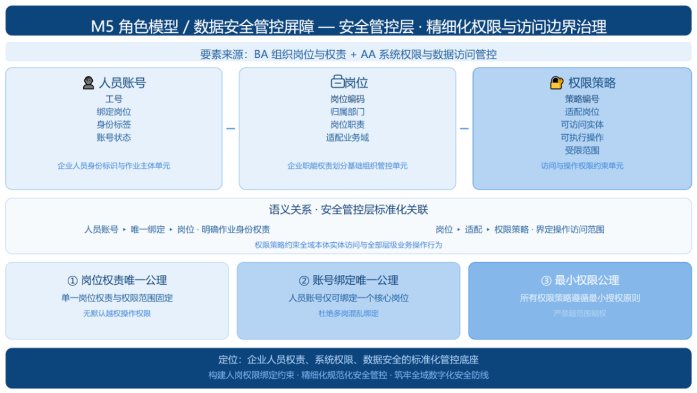

**图** **10** \*\*：\*\*M5角色模型标准定义图

M5定义了业扩业务中"谁能在什么条件下做什么"。

### 1 岗位定义

| **岗位编码** | **岗位名称** | **所属组织** | **核心职责** |
| Role\\\_01 | 电话坐席 | 客服中心 | 电话受理 |
| Role\\\_02 | 网络坐席 | 客服中心 | 在线交谈受理 |
| Role\\\_03 | 坐席班长 | 客服中心 | 回退指派 |
| Role\\\_04 | 建设部专职 | 建设部 | 图纸审查服务 |
| Role\\\_05 | 居配专职 | 省公司营商室 | 设计文件抽检、开工备案抽检 |
| Role\\\_06 | 发展部专职 | 市公司发展部 | 接入系统设计服务 |
| Role\\\_07 | 营业厅人员 | 供电公司营业厅 | 营业厅受理 |
| Role\\\_08 | 客户经理 | 供电公司 | 方案拟定、现场勘查、送电等 |
| Role\\\_09 | 计量人员 | 计量中心 | 计量设备装拆、调试 |
| Role\\\_10 | 审批人员 | 供电公司管理层 | 方案审批、合同审批 |

### 2 权限策略实例

| **策略编号** | **适配岗位** | **可访问实体** | **可执行操作** | **受限范围** |
| Pol\\\_001 | 电话坐席 | 用电申请(只读) | 电话受理、创建申请 | 不可查看合同、方案详情 |
| Pol\\\_002 | 客户经理 | 客户、申请、方案、工单、合同 | 全流程操作 | 仅限本供电公司辖区 |
| Pol\\\_003 | 建设部专职 | 供电方案(只读)、图纸审查工单 | 图纸审查服务 | 仅限10kv/35kv及以上 |
| Pol\\\_004 | 计量人员 | 计量设备、装拆工单 | 装拆操作、调试操作 | 不可修改客户信息和方案 |
| Pol\\\_005 | 审批人员 | 供电方案、合同 | 审批操作 | 不可修改方案内容 |

### 3 角色公理

| **公理名称** | **规则描述** |
| 岗位权责唯一公理 | 电话坐席仅可创建申请，不可审批方案；审批人员仅可审批，不可修改方案内容 |
| 辖区管控公理 | 客户经理仅可操作本供电公司辖区内的工单和客户 |
| 最小权限公理 | 计量人员仅可访问计量设备相关实体，不可查看合同和客户敏感信息 |
| 审批分离公理 | 方案拟定人与方案审批人不可为同一人 |

## 03 本体模型怎么建—落地路径

### 3.1 整体路线图

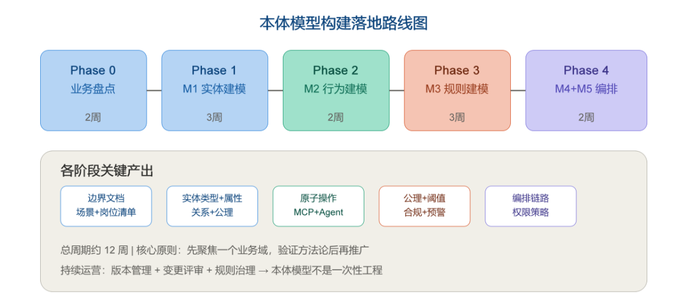

**图** **11** **：本体模型构建落地路线图**

Phase 0 业务盘点(2周) → phase 1 M1实体建模(3周) → phase 2 M2行为建模(2周) → phase 3 M3规则建模(3周) → phase 4 M4+M5编排(2周) → 持续运营

### 3.2 Phase 0：业务盘点

**目标：厘清建模边界，梳理业务全貌。**

| **步骤** | **方法** | **产出** | **业扩实例** |
| 1. 确定建模边界 | 与业务方对齐，明确业务域范围 | 建模边界文档 | 业扩接入，不含变更用电、分布式电源 |
| 2. 梳理业务场景 | 从需求文档中提取场景清单 | 场景清单 | 8大场景：高压新装、低压非居民等 |
| 3. 提取岗位角色 | 从需求规格说明书岗位角色章节提取 | 岗位角色清单 | 43个岗位、43个角色 |
| 4. 盘点业务流程 | 从业务模型设计说明书提取流程层级 | 流程清单 | 7类移动作业+7类桌面应用 |
| 5. 收集规则素材 | 从校验规则清单、制度文件中提取 | 规则素材库 | 48+条系统校验规则、16+条省级定制规则 |

⚠️ 不要试图一次性建模全部营销域——先聚焦一个业务域，验证方法论后再推广。建模边界的判断标准：业务闭环+组织自治+数据自洽。

### 3.3 Phase 1： M1 实体建模

**目标：构建业扩业务的静态数据底座。**

五步法：从物理数据模型中提取实体→ 按六类数据元实体归类 → 标准化属性定义 → 构建语义关系网络 → 固化领域公理

**Step 1 实操：从数据模型字典提取实体**

数据模型字典包含6000+张数据表、100000+个字段。提取业扩相关表的方法：按业务中心字段过滤（业扩中心、合同中心、客户中心、计量中心）；按表名关键词过滤（"用电申请""供电方案""报装""送电""合同"等）；交叉验证需求规格说明书附录中的业务信息详单。

✅ 不要把数据库表直接等同于实体类型——一张物理表可能承载多个业务对象的凭证数据，需要按业务语义抽象。区分"实体"和"实体凭证"：用电客户是实体，用电客户凭证是实体的变更记录。

### 3.4 Phase 2： M2 行为建模

**目标：将零散的业务环节封装为标准化、可编排的原子能力。**

**粒度把控：**

| **粒度** | **示例** | **判断标准** |
| 太粗 | 完成高压新装全流程 | 一个操作跨多个环节，无法复用 |
| 合适✓ | 创建用电申请、校验客户身份 | 一个操作完成一个明确的业务动作 |
| 太细 | 点击保存按钮、提交http请求 | 纯技术操作，无业务语义 |

⚠️ 不要把ui操作等同于原子操作——"点击保存按钮"是交互，"创建用电申请"才是原子操作。原子操作命名用"动词+业务对象"。

### 3.5 Phase 3： M3 规则建模

**目标：将自然语言规则转化为机器可校验的标准化规则。**

**规则提取四步法：**

收集规则素材（需求文档+校验规则清单+制度文件）→ 分类归档（通用公理/阈值规则/合规校验/风险预警）→ 结构化表达（触发条件→校验逻辑→处置动作）→ 关联实体与行为（每条规则绑定M1实体和M2操作）

**结构化表达示例：**

*自然语言：供电方案答复时限：高压单电源不超过15个工作日，高压双电源不超过30个工作日*

| **字段** | **值** |
| 规则编号 | Thresh\\\_001 |
| 规则类型 | 阈值规则 |
| 触发时机 | 供电方案创建时 |
| 管控对象 | 供电方案.答复时限 |
| 校验逻辑-高压单电源 | 方案答复日期 - 申请受理日期 ≤ 15个工作日 |
| 校验逻辑-高压双电源 | 方案答复日期 - 申请受理日期 ≤ 30个工作日 |
| 校验逻辑-低压居民 | 方案答复日期 - 申请受理日期 ≤ 3个工作日 |
| 校验逻辑-低压非居民 | 方案答复日期 - 申请受理日期 ≤ 7个工作日 |
| 处置动作 | 超期自动预警，推送给督办人员 |
| 制度依据 | 供电监管办法 |

### 3.6 Phase 4： M4 +M5 编排

**目标：将** **M1** \*\*-**M3** \*\*的资产组装为可执行场景，绑定权限管控。

**M4** **场景编排方法：**

每个业务场景定义一条编排链路；编排链路由有序的"资源引用"组成；每个资源引用指向 M1 实体、M2 操作或M3 规则；通过条件分支实现场景差异。

**M5** **权限绑定方法：**

从需求规格说明书岗位角色章节提取岗位和角色定义；为每个岗位定义"可访问实体"和"可执行操作"；将权限策略与 M4 场景的编排链路关联——同一个场景，不同岗位看到不同的操作入口。

✅ 不要在 M4 中重新定义实体或操作——M4 只做引用和编排，不创造新资产。场景差异用"条件分支"表达，不要为每个变体创建独立场景。

### 3.7 持续运营：版本管理与治理

| **治理场景** | **处理方式** | **示例** |
| 新增业务场景 | 在M4新增编排链路，复用M1-M3存量资产 | 新增"分布式电源接入"场景 |
| 规则变更 | 在M3新增规则版本，标记生效日期 | 供电方案答复时限调整 |
| 实体扩展 | 在M1新增属性或实体类型，向下兼容 | 用电客户新增"碳账户"属性 |
| 流程调整 | 在M2修改环节的前置依赖关系 | 竣工验收环节增加前置 |

❌ 版本管理铁律：M1-M3的变更必须向下兼容；M4的编排变更通过"场景版本"管理；M5的权限变更需经安全评审。

## 04 常见坑与避坑指南

| **坑** | **症状** | **避坑方法** |
| 实体粒度过粗 | "用电申请"一个实体塞了50+属性，不同环节的属性混在一起 | 按业务阶段拆分：受理信息、方案信息、实施信息分别建模 |
| 实体粒度过细 | 把"客户姓名""客户地址"都建模为独立实体 | 判断标准：是否有独立的生命周期和业务语义 |
| 规则遗漏 | 上线后发现大量"潜规则"未建模 | 规则收集不仅看校验规则清单，还要逐条审需求文档和制度文件 |
| 规则冲突 | 省级定制规则与通用规则矛盾 | 明确优先级：定制规则\>通用规则，标注适用范围 |
| M4编排僵化 | 每个场景都是独立的硬编码流程，无法复用 | 用"条件分支"替代"场景复制"，公共环节只定义一次 |
| 权限模型与业务脱节 | M5的权限策略无法反映实际的岗位权责 | M5的岗位定义必须与需求规格说明书中的岗位角色章节完全对齐 |
| 物理模型≠本体模型 | 直接把数据库表映射为本体实体 | 物理表是技术实现，本体实体是业务抽象 |
| 忽视演进治理 | 一次建模后无人维护，3个月后与实际业务脱节 | 建立本体变更评审机制，任何业务变更必须先更新本体再改系统 |

## 05 总结

本文以电网营销业扩业务为实例，完整展示了企业级本体模型M1-M5 的样貌：

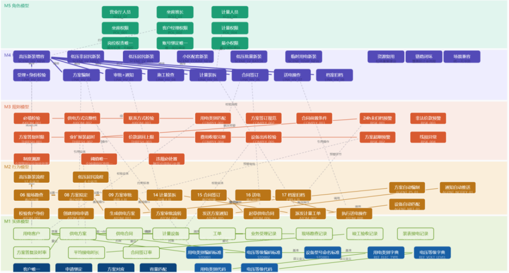

**图12** \*\*：**电网营销业扩** \*\*业务本体模型知识图谱

✅ M1 实体模型：6类数据元实体，涵盖用电客户、供电方案、合同、设备等核心业务对象，以及它们之间的语义关系和领域公理

✅ M2 行为模型：17个业务环节（高压新装）vs 4个环节（低压居民），8个原子操作，5个mcp服务，3个智能agent

✅ M3 规则模型：4条通用公理、4条阈值规则、5条合规校验、4条风险预警，全部来自业务文档

✅ M4 场景模型：8大业务场景的编排链路，清晰展示了不同用电类别下流程差异的编排逻辑

✅ M5 角色模型：11个核心岗位，5类权限策略，4条角色公理

在落地路径上，我们给出了五阶段构建法（业务盘点→M1→M2→M3→M4+M5），每个阶段都提供了具体的方法、产出和避坑指南。

**本体模型的价值不在于"画完"，而在于"用起来"。当一个新业务场景出现时，如果可以在** **M1** \*\*-**M3** **的存量资产中找到80%的复用素材，只需要在** **M4** \*\*做编排适配——那这个本体模型就是成功的。
