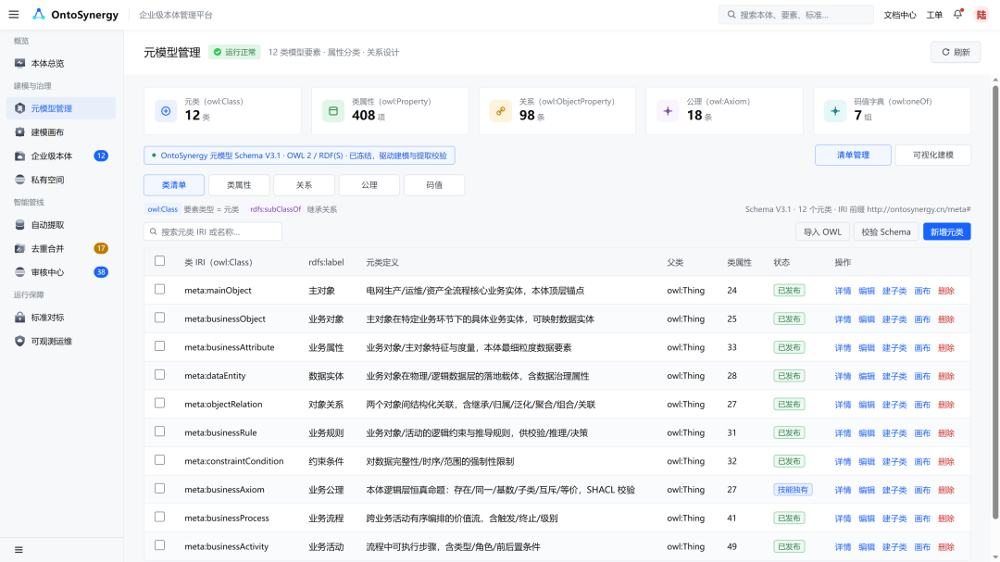

# 本体智能 | 基于 OWL 的本体模型标准管理

> **来源**：微信公众号「华力江海」
> **作者**：华力江海
> **发布日期**：2026-09-06
> **原文**：[点击查看](https://mp.weixin.qq.com/s?__biz=MzcxMDMyNTI4MQ==&mid=2247485900&idx=1&sn=a25e096faa70113a9e403174fd5094e2&chksm=f519ac82c26e259410761a89177b7e692709421aa51ac1c795889b3cb6bdea445bbaee97d353#rd)
> **系列**：本体智能系列

**本体智能 · 企业级本体模型**

### 基于 OWL 的本体模型标准管理

### 从标准构件到系统性管理方法

本体模型建得出来、管不住，就会成为又一座数据孤岛。本文以 OWL 标准构件为经纬，从内容地图、IRI 命名、类属性治理到规则约束公理，讲清使“标准”成为可校验、可推理、可查询、可演化的系统性管理方法。

**OWL 语义基座** **生命周期治理**

**📌 本文导读** \*\*本文摘要：\*\*企业级本体标准管理的核心问题只有一个：如何让"标准"真正被机器理解、被系统遵守、被时间演化。本文以 OWL（Web Ontology Language）为统一语义基座，从内容地图、IRI 命名、类属性治理、规则约束公理、SPARQL 消费、元模型层次到生命周期闭环，讲清一套"让标准成为活资产"的系统性管理方法，并以 OntoSynergy 平台的 20 余元类、500 余属性、50 余关系、20 组码值为真实实例贯穿始终。

企业级本体标准管理的核心问题只有一个：**如何让"标准"真正被机器理解、被系统遵守、被时间演化**。答案是明确的——让标准以 OWL 为语言落地。OWL（Web Ontology Language）是 W3C 推荐的语义网标准语言，提供了一套完整的、可推理的、机器可读的表达体系。当本体模型标准以 OWL 表达时，标准就不再是一份躺在文档里的描述，而是一套可以被校验、被推理、被查询、被执行的语义契约。

基于 OWL 的管理，不应当被简化为某几个孤立的定义动作。OWL 标准自身提供了一套完整的构件体系——从底层的三元组、到 RDFS 的类与属性、再到 OWL 的类表达式、属性特征、约束与公理，直至 OWL 2 的三大推理配置。基于 OWL 的管理方法，本质上是把这套构件体系转化为企业的管理动作：**让每一个构件都有治理档案，让每一次演化都在统一语义框架下进行**。

本文以 OntoSynergy 平台的企业级本体模型标准为实例。本标准包含二十三个要素、五百三十四条属性、五十三条关系、二十一组一百一十六个码值，覆盖实体（M1）、行为（M2）、规则（M3）、场景（M4）、角色（M5）五个模型层。全文以本标准的真实设计贯穿始终，展示 OWL 标准构件如何系统性落地为管理方法。

**23**

元类要素

**534**

属性定义

**53**

关系类型

**116**

码值字典

### 语义基座

## 01 OWL 作为标准的语义基座

### 1.1 从文档标准到语义标准

传统意义上的"标准"以文档存在：一份规范、一张数据表、一段描述。文档标准有两个根本局限：**一是不可推理**，机器只能读取而不能推导；**二是不可校验**，语义的一致性无法自动检查。基于 OWL 的管理，正是要突破这两个局限，把标准从"给人看的文档"升级为"给机器执行的语义契约"。

这一升级的本质是表达方式的改变。当一条业务语义"检修合格率低于百分之九十五必须预警"以自然语言存在于文档中时，它无法被执行；当它被表达为 OWL 体系中的阈值规则实例、关联的业务指标、触发的风险预警、对应的制度依据时，它就变成了一组**可被查询、可被校验、可被推理的结构化断言**。这就是语义标准的含义。

### 1.2 基于 OWL 管理的三层要求

基于 OWL 管理包含三层递进的要求。第一层，**以 OWL 表达标准**：本体模型标准的全部内容都用 OWL 构造表达，而不是用自然语言或表格描述，保证机器可读。第二层，**以 OWL 校验标准**：OWL 提供逻辑一致性与可推理性，能够自动发现标准中的矛盾与缺失。第三层，**以 OWL 驱动演化**：标准的版本升级、去重合并、自动提取都以 OWL 为统一语言进行，保证演化的语义不漂移。三层要求表明，**OWL 不是一种文件格式，而是标准的统一语义基座**。

### 1.3 OWL 语言家族：从 RDF 到 OWL 2

OWL 不是孤立的标准，而是一组层层递进的语言家族。理解这个家族，是发散式管理思考的起点。

| **层次** | **核心构造** | **管理意义** |
| **RDF** | 三元组（主语-谓语-宾语） | 一切断言的最小单位，标准的数据底座 |
| **RDFS** | rdfs:Class、rdfs:Property、subClassOf、domain/range | 引入类与属性的基本骨架，支撑简单层级 |
| **OWL** | 类表达式、属性特征、值约束、等价/不相交、公理 | 完整表达语义与推理，标准的主体表达能力 |
| **OWL 2** | EL/QL/RL 三大配置、键、新的数据类型 | 按场景选择推理强度与复杂度，标准的分场景落地 |

语言家族的意义在于选择：**不是所有场景都需要 OWL 的完整表达能力**。本体层级低、追求大规模分类推理时可选 OWL 2 EL；数据查询需求为主时可选 OWL 2 QL；规则驱动的场景可选 OWL 2 RL。标准管理的第一步，就是为企业的本体模型选择恰当的表达层次。

### 💡 核心结论

OWL 不是一种文件格式，而是标准的统一语义基座——表达、校验、演化都在同一语言体系下完成。

### 内容全景

## 02 本体模型标准的内容地图：OWL 构件体系

### 2.1 内容地图：标准管理先看清全貌

基于 OWL 管理，首先要有一张"内容地图"——标准里到底有哪些东西需要管理。OWL 标准的构件体系给出答案：**个体、类、属性、约束、断言、注解、公理**。这七类构件是标准管理的内容全景，管理动作逐一落在每一类构件上。

| **构件** | **OWL 构造** | **管理意义** |
| **个体** | owl:NamedIndividual、rdf:type | 具体实例的声明与分类，标准的落点 |
| **类** | owl:Class、subClassOf、equivalentClass、disjointWith | 概念骨架与分类层级 |
| **属性** | DatatypeProperty、ObjectProperty、AnnotationProperty、subPropertyOf、属性特征 | 概念的特征与关联 |
| **约束** | allValuesFrom、someValuesFrom、hasValue、min/max/exactCardinality | 取值边界与数量边界 |
| **断言** | sameAs、differentFrom、AllDifferent | 个体同一性与差异性 |
| **注解** | rdfs:label、rdfs:comment、AnnotationProperty、版本注解 | 人类可读的名称与治理元信息 |
| **公理** | ClassAxiom、PropertyAxiom、个体断言集合 | 推理基座与一致性基础 |

这张内容地图揭示了一个重要事实：**五类"定义"只是这张地图的子集**——类与属性构成骨架，约束落在取值边界，公理提供推理；而个体、断言、注解同样是标准管理不可缺失的构件。发散式管理意味着：把这七类构件全部纳入治理视野。

### 2.2 个体与类型：世界的最小单位

个体是本体中对具体事物的命名。一个具体的主变压器、一份具体的工作票、一个具体的岗位，都是个体。个体通过 rdf:type 声明其类型，通过属性断言描述其特征。在标准管理中，个体是"标准被实例化"的落点：**元模型定义标准的结构，个体承载具体的业务数据**。

个体管理有三个要点：一是**类型明确**，每个个体必须声明所属类型，且类型必须是标准中定义的类；二是**标识唯一**，个体 IRI 全库唯一，可追溯；三是**断言完整**，个体满足其类型类的必填属性约束。这三条保证了个体的合规性——个体不是游离数据，而是标准的实例化。

### 2.3 类体系：骨架与分类

类体系是标准的内容骨架。OWL 提供丰富的类构造：子类（rdfs:subClassOf）构建层级，等价类（owl:equivalentClass）声明语义等同，不相交类（owl:disjointWith）保证分类排他，类表达式（owl:unionOf、owl:intersectionOf、owl:complementOf）构造复杂类。

类体系的管理要点：**父类统一**（本标准所有元类的父类统一为 owl:Thing，保证推理根基）；**继承传递**（子类关系具有传递性，构成分类树）；**分类排他**（不相交声明防止语义交叉）；**实例化控制**（本体层级码值区分顶层类、抽象类与可实例化类）。类体系的管理质量，决定了整个标准的骨架是否稳固。

### 2.4 属性体系：特征与关联

属性体系描述概念的特征与关联。OWL 区分三类属性：数据属性（取值字面量）、对象属性（取值个体）、注解属性（承载注释与治理元信息）。属性之间可以有层次（rdfs:subPropertyOf），可以声明特征——函数性（owl:FunctionalProperty，值唯一）、传递性（owl:TransitiveProperty）、对称性（owl:SymmetricProperty）等。

属性体系的管理要点：一是**分类正确**，分清数据/对象/注解属性；二是**层次清晰**，子属性关系可追溯；三是**特征明确**，函数性、传递性等特征声明要符合业务语义。本标准的五十三关系、五百三十四条属性，正是属性体系的完整实例。

### 2.5 约束与断言、注解：完整表达

约束通过值约束（allValuesFrom/someValuesFrom/hasValue）与基数约束（min/max/exactCardinality）限定属性取值。断言通过 sameAs、differentFrom 声明个体间的同一性与差异性，是去重合并的语义基础。注解通过 rdfs:label、rdfs:comment 承载人类可读名称与定义，通过注解属性承载版本、责任人、制度依据等治理元信息。

这三类构件常被忽视，却是标准治理的关键：**约束让校验可执行，断言让去重可推理，注解让标准可治理**。完整的内容地图，缺一不可。

### 命名基础

## 03 命名空间与 IRI 治理：标准的命名基础

### 3.1 IRI 前缀与命名规范

OWL 中一切资源都以 IRI（国际资源标识符）标识。命名空间（namespace）是 IRI 的公共前缀，是标准命名的基础设施。本标准中所有元模型层资源的 IRI 前缀统一为 `meta:`，保证命名空间的一致性；业务层资源继承企业级命名空间并允许扩展。

命名规范包含三条：**前缀统一**，同一层级的资源使用同一前缀，禁止随意起名；**驼峰命名**，英文标识采用语义化的驼峰命名，与中文展示名一一对应；**全库唯一**，IRI 在整个标准库中唯一，禁止重名。命名规范是标准可治理的前提——无法唯一标识的标准，无法被管理。

**1**

### 前缀统一

同一层级资源用同一前缀，禁止随意起名。

**2**

### 驼峰命名

英文标识语义化驼峰，与中文展示名一一对应。

**3**

### 全库唯一

IRI 全库唯一，禁止重名。

### 3.2 IRI 的唯一性与可追溯性

IRI 治理的核心是唯一性与可追溯性。唯一性保证每个语义条目可被精确引用，是去重合并、自动提取的判定基础；可追溯性保证每个 IRI 都可回溯到它的定义、版本与依据，是标准审计的基础。本标准的关系清单（五十三条）与码值清单（二十一组一百一十六个码值）都以统一 IRI 标识，任何一处引用都指向唯一实体。

### 类治理

## 04 类定义与类层级管理

### 4.1 类的命名与归属

类是本体中"概念"的表达。类定义的管理核心是命名与归属。命名规范保证类的可读性与唯一性：每个类名必须是能准确表达概念的名词短语，全库唯一，配中文展示名。归属规范保证类的可治理性：本标准的每个类都归属一个模型层（M1-M5），都声明本体层级，都有责任人、状态与版本管理。**类定义不是"造一个名字"，而是"建立一条有归属、有治理档案的语义条目"**。

### 4.2 类层级的构建

类层级通过 rdfs:subClassOf 表达"一个类是另一个类的子集"。本标准中所有元类的父类统一为 owl:Thing，保证了类层级的完整性与推理的根基。子类关系具有传递性：若 A 是 B 的子类、B 是 C 的子类，则 A 是 C 的子类。通过 owl:disjointWith 声明不相交类，保证一个实例不会同时属于两个互斥的类。

OWL

```
meta:businessObject  rdf:type   owl:Class ;                      rdfs:subClassOf  owl:Thing ;                      rdfs:label  "业务对象"@zh . meta:transformer  rdfs:subClassOf  meta:businessObject ;                   rdfs:label  "主变压器"@zh . meta:businessObject  owl:disjointWith  meta:businessFact .
```

### 4.3 类的实例化控制

类定义还要回答"这个类能否被实例化"。本标准用本体层级码值区分三类：\*\*顶层类（TOP\\\_CLASS）\*\*是顶层抽象，不可直接实例化；\*\*抽象类（ABSTRACT\\\_CLASS）\*\*是中间层抽象，不可直接实例化；\*\*可实例化类（INSTANCE\\\_CLASS）\*\*可以被创建实例。这一区分防止把抽象层级误当成具体对象实例化，保证模型层的数据质量。

### TOP\\\_CLASS

### 顶层类

顶层抽象，不可直接实例化。

### ABSTRACT\\\_CLASS

### 抽象类

中间层抽象，不可直接实例化。

### INSTANCE\\\_CLASS

### 可实例化类

可以被创建实例。

### 4.4 本标准的类体系：五层二十三类要素

本标准的类体系由五个模型层、二十三个元类构成。

### M1

### 实体模型

业务对象、业务事实、业务指标、数据标准、参考数据、数据字典、业务属性、对象关系

### M2

### 行为模型

业务流程、业务环节、原子操作、MCP 服务、原子 Agent

### M3

### 规则模型

通用公理、阈值规则、合规校验、风险预警

### M4

### 场景模型

业务场景、编排链路、资源引用

### M5

### 角色模型

岗位角色、人员账号、权限策略

二十三个元类的划分遵循一个原则：**每个元类都有独立业务语义，且与其他元类的关系清晰**。

### 属性治理

## 05 属性定义与属性治理

### 5.1 三种属性的划分

本标准的五百三十四条属性中，数据属性二百六十五条（描述特征与状态，取值字面量）、对象属性八十六条（表达关联，取值为个体）、管理属性一百八十三条（承载治理元信息：版本、依据、责任人、状态）。管理属性虽名为"管理"，在 OWL 中仍是数据属性，但语义上承担治理职能。**这一划分是属性治理的第一原则：先分清"特征"与"关联"与"治理信息"，再谈约束**。

**265**

### 数据属性

描述特征与状态

**86**

### 对象属性

表达关联

**183**

### 管理属性

承载治理元信息

### 5.2 属性的五段式结构

本标准的属性设计遵循五段式结构，每个要素的属性按此组织。

**1**

### 标识与编码段

业务对象标识 businessObjectId、编码 businessObjectCode，必填唯一，提供全局身份锚点。

**2**

### 分类与主题段

一级/二级/三级业务域加要素特有分类，提供语义定位。

**3**

### 名称与描述段

业务对象名称、展示名称、描述，提供人类可读信息。

**4**

### 关联与映射段

对象属性：关联业务对象、关联业务规则等，提供结构关联。

**5**

### 治理与管理段

模型版本、标准依据、责任人、状态，提供治理档案。

五段式结构的价值是双重的：**对内强制属性设计完整，对外让不同要素的属性具有可比性**。

### 5.3 属性的定义域与值域

属性定义必须声明定义域（rdfs:domain）与值域（rdfs:range）。定义域声明属性的主语类型，值域声明属性的宾语类型。这两者不是装饰，而是推理的依据：若存在三元组 x P y，且 P 的定义域是 C，则推理器可推出 x 是 C 的实例。本标准中每条属性都声明定义域为所属元类，每条对象属性的值域指向具体元类。以对象属性"业务指标溯源业务事实"（traceFrom）为例，定义域为业务指标，值域为业务事实。

### 5.4 属性约束：四个开关

属性定义还包含四个布尔开关，直接映射为 OWL/SHACL 约束。

### 是否必填

sh:minCount 1

### 是否唯一

owl:FunctionalProperty

### 是否可空

存储约束

### 是否入图

图数据库节点/属性选择

四个开关让"必填、唯一、可空、入图"这些约束从文档描述变为机器可执行的校验逻辑，**是属性治理向约束治理过渡的桥梁**。

### 语义动力

## 06 规则与推理：OWL 的语义动力

### 6.1 从自然语言到形式化规则

企业里的大量业务语义以自然语言存在："检修合格率低于百分之九十五必须预警""执行环节未完成不得进入验收环节"。这些语义如果不形式化，就无法被机器理解与执行。规则治理的任务，就是把自然语言的业务语义转化为机器可读的形式化规则。

翻译的质量取决于"五步翻译法"：先**识别业务陈述中的对象与关系**，再**映射到本体要素**，然后**定义规则的形式化表达**，接着**校验规则的可执行性**，最后**建立规则的治理档案**。

### 6.2 OWL 推理：TBox 与 ABox

OWL 推理建立在本体逻辑之上。TBox（术语公理）声明类与属性的逻辑结构，ABox（断言公理）声明个体的具体断言。推理器基于 TBox 的类层级与公理，推导 ABox 中个体的隐含类型与关系。例如：若"变压器"是"设备"的子类，且某个体被声明为"变压器"，则推理器可推导该个体也是"设备"。**这种推理让标准自动发现隐含知识，是 OWL 相比普通数据建模的核心优势**。

### 6.3 规则与 SWRL

当业务规则超出 OWL 表达范围（如涉及算术、字符串处理），可引入 SWRL（语义网规则语言）。SWRL 规则形如"前提 ∧ 前提 → 结论"，把业务逻辑显式化为可执行的规则。在标准管理中，规则分两类：**可推理的规则**（公理化的逻辑准则，通过 OWL 公理表达）与**可执行的规则**（操作性的判断逻辑，通过约束与规则引擎执行）。本标准的 M3 规则模型正是这一区分的实例。

### 6.4 本标准的规则体系：M3 四要素

| **规则要素** | **职责** | **关联关系** |
| **通用公理** | 本体模型底层的逻辑准则与推理依据 | 对应制度依据（basedOn） |
| **阈值规则** | 基于指标与事实设定数值边界，触发管控 | 监控业务指标（monitors）、触发风险预警（triggersAlert） |
| **合规校验** | 对企业业务行为做合规性自动化校验，承载内控制度 | 作用于业务对象（actsOn）、触发风险预警 |
| **风险预警** | 基于阈值与校验结果生成结构化预警与处置建议 | 承接触发关系，输出处置建议 |

四类规则各有职责又相互衔接：公理定义底层逻辑，阈值定义数值边界，合规定义制度校验，预警定义处置响应。**规则治理的可审计性是底线**：本标准的三类规则要素都通过"对应制度依据"关系（basedOn）关联制度依据，回答"这条规则为什么存在"——**没有依据的规则不允许进入标准**。

### 落地闸门

## 07 约束与校验：标准落地的闸门

### 7.1 OWL 与 SHACL 的分工

约束治理需要厘清 OWL 与 SHACL 的分工：OWL 描述世界的逻辑规则，偏重推理；SHACL（Shapes Constraint Language）描述数据的校验规则，偏重数据。两者的分工是：**OWL 保证推理正确，SHACL 保证数据合规**。在标准管理中，两者同时导出、同时运行——OWL 用于语义推理，SHACL 用于实例校验。

### OWL

### 推理正确

描述世界的逻辑规则，偏重推理，用于语义推理。

### SHACL

### 数据合规

描述数据的校验规则，偏重数据，用于实例校验。

### 7.2 约束的类型与表达

| **约束类型** | **语义** | **SHACL/OWL 表达** |
| **基数约束** | 属性/关系的取值数量边界 | sh:minCount、sh:maxCount、owl:cardinality |
| **必填约束** | 属性必须存在 | sh:minCount 1 |
| **唯一约束** | 属性值全局唯一 | owl:FunctionalProperty、唯一形状 |
| **枚举约束** | 取值必须来自码值集合 | sh:in、owl:oneOf |
| **条件约束** | 满足某条件时必须满足另一约束 | sh:if / sh:then / sh:else |

以本标准的基数为实例：业务环节所属业务流程（belongsToProcess）基数 N:1，表达"多个环节可以属于一个流程，每个环节至少属于一个流程"；业务流程包含业务环节（includesStage）基数 1:N，表达"一个流程包含多个环节"。基数在 SHACL 中映射为 minCount/maxCount。

### 7.3 约束的作用对象与码值治理

约束定义还必须明确作用对象：**属性级约束**（必填、唯一、枚举）作用于具体属性；**关系级约束**（基数、方向）作用于关系两端；**类级约束**（不相交、全称限制）作用于类层级；**元模型级约束**作用于标准自身的结构。分层明确约束的作用面，是约束治理的前提。

枚举约束的取值域来自码值字典。本标准的二十一组一百一十六个码值覆盖本体层级、状态、流程类型、环节类型、操作类型、公理类型、阈值级别、拦截方式等，以统一字典管理。**码值治理是约束治理的底座**：枚举型属性必须引用存在的码值组，码值组的增删改走版本治理，防止枚举漂移。

### 推理基座

## 08 公理与一致性：推理基座

### 8.1 公理的本质与类型

公理是本体中不需要证明就成立的基本断言，是推理的起点。在 OWL 中，类公理（owl:ClassAxiom）、属性公理（owl:PropertyAxiom）、个体公理声明本体的基本逻辑结构，推理器基于这些公理推导隐含知识。公理与规则的区别需要厘清：**公理是形式化、有前提结论、可推理的逻辑准则；规则是操作性的判断逻辑**。

### 8.2 元模型层公理与业务公理

本标准的公理体系分为两个层面。**元模型层的公理约束标准自身**：类属性必须归属某个元类、关系 domain/range 必须引用存在的元类、枚举型属性必须引用存在的码值组、必填属性在实例中必须存在等，它们是"关于本体的本体"的规则。**业务层的公理**（通用公理要素）描述业务逻辑：如"设备投运前必须完成全部预防性试验"，它们是 M3 规则的推理层。此外，OWL 逻辑公理（子类关系、不相交声明、等价声明）保证本体的逻辑一致性。

### 元模型层公理

### 约束标准自身

类属性必须归属元类、关系 domain/range 必须引用存在元类、枚举必须引用存在码值组……"关于本体的本体"的规则。

### 业务层公理

### 描述业务逻辑

如"设备投运前必须完成全部预防性试验"，它们是 M3 规则的推理层。

### 8.3 公理的可审计性与一致性检查

公理治理强调可审计性：每条公理必须有形式化定义（前提加结论）、明确类型、有制度依据。本标准的通用公理要素通过"对应制度依据"关系（basedOn）关联制度依据，让"这条公理为什么存在"可追溯。公理定义完成后必须进行一致性检查：公理之间不能冲突，推理器会检测类层级的循环继承、属性的矛盾约束、公理之间的矛盾。**只有一致的公理体系才能支撑可靠推理**。

### 标准消费

## 09 查询与访问：SPARQL 驱动的标准消费

### 9.1 SPARQL：标准资产的查询语言

标准的价值在于被使用。SPARQL 是 RDF 数据的标准查询语言，是标准资产的"消费接口"。当本体模型标准以 RDF/OWL 表达后，业务系统可通过 SPARQL 查询标准资产：查询某业务对象的所有属性与约束、查询某条规则的作用对象、查询某码值组的全部取值。**SPARQL 让标准从"静态文档"变为"可被程序动态访问的语义资产"**。

### 查询 1

### 对象全貌

查询某业务对象的所有属性与约束

### 查询 2

### 规则作用域

查询某条规则的作用对象

### 查询 3

### 码值全取

查询某码值组的全部取值

### 9.2 标准资产的可追溯检索

基于 SPARQL，标准管理可实现可追溯检索：一条属性从何而来（溯源到定义）、被谁引用（正向引用）、引用了什么（反向引用）。本标准的关系清单定义了五十三条关系、二十三类语义类型，每条关系都可被 SPARQL 精确查询。**这种可追溯性是标准治理的核心能力**——当需要评估一次标准变更的影响范围时，SPARQL 查询即可给出完整的引用链。

### 本体层次

## 10 元模型层次管理：本体模型的本体

### 10.1 元模型层与模型层的划分

基于 OWL 的管理天然包含两个层次：元模型层与模型层。**元模型层是"本体模型的本体"**——本标准的二十三个元类、五百三十四条属性定义、五十三条关系类型、二十一组码值字典，都是元模型层的内容，它们定义标准的结构。**模型层是具体业务本体**——主变压器、检修流程、工作票等，它们按元模型层的规范实例化。

这一划分对应本体工程的层次化建模：元模型定义"本体应该长什么样"，模型产出"具体领域的本体"。两者通过 OWL 的类/属性/约束体系衔接——**元模型层的每个构造，都是模型层资源必须遵循的规范**。

### 元模型层

定义标准的结构
23 元类 · 534 属性 · 53 关系 · 21 码值组

↓ 遵循规范实例化

### 模型层

具体业务本体
主变压器 · 检修流程 · 工作票

### 10.2 企业级与私有空间的边界

元模型层次的落地需要明确的边界模型。**企业级本体统一管理和设计，是标准的权威来源；私有空间可继承企业级元模型并新增本体，但不能破坏企业级标准**。这一边界模型既保证标准的权威性，又保留业务的灵活性。元模型层的变更走严格的企业级治理流程，模型层的扩展在私有空间内自由进行。

### 企业级空间

统一管理和设计，标准的权威来源；元模型变更走严格的企业级治理流程。

### 私有空间

可继承企业级元模型并新增本体，但不能破坏企业级标准；模型层扩展自由进行。

### 生命周期

## 11 标准生命周期管理：定义-校验-发布-运行-演化

### 11.1 五环节管理闭环

标准管理不是一次性的建库，而是一个持续运转的闭环。基于 OWL 的管理闭环包含五个环节：定义、校验、发布、运行、演化。

### 定义

类/属性/规则/约束/公理

→

### 校验

引用完整/一致性/规范

→

### 发布

TTL/SHACL/JSON 版本冻结

→

### 运行

SHACL 实例校验

→

### 演化

自动提取/去重合并/版本升级

闭环的五个环节各司其职。定义环节：本体构件按 OWL 规范产出各类内容。校验环节：标准校验检查引用完整性（属性引用的元类、关系端点、码值组是否存在）、逻辑一致性（公理无冲突）与规范合规性。发布环节：版本冻结，导出 TTL/SHACL/JSON 三类标准产物。运行环节：SHACL 引擎在业务运行中校验实例数据。演化环节：自动提取补充候选、去重合并净化资产、版本治理发布新版本。**这个闭环让标准从"建好"走向"管好"再到"用好"**。

### 11.2 版本治理

标准的演化必须有秩序。版本治理的四个要素：**版本号管理**（主版本结构性变更、次版本增量修订）、**变更记录**（变更项/类型/人/时间/依据）、**发布冻结**（已发布版本不可直接修改）、**回滚机制**（可回滚到历史版本）。早期版本到当前版本是一次主版本升级：要素扩展、属性精化、关系收敛、码值扩展，每一次变化都在版本治理下有序进行。**演化是本体管理的常态——只有持续演化的标准才是活资产**。

**1**

### 版本号管理

主版本结构性变更，次版本增量修订

**2**

### 变更记录

变更项/类型/人/时间/依据

**3**

### 发布冻结

已发布版本不可直接修改

**4**

### 回滚机制

可回滚到历史版本

### 11.3 自动提取与去重合并

标准的高效演化依赖两条自动化通道。

### 通道一

### 自动提取

从业务文档、系统元数据中自动提取候选本体资产，高置信度候选可直通标准库，低置信度进入人工确认队列。解决标准"从哪来"的效率问题。

### 通道二

### 去重合并

检测语义重复的本体资产并自动合并，合并操作可回滚，保证任何一次合并都可撤销。解决标准"是否干净"的质量问题。

自动提取解决了标准"从哪来"的效率问题，去重合并解决了标准"是否干净"的质量问题，**两者共同支撑标准的持续演化**。

### 平台落地

## 12 平台落地：OntoSynergy 元模型管理

### 12.1 内容地图的清单化承载



基于 OWL 的管理最终要落到工具平台。OntoSynergy 的元模型管理模块以清单形式承载标准的内容地图：**元类清单管理类定义，类属性清单管理属性定义，关系清单管理关系的语义类型与端点，公理清单管理公理定义，码值清单管理枚举约束的取值域**。五大清单构成标准管理的内容骨架，每一类 OWL 构件都在平台上有治理档案。

| **清单** | **对应构件** | **管理要点** |
| **元类清单** | 类定义 | 五层归属、状态管理、属性数统计 |
| **类属性清单** | 属性定义 | OWL 类型、必填唯一、字典引用、分页 |
| **关系清单** | 关系语义 | 23 类类型、domain/range/基数、OWL 映射 |
| **公理清单** | 公理定义 | 元模型层公理、作用对象、可校验 |
| **码值清单** | 约束定义 | 21 组 116 码值、分组管理、层级码值 |

### 12.2 可视化建模与 OWL 输出

五大清单以表格形态管理内容，可视化建模以画布形态呈现结构。建模画布以元类为节点、以关系为边：左侧是元类资源分组树，中间是关系画布（元类卡片呈现色条、图标、IRI 尾段与属性角标，关系按语义类型着色并支持筛选），右侧是元类详情面板（展示类属性分组与 OWL/TTL 实时输出）。**可视化建模的价值在于"所见即所建"**——画布上的每个节点与边都对应本标准的真实数据，编辑即时反映到 OWL 输出。

**1**

### 导入 OWL

引入外部本体资产

**2**

### 导出 SHACL

把约束翻译为校验规则

**3**

### 导出 TTL

生成标准的标准 RDF 序列化

**4**

### 标准校验

检查引用完整性与结构合法性

平台的落地让 OWL 构件的管理从"文档动作"变为"系统动作"：类、属性、关系、公理、码值在平台上被编辑、被校验、被发布、被演化，**标准的每一个构件都有系统承载、有版本记录、有校验结果**。

### 结语

### 结语：让标准成为活的语义基础设施

### ✅ 可溯源

每个构件都有定义、版本与依据

### ✅ 可校验

OWL/SHACL 双重保证一致与合规

### ✅ 可推理

TBox/ABox 自动发现隐含知识

### ✅ 可演化

版本治理让标准持续生长

基于 OWL 的本体模型标准管理，本质上是回答一个问题：**如何让企业关于自身业务世界的语义契约，成为机器可读、可推理、可查询、可校验、可演化的活资产**。本文以 OWL 标准构件体系为经纬展开管理方法：从语言层次的选择，到个体、类、属性、约束、断言、注解、公理七类构件的治理；从命名空间与 IRI 的命名基础，到规则与推理的语义动力；从 SHACL 约束的校验闸门，到 SPARQL 查询的标准消费；从元模型层次的边界划分，到"定义-校验-发布-运行-演化"的生命周期闭环；最终落在 OntoSynergy 平台的系统承载。

以本标准为实例的这套方法已经证明了它的可行性：二十三个元类、五百三十四条属性、五十三条关系、二十一组码值——**每一个构件都可以溯源、可以校验、可以推理、可以查询、可以演化**。这正是"基于 OWL 管理"的意义所在：标准不再是一份文档，而是一套活的语义基础设施。

**愿每一位读者，都能用这套构件体系，为自己的企业建立那个被机器理解、被系统共享、被时间演化的业务大脑。**

### 关注「本体智能」

持续获取企业级本体模型实践干货

### 立即关注\*\* \*\*华力江海

关注我们 · 不错过每一次更新
