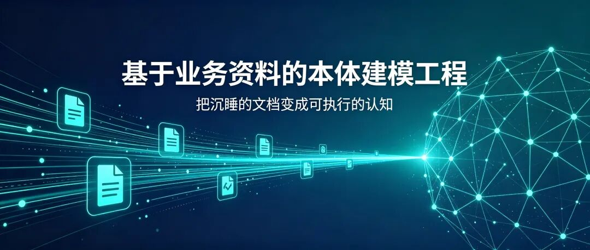
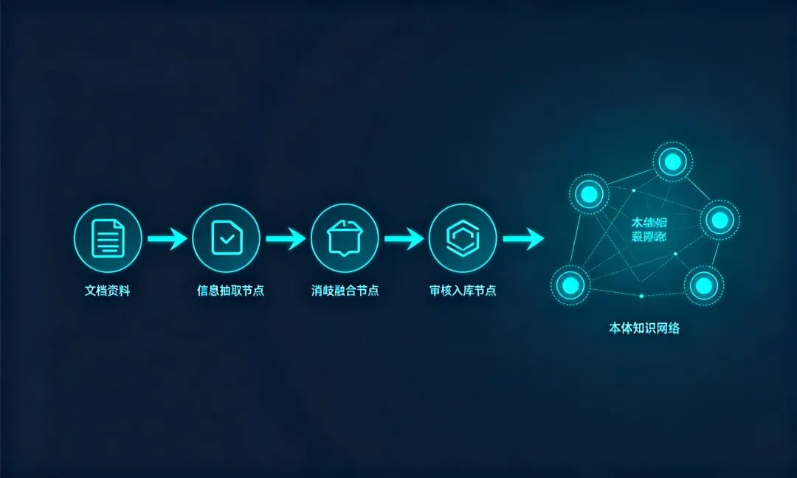
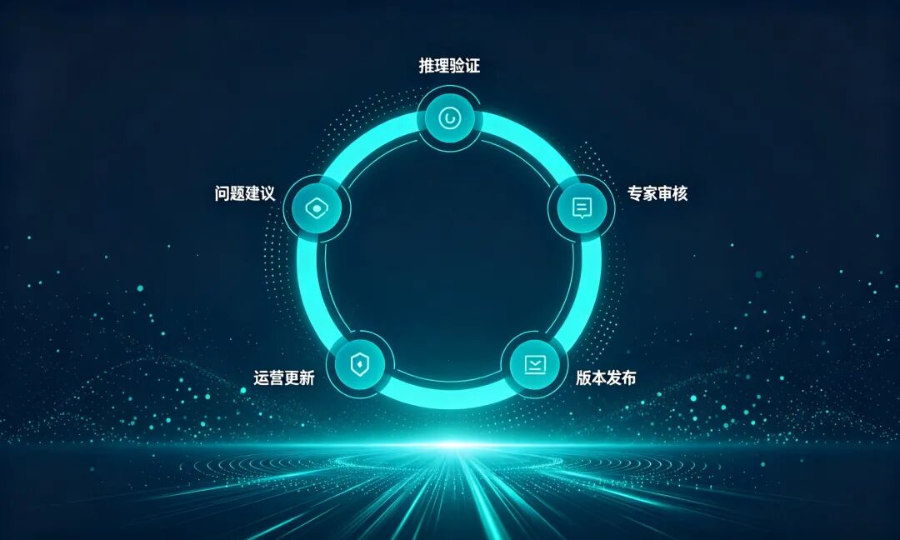

# 本体智能 | 基于业务资料的本体建模工程—把沉睡的文档变成可执行的认知

> **来源**：微信公众号「华力江海」
> **作者**：华力江海
> **发布日期**：2026-09-05
> **原文**：[点击查看](https://mp.weixin.qq.com/s?__biz=MzcxMDMyNTI4MQ==&mid=2247485689&idx=1&sn=2befbfca9cbc87cb3c684ee82c8b082f&chksm=f519adb7c26e24a1ee77c2dd3a13c72fd29ccbdd6f66fef4ce8741540b53c3f3e53de4ef80d9#rd)
> **系列**：本体智能系列

# 基于业务资料的本体建模工程

把沉睡的文档变成可执行的认知

## 01 本体建模的起点，是业务资料

很多人一谈本体建模，就急于画结构图、定义对象、写规则，却忽略了最根本的一件事：本体不是凭空造出来的，它是从业务资料里长出来的。

一个领域积累了多少年，就有多少业务资料沉淀在那里——标准规范、设计文档、操作手册、检修规程、系统代码、历史案例、专家梳理的笔记。这些资料是企业最宝贵的知识资产，但它们大多以非结构化的形态沉睡在文档库里，机器读不懂、系统调不动、经验传不开。

本体建模工程的核心任务，就是把这些沉睡的业务资料，系统性地转化为机器可理解、可推理、可执行的结构化认知。它不是一项"画图"工作，而是一条从资料到模型的工程流水线。资料的质量决定了本体的上限，资料的组织方式决定了建模的效率，资料的持续更新决定了本体的生命力。

## 02 资料准备：建模工程最容易被跳过的一步

在真正开始建模之前，资料准备是决定成败的关键环节，却也是最容易被跳过的一步。

资料准备的第一原则是按用途分层。不同的建模目标需要不同的资料输入：梳理对象体系需要标准模型和数据设计，提炼规则判据需要业务文档和系统代码，定义执行流程需要操作手册和服务元数据。笼统地"收集一堆文档"丢给模型，结果必然是抽取结果偏离目标。

资料准备的第二原则是质量可控。每一份资料都要确认版本有效、来源可溯、格式可解析。用旧标准建模，规则判据必然过时；扫描件不转文本，抽取工具根本读不了；多份资料对同一业务描述不一致却不预先登记，消歧阶段就会爆发源头矛盾。这些问题看似琐碎，却会在建模后期成倍放大返工成本。

资料准备的第三原则是边界裁剪。一份资料里往往只有部分内容与当前建模场景相关，无关内容混进去会污染模型。按场景边界裁剪资料，只保留有价值的部分，是提升建模质量的有效手段。

把资料备齐、备准、备干净，本体建模就成功了一半。

## 03 从资料到本体：一条可重复的工程流水线

资料准备好之后，建模本身遵循一条可重复的工程流水线。无论哪个领域、哪个场景，这条流水线的核心环节是一致的。

第一步是信息抽取。工具对资料内容进行深度解析，识别出其中的对象、属性、关系、规则、约束、流程、动作等核心要素。这一步的关键是"全"——不能遗漏重要概念，也不能把无关信息误纳入。抽取结果要能按资料溯源，每一个识别出的要素都能追溯到它来自哪份文档、哪个段落。

第二步是消歧融合。这是整条流水线里最考验功力的环节。同一个概念在不同资料里叫法不一，同一条规则在不同版本里描述冲突，同一个对象在不同系统里有不同标识。建模工具需要自动识别这些同名异义、异名同义、规则冲突的情况，把它们统一到同一套术语基准下。消歧不是简单的合并，而是要保留差异、记录依据、让专家做最终裁判。

第三步是关联发现。抽取出来的要素不是孤立的，对象之间有关系、规则绑定对象、动作遵循规则、流程串联动作。关联发现就是把这些要素之间的语义联系建立起来，让零散的知识点变成一张完整的认知网络。这一步决定了本体的"连通性"——关联越完整，后续推理和执行的能力越强。

第四步是审核入库。模型自动生成的结果不能直接入库，必须经过业务专家的人工审核。审核要有明确的检查清单——对象是否完整、命名是否统一、关系是否有据、规则是否自洽。审核通过后进入受控版本，每一次更新都留痕可查。审核不是形式主义，而是质量闸门。

这条流水线的价值在于：它把"专家脑子里的经验"变成了"机器可执行的结构"，而且这个过程是可重复、可留痕、可迭代的。换一个场景，同样的流水线可以再跑一遍；资料更新了，流水线可以增量重跑。

从资料到本体：抽取 → 消歧融合 → 关联发现 → 审核入库

## 04 冲突要在建模阶段暴露，不要留到应用阶段

在消歧融合环节，有一个特别值得强调的工程原则：不同资料对同一业务规则的描述存在冲突时，必须在建模阶段自动识别、明确标注、给出处理建议，而不是默默选一个、或者把矛盾留到应用阶段。

规则冲突是业务资料里最常见的问题。两份导则对同一个计算公式的描述不一致，两份规程对同一个状态的判定标准有差异，这种矛盾如果不在建模阶段暴露，智能体在执行时就会遇到规则歧义——到底按哪条算？结果不可预测，责任也无法追溯。

好的建模工程会把冲突检测作为流水线的内置能力：自动比对不同资料中对同一规则的描述，标注冲突点，提示专家裁决。在建模阶段提前暴露信息矛盾，看似多了一步，实则避免了后续应用时的规则执行歧义，是性价比极高的质量投入。

## 05 建模不是一次性交付，而是持续运营的工程

本体建完不是终点，而是起点。业务在变、标准在更新、系统在迭代、新的案例在不断产生。本体如果建完就束之高阁，很快就会过时。

因此，一条贯穿全局的校验闭环是建模工程不可或缺的组成部分。它的工作方式很朴素：定期对已构建的本体做推理验证，检查逻辑是否自洽、要素是否齐全、推理是否可执行；发现问题后形成更新建议；反馈给专家审核；审核通过后由运营人员执行更新；每次更新形成新版本并发布。然后再验证、再发现、再更新，循环往复。

这个闭环让本体建模从"一次性工程"变成了"持续运营"。更重要的是，它让每一次更新都有迹可循——谁发现的问题、谁审核的、改了什么、哪个版本生效，全部留痕。在对可靠性要求极高的行业里，这种可追溯性不是可选项，而是必选项。

业务资料的更新也应该自动触发本体的增量更新。新的标准发布了、新的规程生效了、新的故障案例沉淀了，这些资料变化应该能被及时感知，并通过流水线增量更新本体，而不是等本体明显过时了才想起重做。

校验闭环：验证 → 建议 → 审核 → 更新 → 发布，循环往复

## 06 工程化的几个关键意识

基于业务资料的本体建模，要真正落地，需要建立几个关键的工程意识。

一是标准意识。术语要有统一基准，命名要有治理规则，版本要有受控机制。没有标准，本体就会越建越乱。

二是留痕意识。每一个要素来自哪份资料、每一次更新是谁做的、每一条规则是怎么裁决的，都要留痕。留痕不是为了追责，而是为了可追溯、可复现、可信任。

三是增量意识。不要追求一次性建完建全，而要支持增量更新、持续迭代。先把核心场景建扎实，再逐步扩展。

四是人机协同意识。建模工具能做抽取、消歧、关联的体力活，但最终的业务判断必须由专家把关。工具提效、专家把关，两者结合才能产出高质量的本体。

五是落地意识。本体建出来是要用的，不是摆着看的。对象要能映射到真实数据表，动作要能绑定到真实服务，规则要能支撑真实推理。不能落地的本体，再精致也没有价值。

## 07 写在最后

基于业务资料的本体建模工程，本质上是一场"资料资产化"的变革。它把企业沉睡在文档里的业务知识，通过一条可重复、可留痕、可迭代的工程流水线，转化为机器可理解、可推理、可执行的结构化认知。

这件事的难点不在工具多先进，而在工程意识够不够扎实——资料备得够不够准、消歧做得够不够透、冲突暴露得够不够早、审核把得够不够严、闭环跑得够不够顺。

把这些工程环节做扎实，业务资料就不再是沉睡的文档，而是变成了能支撑智能体推理、决策、执行的活的认知资产。这，就是本体建模工程真正的价值。

### 关注「本体智能」

持续获取企业级本体模型实践干货

### 立即关注\*\* \*\*华力江海

关注我们 · 不错过每一次更新
