# 本体智能 | 基于本体驱动的光伏设备可靠性分析

> **来源**：微信公众号「华力江海」
> **作者**：华力江海
> **发布日期**：2026-08-22
> **原文**：[点击查看](https://mp.weixin.qq.com/s?__biz=MzcxMDMyNTI4MQ==&mid=2247485515&idx=1&sn=d349593b456094154cfe79cf744e9066&chksm=f519ad05c26e24135d9f55b65a5fdf06d466122071c11c6ec86725a4c324c60bd44cf3864ea2#rd)
> **系列**：本体智能系列

**本体智能 | 光伏可靠性分析**

### 基于本体驱动的光伏设备可靠性分析

### 让可靠性评价又快又准

企业级本体模型把分散在台账、监控、工单、气象之间的数据变成一张可推理的语义网，让标准从月底才翻一次的考核表，变成时刻运转在系统里的计算规则。它把可用系数、非计划停运系数、能效比等三十余项指标从人工报表升级为可信计算对象，既能实时聚合，也能因果溯源，让可靠性评价又快又准、每一次结论都可审计、可回写、越用越准。

**可靠性评价** **可信计算** **根因推理**

**📌 本文导读** \*\*本文摘要：\*\*把企业级本体模型用作光伏可靠性评价的语义框架。从传统评价的四类局限出发，讲清本体怎么把可用系数、等效可用系数、非计划停运系数、能效比、组件维修率等三十余项指标从人工报表变成可实时聚合、可因果推理、可自我迭代的可信计算对象；以一个电站样本展示根因定位、家族性缺陷、容配比优化、预测性维护四类场景的落地结果，验证「算得准、算得快、算得可追溯」的可信计算能力。文末配五步实施法与三个避坑点。

### 📚 相关阅读

**1**[企业级本体模型建模标准](https://mp.weixin.qq.com/s?__biz=MzcxMDMyNTI4MQ==&mid=2247483823&idx=1&sn=47c8cc159a8cb18e0475fe385cfc6e76&scene=21#wechat_redirect)

**2**[本体自动化建模之一：自动化建模原则和方法](https://mp.weixin.qq.com/s?__biz=MzcxMDMyNTI4MQ==&mid=2247485208&idx=1&sn=6bb449b3fd659cd6af7423cb186bc744&scene=21#wechat_redirect)

**3**[本体自动化建模之二：文档如何长成可信本体模型](https://mp.weixin.qq.com/s?__biz=MzcxMDMyNTI4MQ==&mid=2247485354&idx=1&sn=e0d338431af1a433b74a0e84adb9d477&scene=21#wechat_redirect)

**4**[一文读懂企业级本体模型](https://mp.weixin.qq.com/s?__biz=MzcxMDMyNTI4MQ==&mid=2247483753&idx=1&sn=dec18da14ad72d4cc53e0dd6ecf11dcb&scene=21#wechat_redirect)

### 从保安全到抠电量

## 01 可靠性管理的新压力

光伏行业走到今天，赚钱的逻辑变了。早期靠补贴、靠装机规模扩张拉动收益，现在补贴退坡，电站回报几乎全压在全生命周期发电量折算与运维成本摊销上。一块组件、一台逆变器、一个组串是不是在尽可能多地发电，直接决定这座电站能不能收回投资。

矛盾出在用尺子的人身上。标准把可用系数、等效可用系数、非计划停运系数、能效比、组件维修率等三十余项指标定义得清清楚楚，但支撑评价的数据散落在台账、监控系统、逆变器日志、气象站、缺陷工单、发电量报表等彼此割裂的系统里。月底靠人汇总，损失电量算出来了却说不清来自哪台设备、哪次缺陷；缺陷发生了却追不到同批次其他设备。尺子是准的，但量不出速度，也量不出因果。

新压力来自三个可量化的代价：

**1**

### 一台逆变器非计划停运

集中式逆变器非计划停运一天，对应数十兆瓦容量与数十兆瓦时电量直接损失，月报表里只体现为一条非计划停运记录，看不出金额。

**2**

### 一批组件隐裂衰减

晶体硅组件年衰减率中位数约 0.5%，湿热高热地区系统级可达 0.75% 每年。设计寿命二十五年的电站，累积下来总发电量与设计值可能差出几个百分点，且衰减在某些季度集中暴露。

**3**

### 一个组串因汇流箱熔断失配

汇流箱直流熔丝熔断、触头裂纹很隐蔽。整串电流被拖累后逆变器只看到总功率略低，定位到具体支路要靠人工反复试错。

这三个代价把可靠性管理的目标升级为：把每一度本应发出的电尽可能发出去。衡量这件事的尺子，就是那套可用性、出力、非计划停运与能效指标。谁先把这把尺子用快、用准、用出因果，谁就掌握了电站经营的主动权。

### 四个绕不开的局限

## 02 传统评价的四种局限

标准把指标定义清楚，落到工程里，传统评价方式有四个绕不开的局限。这些局限不是标准的问题，而是数据组织方式的问题。

**局限 1 · 数据孤岛**

台账在资产系统、运行数据在监控系统、逆变器日志在厂家平台、气象数据在气象站、缺陷工单在运维系统、发电量在营销结算。各系统主键、粒度、更新频率都不同，月底出可靠性月报靠人手工拼表。某能源集团应用智能运维后平均发电量提升 5.2%、节约运维费超千万元，前提正是先把这些割裂数据接起来。

**局限 2 · 语义歧义**

同一台设备在不同系统里叫法不同只是表层，更深层的是统计口径漂移。组串式与集中式发电组结构不同，却常被混在一张表里统计，容配比口径自然就乱。容配比高的发电组在非辐照峰时段逆变器要限功率，损失电量被大可用分母稀释，让问题被掩盖。

**局限 3 · 指标滞后**

标准里大多数指标是统计期间的小时聚合、按月计算。等月底发现某发电组群非计划停运系数偏高，故障已经发生了好几周，损失电量已经实实在在流走。AI 驱动的监控把故障识别时间从平均 4 小时缩短到 8 分钟，背后不是报表更快了，而是数据从采集到判断的链路被压缩。

**局限 4 · 不可推理**

标准给了状态划分与损失电量公式，但损失电量怎么溯源到具体部件、缺陷怎么在同批次设备间传导、根因落在哪一级，留给工程实现。比如一台逆变器解列，标准能告诉你进入非计划停运、损失多少电量，却说不清是 IGBT 结温超阈值还是直流母线故障，更说不清这台隐患和三个月前另一台同型号设备过热是同一类。

四类局限叠加，可靠性评价在多数电站仍是合规动作，而非经营工具。指标用来填月报、对考核，却难告诉运维明天该修哪台、换哪批。要同时解开四个局限，靠的不是更大的数据库，而是把数据组织成可推理网络的语义框架。这也是企业级本体模型切入的地方。

### 统一语义框架

## 03 企业级本体模型：给可靠性一个统一语义框架

讲清本体，先要区分三样东西：数据表、知识库、本体。

数据表存的是值。一张设备台账表里，一行是一台逆变器，列是型号、投运日期、额定功率。它能查、能统计，但本身不懂语义。数据库不知道逆变器属于某个发电组、发电组属于某个组群、组群属于某座电站，这些关系要靠写查询的人脑子里装着，或者靠 JOIN 语句临时拼。

知识库存的是事实三元组，比如（逆变器A，属于，发电组B）。它比数据表进了一步，能表达关系。但很多知识库缺一层统一模式，概念怎么定义、关系怎么约束，往往是建到哪算到哪，不同人往里加知识的规则不一致，时间久了图谱里会出现逻辑冲突。

本体在两者之上再叠一层模式层。它先定概念，再定概念之间的关系，再定公理约束，最后才把数据挂上去。打个比方，数据表像一本写满数字的账本，知识图谱像把账本里的条目连成关系网，本体则是先制定这本账本的科目制度和记账规则，再让所有条目按规则入账。账本是死的，关系网能查，但只有科目制度和规则齐了，账本才具备可审计、可追溯、可推理的底子。

企业级本体模型把这套思路工程化，形成一套以本体为核、分层分域、可装配的结构，对外呈现为我们成果中的三层架构：语义内核层（概念、关系、公理，稳定持久）、实例数据层（实体、事件、属性，随电站投运动态生长）、应用推理层（指标派生、根因推理、对话问答，直接服务业务）。语义内核层相对稳定，十年不变，定义什么是发电组、什么是逆变器、什么是失效模式；实例数据层随电站投运不断新增，每接入一座电站、一台设备，就多一批实体。这种分层让标准与数据解耦：标准里的概念沉淀在语义内核层，电站的实际设备沉淀在实例数据层，标准升级不影响已接入的实体，新电站接入也不动摇概念框架。

### 3.1 三层架构（本体为核型）

把本体的结构展开看，便于理解它在光伏场景怎么落地。下面这张图为我们成果中的本体为核型三层架构示意：

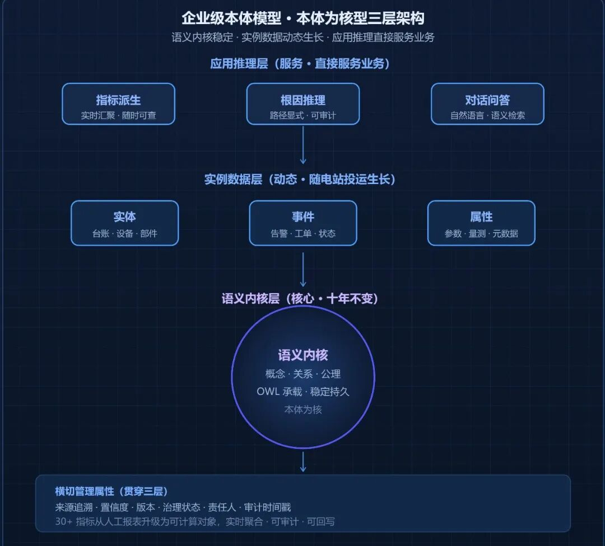

图 1：光伏可靠性本体「本体为核型」三层架构。语义内核层以 OWL 承载概念、关系与公理，稳定持久；实例数据层随电站投运持续生长实体、事件与属性；应用推理层把内核与数据转化为指标、根因与问答。三者之间靠标准设备代码 + 分解路径对齐，横切的标识、来源、状态、置信度、创建者、时间戳六类管理属性贯穿每一层。

### 3.2 三段式信息：让每个对象可追溯

每个进入本体的对象都带三段式信息。数据属性描述它自身，比如逆变器的额定功率、投运日期。对象属性是外键式的关系，指向它所属的上一级设备和它所包含的部件。固定六个管理属性是每类对象都强制带上的：标识、来源、状态、置信度、创建者、时间戳。这六个属性让任何一个对象都可追溯、可审计。你看到一条失效记录，能立刻知道它挂在哪台设备、从哪份工单来、当前状态是什么、系统对它的判断有多大的把握、是谁在什么时候写入的。这种可追溯性，是可靠性评价从合规走向经营的前提。

**核心判断**本体不是又一个知识库，而是可靠性评价的语义操作系统。知识库的价值在存，把分散的知识集中起来；本体的价值在算，把分散的知识组织成可计算、可推理的网络。一座电站的可靠性不是存出来的，是实时算出来的。谁把本体当成存储用，谁就会收获一个没人维护的知识孤岛；谁把它当成操作系统用，谁才真正拿到了标准的可计算版本。

### 3.3 本体建设示例：本体平台原型运行截图

下面这张图是本体建模工具原型对本套光伏可靠性本体的一次完整提取结果：要素覆盖数据实体 10、主对象 5、业务对象 16、业务属性 13、对象关系 14、业务规则 10、约束条件 9、业务公理 7、业务流程 4、业务活动 11、业务动作 11、能力工具 11、要素关系 116、文档质量审查报告 6，共计 149 条要素 + 116 条关系。本体平台不仅是存储，还把每类要素的分布、要素类型占比、文档质量审查结果直接以看板方式呈现。

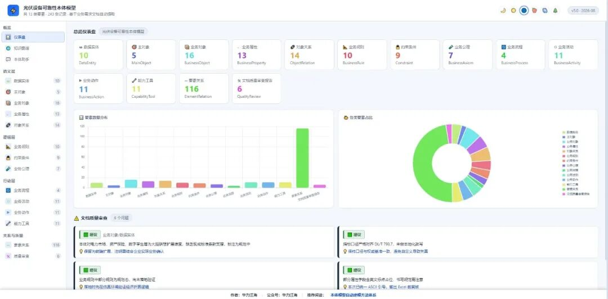

图 2：本体建模工具原型对光伏设备可靠性文稿的一次完整提取结果看板。左侧为 12 类要素导航 + 逻辑域（知识域、逻辑域、过程域、行动域、关系与质量）分布，中间为要素总览（12 类要素条数 + 要素关系 + 文档质量审查报告），右下角为文档质量审查 6 个问题的逐条建议。

### 机器语言翻译

## 04 把标准翻译为机器语言

本体要真正服务光伏可靠性评价，关键动作是把那套评价标准翻译成机器能直接执行的语义对象。这一步做扎实了，后面的实时聚合与因果推理才有锚点。

### 4.1 概念层：把评价对象提升为类树

评价对象提升为一棵类树：发电组群聚合 N 个发电组，发电组按逆变器类型再分。组串式发电组不含汇流箱，集中式发电组含汇流箱，这个区别用公理固化下来，任何一条新数据若标注为组串式却带了汇流箱，系统会判为逻辑矛盾并拒绝入库。这种公理约束杜绝了传统报表里组串式、集中式混统计导致的口径漂移。概念层还定义组件、支架与跟踪系统、汇流箱、逆变器等设备的类，以及它们的评价口径，保证不同电站接入时说的是同一套概念。

### 4.2 设备分解结构：让非计划停运可下钻

以逆变器为例，它不是一个黑盒，而是包含 IGBT 模块、直流母线、滤波单元、散热系统（风扇、风道）等部件。每个部件挂自己的额定参数和实时量测。这一步的价值在于让非计划停运可下钻：一台逆变器非计划停运，系统不再只停留在逆变器这一级，而是能顺着分解结构看是哪个部件先异常。TUV 莱茵的技术风险研究指出，影响光伏逆变器的失效模式主要集中在承受高和电应力的单元，以及热管理本身，IGBT 等电子开关、bus 电容、风扇是逆变器故障的主要责任部件，其中风扇失效会导致逆变器过热、影响整体寿命。把部件建进本体，正是为了把这类行业共识变成可计算的下钻路径。

### 4.3 失效模式本体：FMEA 四元组冷启动

FMEA 是故障模式与影响分析的成熟方法，四元组是失效模式、隐患因素、影响后果、维护措施。这四条槽位让系统在小样本时就能启动：一份新工单进来，系统自动把现象挂到失效模式、把诱因挂到隐患因素、把后果挂到影响后果、把处理挂到维护措施。不需要等全量数据，第一批几十份工单就能把骨架填满。之后每来一份工单，四元组自动生长。这个冷启动特性对光伏很重要，因为电站投运初期缺陷样本少，等不起全量积累。

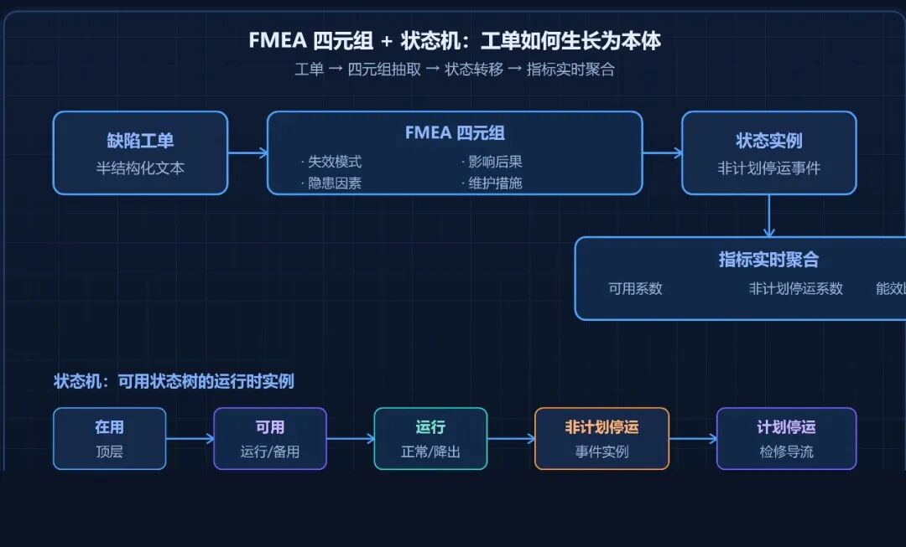

### 4.4 可靠性状态机：标准状态树映射为可计算

可靠性状态机把标准里的状态划分变成可计算的状态类。标准用三层树描述设备状态：在用之下分可用与不可用，可用之下分运行与备用，运行之下分正常出力与降低出力，不可用之下分计划停运与非计划停运。这套状态树直接映射为本体的状态类，状态之间的转移用规则加时间锚点表达。比如逆变器解列事件触发状态从运行转为非计划停运，状态实例带着起止时间戳落在数据库里。于是可用系数、等效可用系数这些指标，不再由人月底拿小时数加减，而是由状态实例实时聚合算出来。某电站的设备小时数，系统随时能给出，不用等月末。

### 4.5 指标本体：派生属性由查询实时算

指标本体把可用系数、等效可用系数、非计划停运系数、能效比、出力系数定义为挂在对象上的派生属性，关键点是它们由查询实时算而非存值。传统报表里这些指标是算完存进单元格的数字，错了难追溯、改了难留痕；本体里它们是查询函数，输入是状态实例和量测，输出随时可重算。容配比修正也显式建模：选出标杆发电组作为参考，其他组群跨组群比较时强制归一化到同一容配比基准，避免大分母稀释非计划损失。这一条直接回应了第 2 章说的语义歧义问题。

把上述四块合起来看，标准被翻译成了四类机器对象：概念类（设备与对象定义）、结构类（设备分解与归属）、失效类（FMEA 四元组与状态机）、指标类（派生属性与查询）。它们之间有清晰的关系和公理，数据进来后自动归位、自动计算、自动可溯。到这里，标准已经不是月底才翻出来的考核表，而是时刻运转在系统里的计算规则。

### 4.6 本体建设示例：业务对象 + 业务规则 + 业务公理

下面三张截图展示了本体平台从光伏标准与故障分析文稿中自动提取出的三类核心要素的明细。

业务对象截图：

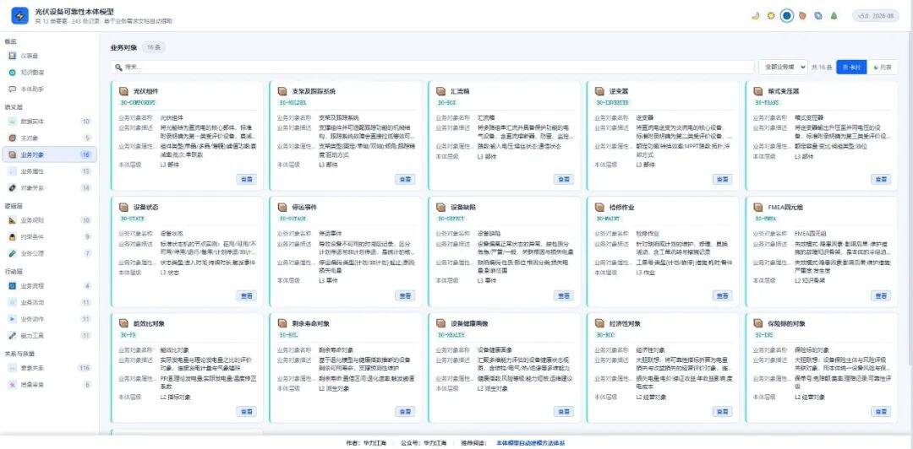

图 4：业务对象 16 条，包括光伏组件、支架及跟踪系统、汇流箱、逆变器、箱式变电站、设备状态、设备缺陷、设备停运、设备检修、检修作业、FMEA 四元组、能效比对象、剩余寿命对象、设备健康画像、经济性对象、保险标的对象。每条都标了「业务对象指标」与本体模型关联状态（本体提取 / L3 部件）。

业务规则截图：

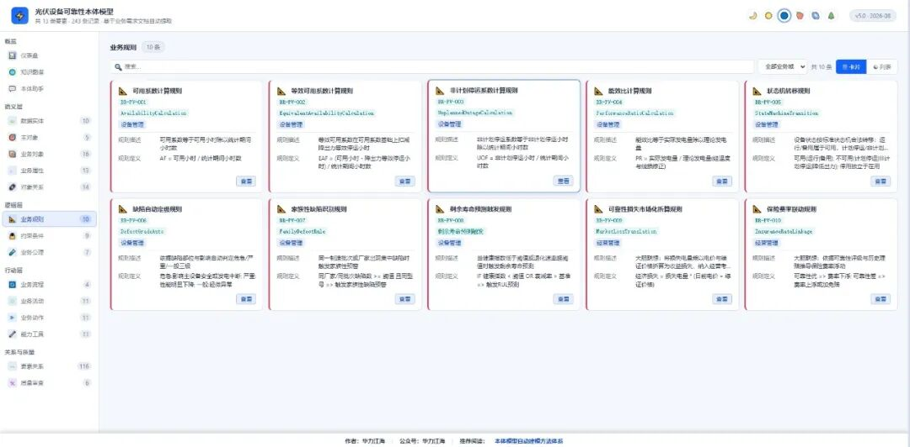

图 5：业务规则 10 条（BR-PV-001 至 BR-PV-010），覆盖可用系数计算、等效可用系数计算、非计划停运系数计算、能效比计算、状态机转移规则、缺陷自动定级、家族性缺陷识别、剩余寿命预测触发、可靠性损失市场化折算、保险费率联动规则。每条都标注规则管理与规则定义（公式）。

业务公理截图：

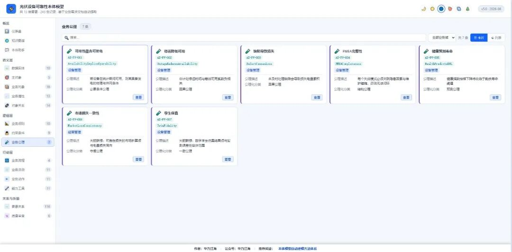

图 6：业务公理 7 条（AX-PV-001 至 AX-PV-007）：可用性蕴含可发电、组串式降出、缺陷导致损失、FMEA 完整性、健康预测寿命、市场损失一致性、孪生保真。每条都明确公理化分录与公理管理判定。本体把这层逻辑以公理形式约束，任何越界数据都会被推理机拒绝。

### 数据流进本体

## 05 数据怎么流进这张网

本体框架搭好了，下一步是把真实数据接进来。光伏电站的数据源不少，按落点分七类。

台账是设备的静态档案，落到实体层。监控系统与逆变器日志是实时量测，电流、电压、温度、功率、谐波这些，落到实体层的实时属性或事件层。衰减测试报告是组件性能的阶段性结论，落到属性层并与时间关联。气象站数据（辐照、温度、风速）既是实时量测也是折算理论发电量的基准，参与指标计算。缺陷告警与检修工单是典型的半结构化文本，包含现象、部位、原因、处理，是失效模式本体的主粮。发电量台账是评价的结果事实，用来校准指标、反推损失。

这些数据接进来，技术上分两类处理。结构化字段直接入库，比如台账的型号、投运日期，监控系统的数值点。半结构化文本用大模型初抽加规则校验：先让大模型从工单里抽出失效模式、隐患因素、影响后果、维护措施四元组，再用本体一致性规则校验，比如逆变器类型只能取组串式、集中式、微型三者之一，越界的字段退回去人工确认。关键字段落库前过一遍本体检查，能挡掉大部分脏数据。前面提到光伏运维面临多源异构数据治理、要处理三成以上的脏数据，这个闸门正是针对它。

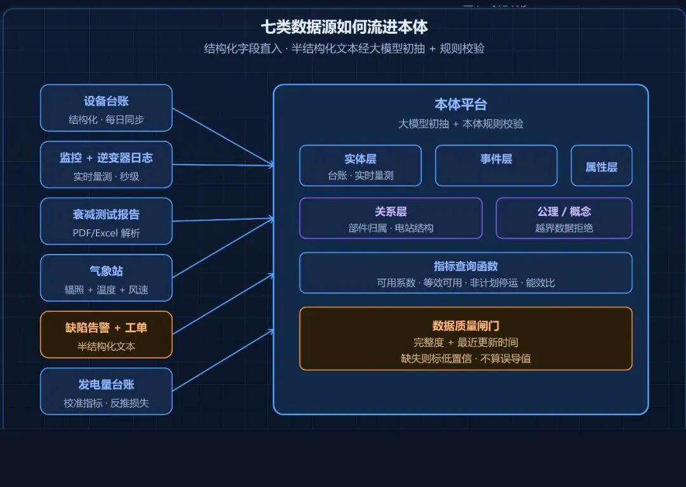

图 4：七类数据源通过不同的清洗路径进入本体的五个层面，并在数据质量闸门处统一校验。半结构化文本（橙框）走大模型初抽 + 本体一致性校验的特殊通道。

对齐靠两套键。一套是标准设备代码，一套是设备分解结构路径。任何一条记录，只要能解析出电站、组群、发电组、设备、部件这条路径，就能准确挂到本体里对应的节点。比如一条逆变器过温告警，用设备代码定位到具体逆变器，用分解路径确认它属于哪个发电组、哪个组群、哪座电站，再挂到该逆变器的散热系统部件上。这种对齐让数据从入库起就带上层级坐标，后面无论是下钻还是上卷统计都不会错位。这里用对齐一词，强调把不同系统的标识对应到同一棵结构树，而不是简单把库连起来。

数据流进来之后，可靠性评价的质变发生了：指标从终点变成起点。传统报表的流程是月底汇总、算出组群非计划停运系数偏高、再派人去查；本体里指标随时可查，一旦某组群非计划停运系数异常，系统顺着结构一路下钻，直接告诉你哪几个发电组的逆变器 IGBT 过热。指标不再是月末才有的结论，而是随时可出发的检索入口。

还要设一道数据质量闸门。每个实时属性都挂完整度与最近更新时间两个元信息。比如能效比计算需要峰值日照时数，如果这个气象量缺失或长时间没更新，系统会把能效比标成低置信，而不是硬算一个误导值。NREL 的衰减率基准、TUV 的故障统计都建立在数据质量可靠的前提上，数据闸门保证了本体算出来的指标值得信。

### 三层推理 + 置信度循环

## 06 从算指标到找根因

指标能实时算，只是第一步。真正的价值在算完之后继续往根因走。本体加推理引擎，干的就是这件事。

规则推理做确定性的因果演绎。状态随事件自动流转，前面讲过的状态机在这里生效。损失电量沿设备与失效链反向推到具体部件和失效模式。比如逆变器解列，状态转非计划停运，系统按 FMEA 四元组里写好的规则，把损失电量归因到对应失效模式，再顺着分解结构定位到部件。这类推理路径明确、可审计，适合处理已知模式。

图神经网络覆盖标准没写、人工也难一眼看穿的隐含关联。公开研究里，华能南京金陵发电有限公司联合东南大学，依托国内最大的校园光伏电站之一，构建了基于知识图谱的光伏电站故障智能诊断与智能运维系统，把多维时序数据预处理后建知识图谱，再基于图谱的时空结构和语义信息构建图神经网络。这类图方法擅长发现跨实例的共性：同一批次 IGBT 在多台逆变器集体过热，单看某一台只是偶发，图谱把多台同类设备的过热事件聚到一起，共性问题就浮出来了。

贝叶斯方法把不确定性显式建模。诊断不是非黑即白，系统对某个根因的判断有概率，观测到新证据后概率更新，诊断结果再回写置信度。这形成一个观测、推理、置信度更新的循环，让系统越用越准。

诊断结论 + 置信度 + 证据链运维可看到「为什么这么判断」，结论可逐条回看

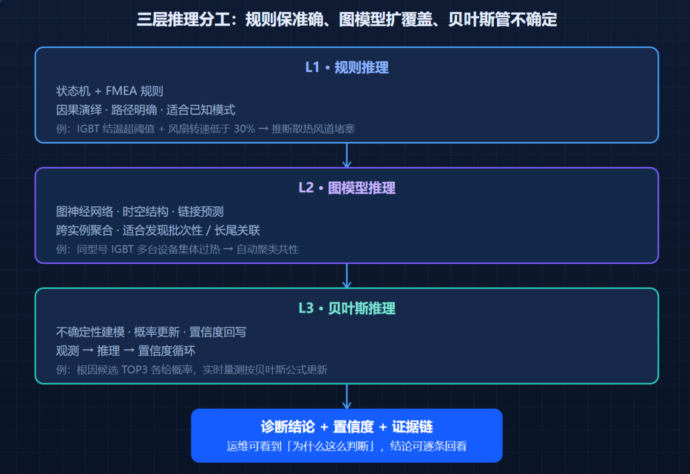

图 5：三层推理自上而下分工、最后汇聚为带置信度与证据链的诊断结论。这与纯检索增强的生成式问答不同：图谱上的推理路径是显式的，诊断依据可逐条回看。

根因定位用一个实例串起来。逆变器解列，状态转非计划停运；系统汇聚该逆变器 IGBT 结温与同批次历史过热记录，图推理给出若干个根因候选及其概率；贝叶斯用实时量测校准，输出概率最高的结论：IGBT 结温超阈值，隐患为散热风道积尘堵塞，并附带处理指令。全程每一步都可追溯，运维人员能看到系统为什么这么判断，而不是接收一个黑箱结论。这与纯检索增强的生成式问答不同：图谱上的推理路径是显式的，诊断依据可逐条回看。

剩余寿命把可靠性从被动修推向主动换。组件衰减率驱动预测性维护，剩余寿命与组群维修率联动，提前一个周期排程更换，从坏了再修转成算好再换。行业里有可参照的基准：阿特斯 PowerLab 开发的组件衰减预测模型误差率小于 0.3% 每年，天合光能 TrinaOSS 系统通过 LSTM 算法提前 72 小时预测发电量偏差。这些外部能力接入本体后，组件剩余寿命成为可计算的派生属性，与维修率一起驱动排程。

为什么本体加图推理优于纯检索增强，结论很清楚。纯检索增强擅长从文本里找相似案例，但跨实例聚合、把多台设备的问题归并成一批次隐患，是它的弱项；本体把实体关系显式存成图，跨实例聚合是原生能力。更重要的是推理路径显式可审计，这对可靠性评价很关键，因为结论要经得起复盘、要能写进月报、要能对供应商追责。

置信度回写是本体区别于静态知识库的关键机制。每次诊断完成，系统把结论、证据链、置信度写回对应实体的管理属性，并追加到事件层。下次同类故障再来，图模型的训练样本里多了一条，贝叶斯先验也更新了，系统越用越准。这个循环不需要人工干预，是自动化完成的，也是全文反复强调自我迭代的具体落点。

规模与性能不是空话。以某电站为例，3200 个发电组、数万台组件、百余台逆变器，本体实体量在数十万级，加上事件与量测，图数据规模在百万节点量级。图数据库对这种规模的多跳查询是毫秒到秒级响应，时序数据库按组群窗口聚合指标也是秒级。月报那种按月统计的查询，在秒级返回，与传统月底拼表相比已经是代际差异。平台上线前要做一次离线回放：把历史一个月的原始数据灌进去，让系统按本体口径重算全部指标，与人工月报逐项比对，差异为零才允许上线。这一步既验证口径一致性，也建立审计基线，后续任何算法改动都能拿回放结果对照，防止越改越偏。

### 6.1 本体建设示例：本体知识图谱 + 业务活动 / 业务动作

下面这张图是本体平台对光伏可靠性本体做的全局知识图谱（自动布局），左上角为本体的五域结构（数据实体、主对象、业务对象、业务属性、对象关系、业务规则、约束条件、业务公理、业务流程、业务活动、业务动作、能力工具），中间主区域是实体与关系图，自动聚出设备、指标、规则、流程几大簇。

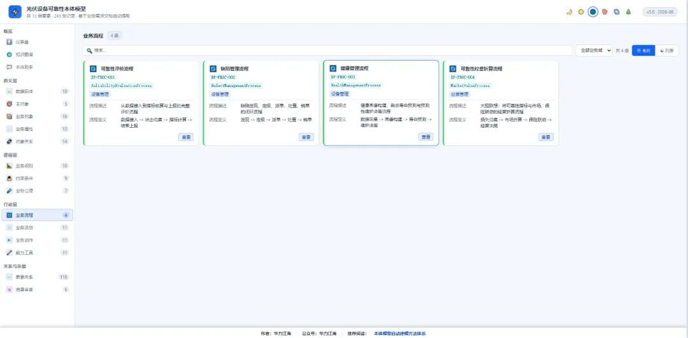

图 6：本体平台对本套光伏可靠性本体的全局知识图谱视图。10 个图层可切换（数据实体、主对象、业务对象、业务属性、对象关系、业务规则、约束条件、业务公理、业务活动、业务动作、能力工具），关系类型可按「关联/包含/父子/组合/聚合/状态/触发」筛选，自动力导布局（F-D-E 全节点定位）。107 个实体 + 116 个关系在浏览器中毫秒级渲染。

下面是业务活动与业务动作两类过程层要素：

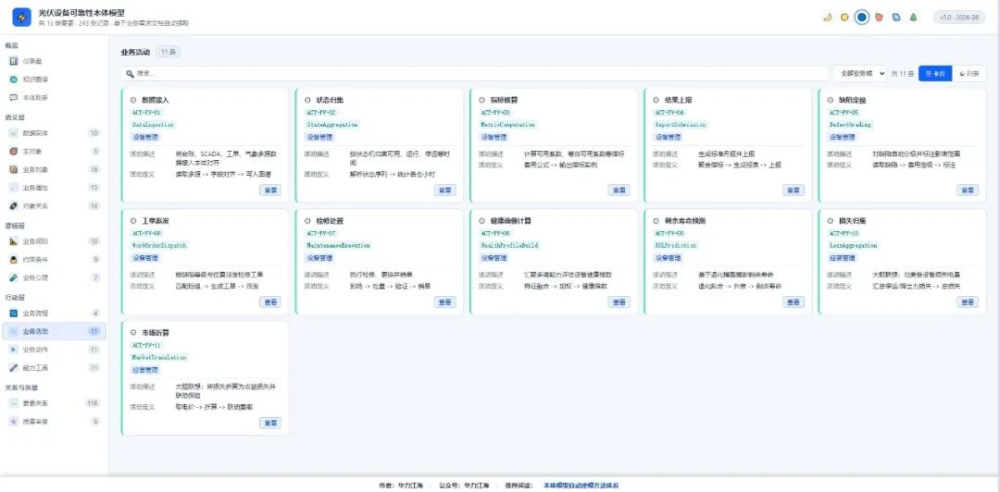

图 7a：业务活动 11 条（ACT-PV-01 至 ACT-PV-11），覆盖数据接入、状态归集、结果上报、缺陷定级、工单派发、检修处置、健康画像计算、剩余寿命预测、损失归集、市场折算。

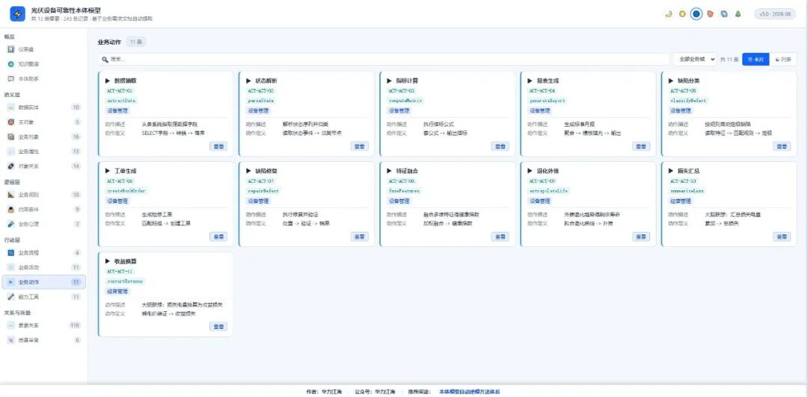

图 7b：业务动作 11 条（ACT-ACT-01 至 ACT-ACT-11），是业务活动的原子化操作：数据抽取、状态解析、报表生成、缺陷分类、工单生成、缺陷修复、特征融合、退化外推、损失汇总、收益换算。

### 可信计算

## 07 可信计算视角下的落地样本

方法讲完，落到可信计算视角看效果。下面以某电站为样本，它分 8 个组群、3200 个发电组，上平台前靠月末人工汇总、根因靠老师傅经验、衰减率年度抽检、容配比口径混乱。接入企业级本体模型后，四类场景最能体现「算得准、算得快、算得可追溯」的可信计算能力。文中数值为综合公开案例区间测算，具体电站以某电站代称。

**场景 A · 根因定位**

某集中式发电组突发非计划停运。系统 90 秒内完成状态流转 + IGBT 结温汇聚 + 同批次历史过热 + 图推理 + 贝叶斯校准，输出「IGBT 结温超阈值，隐患为散热风道积尘」+ 处理指令。诊断时长从数小时压到约九成。

### 数小时 → 90 秒

**场景 B · 家族性缺陷**

某季度组群组件维修率从 0.8% 升到 3.1%。下钻发现某批次单晶组件衰减率普遍超 8% 且空间聚集，标记为疑似家族性缺陷并自动推供应商预警。批次、厂家、同型设备的关系建进本体，家族性缺陷从靠人回忆变成系统自动聚出。

### 0.8% → 3.1% 自动捕获

**场景 C · 容配比优化**

部分组群超配，高辐照时段逆变器限功率，损失被大可用分母掩盖。容配比显式建模后，跨组群比较归一化到同一标杆，立刻暴露限功率损失。建议回调至 1.1 并错峰调度，回收原本被掩盖的损失电量。

### 大可用分母 → 归一化

**场景 D · 预测性维护**

按组件衰减率加辐照预测剩余寿命，识别 RUL 不足 2 年的组件集中在两个组群，提前一个周期排程更换。避免一波集中停运。从「坏了再修」转成「算好再换」。

### 被动修 → 主动换

图 8：四类场景卡片（A 根因定位 / B 家族性缺陷 / C 容配比优化 / D 预测性维护）。每卡用「传统痛点 → 本体方案 → 量化收益」三段式呈现。

四类场景跑下来，量化收益可以参照公开区间做脱敏测算：非计划停运相关的处置时长压缩约七成，诊断从小时级降到分钟级，维护成本优化 15% 到 25%，回收发电量折算到年增发数个百分点。这些数字不是凭空来的，而是对应前面列举的行业实践：某能源集团应用智能运维后平均发电量提升 5.2%、年节约运维费超千万元；三峡乌兰察布电站部署 4 万余个传感器、构建 0.5 米精度数字地图，故障定位效率提升 400%；正泰新能源 AI 调度中心接入 30GW 资产，自动处理七成常规工单。本体框架把这类能力统一到一套语义下，让收益可归因、可复核。

契合度一点要强调：所有指标都按前面说的评价口径计算，实例绑定设备代码，平台可以直接生成标准月报。它不另搞一套算法，只是把标准从人工报表变成实时计算。这意味着运维班组不用学新体系，原来填月报的那套指标，现在由系统按同一口径自动算、自动出，切换成本极低。

### 7.1 本体建设示例：业务流程 + 本体问答

下面这张图是本体平台对本套可靠性本体的 4 条业务流程（BP-PROC-001 至 BP-PROC-004）的明细：可靠性评价流程、缺陷管理流程、健康管理流程、可靠性经营折算流程。每条流程都标注了「流程构成」与「流程定义」两步走。

图 9：业务流程 4 条。BP-PROC-001「可靠性评价流程」是主流程，含数据接入、状态归集、指标计算、结果上报 4 步；BP-PROC-002 / 003 / 004 是三个子流程，分别覆盖缺陷管理、健康管理、经营折算场景。这套结构让流程可拆可合，子流程复用主流程的指标与数据。

「对话即查」是本体平台对运维人员最有用的入口。下图是用户问「光伏电站包含哪些设备？」时，本体平台自动生成的可视化查询结果与文字答案：

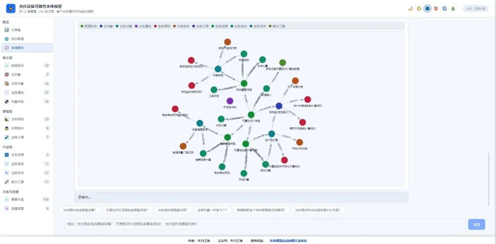

图 10a：自然语言问题 → 自动生成可追溯子图。中心节点「光伏电站」向外辐射到主对象、组件、逆变器、汇流箱、箱变、支架、跟踪系统等子节点。

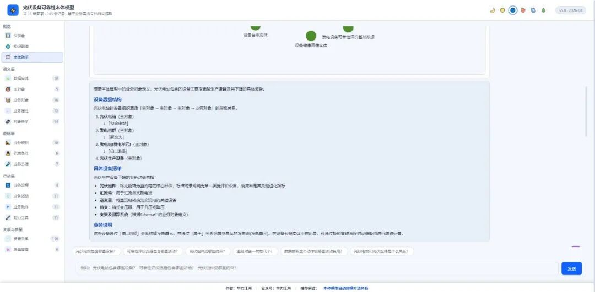

图 10b：自然语言答案：明确设备层级关系（主对象包含 → 组件、逆变器、支架、跟踪系统）、具体业务对象（光伏组件、汇流箱、箱式变电站等）、可作问的属性维度，附 5 个推荐追问。

再来一个偏流程的问法：用户问「可靠性评估流程包含哪些活动？」，本体平台同样返回可视化子图与结构化答案，把「流程」拆到具体的业务活动与业务动作：

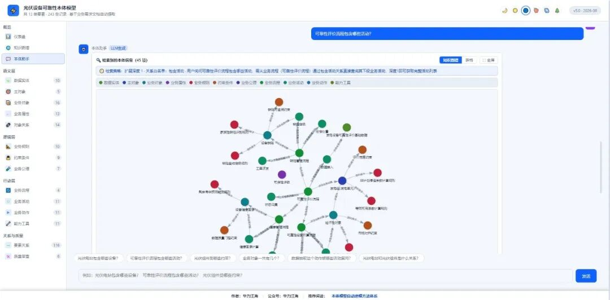

图 11a：流程类问题 → 自动聚合相关业务活动、业务动作、规则与公理，自动力导布局呈现 45 个节点。中心节点「可靠性评估流程」是间接流程（通过过程包含关系），具体活动散落在周围 10 类业务活动与 11 类业务动作上。

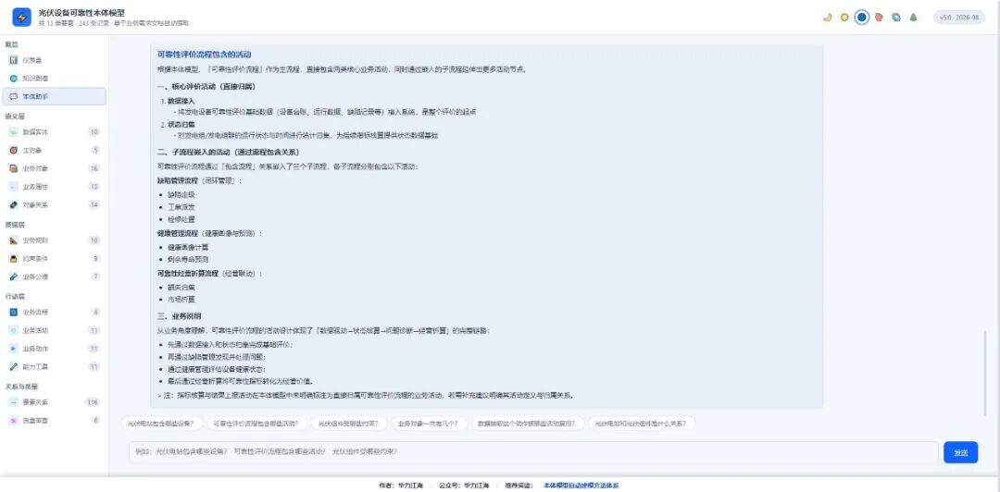

图 11b：结构化答案：先按核心评价流程拆解「数据接入 / 状态归集 / 结果上报 / 缺陷定级 / 工单派发 / 检修处置 / 健康画像计算 / 剩余寿命预测 / 损失归集 / 市场折算」十类活动，再把每类活动映射到原子化的业务动作，并显式给出活动所属的子流程（缺陷管理 / 健康管理 / 可靠性经营折算），最后落到业务说明上「如何使可信计算成为标准动作」。

问答的关键不是搜索相似文本，而是把「自然语言问题」解析为本体查询，在图谱上执行并返回带置信度与子图的结果。这与纯检索增强的生成式问答差异显著：结论可逐条回看，不是一个黑箱生成。

### 实施路径与避坑

## 08 落地五步与三个避坑

方法再好，落地也有节奏。结合企业级本体模型的通用实施路径，光伏可靠性评价落地可拆成五步。

### 8.1 实施五步法

### 1\*\* \*\*域界定

**目的** 钉死要算哪些指标、对哪些设备，划清边界。

**关键动作** 先选可用系数、等效可用系数、非计划停运系数这几个核心指标，对准逆变器和组件这两类故障高发设备。

**产出** 明确的指标清单 + 设备范围 + 时间窗。

**误区** 一上来就想接全站所有数据，域界定不清，模型建到一半返工。

### 2\*\* \*\*预处理

**目的** 把七类数据源接进来并对齐到统一结构树。

**关键动作** 台账、监控、工单、气象各归其位，用标准设备代码 + 分解路径两套键对齐。

**产出** 可挂载到本体的原始数据流 + 别名表。

**误区** 耗时最长、脏数据最多，但跳过这一步直接建模，结论会全错。

### 3\*\* \*\*本体建模

**目的** 建模式层加公理，让机器能按规则校验。

**关键动作** 概念层、设备分解、FMEA 四元组、状态机、指标本体，每一项的定义和公理都要专家确认。

**产出** OWL 模式层 + 推理规则集。

**误区** 由算法拍板术语定义，导致后续抽取一改全错。

### 4\*\* \*\*融合装配

**目的** 把模式层与接入的数据融合，做一次离线回放验证。

**关键动作** 用历史一个月的数据跑一遍，指标结果与人工月报逐项比对，误差为零才算成功。

**产出** 回放报告 + 差异清单（应为零）。

**误区** 跳过回放直接上线，月报一出来发现全是「系统性偏差」。

### 5\*\* \*\*评测发布

**目的** 上线四类场景并让系统自我迭代。

**关键动作** 开根因定位、家族性缺陷、容配比优化、预测性维护；诊断结果持续回写置信度。

**产出** 四类场景全部上线 + 置信度循环跑通。

**误区** 只上线一两个场景就交付，价值没有充分释放，运维切回去用旧流程。

### 8.2 试点选择

试点选择上，建议挑非计划停运偏高、数据相对齐全的 1 到 2 个组群，4 到 8 周跑通端到端，拿到可见收益再推广。不要全站铺开，先在小范围证明价值。

### 8.3 三个避坑点

**避坑 1 · 定位错**

把本体当存储而非操作系统，结果建了一堆知识进去却没人维护、没人算，最后成知识孤岛。本体的价值在算不在存，立项时就要想清楚后面跑哪些推理场景，而不是先把数据堆上去再说。

**避坑 2 · 数据质量**

衰减率抽检不全、采样有断点，会直接污染指标。本体应显式管理每个属性的完整度与置信度，缺失就标低置信，绝不算误导值。前面提过光伏运维有三成以上脏数据要治理，这道关不把，后面全错。

**避坑 3 · 组织阻力**

严格对齐标准口径、直接生成月报，降低运维切换成本；推理结果如果置信度低，只预警不自动执行，保留人工确认。可靠性评价涉及考核，系统不能越权替人做高风险决策，这一点要在设计时就写进权限。

### 8.4 三类角色与三套机制

落地五步之外，还有一层容易被低估的工作：组织与机制的配套。本体平台的技术基础只是必要条件，电站要真正把可靠性评价从合规动作变成经营工具，还需要三类角色与三套机制。

### ▍三类角色

### ① 本体建模师

不写业务代码，维护概念层与公理，审核新设备 / 新失效模式定义，处理抽取环节退回的人工确认队列。

### ② 数据治理岗

负责各数据源接入配置、别名表维护、质量闸门参数调整，盯住三成脏数据里被挡下来的部分。

### ③ 业务负责人

通常运维主管兼任，把系统结论与考核、检修计划、供应商管理串起来，让可靠性指标真正影响决策。

### ▍三套机制

### 1\*\* \*\*口径变更管理

标准修订、设备升级、新增评价对象，牵动概念层与公理，必须走「申请 → 评审 → 回放验证 → 发布」四步。

### 2\*\* \*\*置信度复核

系统对每个低置信结论留痕，定期抽检人工复核，复核结果回写训练样本，越用越准。

### 3\*\* \*\*月报审计

每期月报保存完整计算快照，指标与支撑证据一一对应，审计时可逐项追溯，经得起检查。

### ▍两类新技术的承载

**1**数字孪生

IEA-PVPS 2026 报告强调标准化数据模型是数字孪生落地的前提，本体正是这种工程形态。VR4PV 在虚拟环境里验证运维策略再回到现场执行。

**2**大模型

大模型擅长从非结构化文本里理解语义，正好补上本体抽取最费人工的部分。领域知识图谱补全 MRR 提升 26.34%。两者配合既扩大覆盖面，又不牺牲可审计性。

### ▍两个常见问题

**Q1 · 这套东西是不是换个数据库？**

不是。数据库存的是数据，本体存的是数据的语义规则，同一个库可按不同本体解释，同一个本体可挂不同库。

**Q2 · 小电站值不值得做？**

本体建模的一次性投入与电站规模弱相关，与设备类型和数据复杂度强相关。规模不是门槛，数据质量才是。

### 回到开头

### 结语

回到开头那句话。光伏可靠性评价的尺子一直在，问题是这把尺子过去只在月末被人拿起一次，量出的只是一个百分比，量不出因果、量不出速度。企业级本体模型做的事，是把这把尺子变成系统里随时运转的计算规则：标准被翻译成概念、结构、失效、指标四类机器对象，数据接进来自动归位，推理引擎从指标继续往根因走，结论可审计、可回写、越用越准。可靠性从月度报表里的一个百分比，变成实时可优化的经营变量。

### ▍往前看，三个方向值得跟

### 方向 01

### 单站 → 区域电网联邦

多座电站的本体联合，批次缺陷、家族性隐患在更大范围被识别。

### 方向 02

### 可靠性 → 电力市场经营

剩余寿命、可用系数进一步支撑电力交易与资产保险。

### 方向 03

### 规则图推理 → 神经符号融合

大模型语义理解 × 图谱显式推理，既保可审计又提升长尾覆盖。

**一句实在话：** **这套系统的价值上限，取决于数据质量的下限。**

本体框架解决的是数据怎么组织、怎么推理，解决不了数据本身有没有。抽检缺失、采样断点、工单不填，这些老问题不会因为上了系统自动消失。实施第一年，把力气花在数据治理上比花在算法调优上更值。

静态文本

### 标准

⇄

翻译层

### 企业级本体

⇄

动态事实

### 数据

翻译做得好，标准就活了，数据就有用了。

让每一座电站都拥有一张可推理、可进化、可上报的本体，是这件事的终点，也是光伏资产管理从劳动密集走向数智自治的起点。

### 关注「本体智能」

持续获取企业级本体模型实践干货

### 立即关注\*\* \*\*华力江海

关注我们 · 不错过每一次更新
