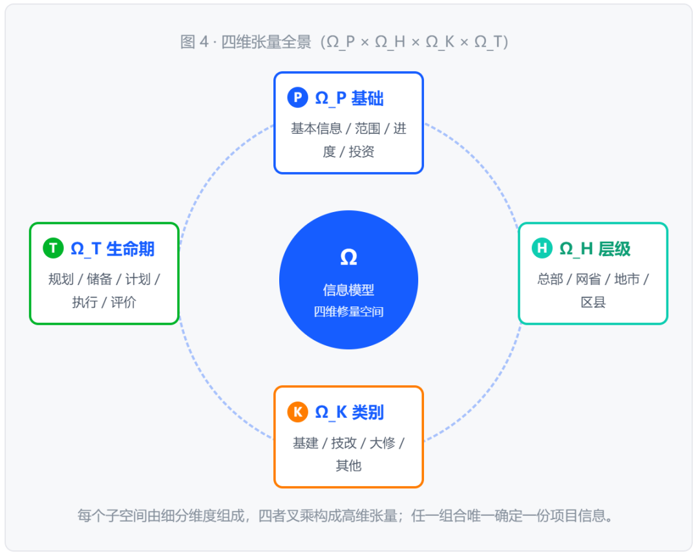

# 本体智能 | 本体在项目管理领域的思考

> **来源**：微信公众号「华力江海」
> **作者**：华力江海
> **发布日期**：2026-08-23
> **原文**：[点击查看](https://mp.weixin.qq.com/s?__biz=MzcxMDMyNTI4MQ==&mid=2247485528&idx=1&sn=c0faf8c39b7a5f7e9724d222a53df773&chksm=f519ad16c26e240000c611ee2ad9fb68d9108a656b48e56554116825a81b8c79dea2ab7d5627#rd)
> **系列**：本体智能系列

**企业级本体模型 · 电网项目管理**

### 本体在项目管理领域的思考

### 统一语义是地基，工程化是主线

电网项目管理长期受困于数据多源异构、口径对不齐、全生命周期割裂等老问题，根子都在缺少统一语义基础。本文不把方法论与工程实践拆成两半，而是以真实业务为线索，沿问题讲方法、顺着方法讲落地，把本体从学术概念还原成一种给项目数据定规矩、定溯源、可演进的工程语言，为项目管理中台建设与企业级本体模型工程化提供一套可复用、可溯源、可论证的完整思路。

**五层模型** **九步法** **四维张量**

\*\*📌**本文导读** \*\*本文摘要：**本文的核心主张是：电网项目管理的种种顽疾，本质是语义缺位，而非工具不足；补齐统一语义底座，并用工程化方式将其沉淀为可运行、可溯源、可演进的本体资产，才是治本之道。文章以这一主张为主线，先厘清问题根因与方法论骨架，再说明模型如何随业务持续生长、如何在真实场景中落地、如何与既有系统衔接，最后给出可度量的价值论证。通篇强调业务思考、本体做法、工程承载与场景验证四位一体，目标是让建设者拿到一套能直接上手、经得起推敲的落地范式。**

### 📚 相关阅读

**1**[企业级本体模型建模标准](https://mp.weixin.qq.com/s?__biz=MzcxMDMyNTI4MQ==&mid=2247483823&idx=1&sn=47c8cc159a8cb18e0475fe385cfc6e76&scene=21#wechat_redirect)

**2**[本体自动化建模之一：自动化建模原则和方法](https://mp.weixin.qq.com/s?__biz=MzcxMDMyNTI4MQ==&mid=2247485208&idx=1&sn=6bb449b3fd659cd6af7423cb186bc744&scene=21#wechat_redirect)

**3**[本体自动化建模之二：文档如何长成可信本体模型](https://mp.weixin.qq.com/s?__biz=MzcxMDMyNTI4MQ==&mid=2247485354&idx=1&sn=e0d338431af1a433b74a0e84adb9d477&scene=21#wechat_redirect)

**4**[一文读懂企业级本体模型](https://mp.weixin.qq.com/s?__biz=MzcxMDMyNTI4MQ==&mid=2247483753&idx=1&sn=dec18da14ad72d4cc53e0dd6ecf11dcb&scene=21#wechat_redirect)

### 为什么要从语义底座做起

## 01 开篇：两类读者与三类老毛病

本文写给两类读者。一类是电网企业的项目管理中台建设者，你们关心的是怎么把项目管理得准、管得顺；另一类是企业级本体模型的工程落地者，你们关心的是怎么把方法论变成可运行、可溯源、可演进的资产。这两类人过去常常各说各话：一方谈业务痛点，一方谈建模原语，中间缺一座桥。本文就是那座桥，它沿着业务问题讲方法，顺着方法讲工程，最后落到真实场景。

读本文不必先懂本体理论。你会看到，本体不是学术概念，而是一种给项目数据定规矩、定溯源的工程语言。你也不必先懂五层模型和九步法，它们会在对应的业务问题出现时被自然引出。建议带着自己项目里最痛的一个问题来读，比如为什么三库对不齐，然后到对应章节找答案。

电网企业主要采用综合计划加专项计划的矩阵式模式：由项目综合管理部门统筹，专业部门并行管理各专项。这种模式在一定程度上解决了专业管理复杂度高的问题，但也暴露出三类长期存在的老问题。

**01**

### 数据多源异构

规划计划、生产管理、营销、人力、ERP 等多系统，各自数据模型不统一，缺唯一数据源，同物异名、同名异义。

**02**

### 管理内容复杂

十几类专项再细分类型，总部/网省/地市/区县各级关注不同，靠人对齐差异，成本高、易出错。

**03**

### 全生命周期割裂

规划、储备、计划、执行、评价五环节信息难连续继承，前后衔接靠人工，口径漂移、信息断档。

### 共同根因

缺统一语义基础：同一对象在多系统、多环节、多层级被赋予不同含义与表达，机器读不懂对应关系。

这三类问题的共同根源，是缺少一个统一的语义基础：项目这个对象，在不同系统、不同环节、不同层级被赋予了不同的含义和表达方式，机器读不懂它们之间的对应关系。

**💡 核心结论** 本体的价值正在这里。它既能描述领域概念术语，又能表达概念间的内在联系，保持语义一致性，并通过推理机制消除重复定义、发现隐含关系。把本体引入电网项目管理，就是给所有项目数据一个统一的定义语言和溯源框架。

本文不把建模方法和工程落地拆成两半，而是沿着业务问题逐章展开，每一章同时讲清楚业务思考、本体做法、工程承载和真实场景。

### 怎么搭语义骨架

## 02 统一语义：用结构本体加应用本体搭骨架

### 2.1 业务思考：为什么项目数据对不齐

前面提到的数据多源异构，根子不在系统多少，而在于没有一个统一的项目语义定义。规划计划系统说项目有项目名称、项目编码、建设内容；生产管理系统说项目有设备编号、停电范围、检修计划；ERP 说项目有预算科目、成本中心、资产卡片。三套系统对同一个物理项目用了三套字段、三套编码、三套口径。

一个具体例子能让问题更直观。同一个 10kV 配网新建工程，在规划计划系统里叫工程编号、字段类型是字符串；在生产管理系统里叫项目编码、字段类型是数字；在 ERP 里又叫资产卡片号、还带前缀。三个系统对同一个物理对象用了三套标识，做投资汇总时，人工要一条条比对才能认定它们是同一个项目。一旦有一个系统改了命名规则，比对逻辑就失效，投资口径立刻失真。这种同物异名、同名异义的现象，在十几类专项、几十个系统里反复发生，靠人肉对齐根本跟不上。

要让机器把这些描述对应起来，必须先把项目的概念层定义清楚：什么是项目、什么是专项、什么是环节、什么是属性。这一步做不到，后面无论上多少中台、做多少数据清洗，都是在沙子上面盖楼。

### 同一物理项目，三个系统的「同物异名」

### 规划计划系统

项目名称、项目编码、建设内容

### 生产管理系统

设备编号、停电范围、检修计划

### ERP 系统

预算科目、成本中心、资产卡片

共同根因：缺统一语义基础，三套字段、三套编码、三套口径

### 2.2 本体做法：五元组与两层拆分

本体建模把领域知识表示成一个五元组，包含概念、关系、函数、公理、实例五个基本建模原语。概念是领域里的核心名词，比如项目、专项、环节；关系是概念之间的关联，比如归属、继承；函数是关系的特殊形式，比如编码生成；公理是领域里必须成立的约束；实例是具体取值，比如某一个真实的 10kV 配网新建工程。

领域本体可以进一步拆分为一个结构本体和若干个应用本体。结构本体只包含领域相关的基础概念和事实类型，描述领域的框架结构知识，是稳定、通用的骨架。应用本体反映某一类业务的相关知识，包含业务概念、事实类型，以及限定这些概念和事实类型的各种约束。应用本体中的概念直接通过重用结构本体获得，不同应用本体之间相互独立，不存在依赖关系。

**结构本体 · 骨架**

领域最稳定的基础概念与事实类型，通用、稳定，不含业务规则。骨架稳定，业务视图才能灵活。

**应用本体 · 视图**

按业务视角拼装视图，叠加三类约束，相互独立、插排式扩展，互不依赖。

这种拆分是全文的主线。结构本体负责把项目领域最稳定的那部分定义死，应用本体负责按不同业务视角拼装出具体视图。骨架稳定，业务视图才能灵活。

应用本体的约束是结构本体没有、但业务必须有的部分。以电网项目管理为例，应用本体要叠加三类约束。其一是架构体系约束：项目管理必须遵循企业成熟的管理体系架构和管理制度体系，不能各专项各搞一套。其二是中台模式约束：项目管理采用中台目标模式，项目管理中台数据来源于数据中台，需要实现与财务中台、电网资源中台以及客户服务中台的信息交互。其三是统一信息模型约束：全部信息系统建设需遵循 SG-CIM 框架，SG-CIM 已构建项目域模型。

这三类约束决定了应用本体不是结构本体的简单复制，而是带着业务规则的具体视图。不同应用本体之间相互独立，比如规划视角应用本体和计划视角应用本体，各自叠加本环节的约束，互不依赖。这种独立性很重要：增加一个业务视角，不会影响其他视角，模型因此具备插排式灵活扩展的特性。

### 2.3 工程承载：五元组落到五层结构

结构本体对应的工程载体是企业级本体模型的 M1 实体模型。M1 包含业务对象、业务事实、业务指标、数据标准、参考数据、数据字典、业务属性、对象关系八类实体。落到电网项目管理，业务对象就是项目、专项、环节；业务事实就是项目与专项的归属、项目与部门的关联；业务指标就是投资完成率、储备库规模；数据标准、参考数据、数据字典、业务属性、对象关系则把字段名称、枚举值、属性定义、实体关联全部固化下来。

应用本体对应的工程载体是 M2 行为模型加 M3 规则模型。M2 包含业务流程、业务环节、原子操作、MCP 服务、原子 Agent 五类实体，把项目规划、储备、计划、执行、评价这些生命周期环节和管理操作结构化。M3 包含通用公理、阈值规则、合规校验、风险预警、约束条件、制度依据六类实体，把应用本体里的架构约束、中台模式约束、统一信息模型约束变成可管理的规则。

**📌 护照模型** 每一个被抽取和确认的要素，无论它是 M1 的一个业务对象还是 M3 的一条规则，都会被赋予一张护照。护照记录：唯一标识、所属模型层、具体类型、数据属性、关系锚点、状态、置信度、来源片段、待解决问题、创建者。来源片段记录它来自哪份制度文档的哪一段，置信度表示抽取把握，创建者记录责任归属。护照让每个节点都有了可追溯、可审计的身份。

| **五元组原语** | **落地工程层** | **电网项目管理示例** |
| 概念 | M1 业务对象 / 业务属性 | 项目、专项、电压等级、投资金额 |
| 关系 | M1 对象关系 / M2 业务流程时序 | 项目归属专项、规划→储备→计划 |
| 函数 | M2 原子操作 | 按电压等级+行政区划生成项目编码 |
| 公理 | M3 通用公理 / 约束条件 | 一个项目归属且仅归属一个专项 |
| 实例 | 带护照的具体取值 | 某 10kV 配网新建工程全字段 |

五元组逐项落地能看清每个建模原语在工程里落在哪里，避免方法和工程两张皮。概念对应 M1 的业务对象和业务属性，比如项目、专项、电压等级、投资金额在 M1 里被实例化为有标准字段和枚举的实体。关系对应 M1 的对象关系以及 M2 业务流程里的环节衔接，比如项目归属专项是一条对象关系，规划到储备到计划是业务流程里的时序关系，关系一旦定义，机器就能自动推断项目属于哪个专项、处于哪个环节。函数对应 M2 的原子操作，比如根据电压等级和行政区划生成项目编码，过去这类规则散落在各系统代码里，现在集中成可调用、可审计的原子操作。公理对应 M3 的通用公理和约束条件，比如一个项目必须归属且仅归属一个专项，在 M3 固化而不是写在管理办法里等人自觉遵守。实例对应带着护照的具体取值，某 10kV 配网新建工程就是应用本体在电网基建专项维度上的实例化，它的每个字段都对应一张护照，能回答从哪来、凭什么成立。

### 2.4 应用场景一：字段级标准化

统一语义落到现场，最直接的场景是字段级标准化。某省级电网过去各专项系统对项目基本信息的描述各不相同：有的叫项目编码，有的叫工程编号；有的电压等级用字符串，有的用数字；投资金额有的含税有的不含税。

通过 M1 实体模型，把项目基本信息、范围信息、进度信息、投资信息四类信息统一建模，字段名称、数据类型、枚举值全部固化进数据字典和参考数据。每一个字段通过护照登记来源制度片段，置信度低于阈值的字段在发布前必须人工复核。

**✅ 成果验收** 新接入一个专项类型时，不再从零定义字段，而是复用 M1 已有的标准实体，只对差异部分做扩展。字段冲突在 S6 融合阶段被识别裁决，而不是等到数据入湖后才被发现。

### 多维全景怎么看

## 03 多维全景：张量模型与中台落地

### 3.1 业务思考：为什么信息难继承

前面提到全生命周期割裂，本质原因是项目信息被按环节割裂存储。规划库只关心规划项目的需求匹配和准入，储备库只关心可行性与总量控制，计划库只关心投资分配，执行和评价库又各管一段。从建模角度看，项目的信息模型是一个多维信息模型，如果把一些关键类或关键项描述信息视作数学空间上的一个维度，描述项目的全部信息就会组成一个高维立方体的形式。

### 割裂存储（现状）

规划库管准入、储备库管总量、计划库管投资、执行评价库各管一段。信息按环节切块，前后口径漂移、断档。

### 张量模型（解法）

把各环节视为维度，全部信息组成高维立方体。任一环节的取值，都是同一模型在对应维度的投影。

### 3.2 本体做法：四维张量全景模型

以空间 Ω 表示项目信息模型的高维空间，它由若干关联信息子空间组成。定义子空间 Ω\\\_P、Ω\\\_H、Ω\\\_K、Ω\\\_T 分别表示项目通用基础信息维度、总部网省地市区县多层级的管理层级维度、全类别项目管理的项目类别维度、项目生命期维度，则项目管理的信息模型可以表示为这四个子空间叉乘构成的高维张量空间：

**Ω = Ω\\\_P × Ω\\\_H × Ω\\\_K × Ω\\\_T**

其中每个子空间又由若干细分维度组成。Ω\\\_P 包含基本信息、范围信息、进度信息、投资信息等项目基础描述；Ω\\\_H 包含总部、网省、地市、区县及其细分的管理组织；Ω\\\_K 包含基建、技改、大修、其他等专项类别及其二级分类；Ω\\\_T 包含规划、储备、计划、执行、评价等生命周期阶段。

把管理层级、项目类别、生命周期三个维度组合起来，就得到一个三维立方体模型。立方体的每个格子，由这三个维度的某一组合唯一确定，并承载对应的项目基础信息。同一份项目信息，可以从总部视角看、从专项视角看、从生命周期视角看，每个视角都是同一模型的不同投影。

### 按类别投影

定位电网基建专项下所有项目及其投资、进度。

### 按生命期投影

定位处于储备阶段的项目，做总量控制与优选。

### 按层级投影

从区县上钻到地市、网省、总部，看同一批项目口径变化。

### 维度钻取

改变维度颗粒度，就是从宏观到微观的钻取。

### 3.3 工程承载：从数学投影到可运行场景

张量模型在数学表达里靠投影实现多视角检索，但在工程里，企业级本体模型用 M4 场景模型把这个能力固化下来。M4 包含业务场景、编排链路、资源引用、底层资产四类实体。以管理层级为视角看项目、以专项类型为视角看项目这类需求，在 M4 里被表达为具体的业务场景，每个场景通过编排链路把底层的数据资产、流程资产串起来，通过资源引用指向 M1、M2、M3 里的具体要素。

这意味着，换个视角看全景不再是临时算出来的投影，而是预先编排好、随时可调用的场景。视角变成了可配置、可运行、可授权的资产。

M5 角色模型则补上层级差异的工程化。总部规划岗、地市执行岗、区县现场岗，各自能看哪些维度的项目信息、能改哪些字段、能触发哪些流程，都通过权限策略固化。同一个全景模型，对不同角色呈现不同视图、开放不同操作，既不泄露也不越权。

**M4 场景模型 · 视角变资产**

四类实体：业务场景、编排链路、资源引用、底层资产。多视角从临时投影变为可配置、可运行、可授权的场景。

**M5 角色模型 · 层级差异**

总部、网省、地市、区县各有查看范围与操作权限，同一模型按角色呈现不同视图、开放不同操作。

### 3.4 业务思考：为什么中台需要统一信息模型

十几类专项、矩阵式管理，意味着项目管理中台必须与多个系统中台打交道。项目管理中台对外提供数据服务，它的数据来源于数据中台，又要与财务中台、电网资源中台、客户服务中台交互。如果项目管理中台自身的语义不统一，它和周边中台的交互就会变成又一场数据翻译灾难。

一个常见的痛点是投资口径对不齐。总部要全局投资总控，网省要专项结构，地市要本地开工，三者的数据分别来自规划库、储备库、计划库，而这三个库过去由各系统各自维护，同一个项目的投资金额在三个库里可能因为统计时点、口径定义不同而不一致。月底对账时，财务中台拿到的投资数和项目管理中台自己统计的对不上，两边互相甩锅。根子还是在缺少统一信息模型：投资这个概念的口径、时点、枚举，没有在模型层面被唯一定义。

**⚠ 投资口径对不齐** 同一个项目的投资金额，在规划库、储备库、计划库因统计时点与口径定义不同而各说各话，月底对账财务中台与项目管理中台互相甩锅。根因：投资概念的口径、时点、枚举未在模型层唯一定义。

### 3.5 本体做法与工程承载：SG-CIM 与多中台交互

电网企业已有成熟的企业级标准数据模型体系 SG-CIM，定义了全部信息系统需要遵循的标准数据模型及接口规范。其中项目域模型包括项目公共包、项目规划、项目计划、项目预算、项目执行、项目评价共六个二级主题域，每个主题域下又有细分的管理节点，比如规划域下的主网规划管理、配电网规划管理、项目储备管理，计划域下的项目计划下达、预算下达、技经管理。

把应用本体的约束翻译成 M3 规则，有两类值得单独说。其一是阈值规则，比如规定电网基建专项中，总投资超过一定金额的项目必须走限上管理流程，低于该金额的走限下管理流程，这条规则在 M3 固化后，新纳入的项目会自动按投资金额分流，不会因人手判断而错分。其二是风险预警，比如计划项目的投资完成进度严重滞后于时间进度时，M3 风险预警自动触发，提醒管理者介入，把事后救火变成事前预警。

工程上，这些约束在 S7 装配和 S8 评测阶段自动执行，是模型发布前的自动心电图。把建模方法落成工程，靠的是九步法流水线（S1 到 S9），下一章详述。

### 怎么持续建好

## 04 工程回路：九步法与护照

### 4.1 业务思考：模型会老化

前面所有方法，都建立在模型被正确建好的前提上。但真实企业的项目领域知识是流动的：专项类别每年可能增加，管理口径会调整，系统会升级，制度会更新。如果模型是一次建好就锁死，过两年就和现实对不上了。靠少数人手工维护统一信息模型是不现实的，必须靠工具和流程把抽取、校验、发布变成组织的标准能力。

### 专项类别增加

每年可能有新专项纳入管理。

### 管理口径调整

层级、环节定义随改革变化。

### 系统升级

新系统接入、旧系统下线。

### 制度更新

管理办法修订触发模型演进。

### 4.2 九步法流水线

九步法把结构本体确立、应用本体确立两条建模线，升级成有输入、输出、责任方和产出文件的可运行流水线，分三个阶段：输入与预处理（S1 业务域界定、S2 文档预处理）、抽取与装配（S3 场景画像、S4 定向分析、S5 分层提取、S6 融合消解、S7 装配贯通）、质量与发布（S8 多维评测、S9 发布）。

### ✓

### S1 业务域界定

**目的**：确定本次建模覆盖的专项、层级、生命周期。**关键动作**：锁定范围，默认从 M1 切入。**产出**：建模范围说明书。

### ✓

### S2 文档预处理

**目的**：形成可检索语料库。**关键动作**：解析、切段、打标、生成摘要。**产出**：打标语料库。

### ✓

**S3 场景画像 · S4 定向分析**

**目的**：排定抽取优先级。**关键动作**：多维画像、相关性加权去噪。**产出**：抽取优先级列表。

### ✓

**S5 分层提取 · S6 融合消解**

**目的**：逐层抽要素、同义归并、冲突裁决。**关键动作**：M1→M5 自上而下引用。**产出**：确认要素集。

### ✓

**S7 装配贯通 · S8 多维评测**

**目的**：依赖检查、质量评测回流。**关键动作**：五维评测、问题回流。**产出**：问题清单。

### ✓

### S9 发布

**目的**：生成标识与管理属性。**关键动作**：专家确认后发布。**产出**：可信模型版本。

S1 业务域界定，对应确定本体的领域和范围，它强制先锁定这次建模覆盖哪些专项类别、哪些管理层级、哪些生命周期环节，默认从 M1 实体层切入。范围即纪律。S2 文档预处理，把制度文件、设计规范、系统数据字典统一解析、切段、打标并生成摘要，形成可检索的语料库。S3 场景画像，从多个维度分析业务域的使用场景，比如谁用、看什么视角、关心哪些指标。S4 定向分析，对文档片段做相关性和重要性加权，把最该抽的段落排到前面，起到去噪作用。

S5 分层提取是核心，它按 M1 到 M5 顺序逐层抽取要素：先抽 M1 八类实体，确认后再抽 M2 五类，再抽 M3 六类，然后 M4 四类，最后 M5 三类。上层只引用下层已确认要素，引用不到的标记待解决。S6 融合，做同义归并和冲突消解，不同文档里同一概念可能叫不同名字，这一步把它们合并，并识别字段定义冲突，由人裁决。S7 装配，把确认过的要素落位到五层，做依赖完整性检查。S8 评测，从多维度对模型做质量评测，输出问题清单，回流到 S5 甚至 S2，形成回路。S9 发布，生成标识和管理属性，经专家最终确认后发布成可信模型。

**📌 护照贯穿全程** 每一个要素从被抽取的那一刻就带着来源片段和置信度，低置信度要素在发布前必须人工复核。

### 4.3 为什么必须自下而上

九步法强调 S5 按 M1 到 M5 顺序逐层抽取，上层只引用下层已确认要素，这不是随意的排序，而是结构本体在前、应用本体在后的工程化展开。如果反过来先抽 M4 场景、M5 角色，它们引用的 M1 字段和 M2 流程还没确认，就会出现大量悬空引用，装配阶段一片飘红。

自下而上也符合认知规律：先把项目、专项、环节这些最稳定的对象定准，再叠加业务规则和流程，最后才是视角和权限。地基不稳就盖楼，后期冲突会指数级爆发。实际项目里，凡是跳层抽取的团队，最终都退回到了先补 M1 这一步。所以范围即纪律，顺序也是纪律。

### 自下而上：上层只引用已确认下层

**M1 实体**→**M2 行为**→**M3 规则**→**M4 场景**→**M5 角色**

跳层抽取（先 M4/M5）会出现悬空引用，装配阶段一片飘红

### 4.4 应用场景四：制度更新触发模型演进

某省级电网有一次制度更新，调整了电网基建专项的储备入库条件。过去，这类更新要靠人去翻所有相关模型文档，逐处核对。现在，更新被登记为一条 M3 规则要素的修订，S8 评测自动扫描所有引用该约束的要素，找出受影响的字段和实例，回流到 S5 重新抽取、S6 融合、S7 装配，跑一遍流水线，模型演进一版。

每个受影响的要素都能通过护照回答它为什么变、依据哪份新制度、谁确认的。模型从一次性成果，变成了持续运营的标准能力。

### 一次制度更新，如何演进一版模型

**① 登记 M3 修订**→**② S8 扫描受影响**→**③ S5 重抽**→**④ S6 融合**→**⑤ S7 装配**↻**发布新版本**

### 4.5 建模实战走查：从一份制度文档到一张护照

前面讲了方法和工程，这一节把两者捏在一起，走一遍真实建模过程：以某 10kV 配网新建工程为对象，看它如何从一个制度文档片段，变成带着护照的可信要素。

定域，S1 锁定本次建模覆盖电网基建专项、区县管理层级、规划到计划三个生命周期环节，默认从 M1 切入。预处理，S2 把《配网规划管理办法》《项目储备细则》《计划编制规范》三份文档解析、切段、打标，形成语料库，规划文档里项目编码由电压等级加行政区划加序号生成这一句，被打上 M1 数据标准标签，成为后续抽取的锚点。画像，S3 分析使用场景：总部规划岗关心总量和集合，区县现场岗只关心本地项目的基本信息和开工状态，这决定了后面 M5 角色模型的权限设计。

分层提取，S5 先抽 M1：项目编码、项目名称、电压等级、线路长度、总投资、建设性质，确认无误后抽 M2：规划、储备、计划三个环节及其时序，再抽 M3：入库条件、下达规则，接着抽 M4：规划视角场景，最后抽 M5：区县现场岗只读、总部规划岗可编辑。融合，S6 发现两份文档对同一字段叫了不同名字：一份叫工程编号，一份叫项目编码，融合把它们归并到 M1 的项目编码，并标记冲突已由人裁决，保留裁决记录。装配，S7 做依赖检查：M3 的入库条件引用了 M1 的项目编码和 M2 的储备环节，两者都已确认，依赖完整。评测，S8 检查置信度：项目编码字段置信度 0.95，建设性质置信度 0.7，后者来自一份征求意见稿，被标记为待人工复核，不进入发布态。发布，S9 专家确认后发布。

走完这一遍，方法和工程不再是两件事，而是同一次操作的前后手。护照不是比喻，而是一段结构化的记录。以某 10kV 配网新建工程的项目编码字段为例，它的护照大致是：标识 PRJ-1805F020006D，所属层 M1，类型业务属性，数据属性记录编码值 1805F020006D、电压等级 10kV，关系锚点指向它所属的项目对象和专项对象，状态已发布，置信度 0.95，来源片段指向《配网规划管理办法》中关于编码规则的段落，待解决问题为空，创建者是建模工具在一次九步法运行中自动抽取、再由领域专家确认。

这样一张护照，让这个字段从一团文本变成一个可审计的生产对象。当有人质疑编码为什么是这个值，打开护照就能看到依据；当制度更新编码规则，系统扫描所有引用该规则的护照，精准定位受影响字段。

### 有哪些场景

## 05 六个真实应用场景

前面各章把方法、工程和场景穿插着讲，这一章把最关键的几个真实应用场景单独展开，每个场景都按业务痛点、本体做法、工程承载、落地效果四段式说明，方便中台建设者直接对照复用。

**A · 三库联动**

规划→储备→计划三库继承衍化，同维信息模型在不同节点实例化。

**B · 合规校验闸门**

SG-CIM、中台模式、架构体系三道闸门，发布前自动心电图。

**C · 审计溯源**

护照让每个要素带完整溯源信息，按来源片段检索受影响项。

**D · 投资精准分配**

统一模型支撑事前平衡、事中跟踪、事后评价三类动作。

**E · 跨中台编排**

中台交互建模成关系，链路编排成可复用数据服务。

**F · 项目集群管理**

按网格聚合关联项目，识别施工窗口冲突、协调停电计划。

### 5.1 场景 A：三库联动（规划到储备到计划）

这是本体应用最具代表性的落地场景。电网企业按项目规划、项目储备、项目计划三个库管理项目，三库之间是继承衍化关系：规划库的项目经过评审优选进入储备库，储备库的项目经过计划编制下达进入计划库。

某 10kV 配网新建工程，规划阶段记录行政区划、项目名称、电压等级、线路长度、总投资、规划来源、规划投产年份等；储备阶段继承规划信息，补充可研评审文号、项目入库时间、储备库评分、建设性质、计划批次等；计划阶段再继承前两者，补充年度综合计划、预算发布金额、计划分解下达、纳入财务储备年份等。三库不是三套独立数据，而是同一全维信息模型在不同生命周期节点的实例化。

工程上，规划项目库实现各专业规划成果的归集入库，支持入库、批量打包、分解、优化调整、溯源、版本管理、出库；储备项目库支撑可行性研究、前期手续、优选论证；计划项目库支撑计划编制与下达。某省级电网 2021 年归集全省储备项目 5338 项，计划项目 4197 项。

本体做法体现为：用结构本体统一三个库的通用字段，用应用本体描述各库特有的评审、优选、下达约束；张量模型的沿生命周期投影，让同一项目在三库中连续继承。工程承载体现为：M1 固化字段、M3 校验入库条件、M4 编排各库场景、护照支撑版本溯源。

同一全维信息模型，在生命周期节点上连续继承

### 规划库

行政区划、名称、电压、长度、投资、来源

### →

### 储备库

继承规划 + 评审文号、入库、评分、性质

### →

### 计划库

继承前两者 + 下达、预算、分解、纳入年份

以某 10kV 配网新建工程为例 · 三库非三套独立数据，而是同一模型的不同节点实例化

### 5.2 场景 B：合规校验闸门

项目数据要进入发布态，必须过几道合规闸门，这些闸门来自应用本体的约束。第一道是 SG-CIM 框架闸门，任何新纳入统一信息模型的项目字段，必须能在 SG-CIM 项目域六个主题域里找到对应实体或属性，找不到的标记为待对齐，不允许直接发布。第二道是中台模式闸门，项目管理中台对外提供的数据服务，必须同时登记来源中台和目的中台，缺任意一端登记就视为不合规。第三道是架构体系闸门，项目管理必须遵循企业成熟的管理体系架构和管理制度体系，新设计的流程或环节若违反既有架构，在 S7 装配阶段被标记。这些闸门在 S7 装配和 S8 评测阶段自动执行，是模型发布前的自动心电图。

### ① SG-CIM 框架闸门

字段须在项目域六主题域找到对应，找不到标记待对齐，禁发布。

### ② 中台模式闸门

数据服务须同时登记来源与目的中台，缺一端即不合规。

### ③ 架构体系闸门

违反既有管理体系架构的新流程，S7 装配阶段即被标记。

### 5.3 场景 C：审计溯源

项目数据进入生产后，最怕的问题是它从哪来、凭什么成立。传统做法靠人记忆和文档翻找，效率低、易出错。护照模型让每个要素带着完整溯源信息。打开某 10kV 配网新建工程的护照，能立刻看到：项目编码是什么、属于电网基建专项、规划信息来自哪份规划文档的哪一段、置信度多少、谁确认过、还有哪些问题待解决。

当某项制度更新，需要找出所有受影响要素时，直接按来源片段或类型检索即可，不用全文翻找。质量也可量化：低置信度要素在进入发布前必须人工复核，避免低质量数据进入生产。

**🔍 一张护照回答** 打开某 10kV 配网新建工程的护照，立即看到：项目编码、所属专项、规划信息来自哪份文档哪一段、置信度、谁确认、待解决问题。
制度更新时按来源片段或类型检索，精准定位受影响要素，免全文翻找。

### 5.4 场景 D：投资精准分配

计划项目库汇聚各类计划项目的归集信息后，可以支撑投资分配的场景。基于统一信息模型，计划项目库能从项目计划视角，展示各类项目的计划情况和预算情况，方便管理者总体把握投资分配。

**某省级电网 7 个专项投资分配（亿元）**

电网基建**694.07**

生产技改**115.44**

电网数字化**34.48**

电力市场营销**26.17**

电网小型基建**29.56**

零星购置**18.50**

生产辅助技改**1.17**

合计 28457 项 · 投资 919.36 亿元 · 口径在统一模型下保持一致

投资精准分配不只是把数字摆出来。基于统一信息模型，计划项目库能支撑三类具体动作。其一是事前平衡：在年度综合计划编制时，按专项类别汇总投资需求，与总控目标比对，发现超盘子的专项提前预警。其二是事中跟踪：计划下达后，实时归集累计下达计划值、计划分解下达金额，与预算发布金额对照，发现执行偏差。其三是事后评价：项目竣工后，归集实际投产内容、竣工决算金额、投资完成进度，回溯计划与实际偏差，沉淀为下一年度的编制依据。

### 5.5 场景 E：跨中台数据服务编排

项目管理中台不是数据孤岛，它要把项目信息推送给周边中台。一个典型链路是：项目管理中台的项目投资数据，经数据中台流向财务中台做预算核算，同时流向电网资源中台做设备台账关联。过去这类链路靠点对点接口硬编码，中台之间语义对不齐，漏接、错接频发。

本体做法体现为：把中台交互建模成应用本体里的关系，明确项目管理中台的数据来源于数据中台，需与财务、电网资源、客户服务中台交互。工程承载体现为：M3 规则保证每次推送都登记来源中台和目的中台，缺项不发布；M4 场景把这条链路编排成可复用的数据服务，而不是每次临时写接口。中台交互在模型层面就是语义完整的。

投资数据从项目管理中台流向周边中台（不再是硬编码接口）

### 项目管理中台

项目投资数据

### →

### 数据中台

汇聚流转

### ↘

### 财务中台

预算核算

### ↘

### 电网资源中台

设备台账关联

M3 登记来源与目的中台（缺项不发布） · M4 编排为可复用数据服务

### 5.6 场景 F：项目集群管理

同一个电网网格里往往有多个关联项目，比如一条线路上的多个 10kV 新建工程、一个变电站周边的多个技改项目。单项目视角看不到协同关系，会导致重复进场、资源冲突、进度打架。

张量模型支持按所属网格维度聚合，M4 场景把同网格项目聚成集群，支撑集群级的进度协调和资源统筹。比如某城东网格有 3 个 10kV 新建工程和 2 个技改项目，集群场景把它们的时间线叠加，识别出施工窗口冲突，协调出统一的停电计划。这解决了单项目视角看不到协同关系的问题，也让网格级的资源调度有了数据支撑。

**🗺 城东网格集群** 3 个 10kV 新建工程 + 2 个技改项目，时间线叠加 → 识别施工窗口冲突 → 协调统一停电计划。单项目视角看不到的协同，在集群级被显形。

### 5.7 场景小结

四个场景串起来看：三库联动解决全生命周期割裂，合规闸门解决多源异构下的语义不一致，审计溯源解决模型可信问题，投资分配解决管理内容复杂下的精准决策。它们共同依赖同一个基础：结构本体加应用本体的统一语义、张量全景的多视角能力、企业级本体模型的五层工程载体。

### 四场景 × 四老问题

### A 三库联动

↳ 全生命周期割裂

### B 合规闸门

↳ 多源异构语义不一致

### C 审计溯源

↳ 模型可信

### D 投资分配

↳ 管理复杂下精准决策

共同底座：统一语义 + 张量全景 + 五层工程载体

### 怎么保障与避坑

## 06 质量保障、实操建议与避坑

### 6.1 质量保障：评测、阈值、裁决、版本

模型要可信，必须有质量保障回路。评测维度有四类。其一是覆盖度：M1 到 M5 每层该抽的要素是否抽全，有没有遗漏的实体类型。其二是一致性：同义词是否归并、字段定义是否冲突、跨层引用是否完整。其三是合规性：每条要素是否满足 M3 规则的约束，能不能在 SG-CIM 项目域找到对应。其四是溯源度：每个要素是否都有来源片段和置信度，能不能被审计。

### 置信度阈值与发布决策

### ≥0.8

高置信 · 直接发布

### 0.6至0.8

中置信 · 人工复核

### \<0.6

低置信 · 回炉重抽

置信度阈值决定要素能否进入发布态。一般把 0.8 以上视为高置信，可直接进入发布；0.6 到 0.8 为中等置信，需人工复核关键字段；0.6 以下为低置信，必须先回 S2 补语料或回 S5 重抽。阈值不是固定的，随制度成熟度和语料质量动态调整。

冲突裁决是 S6 融合的核心动作。当两份文档对同一概念给出不同定义，系统标记冲突并交人裁决，裁决结果记入护照的待解决问题字段并回路。裁决记录本身也是资产，下次遇到同类冲突可参考。版本管理保证模型可追溯：每次九步法跑完发布一版，模型带版本号，要素带版本归属；制度更新触发新版本时，旧版本不删，方便对比改了什么、为什么改。

一次真实感强的例子：某次制度更新后，两份文档对建设性质的枚举值出现分歧，一份写新建、扩建、改建，另一份写新建、改扩建。S6 融合标记冲突，交领域专家裁决，专家对照护照来源片段，确认以最新发文为准，采用新建、扩建、改建，并在冲突记录里写明裁决依据。模型从 3. 2 版演进到 3.3 版时，版本管理记录了差异：新增了 2 个 M1 字段、修订了 1 条 M3 规则、继承了其余全部要素。管理者打开版本对比，能看清这一版改了什么、为什么改、影响哪些项目。

### 6.2 给中台建设者的十条动作

给中台建设者的十条动作，条目如下，每条都对应前面讲过的工程载体，照着做即可落地。

**1**先定域再动手（S1），默认从 M1 切入

**2**知识文档化入库（S2），形成语料库

**3**先骨架后业务，基础框架定稳再填视图

**4**约束即时规则化（M3），登记制度依据

**5**护照管理每个要素，填来源与置信度

**6**按 SG-CIM 项目域对齐六主题域

**7**多视角预编排成 M4 场景，非临时查询

**8**按角色开放视图（M5）固化权限策略

**9**建模跑成九步法流水线，可重复运行

**10**保留 S8 评测回路，问题回流持续改进

### 6.3 常见误区

**1**

### 先抽全层

一上来就想把 M1 到 M5 一次抽全，骨架没稳就堆业务视图，后期冲突爆炸。正确：自下而上。

**2**

### 约束事后补

只管抽概念，约束留到发布前才想，收拢成本极高。正确：约束即时规则化。

**3**

### 视图临时查

多视角一来就临时写投影，口径漂移。正确：高频视角预编排成 M4 场景。

**4**

### 当又一套系统

把本体当又一套管理系统，而非统一语义基础。正确：服务于中台。

**5**

### 重建模轻运营

跑通一遍就认为大功告成，制度一更新模型过时。正确：S8 评测回路常态化。

### 检查清单口诀

启动看定域+语料；构建看骨架+规则+护照；中台看对齐+场景+视图；运营看流水线+回路。

### 6.4 与数据治理的衔接

本体建模不是和数据治理抢活，而是给数据治理提供语义骨架。M1 的参考数据、数据字典、数据标准天然是数据治理的核心资产；护照模型的来源片段和置信度是数据血缘和质量评分的底层；M3 规则模型是可落地的数据质量校验规则。把本体建模纳入企业数据治理体系，建模成果可直接成为数据标准、数据质量、数据血缘的源头。从落地节奏看，建议先把本体建模纳入数据治理的试点专项，跑通 M1 参考数据、数据字典、数据标准与既有数据标准平台的对接，再逐步把护照血缘、M3 质量规则接入数据质量平台。

### 本体建模成果，直接成为数据治理的资产

### M1 标准资产

参考数据 / 数据字典 / 数据标准

### 护照血缘

来源片段 + 置信度 → 血缘与质量评分

### M3 质量规则

可落地的数据质量校验规则

落地节奏：先对接数据标准平台，再接入血缘与质量平台

### 怎么接入既有系统

## 07 集成路径、实施路线与组织保障

### 7.1 三条集成线

本体模型不是推倒重来，而是叠在既有系统之上做语义层。集成路径分三条线。第一条线，和数据中台集成，M1 的参考数据、数据字典、数据标准直接成为数据中台的数据标准资产，护照模型的来源片段和置信度成为数据血缘和质量评分的底层，建模成果不必另建存储，复用数据中台的贴源域和共享域。第二条线，和 SG-CIM 集成，所有纳入统一信息模型的项目字段，先在 SG-CIM 项目域六个主题域对齐，对齐后再发布，保证本体模型和既有企业标准数据模型的双向可追溯。第三条线，和业务中台集成，M4 场景模型编排的链路，通过 MCP 服务和原子 Agent 暴露成业务中台可调用能力，本体模型成为业务中台背后的语义引擎。

### ① 数据中台

M1 标准资产复用到共享域，护照成为血缘底层，复用贴源域语料。

### ② SG-CIM

字段先在六个主题域对齐再发布，保证双向可追溯。

### ③ 业务中台

M4 链路通过 MCP 与原子 Agent 暴露为可调用能力。

举个与数据中台集成的实例。项目管理中台的项目主数据（项目编码、名称、建设单位）在 M1 只有一份标准定义，这份定义直接成为数据中台共享域里的项目主数据资产，不用再在数据中台另建一套。反过来，数据中台的贴源域已经汇聚了各业务系统的原始项目数据，S2 预处理可以直接消费这些贴源数据做语料，而不是重新对接十几个业务系统。两条线汇到一起，本体模型成为数据中台之上的语义层。

### 7.2 三阶段实施路线

把本体建模引入电网项目管理中台，分三个阶段更稳。阶段一，试点，选一个专项、一个层级、一个环节，用九步法跑通 M1 到 M3，产出带护照的要素和几条 M3 规则，目标是验证方法可行、工具顺手、业务愿意用。阶段二，推广，把试点扩展到全部专项和全部生命周期环节，补全 M4 场景和 M5 角色，连通与数据中台、财务中台的交互。阶段三，运营，把建模流水线固化进日常，制度每次更新触发模型演进，评测回路持续运行，版本管理常态化。

### 阶段一 · 试点

3 人小组 · 1 专项 · 地市层级 · 产出 M1 约 30 要素、M3 约 5 规则。

### 阶段二 · 推广

扩到全专项全周期，补 M4/M5，连通数据中台、财务中台。

### 阶段三 · 运营

流水线固化进日常，制度更新触发演进，评测回路常态。

阶段一的具体动作清单：组建三人建模小组（领域专家、数据工程师、中台架构师）；选电网基建专项做试点，锁定地市层级、规划到储备环节；跑通 S1 到 S9，重点验证 S5 分层抽取是否顺、S6 冲突裁决是否好用；产出带护照的 M1 要素约 30 个、M3 规则约 5 条；在一个真实项目上做端到端演示，拿到业务方签字认可。三个阶段的风险提示：阶段一最怕范围失控，务必先定域再动手；阶段二最怕中台交互漏接，务必每条数据服务都登记来源和目的中台；阶段三最怕流水线空转，务必让制度更新真正触发建模。

### 7.3 组织与角色保障

建模团队建议由三类人组成。其一是领域专家，熟悉项目管理业务和各专项管理办法，负责定域和裁决冲突。其二是数据工程师，负责 S2 预处理、S5 抽取、S6 融合的技术执行。其三是中台架构师，负责把模型对接到 SG-CIM 和周边中台。三者缺一不可，领域专家保证语义正确，数据工程师保证效率，中台架构师保证可集成。

运营团队和中台团队合一，模型发布后，日常的冲突裁决、评测回流、版本管理由中台运营团队承接，不另设岗位。治理机制上，建议设模型负责人（model owner），对模型的准确性、时效性负总责，重大冲突裁决由模型负责人拍板，普通冲突由领域专家就地解决。

### 度量指标建议

### 模型覆盖率

应抽类型已抽比例

### 要素准确率

发布被认可比例

### 规则命中率

拦截不合规比例

### 演进频次

单位时间版本数

### 价值论证与术语

## 08 一线实践、价值论证与术语对照

### 8.1 一线的一天

前面讲的都是方法和机制，这一章换个人视角，看模型在日常里怎么被用。早上，中台运营人员打开模型看板，S8 评测昨晚跑完，列出三条待处理：一条是某专项管理办法更新后两个字段的定义冲突；一条是新纳入的电网数字化项目投资字段在 SG-CIM 项目域找不到对应，被标记为待对齐；一条是某要素置信度跌到 0.6 以下，需回 S2 补语料。运营人员把冲突派给领域专家裁决，把待对齐字段转给中台架构师做 SG-CIM 映射，把低置信要素退回抽取队列。

上午，领域专家登录建模工具，处理那条冲突，对照护照的来源片段，确认以最新发文为准，在 S6 融合里标记裁决结果，裁决记录留痕。中午，中台架构师把待对齐的投资字段映射到 SG-CIM 项目域的项目预算主题域，补上对应实体，M3 的 SG-CIM 框架闸门重新校验通过。下午，数据工程师触发一次增量九步法，从 3.2 版演进到 3.3 版，全程护照跟踪。傍晚，业务人员打开区县现场岗的 M5 视图，只看本地项目的基本信息和开工状态，看不到投资金额和评价得分，权限策略守住了边界；总部规划岗打开总部视角场景，看到全省七个专项的投资全景，用于次日的总控会。

### 8.2 价值论证：为什么值得做

落到决策者视角，这件事值不值得投入，要看它解决了什么、代价是什么、回报是什么。它解决的是电网项目管理长期的三类老问题：数据对不齐、管理太复杂、生命周期断档。某省级电网 28457 项、919.36 亿元规模的项目实证说明，统一信息模型能支撑规划、储备、计划三库联动，支撑多视角价值挖掘，这不是概念验证，而是已经在真实数据上跑通的能力。

| **维度** | 解决什么 | **代价** | **回报** |
| 投入 | 三类老问题 | 一次性建模投入 | 持续演进、可控省钱 |
| 实证 | 28457 项 / 919.36 亿 | 边际成本递减 | 字段级可溯源 |

它的代价是前期建模投入：组建三类人的团队，跑通九步法，把制度文档语料化，这部分投入是一次性的，且随模型成熟边际成本递减。它的回报是持续的：模型每次制度更新自动演进，评测回路持续运行，三库联动和合规闸门成为默认能力。相比靠人肉维护多套系统语义，长期看是省钱的，更是可控的。模型出问题时，能精确到字段级回答为什么、依据什么、谁确认的，这是人工维护做不到的。

对正在建设或规划项目管理中台的单位，建议把本体建模作为中台语义层的标配，而不是事后补丁。早做，语义债就少；晚做，多套系统的翻译成本会越积越高。如果只记住三句话：第一，本体解决的是项目数据怎么说清楚的问题，是统一语义基础，不是又一套系统。第二，工程化解决的是模型怎么一直建得好的问题，五层、护照、规则、九步法是把方法论落地的载体。第三，场景是检验一切的尺子，三库联动、合规闸门、审计溯源、投资分配这四个场景跑通了，模型才算真正落地。

还有一个常被问到的问题：小单位项目少，值不值得上这套？答案是看语义债。项目少不等于语义不乱，只要存在多系统、多环节、多层级，就会有同物异名。早做，投入小、债少；等系统堆到十几个再补课，翻译成本会居高不下。所以值不值得，不取决于项目数量，而取决于系统复杂度和中台规划。

### 8.3 术语对照

为了避免不同团队各说各话，这里把本体术语、企业级本体模型术语、中台术语对照起来，作为沟通的共同语言。本体概念对应企业级本体模型的 M1 业务对象，应用本体对应 M2 加 M3，张量视角对应 M4 场景模型，管理层级角色对应 M5 角色模型，实例对应带护照的要素。在中台语境里，结构本体相当于共享数据模型，应用本体相当于业务中台的能力定义，M3 规则相当于数据质量校验，九步法相当于建模流水线，护照相当于数据血缘卡片，张量投影相当于多维分析场景。

| **本体术语** | **企业级本体模型** | **中台语境** |
| 概念 | M1 业务对象 | 共享数据模型 |
| 应用本体 | M2 + M3 | 业务能力定义 |
| 张量视角 | M4 场景模型 | 多维分析场景 |
| 实例 | 带护照要素 | 数据血缘卡片 |
| 九步法 | 建模流水线 | 无对应 |

举一个具体的映射例子，帮助团队建立直觉。业务人员口中的项目类型，在结构本体里是概念集里的一个概念，落到工程是 M1 的业务对象专项；口中的这个项目归哪个部门管，是对象关系，落到工程是 M1 的对象关系实体；口中的这个项目处于什么阶段，是生命周期维度的节点，落到工程是 M4 场景的视角参数；口中的总部能看、区县只能看本地，是层级权限，落到工程是 M5 的权限策略；口中的这个字段从哪份文件来的，是实例溯源，落到工程是护照的来源片段。当中台架构师说建一个 MCP 服务做项目查询，建模人员对应的是 M2 的原子操作加 M4 的场景编排；当数据工程师说加一条质量规则，建模人员对应的是 M3 的合规校验。统一术语后，三方在同一张图上对话，不再各说各话。

### 8.4 收尾

回到开篇的三个老问题。数据多源异构，靠结构本体加应用本体的统一语义把项目字段对齐；管理内容复杂，靠先骨架后业务、多视角场景让总部、网省、地市、区县各取所需；全生命周期割裂，靠张量全景投影和三库联动让规划、储备、计划、执行、评价的信息连续继承。某省级电网数万项、近千亿规模项目的实证说明，这条路走得通。而企业级本体模型的工程化思想，让这条路可以从一次性成果，变成企业持续运营的标准能力。

本文所做的，是把建模方法和工程落地讲成同一件事的两个层次：方法负责说清楚项目领域该怎么建模，工程负责让这套模型一直建得好、用得稳。对于正在建设或规划项目管理中台的单位，希望这份融合后的叙述，既能帮你看懂方法，也能帮你落地工程，更能直接在四个真实场景里找到自己的切入点。落到行动上，不必追求一步到位。建议先用一个专项、一类业务把统一语义和中台交互跑通，再用护照模型与九步法把建模变成可复制的常态化作业。语义对齐的标准能力一旦建立，后续每一个新系统、新场景接入的成本都会明显下降，这是本体给企业项目管理留下的长期复利。

### ✅ 核心观点

• 本体解决的是项目数据怎么说清楚的问题，是统一语义基础，不是又一套系统。

• 工程化解决的是模型怎么一直建得好的问题，五层、护照、规则、九步法是把方法论落地的载体。

• 场景是检验一切的尺子：三库联动、合规闸门、审计溯源、投资分配跑通了，模型才算真正落地。

### 关注「本体智能」

持续获取企业级本体模型实践干货

### 立即关注\*\* \*\*华力江海

关注我们 · 不错过每一次更新
