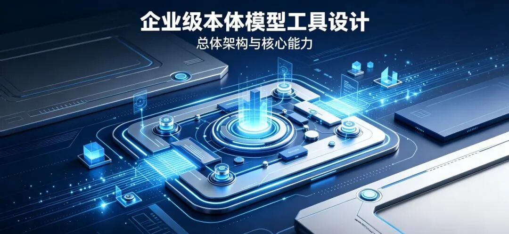

# 本体智能 | 本体实践(2)—企业级本体模型工具设计之一：总体架构与核心能力

> **来源**：微信公众号「华力江海」
> **作者**：华力江海
> **发布日期**：2026-07-05
> **原文**：[点击查看](https://mp.weixin.qq.com/s?__biz=MzcxMDMyNTI4MQ==&mid=2247483845&idx=1&sn=9357ac9f4e5eb4dfc3c3aa2899ff8802&chksm=f519a48bc26e2d9d1d45d3952db7f0195ec1ed40ace0f720117cf55167390920cc1e5bcab51e#rd)
> **系列**：本体智能系列



**📌 本文导读** **前文引导：《企业级本体模型建模标准》从方法论层面明确了本体模型的五层架构、形式化规范与公理体系，回答了"本体模型应该建成什么样"的核心问题。** **本文摘要：本文作为工具设计系列的开篇，建立全局认知框架，从建设背景、工具定位、能力框架、系统架构、流转路径、落地方案六个维度，系统拆解企业级本体工具的全景框架，建立对本体工具体系的全局认知，为后续各篇的深度拆解奠定基础。**

## 01 建设背景、定位与作用：为什么需要本体工具链

### 1.1 建设背景：企业语义智能化落地痛点剖析

在传统企业信息化建设进程中，企业经过多年系统建设，积累了海量静态资产 —— 业务制度文档、多套系统数据、固化的流程规则、分散的指标口径，但这些资产始终以"非结构化 + 异构系统"的形式存在，无法形成统一的业务语义底座。

随着大模型技术爆发，企业对智能化的需求从"信息检索"升级为"逻辑推理、规则执行、流程自动化"，但通用大模型普遍面临"智商很高但不懂业务"的困境：强监管、强合规的核心业务无法容忍黑盒式的幻觉输出，跨系统的语义割裂也让大模型无法完成精准的跨域关联。

以电网营销域最核心、最复杂的业扩业务（覆盖"客户申请用电→供电方案制定→工程施工→装表接电→合同签订"全链路）为例。该业务是电网营收的核心入口，涉及客户、用电设备、供电方案、计量装置、合同、工单等多类实体，流程环节差异极大（高压新装增容涉及 17 个业务环节，低压居民新装仅 4 个环节），且合规约束极强（供电方案答复时限、合同签订规范、用电类别校验等规则散落于数十份制度文件中），是典型的"实体多、流程繁、规则严、跨系统广"的业务场景。

如果仅依靠大模型的通用理解能力直接处理这类业务，必然面临四类无法绕过的核心问题：

❗️ **业务语义不统一**：同一个"客户"概念，在营销系统、财务系统、客服系统中的定义、字段编码、主键规则截然不同，大模型无法自动完成跨域语义对齐，检索拼接的信息极易出现偏差，反而增加人工核对成本。

❗️ **业务流程碎片化**：高压与低压、单电源与双电源、居民与非居民的流程差异巨大，分支条件嵌套复杂，仅靠自然语言描述无法让大模型精准判断触发条件，很容易出现流程跳步、环节遗漏。

❗️ **合规规则散落**："高压单电源答复时限不超过 15 个工作日"这类硬性监管约束，如果仅以自然语言喂给大模型，模型在长链路推理中极易忽略边界条件，输出违规结论，带来监管风险。

❗️ **物理模型不等于业务模型**：直接把数据库表结构映射给 AI，表结构的技术耦合会导致 AI 理解混乱。一张物理表往往承载多个业务对象的凭证数据与变更记录，需要按业务语义重新抽象（如区分"用电客户"业务实体与"用电客户凭证"数据记录），否则 AI 会把技术字段当成业务属性，造成语义混乱。

**💡 企业级 M1-M5 五层本体模型正是为系统性解决这些问题而生。M1 构建统一静态数据底座，M2 封装标准化动态执行能力，M3 转化业务约束为可校验可执行规则，M4 组装底层资产形成可运行业务场景，M5 定义岗位权责与权限策略。但是，这套标准本质是方法论与规范文档，无法直接运行，其落地必须依托一套专业的工程化工具平台作为载体。**

### 1.2 工具定位：标准落地与工程赋能核心载体

本体构建工具应明确定位为支持本体建模、编辑、存储、推理、验证与发布的单页应用程序（SPA）软件系统，是本体模型从"静态文档"走向"运行系统"的核心载体，也是连接抽象建模标准与具体业务系统落地的关键桥梁。

它与三类常见工具有着本质区别：

✦ **不同于 Visio 等绘图工具**：它不是生成仅供展示的示意图，而是输出具备完整形式化逻辑、可直接被推理引擎执行的语义模型，每一个图形元素背后都对应着标准的 OWL/SHACL 语法。

**✦ 不同于 ER 图等数据建模工具**：它不止定义数据结构，更定义实体间的语义关系、业务规则、流程逻辑，是面向业务语义的全维度建模，而非仅面向物理存储的数据结构设计。

**✦ 不同于 Protégé 等开源本体工具**：它不是仅面向专业本体工程师的技术工具，而是面向业务人员、架构师、开发人员、运维人员多角色的企业级工程平台，在底层严格对齐 W3C 标准的同时，上层通过可视化、自然语言交互大幅降低使用门槛。

更进一步说，它不仅是建模工具，更是企业语义资产的全生命周期管控平台，承接从业务需求、模型设计、校验审批、发布运行到迭代运维的完整链路，是企业统一语义底座的"设计 + 发布 + 运维"一体化工作台。

### 1.3 核心价值：提质合规、提效赋能、闭环迭代

一套合格的本体建模工具链，必须围绕"减少人员工作量、降低落地门槛、保障长期可维护"三大目标，发挥提质、提效、保闭环三大核心作用，且每一项价值都要落地到具体业务场景中：

### 提质：保障语义一致性与合规性

通过自动化 SHACL 约束检查与逻辑一致性校验，形成语法、逻辑、业务三道质量防线，取代人工代码审查与规则核对，从源头杜绝非标建设与逻辑冲突。在业扩业务中，可强制约束"用电类别"必须参考"大工业 / 一般工商业 / 居民 / 农业"统一字典，且"低压场景下电压等级只能选 220v/380v"，一旦违规立即在建模阶段拦截，避免问题流入生产环节后再排查返工 —— 传统模式下这类错误往往要到现场勘查环节才会发现，修复成本是建模阶段的数十倍。

### 提效：大幅降低建模与开发工作量

通过自然语言解析（NLP）与数据库反向工程批量导入两大核心能力，解决 80% 以上的基础建模与数据接入工作量。业务专家无需掌握 OWL 语法，通过自然语言描述即可生成实体、规则草案；数据工程师无需手写复杂 ETL 脚本，通过数据库 Schema 反向工程即可自动完成业务实体与物理表的映射，让业务专家聚焦业务逻辑，而非技术实现。

### 保闭环：支撑持续演进与免码迭代

本体模型不是一次性交付产物，而是会随业务发展持续迭代的活资产。工具通过 CI/CD、版本管理、变更评审与影响分析机制的工具化，保障"先更新本体，再改系统"的落地铁律，让本体模型始终是企业唯一的业务真相源，避免系统与规则"两张皮"。同时，标准化的本体资产支持 80% 以上的跨场景复用，新业务场景无需从零开发代码，仅需在工具层对已有实体、规则、流程进行编排适配，即可快速上线。

## 02 工具能力框架：六大核心模块全景

### 2.1 能力框架总览

企业级本体工具平台采用模块化设计理念，自下而上分为六大核心能力域，完整覆盖本体从创建、建模、校验、存储、消费到协同运维的全生命周期。六大模块既独立解耦、可单独迭代，又协同联动、形成完整闭环，是企业统一语义底座的"设计 → 验证 → 存储 → 消费 → 运维"一体化工作台。

如《一文读懂企业级本体模型》中定义，企业级本体模型是面向企业全业务链路构建的全域结构化、可推理、可复用的智能认知底座。而六大核心模块正是这套认知底座的工程化载体，将抽象的M1-M5五层建模标准转化为可操作、可验证、可运行的软件能力。

| **能力域** | **核心职责** | **对应M1-M5层** | **建设优先级** |
| **建模编辑能力** | M1-M5五层本体可视化建模与代码编辑 | M1/M2/M3/M4/M5 | 第一优先级 |
| **校验推理能力** | 三级校验体系、TBox/ABox推理、规则执行 | M3规则层 | 第一优先级 |
| **存储查询能力** | 分层语义存储、多级查询体系、事务管理 | 全层支撑 | 第一优先级 |
| **可视化交互能力** | 图谱可视化、语义转译、业务语言交互 | 全层消费 | 第二优先级 |
| **协作运维能力** | 多租户管理、版本控制、变更审批、审计监控 | 全层管控 | 第二优先级 |
| **技术架构能力** | 四层解耦架构、微服务治理、企业集成 | 基础设施 | 贯穿全程 |

**📌 系列规划说明**本文作为工具设计系列的开篇，建立全局认知框架，后续各篇将深度拆解上述六大能力域。

### 2.2 建模编辑能力详述

**✦ 核心定位**：建模编辑能力是本体工具平台的生产端核心，是企业业务专家、架构师、开发工程师共同工作的"画布"，直接决定本体资产的质量与建设效率。

**✦ 关键挑战**：M1-M5五层本体模型涉及实体、属性、关系、规则、流程、场景、角色等多类异构要素，传统建模工具要么过于技术化（如Protégé，需要掌握OWL语法），要么过于简化（如Visio，无法输出可执行业务逻辑），无法兼顾"业务语义准确性"与"工程落地可操作性"。

**✦ 能力设计要点**：

**1. 分层画布设计**：M1实体、M2行为、M3规则、M4场景、M5角色独立画布，避免要素混杂，同时支持跨层引用与联动更新。

**2. 三视图同步机制**：图形拖拽视图、表格批量视图、代码编辑视图实时同步，业务人员用图形视图零代码建模，本体工程师用代码视图精细化调优，两者协同无需格式转换。

**3. 业务语义自动转译**：底层IRI（如`ex:Customer`）自动映射为业务术语（如"用电客户"），支持中英文切换，屏蔽技术细节，让业务专家聚焦业务逻辑。

**4. 批量建模辅助**：支持数据库Schema反向工程（自动完成物理表到业务实体的映射）、Excel批量导入、NLP辅助建模（业务文档自动抽取要素生成候选模型），解决80%以上的基础建模工作量。

**💡《企业级本体模型建模标准（第1讲）》中所述，M1层实体定义需要严格遵循532个实体属性规范、53条语义关系规范。建模编辑能力通过可视化约束模板（零代码生成SHACL）将这些规范内嵌到工具中，实现"建模即合规"，从源头保障本体质量。**

### 2.3 校验推理能力详述

**✦ 核心定位**：校验推理能力是本体工具平台区别于普通数据建模工具的核心差异，是实现"静态本体"向"动态智能"跃迁的关键，也是保障本体资产长期质量的"质量门禁"。

**✦ 关键挑战**：企业本体模型规模一旦达到万级实体、十万级关系，人工校验逻辑一致性、语义冲突、引用完整性几乎不可能。同时，业务规则（如"高压单电源答复时限不超过15个工作日"）需要被自动执行、自动校验，而非仅停留在文档中。

**✦ 能力设计要点**：

**1. 三级校验体系**：语法级（OWL/RDF格式合规）→ 逻辑级（一致性、可满足性、环路冲突）→ 业务级（基于SHACL的形状约束校验），形成质量左移的三道防线，90%以上的模型缺陷在建模阶段拦截。

**2. 混合推理策略**：支持物化推理（预计算存储，保障高频查询性能）+ 查询时推理（实时计算，兼顾灵活性）+ 增量推理（仅重算变更影响范围，减少全量推理开销），平衡推理精度与执行性能。

3. **规则可执行化**：将业务规则（自然语言）转化为SWRL规则（机器可执行），并通过规则调试器可视化展示推理链路，解决"规则写了对不对、执行了准不准"的验证难题。

**4. 校验闭环**：实时校验（编辑即校验）+ 异步批量校验（全量扫描）+ 问题一键定位（点击错误信息自动跳转至对应实体/规则），大幅降低整改成本。

**💡《本体+大模型协同驱动的智能体架构》中所述，本体作为智能体的"认知底座"，需要提供可推理的语义模型。校验推理能力确保这个认知底座的逻辑一致性与业务合规性，是智能体可靠执行决策的前提。**

### 2.4 存储查询能力详述

**✦****核心定位****：存储查询能力是本体工具平台的"数据底座"，决定本体资产的存储效率、查询性能与扩展能力，是所有上层能力的支撑基础设施。**

**✦****关键挑战****：企业级本体模型规模可达亿级三元组（TBox模式 + ABox实例），传统关系型数据库无法高效存储和查询图结构数据。同时，业务系统对查询性能要求极高（如营销系统需要亚秒级响应客户信息查询），存储层需要兼顾"图查询表达能力"与"高并发查询性能"。**

### ✦**能力设计要点**：

**1. 分层存储架构**：核心语义存储（OWL/RDF原生存储引擎，如GraphDB、Stardog）→ 元数据存储（项目、权限、版本等管理数据，用关系型数据库）→ 索引加速层（全文索引、关系索引、物化结果索引，用Elasticsearch）→ 归档存储（历史版本、审计日志，用对象存储），四层协同，兼顾性能与成本。

**2. 多级查询体系**：模板化查询（面向业务人员，零代码拖拽式构建查询）→ 可视化语义查询（拖拽式构建查询逻辑，自动生成SPARQL）→ 高级SPARQL查询（专业编辑器，语法补全、调试能力），覆盖从业务人员到本体工程师的全体用户。

**3. 事务与高可用**：模式变更的ACID特性（保障本体演化的原子性）、主从架构（读写分离，提升查询性能）、加密与备份恢复（保障数据安全），满足企业级高可用要求。

**4. 多引擎适配**：提供存储引擎适配层，屏蔽底层差异，支持GraphDB、Stardog、Jena TDB等主流RDF存储引擎，支持平滑替换与混合部署。

### 2.5 可视化交互能力详述

\*\* **✦** **核心定位**：可视化交互能力是本体工具平台的"消费端"核心，解决"技术自嗨"问题，让业务人员、管理人员、外部系统都能便捷地消费本体能力，是本体资产价值变现的"最后一公里的转化器"。\*\*

\*\* **✦** **关键挑战**：本体底层是OWL/RDF三元组，技术门槛高，业务人员无法直接理解。同时，企业本体模型规模庞大（万级实体、十万级关系），如何清晰地展示、便捷地检索、直观地理解，是可视化交互设计的核心难题。\*\*

### **✦** **能力设计要点**：

**1. 四大核心可视化视图**：类层次树视图（继承体系的层级化展示与检索）→ 实体关系图谱视图（力导向/分层布局，节点-边语义网络）→ 实例溯源链路视图（单实例上下游关联全链路展示）→ 规则依赖拓扑图（规则与实体、流程、场景的依赖关系），覆盖从概览到细节、从模式到实例的全景可视化。

**2. 语义自动转译**：IRI自动映射为业务术语，支持中英文切换，屏蔽技术细节，让业务专家聚焦业务逻辑。例如，底层`ex:HighVoltageCustomer`在界面上自动显示为"高压用电客户"。

**3. 本体智能问答**：基于自然语言理解 → NL2SPARQL → 结果组装 → 溯源展示的全链路智能问答能力，业务人员用自然语言提问（如"高压单电源答复时限是多少"），系统自动生成SPARQL查询、执行、返回答案并附带来源实体与推理链路，实现"问即所得"。

**4. 交互体验设计**：缩放平移、节点下钻、高亮关联、筛选过滤、关键词快速定位与路径高亮，降低大规模图谱的阅读门槛。

**💡《本体+大模型协同驱动的智能体架构》中所述，本体驱动智能体的核心优势是"缓解幻觉"。可视化交互能力中的"本体智能问答"正是这一优势的直接体现：答案附带来源实体与推理链路，可解释、可验证，避免大模型黑盒输出。**

### 2.6 协作运维能力详述

\*\* **✦** **核心定位**：协作运维能力是本体工具平台区别于单机开源工具的核心差异，解决"多团队协同建模、长期迭代运维、企业级管控"的落地难题，是企业级本体资产"可运营、可管控、可审计"的保障。\*\*

\*\* **✦** **关键挑战**：企业本体建模往往涉及业务专家、架构师、开发工程师、运维人员等多角色协同，如何管控并行建模的冲突、如何追溯本体的变更历史、如何评估变更的影响范围、如何保障本体质量持续可控，是单机工具无法解决的。\*\*

### **✦** **能力设计要点**：

**1. 多项目与多租户体系**：项目空间隔离（独立本体集、权限、版本链路），全域资产共享（公共本体、标准字典的跨项目复用），多租户架构（适配多业务域独立运营），支持大型企业跨部门、跨业务域的本体协同建模。

**2. 全生命周期版本管理**：版本快照与标签化管理、语义级Diff对比（不仅对比文本，更对比语义变更）、版本回滚与分支管理（支持并行建模与版本合并），保障本体演化的可追溯性与可回退性。

**3. 变更影响分析**：自动扫描全链路依赖（规则、流程、场景、实例），生成变更影响报告（变更范围、风险等级、受影响对象清单），并嵌入审批流（变更提交自动附带影响分析报告），让变更决策有依据、可审计。

**4. 细粒度权限体系**：RBAC角色基础（建模师、审核员、管理员、普通查询者），三级数据权限（类级别/属性级别/实例级别），企业身份对接（IAM/SSO集成，统一账号体系），保障本体资产的安全性与合规性。

**5. 运维与合规能力**：全量审计日志（操作人、对象、时间、变更前后内容）、CI/CD流水线集成（自动化测试、灰度发布）、运行监控（查询性能、推理耗时、数据质量监控），满足政企合规要求。

### 2.7 技术架构能力详述

\*\* **✦** **核心定位**：技术架构能力是本体工具平台的"基础设施"，决定平台的性能、稳定性、扩展性与集成能力，是支撑上述五大能力域的"底座"。\*\*

\*\* **✦** **关键挑战**：本体工具平台涉及存储（IO密集型）、推理（CPU密集型）、查询（高并发）、可视化（GPU加速）等多种异构计算需求，如何合理分层、资源隔离、独立扩缩容，是技术架构设计的核心难题。\*\*

### **✦** **能力设计要点**：

**1. 四层解耦架构**：存储层（RDF四层存储体系）→ 推理引擎层（TBox/ABox推理、混合推理策略）→ 核心服务层（微服务拆分、统一网关、服务治理）→ 应用层（面向不同角色的前端应用矩阵），四层单向依赖、资源隔离，规避IO密集型存储与CPU密集型推理互相抢占资源的性能问题。

**2. 微服务拆分与服务治理**：按能力域拆分为八大原子服务（项目管理、M1-M5建模、校验推理、存储查询、可视化交互、协作运维、智能问答、系统管理），独立扩缩容与灰度发布；统一网关鉴权、路由、限流、协议转换；服务治理（熔断降级、全链路监控、统一错误码）。

**3. 关键技术难点与解决方案**：大规模三元组查询性能优化（索引加速、查询重写、缓存策略）、推理任务的调度与资源隔离（独立部署推理集群、弹性扩缩容）、实时建模的多用户协同与冲突处理（操作锁、版本合并策略）、大模型能力的集成与安全管控（LLM辅助建模的幻觉防控、敏感信息过滤）。

**4. 企业集成方案**：与数据中台、业务系统的对接方式（API/消息队列/文件批量），与大模型平台、知识图谱平台的协同关系（本体作为认知底座，大模型作为推理引擎，知识图谱作为可视化载体），与现有DevOps体系的融合（CI/CD流水线、容器化部署、监控告警）。

### 2.8 M1-M5五层建模能力映射总结

工具平台的六大能力域与M1-M5五层本体模型有着清晰的对应关系，形成"建模标准 → 工程工具 → 运行系统"的完整闭环：

\*\* **✦** \*\*M1实体模型 → 实体建模编辑器（建模编辑能力）

✓ 支持业务对象、业务事实、业务指标、数据标准、参考数据、数据字典六类核心数据实体的可视化定义

✓ 提供类继承、属性配置、关系建立的标准化操作界面，内嵌SHACL约束模板，实现"建模即合规"

✓ 支持数据库Schema反向工程、Excel批量导入、NLP辅助建模，解决80%以上的基础建模工作量

\*\* **✦** \*\*M2行为模型 → 行为建模编辑器（建模编辑能力）

✓ 支持业务流程、业务环节、原子操作、MCP服务、原子Agent五类核心行为实体的流程编排

✓ 实现流程模型与底层执行能力的绑定，支持BPMN式流程画布设计，让业务人员零代码编排业务流程

✓ 提供动作定义面板（原子/复合/异步动作的参数化配置）与系统能力对接（底层API与动作的绑定机制）

\*\* **✦** \*\*M3规则模型 → 规则建模编辑器 + 校验推理引擎

✓ 支持通用公理、阈值规则、合规校验、风险预警四类核心规则实体的形式化表达

✓ 提供SHACL约束可视化配置与SWRL规则调试能力，规则卡片化设计（类型徽章、触发条件、规则体、描述）

✓ 支持规则版本管理、规则执行监控、规则效果评估，形成规则全生命周期管理

\*\* **✦** \*\*M4场景模型 → 场景建模编辑器（建模编辑能力）

✓ 支持业务场景、编排链路、资源引用三类核心场景实体的快速编排

✓ 实现基于底层资产的场景复用与灵活组装，支持场景步骤与资源引用的可视化绑定

✓ 提供单步调试器设计（输入输出查看、规则命中高亮），降低场景编排的调试门槛

\*\* **✦** \*\*M5角色模型 → 角色建模编辑器（建模编辑能力）

✓ 支持岗位实体、人员账号、权限策略三类核心权限实体的精细化配置

✓ 实现人岗权的绑定与数据权限管控，支持岗位-角色-权限的三级映射配置

✓ 提供建模权限与数据权限的双维度管控，并与企业IAM/SSO系统集成，统一账号体系

## 03 系统架构总览：四层解耦架构体系

### 3.1 核心设计原则

企业级本体工具平台的设计遵循四大标准化设计准则：

✧ **标准先行**：底层严格遵循 OWL 2 DL、SHACL、SWRL、SPARQL W3C 国际规范，本体资产可跨工具、跨平台迁移，无技术绑定。

**✧ 分层解耦，独立演进**：平台纵向分为四层架构，层间单向依赖，存储、推理、服务、应用可单独扩容、单独迭代，底层引擎替换不影响上层业务功能。

**✧ 双端适配**：兼顾业务人员零代码可视化操作、本体工程师专业代码编辑，一套平台覆盖两类用户使用诉求。

**✧ 企业原生**：内置多租户隔离、细粒度权限、操作审计、变更审批、高可用灾备等政企必备能力，区别于单机开源工具。

### 3.2 四层技术架构

整体自下而上分为**存储层 → 推理引擎层 → 核心服务层 → 前端应用层**，四层单向依赖、资源隔离，规避 IO 密集型存储与 CPU 密集型推理互相抢占资源的性能问题。

\*\* **✦** \*\*存储层

全量 TBox 模式、ABox 实例、项目元数据、索引数据持久化底座，支持冷热分层、多引擎适配。采用分层存储架构，核心语义存储、元数据存储、索引加速层、归档存储四层协同，兼顾性能与成本。

\*\* **✦** \*\*推理引擎层

独立部署推理计算集群，承载 TBox 分类、ABox 实例、SWRL 规则推理，支持实时推理 + 物化混合策略。采用混合推理架构，平衡推理精度与执行性能，支持增量推理与批量推理两种模式。

\*\* **✦** \*\*核心服务层

微服务化原子能力封装，统一网关鉴权限流，对外标准化输出建模、校验、查询、问答接口。按能力域拆分为八大原子服务，支持单独扩缩容与灰度发布。

\*\* **✦** \*\*前端应用层

面向不同角色的一体化 SPA 工作台，包含项目管理、M1-M5 五层建模、校验、图谱可视化、语义查询、智能问答、运维后台七大功能模块。采用角色化工作台设计，不同角色看到不同的功能入口。

### 3.3 全链路流转路径

完整本体资产从需求到运维的统一流转流程：

```
需求提交 → 可视化建模 → 多层校验 → 变更影响分析审批 → 推理计算 → 三元组持久化 → 语义查询/问答 → 运行监控
```

核心优化点：变更自动扫描全链路依赖（实体、规则、场景）生成风险报告，解决人工排查变更影响效率低下的痛点。

### 流转路径详解：

一、需求提交：业务专家或架构师提交本体建模需求，系统自动创建项目空间

二、可视化建模：在M1-M5编辑器中完成本体要素的可视化配置

三、多层校验：系统自动触发语法级、逻辑级、业务级三级校验

四、变更影响分析：自动扫描依赖关系，生成影响分析报告

五、审批发布：审批人基于质量报告和影响分析进行审批决策

六、推理计算：发布后自动触发推理计算，生成物化结果

七、三元组持久化：推理结果持久化到存储层，供查询服务使用

八、语义消费：业务系统通过查询服务或问答服务消费本体能力

九、运行监控：持续监控本体质量、查询性能、推理负载等指标

## 04 分级落地方案：三阶段阶梯式建设路径

### 4.1 架构部署版本

根据企业规模与业务复杂度，本体工具平台提供三种部署版本，支持从试点验证到全域推广的平滑演进：

| 部署版本 | 架构特点 | 三元组规模 | 适用场景 | 投入预估 |
| **轻量试点版** | 存储推理单机合并部署，简化服务层 | 百万级 | 单业务域POC、小团队验证 | 1-2人月 |
| **标准生产版** | 四层架构完全拆分，独立推理集群 | 千万级 | 多业务域正式生产 | 4-6人月 |
| **大规模集团版** | 分布式存储、增量推理、微服务细拆分 | 亿级 | 集团全域知识底座 | 8-12人月 |

**💡 版本演进路线：从轻量版到标准版的升级要点是"存储推理分离"（引入独立推理集群）、"服务层拆分"（按能力域拆分为微服务）；从标准版到大规模版的核心改造点是"分布式存储"（支持横向扩展）、"增量推理"（减少全量推理开销）、"微服务细拆分"（支持按需扩容）。演进过程中的数据迁移与业务平滑过渡方案需提前规划。**

### 4.2 三阶段建设路径详解

为避免一次性过度投入，建议采用三阶段阶梯式建设路径，每个阶段形成独立闭环，快速验证业务价值，再决定是否扩容。

\*\* **✦** \*\*阶段一：基础闭环

**✧****建设目标****：跑通"建模-校验-查询"最小闭环，完成数据库反向建模，解决80%手工建模工作量，验证本体工具的基本价值。**

### ✧**核心建设内容**：

1. 部署轻量版平台，配置项目空间与权限体系
2. 建设M1实体编辑器基础能力，集成数据库Schema反向工程
3. 建设M3基础约束与校验能力，实现"建模即合规"
4. 对接RDF存储引擎，开发模板化查询能力
5. 选取业扩业务作为试点，跑通完整链路

\*\* **✧** **阶段成果**：完成核心实体本体建模，实现数据库反向工程自动映射，通过SHACL约束校验，业务人员可零代码检索信息。\*\*

\*\* **✦** \*\*阶段二：业务场景打通

\*\* **✧** **建设目标**：实现流程+规则自动推理，业务场景零代码编排落地，验证本体工具在复杂业务场景中的价值。\*\*

### **✧** **核心建设内容**：

1. 建设M2行为建模编辑器，支持流程画布设计与动作定义
2. 建设M4场景编排器，支持场景步骤与资源引用绑定
3. 建设独立推理引擎，支持TBox/ABox推理与SWRL规则执行
4. 建设可视化图谱与拖拽式语义查询能力
5. 选取业扩全流程作为试点，验证流程自动推理与规则自动校验

\*\* **✧** **阶段成果**：完成业扩全流程的M2行为建模与M4场景编排，实现流程自动推理与规则自动校验，业务人员可零代码编排业务场景。\*\*

\*\* **✦** \*\*阶段三：全域运营

\*\* **✧** **建设目标**：多租户全域协同，本体资产可复用、可对外赋能AI与业务系统，形成企业级语义资产的"建设-运营-增值"闭环。\*\*

### **✧** **核心建设内容**：

1. 建设M5角色权限管理，支持岗位-角色-权限三级映射
2. 建设智能问答模块，实现自然语言提问与可解释答案
3. 建设NLP辅助建模，支持业务文档自动抽取要素
4. 集成CI/CD流水线，保障本体质量与发布安全
5. 建设开放API与SDK，支持业务系统与大模型平台消费本体能力

\*\* **✧** **阶段成果**：完成多业务域本体建模与复用，实现智能问答准确率≥85%，本体资产通过开放API赋能多个业务系统或AI应用。\*\*

### 4.3 建设优先级建议

根据业务价值与实施难度，建议按以下优先级推进：

### 第一优先级（必须建设）

- M1实体建模编辑器（业务价值最高，实施难度中等）
- 基础校验能力（质量保障基础，实施难度低）
- 项目与权限管理（多团队协同基础，实施难度低）
- 简易存储查询（价值验证基础，实施难度中等）

### 第二优先级（强烈建议）

- M3规则建模编辑器（合规保障核心，实施难度中等）
- 独立推理引擎（智能应用基础，实施难度高）
- 可视化交互能力（降低使用门槛，实施难度中等）
- M2行为建模编辑器（业务流程自动化基础，实施难度高）

### 第三优先级（可选建设）

- M5角色权限精细化管控（大型企业的必选项，中小型企业可暂缓）
- 智能问答模块（提升用户体验，实施难度高）
- NLP辅助建模（降低建模工作量，实施难度高）
- CI/CD流水线（成熟运营阶段的必选项，试点阶段可暂缓）

### 4.4 建设风险与规避策略

基于多个企业落地实践，总结四类常见风险与规避策略：

**风险一：业务人员参与度低，建模工作由技术团队包揽**

**表现**：技术团队不懂业务语义，建模结果无法反映真实业务需求；业务团队认为建模是"技术活"，不愿参与。

**规避策略**：① 工具设计强调"业务视角优先"，让业务人员能用图形化界面零代码建模；② 建立"业务专家+本体工程师"双人建模机制，业务专家负责语义定义，本体工程师负责形式化实现；③ 将本体建模纳入业务流程，如"新业务上线前必须完成本体建模"。

### 风险二：本体规模膨胀后，模型质量失控

**表现**：实体数量过万，关系错综复杂，逻辑冲突、语义歧义、引用断裂等问题频发，整改成本极高。

**规避策略**：① 优先上线校验模块，通过SHACL约束从源头统一业务语义；② 建立本体质量评价标准（如语义覆盖率、逻辑一致性、引用完整性）与持续改进机制；③ 控制本体规模，遵循"最小化原则"，只建模业务中真正需要语义化的核心要素。

**风险三：与现有系统重复建设，价值证明困难**

**表现**：业务部门认为"现有系统已经能处理业务，为什么还要建本体？"，项目价值难以证明，推广受阻。

**规避策略**：① 明确本体工具与现有系统的关系——是"增强"而非"替代"，本体提供统一语义底座，现有系统作为执行载体；② 选取痛点明确的业务场景（如业扩流程合规校验）作为试点，量化业务价值（如"合规校验效率提升80%"）；③ 强调本体的复用价值——"一次建模，多处复用"，避免重复建设。

**风险四：大模型幻觉问题未解决，智能应用可信度低**

**表现**：基于大模型的直接应用经常出现幻觉输出，业务人员不信任，推广受阻。

**规避策略**：① 采用"本体+大模型"协同架构，本体提供语义底座（缓解幻觉），大模型提供推理引擎（提升效率）；② 智能问答答案附带来源实体与推理链路，可解释、可验证；③ 建立大模型输出的人工审核机制，逐步建立信任。

### 4.5 投入产出比分析

基于多个企业落地数据，本体工具平台建设的投入产出比（ROI）分析：

| 建设阶段 | 投入预估 | 产出预估 | ROI（1年） |
| **阶段一** | 1-2人月 | 建模效率提升80%，合规校验效率提升90% | 约3-5倍 |
| **阶段二** | 4-6人月 | 业务流程自动化覆盖率提升60%，规则执行准确率100% | 约5-8倍 |
| **阶段三** | 6-8人月 | 本体资产复用率≥70%，智能问答准确率≥85% | 约8-12倍 |

**投入说明**：人力投入为主（占80%），包含项目经理、本体架构师、开发工程师、业务专家；硬件投入为辅（占20%），包含服务器、存储、推理加速卡等。

**产出说明**：直接产出（建模效率提升、合规校验效率提升、业务流程自动化覆盖率提升）占60%；间接产出（本体资产复用、智能应用可信度提升、业务创新加速）占40%。

**ROI提升策略**：① 优先选取痛点明确的业务场景作为试点，快速验证价值；② 建立本体资产复用机制，避免重复建模；③ 持续运营与优化，逐步提升本体质量与智能应用效果。

## 05 总结与落地行动建议

### 5.1 整体工作总结

本文从六个维度系统拆解了企业级本体工具的全景框架：

◈ **建设背景**：企业语义智能化落地面临四大核心痛点，M1-M5五层本体模型是系统性解决方案，但需要工程化工具作为载体

◈ **工具定位**：本体工具是标准落地与工程赋能的核心载体，区别于三类常见工具，是企业语义资产的全生命周期管控平台

◈ **能力框架**：六大核心模块完整覆盖本体全生命周期，与M1-M5五层建模能力一一对应

◈ **系统架构**：四层解耦架构体系，存储、推理、服务、应用分层隔离，兼顾性能与可扩展性

◈ **流转路径**：九步全生命周期闭环，变更影响分析自动化，保障本体质量与可追溯性

◈ **落地方案**：三种部署版本+三阶段建设路径，避免一次性过度投入，快速验证业务价值

本体工具是M1-M5建模标准唯一工程落地载体，实现企业统一业务语义底座，支撑业务自动化、可控大模型智能应用。

### 5.2 落地实施建议

基于多个企业落地实践，总结三条可操作的行动清单：

### 行动一：能力盘点与差距分析

梳理现有建模工具、数据引擎、规则引擎的能力现状，对照六大核心模块，识别能力缺口与建设优先级，制定分阶段建设计划，明确每阶段的交付物与验收标准

### 行动二：最小验证闭环

优先搭建轻量版平台，选取业扩等核心业务作为试点，跑通"建模-校验-查询"完整链路，验证业务收益，基于试点效果优化方案，再决定是否扩容到标准版或大规模版

### 行动三：质量优先落地

优先上线校验模块，通过SHACL约束从源头统一业务语义，建立本体质量评价标准与持续改进机制，避免大量不规范本体堆积后期整改，增加整改成本

### 写在最后

企业级本体模型工具的建设，本质上是将"业务语义资产化"从理念变为现实的过程。当本体工具平台真正落地，业务人员的经验将转化为可复用、可推理、可验证的结构化资产，大模型的强大能力将有了可靠的认知底座，企业的智能化转型将从此有了坚实的语义基石。

这不是一朝一夕的工程，但一旦建成，它将成为企业最宝贵的长期资产——一个真正理解业务、持续进化、可信可用的企业级智能底座。
