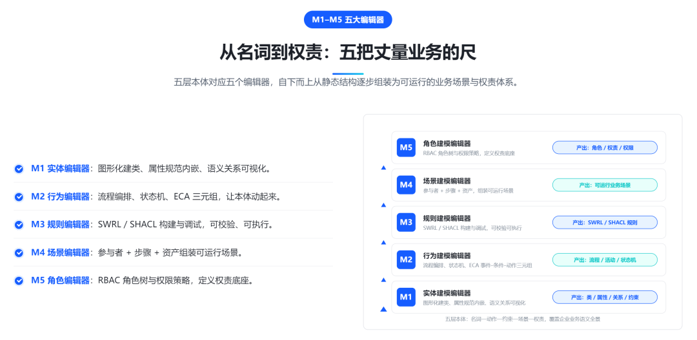

# 本体智能 | 本体实践(2)—企业级本体模型工具设计之二：本体建模编辑器设计

> **来源**：微信公众号「华力江海」
> **作者**：华力江海
> **发布日期**：2026-07-14
> **原文**：[点击查看](https://mp.weixin.qq.com/s?__biz=MzcxMDMyNTI4MQ==&mid=2247483873&idx=1&sn=5f2f1b26f742755ae2fe3cde868150a5&chksm=f519a4afc26e2db912e3063838b5bdc8096bf4c8a747392ef5be7a17879d686214f75f00378b#rd)
> **系列**：本体智能系列

**📌 本文导读** **前文引导：**《企业级本体模型工具设计之一：总体架构与核心能力》（下文简称《总体架构与核心能力》）定义了工具平台的六大核心能力域，并指出**建模编辑能力**是生产端第一优先级。本文承接该定位，把"建模编辑"这一抽象能力拆解为可操作、可验证的编辑器设计。\*\*本文摘要：\*\*从编辑器定位与架构入手，逐一详解 M1 实体、M2 行为、M3 规则、M4 场景、M5 角色五大建模编辑器；重点剖析"图形 / 表格 / 代码"三视图实时同步的统一模型层设计；并给出数据库反向工程、`NLP` 辅助、`Excel` 批量导入三类辅助引擎的落地链路，最终落到"建模即合规"的质量内建闭环。

某电网公司的业务专家老张，想给"用电客户"建一个本体模型。他打开 Protégé，眼前是 `OWL`、`RDF`、`SWRL` 一串标准语法——关掉了软件。三个月后，开发团队用 `Excel` 手敲了一份"实体表"；本体工程师又照着这份表，重画了一遍形式化模型。同一件事，三个人干了三遍，没有一份能对得上。

这不是个例。企业级本体落地的最大瓶颈，从来不是"想不清"，而是"建不出、建不对"。工具一端是给少数本体工程师用的"黑魔法"编辑器，另一端是只能画"示意图"的绘图工具——中间隔着一道业务人员跨不过去的语义鸿沟。

本文是《企业级本体模型工具设计》系列第二篇。上篇《企业级本体模型工具设计之一：总体架构与核心能力》（下文简称《总体架构与核心能力》）已发布，搭好了全局能力框架，并指出**建模编辑能力**是生产端第一优先级。本文钻进"画布"内部，把 M1–M5 五大编辑器、三视图同步、批量辅助引擎的设计拆开讲透。

## 01 建不出、建不对：本体落地的真瓶颈

**image**

### 1.1 为什么编辑器是工具平台的生产端核心

在《总体架构与核心能力》的能力框架中，建模编辑能力（对应 M1–M5 五层）被放在**第一优先级**——这不是偶然。本体工具平台的价值起点，是"把业务语义变成机器可推理的模型"，而这一转化动作 100% 发生在建模编辑器里。

把平台拆开看：存储层是"数据底座"，推理层是"智能引擎"，可视化层是"消费端"。建模编辑器是唯一的"生产端"。业务专家在这里定义实体，架构师在这里约束语义，开发工程师在这里生成可执行业务逻辑。没有高质量的生产端，下游所有能力都是"无源之水"。

所以编辑器设计的好坏，直接决定了一个企业能不能把业务语义真正"资产化"。

### 1.2 传统建模工具的三个失灵

为什么不能直接拿现有工具做企业级本体建模？根本矛盾在于：本体模型是"语义模型"，不是"数据模型"，也不是"示意图"。传统工具在三个方向全部失灵。

▪ **过于技术化（如 Protégé）**：要求建模者掌握 `OWL`、`RDF`、`SWRL` 等 `W3C` 标准语法。业务专家被挡在门外，本体建模退化成少数工程师的"黑魔法"，无法在企业内规模化推广。前面老张关掉软件，就是这个原因。

▪ **过于简化（如 Visio / 普通流程图）**：只能画"展示用"的示意图，图形背后没有形式化语义，无法被推理引擎执行。模型要落地时就必须二次人工转译，带来巨大的语义失真风险。

▪ **割裂（绘图工具 + 代码编辑器 + **`Excel`** 各自为政）**：图形与代码不同步、批量导入与可视化编辑冲突，模型在多种形态间反复转换，版本错乱、口径不一成为常态。

**💡 企业级本体建模编辑器，必须在"业务语义准确性"与"工程落地可操作性"之间取得平衡：业务人员用图形零代码建模，本体工程师用代码精细调优，两者面对同一份模型，无需格式转换。这正是"三视图同步"与"统一模型层"设计的由来。**

### 1.3 设计目标：业务可建、工程可控、建模即合规

针对上面三个失灵，建模编辑器的设计收敛为三个目标：

**1.** **业务可建**：以分层画布 + 语义转译降低门槛，业务专家不写一行 `OWL` 即可完成 80% 的实体与关系定义。

**2.** **工程可控**：保留代码视图与完整版本能力，本体工程师可对模型做精细化、可审计的调优。

**3.** **建模即合规**：将第1讲《企业级本体模型建模标准》（下文简称《建模标准》）的 532 个实体属性规范、53 条语义关系规范内嵌为 `SHACL` 约束模板，建模过程中实时校验，从源头保障质量。

**🎯 从目标到架构**明确了"业务可建、工程可控、建模即合规"三大目标，下一个问题很实际：编辑器在平台里到底坐在什么位置？五大编辑器、三视图和辅助引擎怎么组织？下面给出整体架构。

## 02 一个模型，三种语言：编辑器的骨架

**image**

### 2.1 架构总览

建模编辑能力位于平台的**应用层**，向上承接业务需求，向下对接统一模型层（`UM`）与质量内建模块，是连接"业务语义"与"形式化模型"的核心枢纽，整体架构如下。

企业级本体工具平台应用层 · 建模编辑能力（第一优先级）M1–M5 分层画布独立编辑 · 跨层联动三视图同步图形拖拽 / 表格批量 / 代码编辑批量辅助引擎DB 反向工程 · NLP · Excel统一模型层 UM单一事实源 · IRI 模型 · 版本化质量内建SHACL 约束模板 · 实时校验存储 · 推理 · 可视化 · 消费下游消费与能力复用定位：连接业务语义与形式化模型的核心枢纽 · 合规模型才向下游发布

### 2.2 分层画布：M1–M5 独立画布，跨层联动

五层本体要素的异构性极强——M1 是静态结构（类/属性），M2 是动态行为（流程/状态），M3 是约束（规则），M4 是组装（场景），M5 是权责（角色）。把所有要素塞进一张画布，必然混乱。

我们采用**分层画布**：每个 M 层拥有独立编辑画布，要素在各自画布内建模；同时通过"跨层引用"机制联动——例如在 M4 场景画布中引用 M1 的实体、M3 的规则，引用关系变更会同步回源层并触发下游刷新。这样既互不干扰，又能组装成完整模型。

### 2.3 统一模型层（UM）：三视图同步的基石

无论用户用图形、表格还是代码编辑，底层都落到**同一份统一模型层（Unified Model, **`UM`**）**。`UM` 以 `IRI` 化的本体模型为唯一事实源，记录每个要素的 `IRI`、属性、关系、约束及其版本。三视图只是 `UM` 的不同"投影"，不是独立副本——这恰恰是"改一处、三处同步"能够实现的根本原因。

### 2.4 辅助引擎：把 80% 的重复劳动交给机器

建模编辑不是从空白画布开始。辅助引擎承担三类批量产出：

▪ **数据库反向工程**：读取物理表结构，自动推断实体、属性、关系候选；

▪ `NLP`** 辅助建模**：解析业务文档，自动抽取要素生成候选模型；

▪ `Excel`** 批量导入**：按模板批量填充，快速完成结构化要素录入。

这三路产物最终都汇入 `UM`，经人工映射确认与 `SHACL` 校验后进入本体资产库。

**🔍 进入画布内部**架构搭好了，接下来逐一拆解 M1–M5 五个编辑器：分别解决什么问题、长什么样、关键能力有哪些。

## 03 从名词到权责：五把丈量业务的尺

五层本体对应五个编辑器，职责与产出的关系如下：自下而上，从静态结构（M1）到动态行为（M2）、约束（M3）、组装（M4）、权责（M5），层层支撑、逐级组装。

五层本体 · 五个编辑器产出逐级累加 ↑M5 角色层　·　角色建模编辑器产出：角色 · 权责 · 权限M4 场景层　·　场景建模编辑器产出：可运行业务场景M3 规则层　·　规则建模编辑器产出：SWRL · SHACL 规则M2 行为层　·　行为建模编辑器产出：流程 · 活动 · 状态机M1 实体层　·　实体建模编辑器产出：类 · 属性 · 关系 · 约束定位：五层要素各有其位，从名词底座逐级组装为可运行的权责体系

### 3.1 M1 实体建模编辑器：业务静态底座的图形化构建

实体层（M1）是整个本体的"名词表"，定义企业有哪些核心概念、它们有什么属性、彼此如何关联。实体建模编辑器是五大编辑器中使用频率最高、业务人员接触最多的一个。

**界面分区设计**如下：左侧工具箱提供类/属性/关系/约束等建模原语；中间画布以类层次树 + 语义连线呈现实体网络；右侧属性面板编辑选中要素的数据属性、对象属性、约束与业务域；顶部大纲树提供实体–属性层级导航。

① 工具箱类 / 属性 / 关系 / 约束② 大纲树实体-属性层级导航③ 画布区类层次树语义连线呈现实体网络零代码图形化建模主舞台④ 属性面板数据属性 / 对象属性约束 / 业务域选中要素的语义精修区定位：四类区域各司其职，业务专家无需接触 Turtle 即可完成实体建模

**关键能力**：

▪ **图形化建类**：从工具箱拖出"类"节点，命名即生成 `IRI`（如 `ex:Customer`），无需接触 `Turtle` 语法；

▪ **属性规范内嵌**：属性面板内置《建模标准》的 532 个实体属性规范，下拉即可选标准属性，杜绝自定义歧义；

▪ **语义关系可视化**：对象属性（如"属于/包含/关联"）以带方向连线呈现，53 条标准语义关系以调色板形式提供，避免"关系名乱起"；

▪ **约束即时配置**：基数（0..1 / 1..\\\*）、值域（枚举字典）、主键等约束在面板中点选，后台自动生成 `SHACL` 形状。

以电网"用电客户"为例：业务专家拖出类节点命名为"用电客户"，从属性面板勾选"客户编号（主键）""用电地址""用电类别（枚举：大工业/一般工商业/居民/农业）"，用对象属性连线关联到"用电设备""计量装置"，一个标准实体 5 分钟内即可成型。

### 3.2 M2 行为建模编辑器：让静态本体"动起来"

实体层定义了"有什么"，行为层（M2）定义"怎么运转"。M2 封装标准化的动态执行能力——流程、活动、状态机、事件。

**关键能力**：

▪ **流程编排画布**：以类 `BPMN` 的图形节点编排业务活动（如业扩报装的"申请→方案制定→施工→接电→签约"），支持分支、并行、循环；

▪ **状态机定义**：为实体定义生命周期状态（如"草稿/在途/完成"）及合法迁移，非法迁移在建模阶段即被拦截；

▪ **事件–条件–动作（**`ECA`**）**：将"当 X 发生时，若满足 Y 则执行 Z"可视化为三元组，降低规则编写门槛。

M2 行为直接引用 M1 实体作为流程参与者，引用 M3 规则作为流转约束，形成"实体承载、行为驱动、规则约束"的闭环。

### 3.3 M3 规则建模编辑器：业务约束可校验、可执行

规则层（M3）是把"散落数十份制度文件"的硬约束，转化为机器可校验、可执行的规则。M3 编辑器解决"规则写了对不对、执行了准不准"的验证难题。

**关键能力**：

▪ `SWRL`** 规则可视化配置**：以"前提（条件）— 结论（动作）"两栏式构建器生成 `SWRL` 规则（如 `高压单电源(?c) ∧ 答复(?c,?t) → lessThan(?t,15)`），无需手写 `SWRL` 语法；

▪ `SHACL`** 形状约束模板**：将常见约束沉淀为可复用模板（如"用电类别必须取自统一字典"），一键套用到实体；

▪ **规则调试器**：可视化展示推理链路，输入实例后高亮命中规则与推导步骤，让规则"可解释、可验证"。

**📌 与前面发文的关联**：如《总体架构与核心能力》所述，M3 是"静态本体向动态智能跃迁"的关键。M3 编辑器产出的规则，正是《之三：校验与推理引擎设计》的执行对象。

### 3.4 M4 场景建模编辑器：把资产组装成可运行场景

场景层（M4）是本体价值的"交付面"——把 M1–M3 的资产编排为可运行业务场景。M4 编辑器让架构师像"搭积木"一样组装场景。

**关键能力**：

▪ **场景画布**：以"参与者 + 步骤 + 引用资产"组织场景（如"业扩报装场景"引用 M1 的用电客户/设备、M2 的流程、M3 的时限规则）；

▪ **资产引用与版本锚定**：场景引用的实体/规则锁定版本，源资产变更时提示影响，避免"场景悄悄失效"；

▪ **可运行导出**：场景可一键导出为推理任务或 `API`，直接驱动智能体/业务系统执行。

### 3.5 M5 角色建模编辑器：权责与权限的策略化定义

角色层（M5）定义"谁能做什么"，是本体治理的权责底座。M5 编辑器以 `RBAC` 模型组织角色、权责与数据权限。

**关键能力**：

▪ **角色树管理**：按组织层级定义角色及继承关系（如"建模者→高级建模者→建模管理员"）；

▪ **权限策略配置**：为角色分配对实体/规则的读、写、发布权限；

▪ **数据权限范围**：定义角色可触及的业务域/项目空间范围，支撑多租户隔离。

**💡** **M1–M5 五个编辑器**，对应"名词—动作—约束—场景—权责"五个建模维度，覆盖企业业务语义的全景。它们各自独立、又通过 `UM` 联动，共同构成"业务可建"的画布体系。**🔄 三视图同步机制**五大编辑器解决了"分层建什么"，但同一个模型要服务不同角色——业务人员爱图形、数据分析师爱表格、本体工程师爱代码。怎么让三者面对同一份模型、互不打架？答案是"三视图同步"。

## 04 让图形、表格、代码，不再各说各话

**image**

### 4.1 为什么需要三视图

不同角色对同一份模型有不同操作偏好：

▪ **业务人员**：用图形拖拽零代码建模，关注"长得对不对"；

▪ **数据分析师**：用表格批量维护属性与关系，关注"数据齐不齐"；

▪ **本体工程师**：用代码（`Turtle` / `SHACL`）精细化调优，关注"语义准不准"。

若三套界面背后是三份独立文件，同步就是噩梦。所以设计上三者只是**同一 **`UM`** 的不同视图**。

### 4.2 统一模型层（UM）作为单一事实源

如第二章所述，`UM` 以 `IRI` 模型为唯一事实源。三视图的每一次编辑，都不是修改"自己的副本"，而是向 `UM` 提交一个**模型变更事件**；`UM` 更新后，再把增量 diff 推送给其他视图重渲染。这一机制以时序图展示如下。

业务人员图形化画布编辑本体工程师OWL/TTL 代码编辑图形视图画布拖拽 · 节点连线属性面板表格视图批量编辑 · 属性对齐数据分析师主战场代码视图OWL · TTL · SHACL版本差异对比统一模型层 UM单一事实源 · IRI 唯一标识 · 版本化变更事件 → 差异计算 → 增量广播冲突检测与自动合并其余视图重渲染只刷新变更部分，不丢失编辑状态机理：任一视图变更提交 UM，UM 更新 IRI 并广播增量 diff，万级实体下三视图仍流畅同步

### 4.3 同步协议：事件驱动 + 增量 diff

▪ **事件驱动**：视图变更封装为语义化事件（CreateClass / SetProperty / AddEdge…），经事件总线送达 `UM`；

▪ **增量 diff**：`UM` 仅向其他视图推送"变了什么"（而非整份模型），重渲染开销极低，万级实体规模下仍流畅；

▪ **版本化**：每次变更 `UM` 版本号自增，为冲突处理与回滚提供依据。

### 4.4 冲突处理与一致性保障

多人并发编辑同一要素时：

▪ **乐观锁**：基于 `UM` 版本号，提交时版本不符则提示"已被他人修改"，由用户选择合并或覆盖；

▪ **字段级合并**：不同字段的并发修改可自动合并，仅同字段冲突才需人工裁决；

▪ **可追溯**：所有变更进入审计流，可定位"谁在何时改了什么"。

### 📌 设计原则

三视图同步的基石是"单一事实源 + 投影分离"。任何试图让三套界面各自存盘的设计，最终都会陷入同步地狱。统一模型层是唯一正确答案。

**🤖 让机器承担重复劳动**即便有再好的画布，从零手绘万级实体也不现实。80% 的基础建模工作量，理应交给机器。下面看三类辅助引擎如何把"重复劳动"变成"确认动作"。

## 05 把建模从"创造"改为"确认"

**image**

### 5.1 数据库反向工程：物理表到业务实体的映射

企业积累了大量成熟数据库，表结构里藏着丰富的业务语义。反向工程读取 Schema，自动推断候选模型，左侧链路如下。

▪ **结构解析**：读取表、字段、主键、外键、类型；

▪ **实体推断**：每张表 → 候选实体，每字段 → 候选属性，外键 → 候选对象关系；

▪ **人工映射确认**：用户校正推断偏差（如把"凭证表"与"实体表"区分）；

▪ `SHACL`** 校验**：确认后自动校验并入库。

### 5.2 NLP 辅助建模：业务文档到候选要素

制度文件、需求文档、访谈记录里散落着大量待建模要素。`NLP` 辅助以大模型抽取，中部链路如下。

▪ **要素抽取**：`LLM` 从文档中识别实体、属性、关系、规则候选；

▪ **候选草稿**：生成结构化候选模型，标注置信度；

▪ **人工确认**：业务专家审核、采纳或修正，低置信度项重点复核。

### 5.3 Excel 批量导入：模板化规模录入

对高度结构化的要素（如标准字典、枚举值），提供 `Excel` 模板批量导入，右侧链路如下，适合大规模初始化。

数据库 Schema表 · 字段 · 外键业务文档需求 · 制度 · 访谈Excel 模板标准字典 · 枚举值结构解析实体/属性推断要素抽取候选模型标注置信度待人工审视人工映射确认校正偏差 · 采纳修正SHACL 校验约束模板实时校验本体资产库可复用定位：机器产出候选，人做确认而非从零创造，建模效率提升一个数量级

三类辅助引擎的共同终点是 `UM` 与质量内建——机器生产候选，人做"确认"而非"从零创造"，建模效率提升一个数量级。

**🛡️ 把质量门禁前置到生产端**编辑器生产模型，但"生产得快"不等于"生产得对"。最后看建模编辑器如何把质量门禁前置到生产端，形成闭环。

## 06 不是建完再验，而是建着就合规

**image**

### 6.1 从建模到发布的闭环

建模不是终点，而是"设计—验证—发布—消费—迭代"长链路的起点。编辑器内建的质量门禁，让模型在离开画布前就已合规。闭环如下。

业务需求业务痛点 / 场景目标需求分析术语识别 · 边界梳理M1–M5 分层建模静态结构 → 动态行为 → 约束 → 场景 → 权责实时 SHACL 校验类型检查 · 约束验证质量门禁合规 / 命名 / 覆盖率评审 / 发布运行版本审批 · 上线运行推理 / 问答图谱消费M1 实体层类 · 属性 · 关系 · 约束M2 行为层流程 · 活动 · 状态机M3 规则层SWRL · SHACL 规则M4 场景层可运行业务场景M5 角色层角色 · 权责 · 权限反馈迭代校验失败 / 消费反馈 → 再建模定位：质量门禁前置到生产端，模型离开画布前即合规，消费反馈驱动再建模

### 6.2 建模即合规：SHACL 模板内嵌

《建模标准》定义的 532 个实体属性规范、53 条语义关系规范，不应停留在文档里，而应**内嵌为编辑器中的 **`SHACL`** 约束模板**：

▪ **属性规范模板**：实体创建时自动套用标准属性集，非标属性需显式声明理由；

▪ **关系规范模板**：对象属性只能从 53 条标准语义关系中选择或派生，杜绝"关系名通胀"；

▪ **实时校验**：编辑即校验，违规项在画布上红框标注并给出修正建议，实现"建模即合规"。

**💡 核心价值**回到《总体架构与核心能力》提出的三大价值——本篇的编辑器设计正是"提质、提效、保闭环"的载体：三视图与分层画布实现**提效**（多角色协同零转换），`SHACL` 内嵌实现**提质**（建模即合规），`UM` 版本化与辅助引擎实现**保闭环**（可审计、可迭代、可复用）。

## 07 编辑器不是画图板，是语义生产车间

**image**

**建模编辑器不是"画图工具"，而是企业业务语义的"生产车间"——它决定了本体资产的质量上限与建设效率下限。** 本文拆解了企业级本体建模编辑器的设计全貌：**分层画布**让 M1–M5 五层要素各有其位、**统一模型层 + 三视图同步**让多角色面对同一份模型零转换协作、**批量辅助引擎**把 80% 重复劳动交给机器、`SHACL`** 内嵌**把质量门禁前置到生产端——四者合力，把"业务语义"高效、准确、合规地转化为"机器可推理的模型"。

### 写在最后

企业级本体建模编辑器，是把"业务语义资产化"从理念变为现实的第一道工序。当业务专家在画布上拖出第一个实体、工程师在代码视图看到同步刷新的 `Turtle`、机器把 80% 的重复建模自动完成后，企业的智能化转型才真正有了可信、可演进的语义基石。
