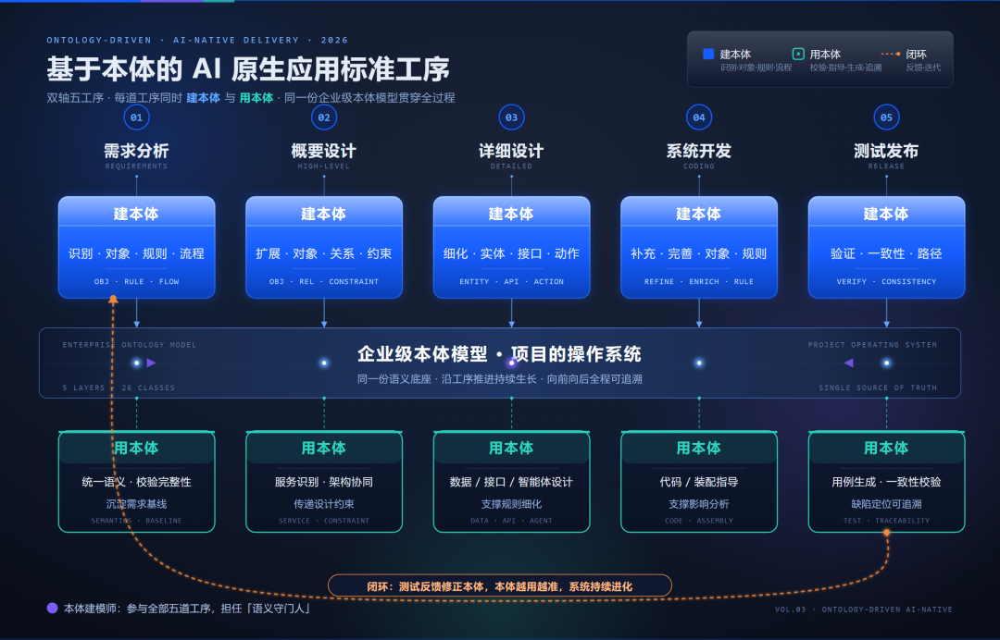
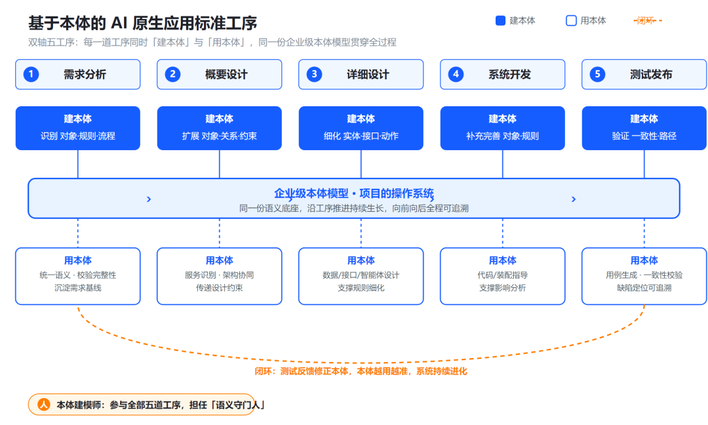

# 本体智能 | 本体驱动的 AI 原生应用项目全流程

> **来源**：微信公众号「华力江海」
> **作者**：华力江海
> **发布日期**：2026-08-18
> **原文**：[点击查看](https://mp.weixin.qq.com/s?__biz=MzcxMDMyNTI4MQ==&mid=2247485471&idx=1&sn=b29ef7dbe2329147e51bd33eb3f28481&chksm=f519ad51c26e2447ceb3dcd6318cccfc35e4425efa4c6d99e264d0388da0af53c8ce25f27216#rd)
> **系列**：本体智能系列

**企业级本体模型 · AI 原生交付**

### 本体驱动的 AI 原生应用项目全流程

### 项目从需求到上线都有据可依

本文以某电网央企的真实交付为样本，系统拆解 AI 原生项目从需求分析、概要设计、详细设计、系统开发到测试发布的双轴五工序，讲清企业级本体模型如何沉淀为可复用、可进化的认知底座与语义主权层，让大模型真正接进真实业务。

**AI 原生** **本体模型** **项目全过程**

**📌 本文导读** \*\*本文摘要：\*\*大模型很强，却常常接不进真实业务。本文先点出信息化交付的三道断层与 AI 原生落地的五处真实痛点，根子都在缺一层企业级语义底座。接着给出解法：用「建本体、用本体」双轴五工序，让同一份企业级本体模型贯穿需求、设计、开发、测试五大环节。再把本体讲清为 AI 原生的「认知底座」：让机器真正读懂业务、能做语义判断的语义主权层。

### 📚 相关阅读

**1**

[本体驱动信息化项目范式升级](https://mp.weixin.qq.com/s?__biz=MzcxMDMyNTI4MQ==&mid=2247485153&idx=1&sn=2390cb38c63c20fd91b38cb92b90eb74&scene=21#wechat_redirect)

**2**[本体自动化建模之一：自动化建模原则和方法](https://mp.weixin.qq.com/s?__biz=MzcxMDMyNTI4MQ==&mid=2247485208&idx=1&sn=6bb449b3fd659cd6af7423cb186bc744&scene=21#wechat_redirect)

**3**[本体自动化建模之二：文档如何长成可信本体模型](https://mp.weixin.qq.com/s?__biz=MzcxMDMyNTI4MQ==&mid=2247485354&idx=1&sn=e0d338431af1a433b74a0e84adb9d477&scene=21#wechat_redirect)

**4**[一文读懂企业级本体模型](https://mp.weixin.qq.com/s?__biz=MzcxMDMyNTI4MQ==&mid=2247483753&idx=1&sn=dec18da14ad72d4cc53e0dd6ecf11dcb&scene=21#wechat_redirect)

前文已把本体是什么、为什么是 AI 原生的认知核心讲清。本文不重复定义，只回答一件事：当本体成为项目主线，知识怎么沉淀、AI 怎么在每道工序替业务把活干掉、项目全过程因此被改写了什么。我们自己的项目统一匿名成「某电网央企」，行业公开案例只作方向佐证。

需要先把视角拔高一层：本文说的本体，不是给 AI 备着的一堆知识，而是 AI 看懂这家企业的「认知底座」。它让机器能理解业务、能做语义判断，是 AI 原生项目真正立得住的地基。

大多数企业把 AI 原生理解成「给现有系统加一层智能」：装个问答、接个 Agent、做个 Copilot。我们在一个对可靠性要求极高的能源业务里跑通完整项目后，得到一个结论：AI 原生项目的真正交付物，不是那套系统，而是贯穿项目始终、持续生长的企业级本体模型。系统只是本体在某个时刻的一个运行投影。这个结论改写了「项目全过程」每一个环节的做法。

### 痛点溯源

## 01 信息化项目交付的三道断层

信息化项目交付做了几十年，问题不在执行力，在层次：一直用「建系统」的方法解决「沉淀认知」的问题。一份需求单几十个字段，表述不规范、逻辑遗漏是常事，漏一个约束后面全链路跟着错。

### 1.1 语义断层：业务真相在阶段间反复流失

业务「真相」在需求、开发、测试间反复流失。「状态=1」在排程表示可开工、在质量表示首检通过、在成本表示可归集人工费，同一概念多义，传统交付不建模，最后散落在人脑子里，系统互通靠老员工口耳相传的映射或一张谁也不敢改的 Excel。

### 1.2 知识沉睡：经验停在文档和记忆里

制度、规程、老师傅经验停在文档和记忆里，系统能跑但「为什么这么干」进不了机器，知识随人走，骨干一调动，一套业务的「为什么」就带走了。

### 1.3 验收错位：功能正确不等于语义被准确捕获

功能正确不等于语义被准确捕获。一份字段齐全的需求表，可能完全没说清「需求」到底是什么对象、「审批」涉及哪些角色规则。语义失真随系统上线，发现时改的是十几套代码。数据中台补了「数据存哪、怎么查」，补不了「数据在业务里意味着什么」，这恰恰是 AI 落地最致命的缺口。

**信息化项目交付的三道断层 · 根因复盘**

**01**

### 语义断层

同一概念多义，业务真相在阶段间反复流失，最后散在人脑子里

**02**

### 知识沉睡

制度规程与老师傅经验停在文档和记忆，知识随人走

**03**

### 验收错位

功能正确不等于语义准确，数据中台补不了「意味着什么」

### 落地卡点

## 02 AI 原生交付的真实痛点

AI 原生想让 AI 从「辅助」升为「核心引擎」，但落地普遍卡在同一道坎：模型很强，业务接不上去。

**AI 原生落地的五处真实痛点 · 同根同源**

**01**

### 接不进业务

大模型幻觉、不可行动、不可审计，挂不上企业规则

**02**

### 对不齐词

各系统同名异义，AI 不认得这家企业的业务词表

**03**

### 写不对码

字段含义靠猜，接口和本体对不上，改一处漏一片

**04**

### 难以自进化

上线即定格，制度一变改十几套代码，越用越笨

**05**

### 验不准

没人能判「业务语义被准确捕获了没有」

这五处痛，根子都在同一处：没有一层企业级语义底座。

### 知识沉淀

## 03 知识沉淀：五道工序，同一个不断长大的本体

常规项目里，需求、设计、开发、测试各产出一份文档，彼此割裂；本体驱动的项目里，五道工序的净产出是同一个不断长大的本体。每道工序既「用本体」又「建本体」，向前承接上一步成果，向后沉淀更细的要素，同一套语义贯穿到底。这套工序对应需求分析、概要设计、详细设计、系统开发、测试发布五个标准阶段。

### 需求分析

首次构建

### ›

### 概要设计

扩展形式化

### ›

### 详细设计

细化落地

### ›

### 系统开发

反哺修正

### ›

### 测试发布

闭环验证

新理解：上面这张流水线图只是骨架。把视角往里推一层，会发现每道工序都在同时做两件事，一件是「建本体」，往同一份语义底座里新增/细化对象、关系、规则；另一件是「用本体」，用沉淀好的语义去做判断、做校验、做设计指导。下面把五道工序拆到可执行颗粒度。

### 3.1 双轴五工序：每道工序都是「建本体 + 用本体」

下面这张架构图把五道工序、两条轴（建/用）、一个本体模型脊柱、闭环反馈一次性画齐。

双轴五工序架构图：建本体 + 用本体，企业级本体模型贯穿

先建立一个阅读坐标：「建本体」是往同一份语义底座里新增或细化对象、关系、规则；「用本体」是用沉淀好的语义去做判断、做校验、做设计指导。两个动作不是分两道工序做，而是在同一道工序里同步发生。「建」是增量，「用」是判断，左右手并作。

一条主线：企业级本体模型贯穿全过程。五道工序依次推进，每道工序都有「建」与「用」两个动作，并落到一位「本体建模师」身上。下面把每道工序的输入、步骤、建/用、产出、角色、示例逐一展开，每一张卡都先看顶部那段工序叙述，再对账「建本体」与「用本体」两栏。

**1** **需求分析** **首次构建**

需求分析是本体驱动项目的语义起点。传统做法把业务口述整理成需求文档就结束；本体驱动下，这一步同时完成「用本体」（用已有术语库校验业务说法是否一致、有无漏缺）和「建本体」（把口述里出现的新对象、新规则首次写进本体）。它定下后面所有工序的语义口径，做错一步后面全错。

需求材料制度规则业务目标现状资料

**1**梳理端到端业务流程，画出业务活动与步骤

**2**识别业务对象及对象间关系（含参与方、产物）

**3**提炼控制规则与业务动作（谁、在什么条件下、做什么）

**4**用本体术语库校验需求表述一致性，当场提示矛盾与漏缺

**5**形成需求基线并完成本体首次建模

### 建本体

**首次识别 对象 · 关系 · 规则，建立需求基线**

### 用本体

### 统一业务语义

辅助需求识别 · 校验流程完整性 · 沉淀需求基线

主要产出

业务流程业务活动与步骤业务对象业务规则

责任角色

**业务专家** 提出并确认业务流程、业务规则

**需求分析师 / 业务架构师** 梳理业务活动步骤，形成业务对象，初步识别本体模型

**本体建模师** **贯穿** 首次建模，统一业务语义口径

\*\*示范：\*\*以「需求填报」为例：识别对象「需求单/部门/审批人」，动作「填报/提交/审核」，规则「必填校验/权限校验」。

**2** **概要设计** **扩展与形式化**

概要设计把业务需求翻译成「能力」与「架构」。本体在这里当尺子：以对象关系为标尺量现有能力，哪些动作已有服务支撑、哪些存在能力缺口，一目了然。缺口不是设计瑕疵，是本体告诉你的事实，必须在概设阶段标红、先补再走。

业务流程 / 活动业务对象 / 规则现有能力资产现状系统 / 数据

**1**盘点现有服务能力、数据资产与智能体清单

**2**将业务动作逐一映射到已有服务 / 智能体

**3**做差距分类：复用、改造、还是新建

**4**基于本体对象关系做架构协同（业务/应用/数据/技术/安全）

**5**形成五维架构设计并传递设计约束

### 建本体

**扩展 对象 · 关系 · 约束，标记能力缺口**

### 用本体

### 服务识别与设计

支撑差距判断 · 支撑架构协同 · 传递设计约束

主要产出

业务架构应用架构数据架构技术 / 安全架构

责任角色

**业务架构师** 设计业务架构

**技术 / 安全架构师** 设计技术、应用、数据与安全架构

**本体建模师** **贯穿** 扩展本体对象、关系映射与约束

\*\*示范：\*\*以「需求审批」为例：复用统一流程服务，改造消息通知服务，新建「合规校验服务」，并明确相关数据与接口。

**3** **详细设计** **细化到可落地**

详细设计把架构落到「能写代码」的颗粒度。传统详细设计靠设计师经验拍字段、拍接口；本体驱动下，字段来自本体属性、接口来自对象关系、智能体动作来自行为层，设计是「派生」出来的而非「创作」出来的，一致性天然成立，下游开发测试读的是同一个源头。

业务架构服务能力清单数据架构 / 模型技术 / 安全架构

**1**细化功能交互与界面流程，明确每一步输入输出

**2**设计物理数据模型（字段派生自本体属性）

**3**设计应用服务与接口（接口派生自对象关系）

**4**设计专业智能体（动作派生自本体行为层）

**5**把业务规则细化到可配置、可校验的参数

### 建本体

**细化 实体 · 接口 · 动作映射，派生物理模型**

### 用本体

### 支撑数据设计

支撑应用接口设计 · 指导智能体设计 · 支撑规则细化

主要产出

功能交互物理模型应用服务 / 接口智能体

责任角色

**交互设计师** 设计功能交互、接口集成

**数据建模师** 设计物理模型

**技术 / 安全架构师** 设计组件、应用与智能体方案

**本体建模师** **贯穿** 细化实体、接口与动作映射

\*\*示范：\*\*以「需求填报」为例：设计「需求填报智能体」，明确目标、输入、可调用工具、审批规则与输出结果。

**4** **系统开发** **本体驱动开发**

系统开发阶段，本体从「设计依据」变成「实时校验器」。每写一段代码、封装一个工具、装配一个智能体，都用本体约束做校验：语义冲突当场拦、影响范围自动列。开发中发现的隐含要素（漏建模的对象、没写全的规则）同步回填本体，不让它变成技术债。

应用 / 接口设计物理模型智能体方案功能交互设计

**1**开发应用服务与接口，实现概要 / 详细设计

**2**把数据与规则封装为可复用工具 / 技能组件

**3**装配专业智能体，接好工具与审批链路

**4**沉淀领域技能与知识制品

**5**用本体做影响分析与语义冲突校验

### 建本体

**补充完善 对象 · 规则 · 流程（开发中隐含要素回填）**

### 用本体

### 指导代码开发

指导工具/技能封装 · 指导智能体装配 · 支撑影响分析

主要产出

服务 / 接口工具组件智能体知识 / 制品

责任角色

**开发工程师** 开发应用服务、智能体，实现接口

**数据工程师** 沉淀数据与知识

**运维工程师** 完成运行与部署，发布版本制品

**本体建模师** **贯穿** 补充完善对象、规则、流程

\*\*示范：\*\*以「需求填报」为例：开发填报服务与校验接口，封装知识检索工具，完成需求填报智能体装配。

**5** **测试发布** **闭环验证**

测试发布是闭环的「回收站」。传统测试只验功能；本体驱动测试还要验「语义是否被准确捕获、执行路径是否与本体一致」。每一个缺陷，除了修代码，还要判断是否要修本体；修完本体，自动回归。本体的进化，正是在这一步被触发。

可运行系统测试方案可部署制品运行规则

**1**场景联调与全链路验证，覆盖正常与边缘路径

**2**本体一致性检查（对象 / 关系 / 公理有无漂移）

**3**缺陷整改与回归，定位缺陷影响面

**4**发布上线，形成可部署制品与系统基线

**5**收集运行反馈并写回本体，触发再一轮进化

### 建本体

**验证 一致性 · 执行路径，回流修本体**

### 用本体

### 生成和完善用例

校验执行路径 · 定位缺陷影响 · 支撑发布一致性

主要产出

验收报告发布基线缺陷闭环优化建议

责任角色

**测试工程师** 执行测试并形成验收结果

**业务专家** 参与业务验收与缺陷确认

**运维工程师** 形成发布制品与系统基线

**本体建模师** **贯穿** 验证本体一致性与执行路径

\*\*示范：\*\*以「需求提报、审批、反馈」为例：验证全链路执行效果，发现问题后同步更新规则、服务与智能体配置。

把五道工序连起来读，会看到一条清晰的语义生长曲线：需求分析首次建模定口径，概要设计扩展对象关系并暴露能力缺口，详细设计把架构细化到可落地的实体与接口，系统开发把设计变成代码并回补隐含要素，测试发布闭环验证并把反馈写回本体。每往前一步，本体都长厚一层；每走完一轮，本体都准一分。

**互动组件 · 工序浏览器** 上面五张卡是静态版。打开公众号发文目录下的「本体驱动的AI原生项目全流程-工序浏览器.html」（独立 HTML 交互组件），可点击五个工序节点在同一面板内切换查看：每个节点的输入、步骤、本体建/用、产出、角色、本体建模师贯穿标记全部联动。

五道工序的「建」与「用」不是一个抽象口号，看每张卡里的「建本体」与「用本体」两栏就能直接对账。建本体那栏是这一道工序对本体的增量改动，用本体那栏是这一道工序用既有的本体去判断/设计/校验什么。两件事在同一道工序里同步发生。

看五张卡的「责任角色」一栏，还要发现一个隐藏事实：本体的「建」与「用」不是分头落到自己团队身上的，而是落在同一个人身上，就是本体建模师。这位角色在需求、概要、详细、开发、测试五道工序里全部出现（其它角色是轮值的），承担「语义守门人」。

### 3.2 角色地图：本体建模师是唯一的常量角色

| **工序** | **业务** | **架构** | **数据** | **实施** | **运维** | **本体建模师** |
| 需求分析 | 业务专家 | 需求分析师 / 业务架构师 | · | · | · | ● 贯穿 |
| 概要设计 | 业务架构师 | 技术 / 安全架构师 | · | · | · | ● 贯穿 |
| 详细设计 | · | 交互设计师 · 技术架构师 | 数据建模师 | · | · | ● 贯穿 |
| 系统开发 | · | · | 数据工程师 | 开发工程师 | 运维工程师 | ● 贯穿 |
| 测试发布 | 业务专家 | · | · | 测试工程师 | 运维工程师 | ● 贯穿 |

上面这张地图把每道工序里参与的角色展开。可以一眼看到：业务专家、架构师、数据工程师、开发工程师、测试工程师、运维工程师在不同工序里轮换，唯有「本体建模师」五道工序全部在岗、全部贯通。这位角色的责任是：把分散在业务、架构、数据、代码、测试里的语义碎片持续收回写入同一份企业级本体模型，让它沿工序不断长大。语义守门人，称得上。

传统做法 · 角色轮换无人守门

### 语义散落每个环节

需求改一行字，代码改十几处，测试靠老员工脑子兜底

### →

本体驱动 · 守门人贯穿

### 本体建模师全程在岗

语义变更一处生效，回归自动跟进，骨干调动不带走

### 5 / 5

本体建模师在岗工序

### 1 份

不断长大的本体模型

### 双向

可追溯：从缺陷到模型 / 从对象到字段

### 3.3 三条新思考：拆开看就是结构性的事

**1** **本体的「建」与「用」同步发生**

传统方法把需求、设计、开发和验证切成五个独立交付物；本体驱动下，这五道工序的每一个都在同时「建本体」与「用本体」。建是增量：用是判断。两件事在同一道工序里同时进行，因此任何一道工序都不再是孤立交付，而是给同一份本体模型增加新内容、并立即用新内容校验自己。

**2** **本体建模师是贯穿始终的「语义守门人」**

五道工序里，业务专家、架构师、研发、测试、运维轮换上场，本体建模师一人在岗。每道工序新增的对象、关系、规则、公理，都由这一位角色统一口、统一写、统一复用。没有这位贯穿角色，本体模型会退化为各部门维护的副本拼图。

### 3\*\* \*\*闭环让本体越用越准

测试发布的反馈不只修缺陷，还要修本体。缺陷整改发现一条公理映射遗漏，写回本体；智能体上线后被业务专家标记某条规则不准确，写回本体。本体随每一次使用而校正，是一台「越用越准的业务机器」。这是「本体是项目的操作系统」最硬的一层意思：操作系统可以被更新，而项目全过程是本体的更新机制。

**实证结论** 某电网央企检修域做过对照：过去一次安规修订后人工核对约束平均要三个人天，现在本体改完自动回归，半天内业务确认即可，且零漏改。这一例里「本体建模师 + 闭环」的双重作用直接落地：本体建模师在修订当天就把新规则写进公理，测试工程师用自动生成的用例做闭环回归，再没人盯Excel。

### 认知底座

## 04 认知底座：AI 在本体上替业务做语义判断

认知底座跟 RPA、低代码、浅层问答都不是一类。RPA 模拟人点界面，低代码拼表单，浅层问答答完就完，它们都没碰到语义。认知底座干的是另一件事：AI 基于企业级本体这个认知底座，在项目的每道工序里，替业务完成那些需要业务语义判断、过去只能靠人脑硬扛的活。它和「知识库」不是一回事：知识库存的是文档、能检索，认知底座存的是概念、关系、规则与公理，能让机器推理。换句话说，知识库让知识「可被找到」，认知底座让业务「可被理解、可被判定」。这一章把认知底座在五道工序里到底替业务干了什么，逐一展开。

**本章路线 · 五道工序全覆盖**

需求分析概要设计详细设计系统开发测试发布

每一道工序，认知底座都既被「建」又被「用」。

### 4.1 为什么必须是认知底座

把认知底座（企业级本体模型）和知识库、向量库、检索增强（RAG）放一起比，差距在语义能否被判定。知识库、向量库能找相似文本，但分不清「语义近但业务不能等同」和「表述不同但需求相同」；检索增强补了知识，但补不进概念之间的约束。认知底座带着概念、关系、规则，AI 做的每一步判断都能挂回具体的业务节点和公理，错在哪一层、改哪一条都清楚。

对电力这类强监管业务，这直接决定方案能不能上线：能不能审计、能不能解释，是验收的硬门槛。知识库只管「存与找」，认知底座管「编与用」，把业务语义变成机器可推理的语义主权层。所以不是「要不要加个知识库」，而是「必须有一层认知底座」，这正是它和知识库最根本的分野。

知识库 · 向量库 · RAG

### 存与找、能检索

找相似文本，却分不清语义近却业务不等同、表述异却需求相同

### →

认知底座 · 企业级本体模型

### 编与用、可推理

带概念关系规则，每步判断挂回业务节点与公理，错在哪个层改哪一条都清楚

### 4.2 需求分析：识别与校验

一份口述需求进来，系统先映射到认知底座的节点，缺的对象、矛盾的规则当场提示，不必等开发完才发现语义对不上。这一步同时完成两件事：用底座的术语库校验表达一致性，把确认过的需求首次写进本体，成为后续工序共享的基线。

某次需求提报，业务口述要处理三处缺陷，传统方式漏了「缺陷需关联停电计划」这条隐含规则；认知底座驱动下，这条规则是公理，系统一映射就提示缺陷对象缺少停电计划关联，当场补全。过去这类漏配要等到现场操作才暴露，现在在需求阶段就被底座拦截。

### 需求分析四动作

**01**

### 映射到认知底座节点

把业务口述挂到本体的对象与关系上

**02**

### 用术语库校验表达一致性

当场发现同名异义、概念缺位

**03**

### 矛盾规则当场提示并补全

避免下游被漏规则绊住

**04**

### 确认需求首次写进本体

建立后续工序共享的语义基线

### 4.3 概要设计：服务识别与缺口拦截

概要设计阶段，认知底座当尺子量能力：用本体做服务识别、差距分析、架构协同。已有能力、待建能力、缺口能力一目了然，架构师不必凭经验拍脑袋。

认知底座还能拦住传统方式拦不住的坑：能力缺口。某次检修域概设，本体比对发现「跨电压等级转供」这个动作没有对应服务和智能体，传统概设文档里它混在「调度操作」一句带过，开发到一半才发现要现做、返工两周；认知底座驱动下，这个缺口在概设就被标红，先补服务再往下走。缺口早一阶段发现，代价就小一个数量级。

**能力三分类 · 缺口早现**

**01**

### 已有能力

本体已覆盖，直接复用

**02**

### 待建能力

规划新建服务或智能体

**03**

### 能力缺口

概设即标红，先补再走

### 4.4 详细设计：物理模型与智能体派生

进入详细设计，字段从本体的属性派生，接口从对象关系派生，智能体的动作从本体的行为层派生，设计不再是拍脑袋。认知底座在这里的作用是把「创作」变成「派生」：下游开发、测试读的是同一个源头，不再各自解释、各自发挥。

以「需求填报」为例，设计「需求填报智能体」时，它的目标、输入、可调用工具、审批规则与输出结果，都直接来自本体对该业务对象的刻画。字段定义一致，接口契约一致，智能体动作一致，一致性不是靠评审保证，而是从底座天然长出来。

传统详细设计

### 凭经验创作

字段、接口、智能体各自拍脑袋，下游各自解释、各自发挥

### →

本体驱动详细设计

### 从底座派生

字段←属性、接口←关系、智能体动作←行为层，天然一致

### 4.5 系统开发：约束即代码校验

系统开发阶段，认知底座从「设计依据」变成「实时校验器」。本体约束即代码校验，装配时自动拦截语义冲突、做影响分析。改一个属性，哪些接口、哪些智能体受影响，模型列出清单，不用人肉排查。

传统开发里改一个字段含义要翻需求文档、找设计稿、改代码、改测试，四处对齐；认知底座驱动下，改一处，校验清单自动列出波及的接口和智能体。更重要的是，开发过程里发现的新对象、新规则，会回补进底座，让底座随开发同步长大，而不是等项目结束才补录。

**约束即代码 · 开发期校验链**

**01**

### 改一个属性

触发底座的关联影响分析

**02**

### 列出波及的接口与智能体

改一处清单全列，不必人肉排查

**03**

### 装配时实时拦截语义冲突

冲突直接标红、不允许误装

**04**

### 新对象新规则回补底座

开发过程沉淀语义、底座同步长大

### 4.6 测试发布：自动生成用例与边缘覆盖

测试发布阶段，认知底座自动生成全链路用例，智能体踩中安规约束立刻标红，还能覆盖「紧急豁免」这类边缘但高风险的路径。过去测试用例靠人写、靠经验覆盖，漏掉的多是「不会发生」的边缘情形；认知底座按公理枚举路径，把人想不到的边界也变成必测项。

检修域一次回归，认知底座生成的用例里有一条专门验「双人复核被旁路」，正是这条查出了前面说的映射漏配。测试发现的缺陷，不只是改代码，还要判「是代码错还是本体错」：若本体公理本身不准，就回写底座，让同样的错在别的项目也被提前拦住。

**自动用例 · 边缘覆盖**

**01**

### 按公理枚举全链路用例

人想不到的边界也成必测项

**02**

### 智能体踩中安规约束立即标红

越界动作当场拦截

**03**

### 覆盖紧急豁免等边缘高风险路径

把高风险场景纳入必测

**04**

### 判代码错还是本体错

本体错则回写底座，别的项目也提前拦住

**本质收束** 认知底座最深的一层改变，是把「人盯」变成「底座守」。过去安规靠审核人脑子里记、Excel 勾，一个人请假整条线失守；现在语义在底座里，谁请假都不影响系统标红。辅助的过程即沉淀的过程，每一次判断被业务确认，就写回本体成为新公理，系统越用越准。

### 结构性改变

## 05 本体改写全过程：从交付物到验收的五重改变

把前面几节合起来，本体对项目全过程的改变是结构性的，不是加了一层能力。我总结成五变。

| **维度** | **传统项目** | **本体驱动项目** |
| 交付物 | 一套可跑通的系统（上线即定格） | 持续进化的知识资产 + 系统 |
| 角色 | 人做翻译官，在系统间搬运 | 人做审核者，本体建模师当语义守门人 |
| 时间 | 验收即收尾 | 验收即进化起点，新安规当夜同步 |
| 协作 | 五个系统十个接口两两对接 | 基于同一本体达成共识 |
| 验收 | 功能正确 | 业务方采信推理结果 |

**五变合一** 一句话收束：本体把项目从「建造系统」变成「养护一个会自己长大的业务大脑」。系统只是本体的运行投影，本体不是项目的产物，是项目的操作系统。五重改变在每一个域都成立，区别只是领域知识不同。

### 落地建议

## 06 给项目管理者的五条

### 五条落地建议

**01**

### 选一个高价值闭合域先跑

别贪大，需求管理、检修、客服挑边界清晰、决策可闭环的

**02**

### 从需求阶段就建本体

别等开发完补语义，产出领域本体最小可行版本

**03**

### 业务 Owner 必须到位

没有业务方认领，技术再正确也活不长

**04**

**工具平台化 + model DevOps**

可视化建模、变更影响分析、可回滚可审计

**05**

### 遵守最小本体承诺

只建模要用于推理的概念，先跑通一个决策场景

回到开头：AI 原生项目的真正交付物不是系统，是贯穿全过程、持续生长的企业级本体模型；系统只是它的一个运行投影。技术正确只是门票，业务采信才是终点。本体不是项目的产物，是项目的操作系统。

### 关注「本体智能」

持续获取企业级本体模型实践干货

### 立即关注\*\* \*\*华力江海

关注我们 · 不错过每一次更新
