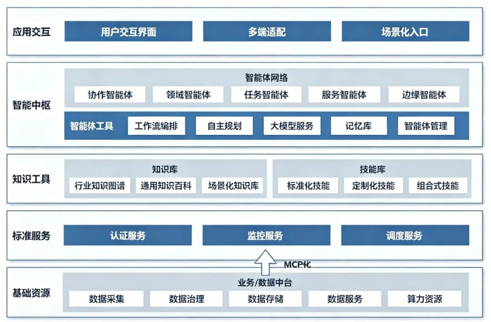
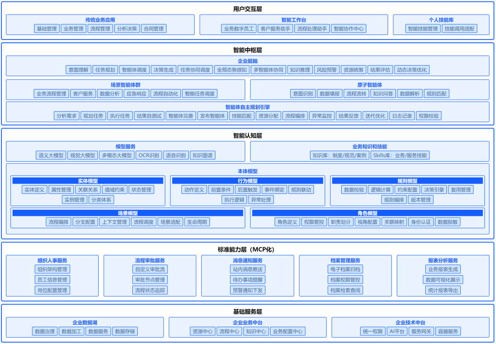
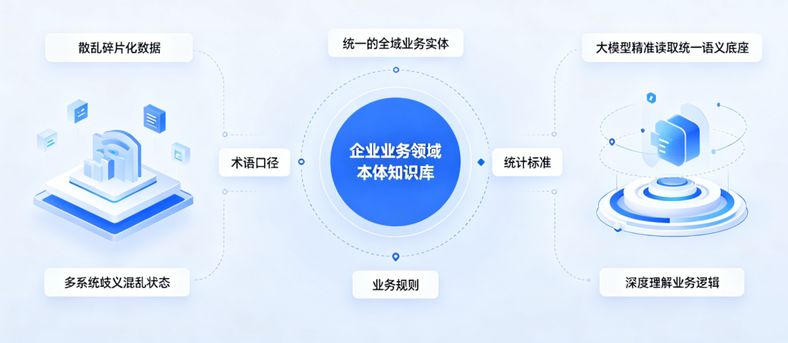
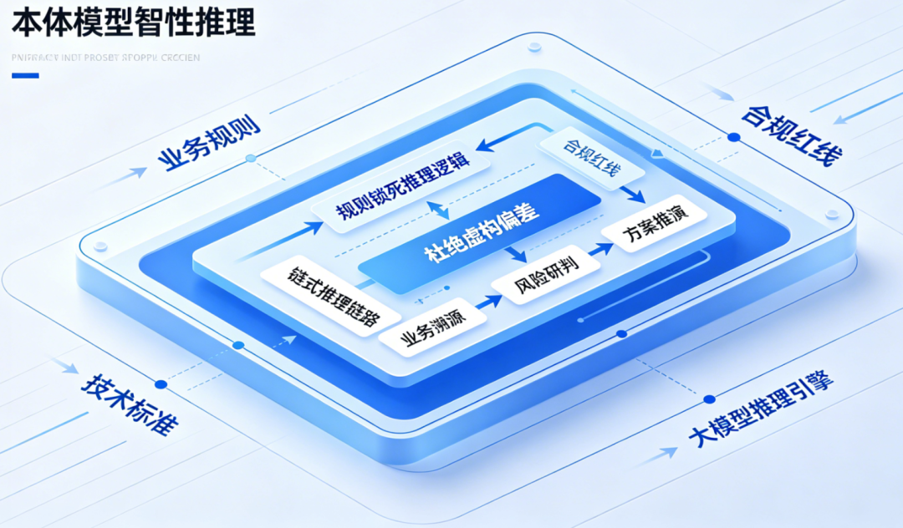
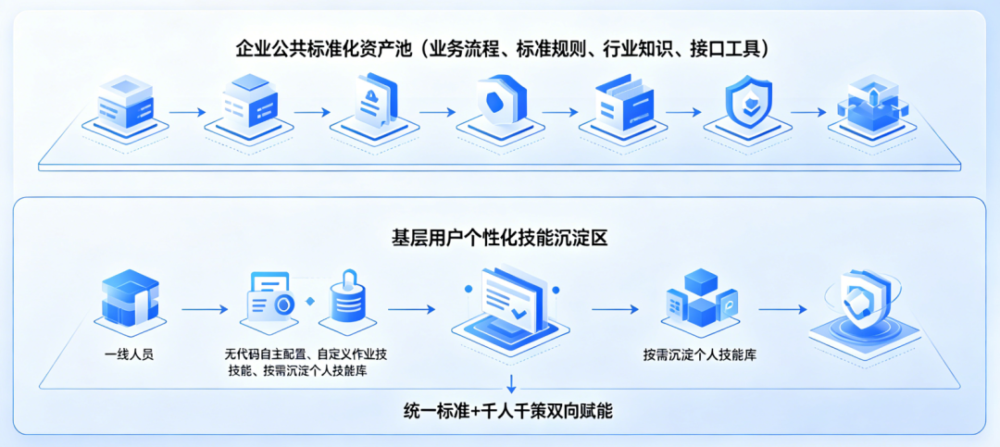
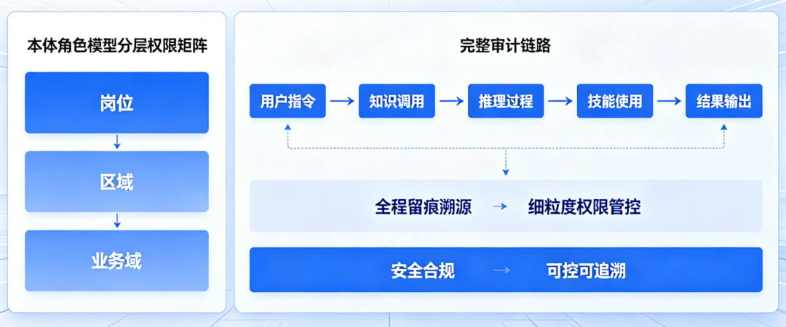
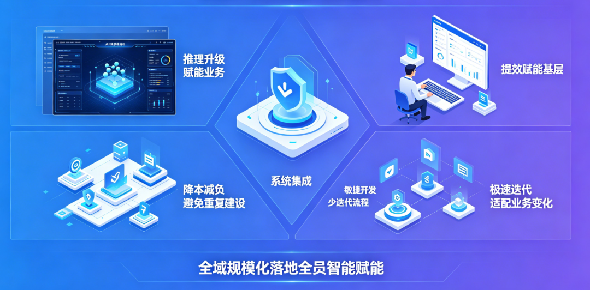
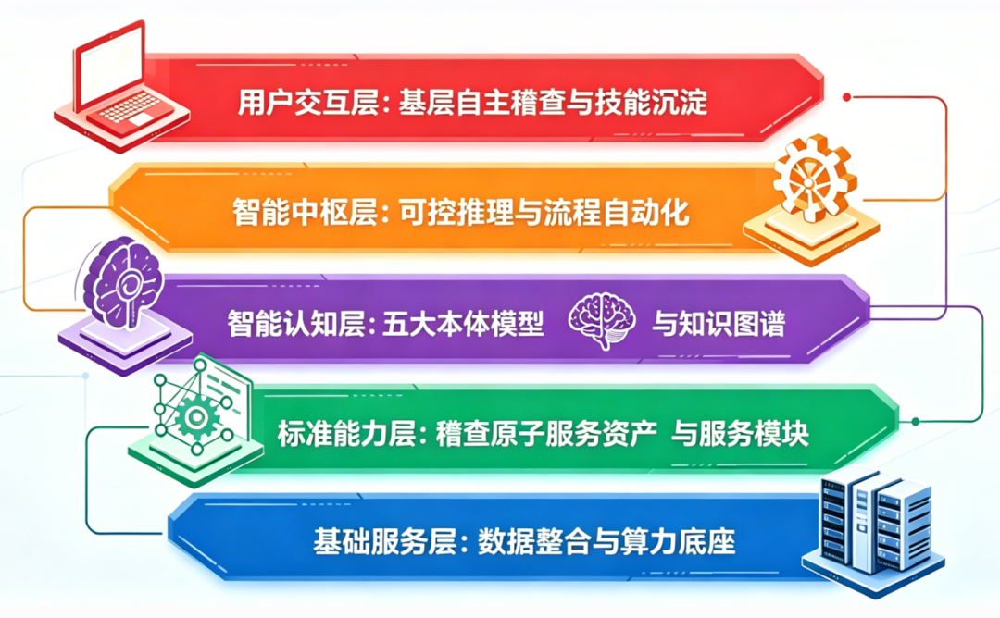
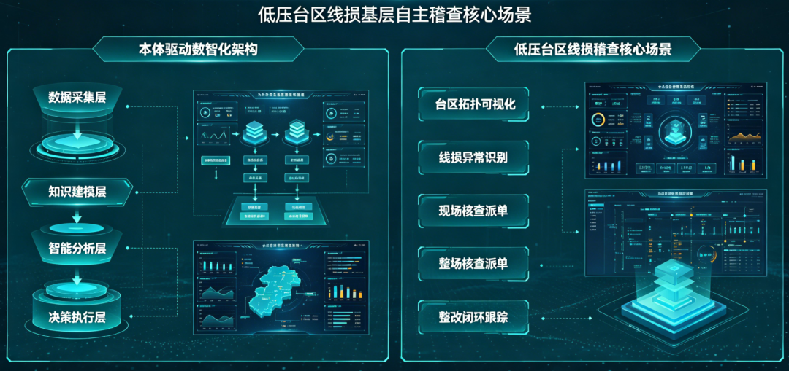

# 本体智能 |本体驱动的AI原生智能化架构

> **来源**：微信公众号「华力江海」
> **作者**：华力江海
> **发布日期**：2026-05-28
> **原文**：[点击查看](https://mp.weixin.qq.com/s?__biz=MzcxMDMyNTI4MQ==&mid=2247483720&idx=1&sn=78f2e96a1f1c9356513ca79047cee31f&chksm=f519a406c26e2d107f6213b856ce411836a8932532e54f3204949bc83d0d88f0f674f3af5ed9#rd)
> **系列**：本体智能系列

随着大模型与智能体技术快速迭代，企业智能化转型迈入规模化落地阶段，传统智能架构普遍存在知识碎片化、模型幻觉突出、多智能体协同低效、系统集成成本高、合规性不足等核心问题，难以支撑全业务域深度落地。

本文提出本体驱动的AI原生五层智能化架构，以本体模型为核心，搭建分层解耦、语义贯通的技术体系，从根源破解传统架构痛点。结合电网工程落地实践，系统拆解架构设计逻辑、核心能力与业务价值，为企业AI原生数智化转型提供可落地、可复制的实践方案。

## 01 引言

大模型技术推动智能问答、业务智能体、辅助决策等各类智能应用快速落地，但企业规模化推广普遍面临“单点试点易、全域复制难”的困境，存在智能应用零散化、业务语义不统一、模型输出不可靠、多智能体协同低效、系统重复对接、迭代成本高昂等问题，究其根源，传统“IT架构叠加AI补丁”的建设模式未从底层实现业务语义统一与能力标准化沉淀，无法支撑高可靠、规模化的生产级智能落地，而本体驱动的AI原生架构可构建全域统一语义体系，让AI深度适配业务逻辑，能够有效破解上述难题，实现企业智能化规模化、可靠化、可扩展落地。

## 02 当前企业智能应用架构

当前企业智能应用普遍采用面向场景的单智能体建设模式，适配快速试点，但规模化落地存在六大痛点和瓶颈。

图1 当前智能应用架构

### 架构说明

- 基础资源层（底层支撑）：作为架构的核心地基，以业务/数据中台为载体，提供数据采集、治理、存储、服务全流程能力，搭配算力资源底座，通过MCPK规范为上层提供标准化数据与算力支撑，解决智能体运行的底层资源供给问题。
- 标准服务层（平台保障）：提供平台级通用服务能力，包含认证服务、监控服务、调度服务三大模块，分别负责身份权限校验、系统运行状态监控、任务与算力资源调度，保障智能体平台的安全、稳定、高效运行，为上层业务提供可靠的基础保障。
- 知识工具层（能力赋能）：是智能体的“业务弹药库”，分为知识库与技能库两大体系。知识库包含行业知识图谱、通用知识百科、场景化知识库，支撑智能体的业务认知；技能库提供标准化、定制化、组合式技能，支撑数据查询、流程处理等业务操作，为智能体提供业务落地的核心能力。
- 智能中枢层（核心引擎）：架构的大脑核心，分为智能体网络与智能体工具两部分。智能体网络包含协作、领域、任务、服务、边缘五类智能体，实现多角色协同作业；配套工作流编排、自主规划、大模型服务、记忆库、智能体管理工具，支撑智能体的流程编排、自主决策、记忆留存与全生命周期管控。
- 应用交互层（用户出口）：作为智能体与用户的交互入口，包含用户交互界面、多端适配、场景化入口三大模块，支持PC、移动端等多终端访问，通过场景化入口降低用户使用门槛，实现智能能力的业务场景化落地。

### 存在瓶颈

- 业务标准割裂，知识体系零散：各业务独立建设智能应用，术语、实体、统计口径不统一，存在语义歧义问题，造成跨系统、跨智能体数据不通、结果不一致，无法形成企业级统一业务标准与知识体系。
- 智能能力不可控，业务落地受限：传统架构缺少业务刚性约束，大模型幻觉问题突出，智能研判准确率低。同时多智能体无统一协作机制，流程固化僵化，难以适配复杂非标场景，无法支撑核心生产业务落地。
- 建设运维低效，合规拓展困难：系统对接零散重复，迭代改造成本高、效率低。权限管控粗放、业务链路无溯源审计，存在合规风险。且变更运维繁琐，故障排查低效，严重制约智能化场景规模化推广。

## 03 本体驱动的AI原生智能化架构

针对传统智能应用补丁式建设、数据孤岛、标准混乱、推理不可控、难以规模化等痛点，本架构打破IT与AI割裂的建设模式，采用本体驱动的AI原生五层智能化架构，以本体模型为核心，依托底层基础服务与标准化能力，通过智能中枢赋能业务、应用交互层落地场景，有效解决大模型幻觉、集成成本高、迭代低效、协同薄弱等问题，实现AI与业务原生融合。

图2 本体驱动的AI原生智能化架构

架构自底向上分为基础服务层、标准能力层、智能认知层、智能中枢层、用户交互层五层，各层解耦联动、逐级赋能，形成“服务打底、能力承载、本体核心、智能赋能、场景落地”的完整闭环体系，支撑企业智能化生产级、规模化迭代落地。

### 1.基础服务层（底层基座）

作为架构最底层的技术基座，本层整合企业数据湖、企业业务中台、企业技术中台三大核心能力，搭建统一的资源与服务底座：

（1）企业数据湖提供数据治理、加工、服务与存储能力；

（2）企业业务中台沉淀资源中心、流程中心、知识中心与业务配置中心能力；

（3）企业技术中台提供统一权限、AI平台、服务网关与容器服务支撑。

统一纳管多元存储、算力资源与系统接口，支持大小模型自适应调度，配套全链路监测、告警、溯源与权限管控能力，解决资源零散、对接杂乱、运维成本高等问题，为上层智能能力提供稳定可靠的技术支撑。

### 2.标准能力层（MCP化，能力承载）

依托底层技术基座，封装MCP化的通用业务能力，沉淀为可复用、可组合的标准化原子资产，涵盖组织人事、流程审批、消息通知、档案管理、报表分析等企业级通用服务，实现数据汇聚、清洗校核、统计脱敏、任务运维等基础能力的统一纳管。

打破各业务、各智能体间的能力孤岛，避免重复建设，大幅降低场景开发与系统集成成本，为本体建模和智能推理提供标准化、可复用的能力支撑。

### 3.智能认知层（核心内核，本体驱动）

作为整套架构的核心内核，本层是区别于传统AI架构的关键层级，以本体模型体系为核心，融合模型服务与业务知识技能，构建全域统一的业务知识体系：

（1）模型服务：提供语义、视觉、多模态大模型及OCR、语音识别、知识图谱等基础AI能力；

（2）业务知识与技能：沉淀制度、规范、案例等知识库，封装业务/服务技能Skills库；

（3）本体模型体系：通过实体、行为、规则、场景、角色五大模型，固化业务实体、术语口径、规则流程、权限角色等企业级统一标准，消除语义歧义，解决业务语义碎片化、标准不统一、知识无沉淀、推理无依据的根本性问题，为全域智能能力提供统一业务语义与知识标准，支撑全场景智能推理共用一套统一业务语言。

### 4.智能中枢层（智能赋能）

智能中枢层是架构的智能赋能核心，依托智能认知层的统一语义标准与标准能力层的通用能力，构建可控、可溯、可靠的智能推理与协同调度体系，根治传统大模型幻觉、推理黑盒、智能体协同僵化、业务适配性弱的核心问题。本层包含四大核心模块：

（1）企业超脑：提供意图理解、任务规划、智能体调度、多智能体协同、动态决策优化等全局管控能力；

（2）场景智能体群：面向业务场景提供业务流程管理、客户服务、数据分析、应急响应等场景化智能服务；

（3）原子智能体：提供意图识别、数据填报、流程流转、知识问答等基础原子智能能力；

（4）智能体自主规划引擎：实现需求分析、任务规划、智能体发布、技能匹配、流程编排、迭代优化等全流程自主管控，支撑智能体的自主运行与持续优化。

### 5.用户交互层（场景落地）

用户交互层是整套AI原生架构的最外层服务出口，承接底层所有层级的技术能力、标准能力、本体知识与智能能力，面向终端用户与外部业务系统提供三类服务：

（1）传统业务应用：为现有业务系统提供智能化赋能，覆盖基础管理、业务管理、流程管理、分析决策、合同管理等场景；

（2）智能工作台：提供业务数字员工、客户服务助手、流程处理助手、智能协作中心等轻量化智能应用；

（3）个人技能库：支持智能技能管理与调用适配，为用户提供个性化智能能力入口，支撑企业智能化场景规模化落地。

五层架构自底向上层层支撑、自上而下语义贯通，通过基础服务层筑牢资源保障、标准能力层实现资产复用、智能认知层统一业务标准、智能中枢层实现可控赋能、用户交互层落地场景价值，彻底颠覆传统AI补丁式建设模式，解决智能架构碎片化、不可控、难协同、高成本等痛点，实现AI与业务原生融合、规模化生产级落地。

## 04 本体模型核心能力与业务价值

以智能认知层本体模型为核心，依托实体、行为、规则、场景、角色五大模型体系，结合大模型能力构建全链路智能闭环，解决通用大模型标准缺失、推理不可控、场景适配差等问题。模式层依托五大模型统一固化业务对象、操作行为、运维规则、场景范式、岗位权限全域标准，形成权威静态业务规范。支持基层用户依托统一本体标准，结合岗位实操经验自定义作业技能、搭建个人专属技能库，兼顾企业标准化赋能与一线个性化作业需求。全流程运行数据持续回流迭代，不断优化本体标准体系与大模型推理精度，形成可自我进化的设备管理智能运行体系。

### 核心能力

### 1.全域业务语义统一，筑牢大模型推理基础

通过本体模型构建企业业务领域唯一的业务“通用语言”，统一全域业务实体、术语口径、统计标准与业务规则。彻底解决传统模式下数据混乱、语义歧义、跨系统标准不统一的痛点，为大模型推理提供标准化、无偏差的业务语义底座，让大模型深度理解企业业务逻辑与场景规范，从根源避免语义理解偏差。

### 2.本体刚性约束赋能，大幅升级大模型推理能力、根治幻觉问题

区别于通用大模型自由生成模式，本架构实现本体规则强约束下的可控推理，大模型所有推理逻辑、数据输出、结论生成均严格贴合本体固化的业务规则、技术标准与合规红线，彻底杜绝虚构数据、错误推演、逻辑矛盾等幻觉问题。同时依托本体的实体关联、规则链条、业务层级关系，赋能大模型实现高阶深度链式推理，可自主完成业务溯源、多维度风险研判、异常趋势分析、最优业务方案推导等复杂推理，推理精度、专业性、可靠性实现质的提升，解决通用大模型“懂AI不懂业务”的核心短板。

### 3.公私资产双层沉淀，支持基层用户自定义个人技能库

一方面，将企业业务流程、标准规则、行业知识、接口工具等核心能力，沉淀为企业级标准化数字资产，支撑全场景复用；另一方面开放轻量化技能自定义能力，支持基层业务人员、一线用户无需代码、无需开发介入，结合自身岗位作业习惯、高频业务场景，自主梳理、固化、沉淀个人专属技能库，自定义常用研判、查询、统计、处置类智能技能，实现“千人千策、按需赋能”，打破智能能力仅能由后台统一配置的固化模式。

### 4.细粒度合规管控，实现推理全流程可追溯

基于本体角色模型构建ABAC细粒度权限体系，精准匹配岗位、区域、业务域的操作与数据权限。同时实现大模型推理全链路语义审计，用户指令、知识调用、推理过程、技能使用、输出结果全程留痕、可查可溯，在开放基层自定义技能的同时，保障智能应用合规可控，满足行业强监管要求。

### 业务价值

✅推理升级，AI能力深度适配业务

依托本体规则赋能，彻底解决通用大模型推理不准、脱离业务、幻觉频发的痛点，实现各类业务场景下的高精度、可解释、可信赖智能推理，让AI从简单问答升级为具备专业研判、数据分析、智能决策的核心生产能力，深度贴合企业全场景业务作业需求。

✅提效赋能基层，释放一线自主创造力

开放基层用户个人技能库搭建能力，一线业务人员可根据岗位高频工作自主定制智能技能，适配个性化作业场景，无需等待研发迭代，大幅降低日常业务统计、数据核查、流程处置等重复性工作压力，真正实现AI服务基层、赋能一线。

✅降本减负，杜绝重复建设

企业级标准化资产全域复用，系统集成成本降低60%以上，避免业务规则、智能能力重复开发；同时基层自主技能沉淀模式，大幅减少平台定制开发、运维迭代成本，实现降本增效。

✅极速迭代，灵活适配业务变化

企业级业务规则、标准口径仅需更新本体模型，全量智能体、应用、用户技能自动适配；基层个人技能可随时自主新增、修改、迭代，业务响应速度从数周缩短至日内完成，适配动态化运维需求。

✅全域规模化落地，实现全员智能赋能

打破传统智能架构的扩展瓶颈，依托本体标准化推理能力+公私双层技能资产体系，支撑企业多级单位、全业务域规模化推广，既保障企业标准统一，又保留基层个性化适配空间，实现智能化全员、全域落地。

## 05 落地案例：电网营销数据供给-基层自主稽查

### 案例背景

电网营销领域基层稽查是防范用电异常、压降线损、规范抄核收业务的关键环节，但传统稽查模式长期面临三大痛点：

标准碎片化：线损、抄核收、用电异常等稽查规则分散在多类业务系统中，术语口径、判定标准不统一，跨系统数据比对易出现语义歧义，异常误判率偏高。

推理无约束：通用大模型仅能辅助浅层分析，缺乏刚性业务规则约束，易出现虚构数据、错配场景等幻觉问题，研判结果不可靠，无法满足行业合规监管要求。

基层适配弱：传统稽查能力依赖后台统一配置，一线人员无法结合区域业务特性自定义分析逻辑，场景迭代周期长，难以快速响应基层个性化作业需求。

基于本体驱动的AI原生数智化架构，可通过本体模型统一业务语义、刚性约束智能推理、开放基层技能自定义能力，系统性解决传统稽查模式的各类痛点。

### 应用架构

依托本体驱动的五层AI原生架构，以智能认知层本体模型为核心，联动各层级能力，搭建“标准统一、推理可控、基层自主”的智能化稽查体系。

### 1. 基础服务层：筑牢稽查数据与算力底座

企业数据湖整合营销系统抄表数据、线损管理系统台区数据、用户档案系统用户信息、稽查工单系统业务数据，完成数据治理与标准化清洗；

企业业务中台提供流程中心、资源中心支撑稽查工单流转，企业技术中台的AI平台为大模型推理、本体服务提供算力支撑，服务网关统一纳管稽查相关接口能力。

### 2. 标准能力层：沉淀稽查原子服务资产

封装流程审批、消息通知、报表分析、数据校验等标准化服务，沉淀稽查专用原子能力：如线损数据比对、抄表成功率校验、用户用电波动分析、稽查工单自动派发，实现跨系统能力复用，避免重复开发。

### 3. 智能认知层：本体模型构建稽查业务“通用语言”

作为核心内核，通过实体、行为、规则、场景、角色五大模型固化稽查全链路标准，构建静态标准与动态数据联动的本体知识体系：

（1）实体模型：定义稽查核心业务实体（台区、用户、线损指标、抄表记录、稽查工单）及属性（如台区线损率、用户电压等级、抄表周期），统一“线损率”“窃电嫌疑”等术语口径，消除跨系统语义歧义；

（2）行为模型：规范稽查全流程动作（数据比对、异常判定、工单派发、现场核查、结果闭环），定义动作的前置条件（如“线损数据同步完成”）与后置触发逻辑（如“异常判定通过→生成稽查工单”）；

（3）规则模型：固化刚性稽查规则（如“低压台区线损率＞5%且抄表成功率＜95%→触发线损异常预警”“居民用户月用电量同比突增300%且无增容申请→窃电嫌疑预警”），同时沉淀合规红线（如稽查数据访问权限、用户隐私保护规则）；

（4）场景模型：聚合高压用户稽查、低压台区线损治理、抄核收合规核查等细分场景知识，封装场景专属指标体系、分析逻辑与处置流程；

（5）角色模型：构建ABAC细粒度权限体系，定义基层稽查员、台区经理、稽查专责的操作权限（如台区经理仅可查看负责台区数据、发起初步核查），实现权限精准管控。

同时，依托语义大模型、知识图谱服务，结合业务知识库（稽查制度、规范、案例）与Skills库，为稽查推理提供业务知识支撑。

### 4. 智能中枢层：实现稽查可控推理与流程自动化

企业超脑通过意图理解解析基层稽查员的分析需求（如“排查XX台区近1个月线损异常原因”），依托本体模型拆解任务、规划分析流程；

场景智能体群中的数据分析、流程自动化能力，结合原子智能体的规则匹配、数据解析能力，按照本体规则开展链式推理（如“线损率异常→关联抄表数据→排除已报停用户→锁定疑似窃电用户”），实现全流程无人工干预的异常研判；

智能体自主规划引擎支撑基层稽查员自定义稽查流程，无需开发介入即可调整分析逻辑、设置预警条件。

### 5. 用户交互层：基层自主稽查与技能沉淀

传统业务应用提供稽查流程管理、分析决策入口，智能工作台的业务数字员工、流程处理助手辅助基层用户完成数据填报、工单流转；

个人技能库为核心赋能载体，基层稽查员可结合岗位经验与本地业务特点，基于本体标准自定义稽查技能（如“农村台区夏季线损异常分析”“城中村用户用电波动稽查”），沉淀专属分析逻辑与规则，实现“千人千策、按需赋能”。

### 核心场景：低压台区线损基层自主稽查

图3  基层自主稽查应用架构

### 1. 基层用户自定义稽查技能

某供电所台区经理在个人技能库中，基于本体模型的统一标准，自定义“农村低压台区线损异常稽查”技能：

设定适配本地的规则组合：线损率＞4.5%、抄表成功率＜96%、用户用电量环比波动＞20%，同时排除农业灌溉季节性用电、已报备临时增容用户；

配置自动分析流程：每日凌晨自动拉取台区线损、抄表、用户用电数据，比对分析后生成异常清单，标注疑似异常原因（抄表问题/窃电嫌疑/计量故障），并推送至台区经理工作台。

### 2. 本体约束下的可控推理执行

大模型解析用户“分析XX台区近7日线损异常”的需求时，依托本体实体模型精准理解“台区”“线损率”等术语，避免语义理解偏差；

推理过程严格受本体规则模型约束，仅按照预设的规则组合进行数据比对，杜绝虚构数据、错误关联，同时依托实体关联关系完成深度溯源（如关联用户计量装置数据、抄表员操作记录，定位计量故障或抄表错误）；

全流程数据调用、推理过程、结果生成全程留痕，角色模型管控数据访问权限，确保稽查合规可追溯。

### 3. 结果闭环与技能迭代

异常清单生成后，系统自动派发核查工单，台区经理现场核查后反馈结果，数据回流至本体模型，基层用户可根据核查结果优化自定义技能的规则阈值，迭代分析逻辑，形成“分析-核查-反馈-优化”的闭环。

### 基层赋能成效

✅稽查效率大幅提升：传统人工筛选数据、比对分析的工作由系统自动完成，单台区线损稽查时间从2小时缩短至5分钟，基层稽查员工作量减少60%以上；

✅误判率显著降低：本体规则约束下的推理彻底杜绝大模型幻觉问题，线损异常误判率从22%降至3%以下，减少无效现场核查；

✅场景适配能力增强：基层用户可通过个人技能库快速适配本地业务场景，如针对山区台区、城中村台区的线损特性自定义分析逻辑，场景迭代周期从数周缩短至1天内；

✅合规管控全程可控：基于本体角色模型的细粒度权限管控与全链路语义审计，确保稽查数据使用合规、流程可追溯，满足电网营销业务监管要求。

### 案例价值

本案例通过本体驱动的数智化架构，实现了电网营销稽查从“后台配置、被动执行”到“基层自主、可控智能”的转变：既通过本体模型统一了稽查业务标准、根治了大模型推理幻觉问题，又通过基层个人技能库释放了一线人员的业务创造力，解决了传统稽查模式标准不统一、推理不可控、场景适配弱的核心痛点，为电网营销领域基层数智化稽查提供了可复制的实践路径。

## 06 结语

企业智能化转型已从单点试点进入全域规模化落地的新阶段，传统补丁式AI架构的瓶颈已全面凸显。本文提出的基础服务层、标准能力层、本体模型层、智能中枢层、应用交互层五层AI原生架构，以本体模型为核心内核，依托底层基础服务与标准化能力承载，通过智能中枢实现可控智能化赋能，最终完成场景化应用落地，构建了分层解耦、语义贯通、闭环可迭代的全新AI原生体系，从底层重构智能应用建设模式，彻底解决知识碎片化、推理不可靠、协同低效、集成成本高、运维难度大等行业共性痛点。
